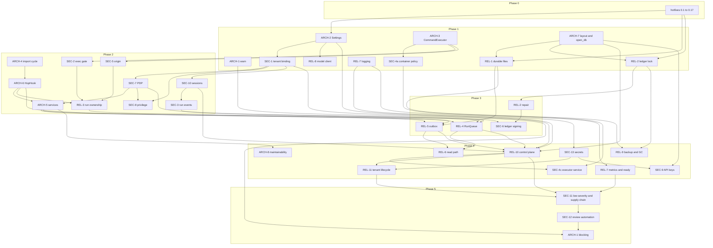

# Remediation plan

**Status:** approved for implementation. This is the order of work. Item internals live in the workstream specs. This file is enough to see what ships, what it depends on, and what it breaks.

**Decisions:** [ADR-0021](../../adr/0021-deployment-model.md) (D1–D5). D1 is accepted, so REL-10 is a committed phase.

**Specs**

- Architecture: [arch-specs.md](arch-specs.md)
- Reliability: [rel-specs.md](rel-specs.md)
- Security: [sec-specs.md](sec-specs.md)

Paths below are relative to `src/recertia/` unless they start at the repo root (`contracts/`, `tests/`, `scripts/`, `docs/`, `AGENTS.md`). Size is the subsystems and files an item touches. There are no calendar estimates.

A later phase replaces a Phase 0 patch only by keeping the guarantee. A phase that reopens a hole the hotfix closed is not done.

---

## 1. Decisions applied

### D1–D5

| ID | Decision | What it binds |
| --- | --- | --- |
| D1 | Multi-tenant service. Pooled control plane: stateless API replicas, Postgres with `tenant_id` and row-level security, object storage. Execution isolated per tenant via the executor service. The API never holds a container socket in `multi_node`. `single_node` stays supported and still treats tenants as first-class. | [ADR-0021](../../adr/0021-deployment-model.md). REL-10 and REL-11 are in scope. REL-10 is not gated. |
| D2 | The `runs` scope may run caller-supplied commands on the container backend, and on the local backend only in `single_node` behind the API break-glass. The `exec` scope is required only for a raw `script`. `multi_node` refuses the local backend at startup. | SEC-2. Hotfix 0.2. `RECERTIA_API_ALLOW_LOCAL_EXEC` is ignored in `multi_node`. |
| D3 | Durability default is `normal`. | `Settings.durability`. `fast` is refused in `multi_node`. |
| D4 | `/v1/runs` becomes async by default after one release. Sync callers keep working through enqueue-and-wait while `RECERTIA_API_DEFAULT_ASYNC=0`. | REL-4 ships the flag at `0`. The following release sets the default to `1`. |
| D5 | The CLI is the local operator principal, `Principal.local_operator()`, with `platform_admin`. | Ledger actor, cancel, tenant admin, repair, backup. |

### Binding cross-spec reconciliations

These names are shared. A spec that introduces a second type for the same role is wrong.

| Topic | Binding shape |
| --- | --- |
| Principal location | `Principal` and `TenantId` live in `recertia/ports/identity.py`. `Principal.local_operator()` is D5. |
| ExecutionBackend vs ExecutionConfig | `ExecutionBackend` is a `Literal` (`"container"` \| `"local"`) in `recertia/ports/execution.py`. The frozen config object is `ExecutionConfig` (image, network, user, resource limits), held by each `CommandExecutor`. The out-of-process daemon is `RemoteExecutor`, selected by `RECERTIA_EXECUTOR_MODE`. `run_id`, `owner_id`, `fencing_token`, and SEC-5 `origin` are fields on `CommandRequest`. There is no `ExecutionContext` type. |
| PDP location | `PolicyDecisionPoint` lives in `recertia/app/authz.py`. Routes and services call `pdp.require(principal, action, resource)`. |
| HOME | The command environment sets `HOME` to the run workdir (the container mount inside the executor, the host workdir for the local backend). A host `HOME` is not inherited. |
| Run-events path | `root/runs/<tenant>/run_events/<run_id>.jsonl`. SEC-3 owns the move off `root/run_events`. REL-4 and REL-6 read it through `RunsRootLayout.run_events_path`. |
| RuntimeLayout shape | Two classes, owned by ARCH-7. `RuntimeLayout` is the root (`.recertia` or `--runs-root`). `RunsRootLayout` is one tenant runs root, or the CLI legacy root from `local_runs()`. REL accessors on the root: `control_db`, `locks_dir`, `root_lock`, `api_lock`. On a runs root: `runtime_db`, `ledger_path`, `run_events_dir`. Tenant methods take a `TenantId`. |
| Golden gate | `golden_backend` defaults to `inherit`, which resolves to the process execution backend. An explicit `local` gate is refused in `multi_node`. |
| Observability package | `recertia/observability/`, with `logging.py`, `metrics.py`, `tracing.py`, and `systems.py`. |
| RecertiaError and CLI exits | One base, `recertia/errors.py::RecertiaError(code, http_status, retryable, exit_code)`. REL subclasses live in `recertia/runtime/errors.py`. CLI exits are the table in section 7. `recertia ledger verify` stays 0 on success and 2 on a broken chain. |
| Quota admission | The only admission points are `RunService.create` and `RunService.resume`. Daily spend comes from the quota repository. In-flight counts are derived from `RunQueue`, not from a counter that survives a crash on its own. |

---

## 2. Shared type and module map

New modules are named here so the three specs import the same path.

| Module | Owns |
| --- | --- |
| `recertia/ports/identity.py` | `TenantId`, `Principal`, `Principal.local_operator()`. |
| `recertia/ports/execution.py` | `ExecutionBackend`, `CommandRequest`, `CommandExecutor`. |
| `recertia/settings.py` | `Settings`, `DeploymentMode`, `validate_deployment`. Read once at process start. ARCH-2. |
| `recertia/fsutil/` | Atomic replace, JSONL append, `flock` (`fsutil.locks`). The procedural skill lock moves here. |
| `recertia/persistence/` | `open_db`, repository interfaces, `migrations/` (`runtime`, `control`, `pg`, `pg/rls`). ARCH-7. |
| `recertia/observability/` | JSON logging, metrics, tracing, systems events. REL-7. |
| `recertia/runtime/` | `RuntimeLayout` consumers, `errors.py`, `tenancy.py` (`current_tenant`, `bind_tenant`), `RunLease`. |
| `recertia/workers/` | `RunQueue`, the worker process, fair claim, cancel checks between hops. REL-4. |
| `recertia/outbox/` | Transactional outbox: trajectory events, eval observations, quota charges. REL-5. |
| `recertia/app/` | `RunService`, `JobService`, `EvalService`, `ProgramService`, `PromotionService`, `authz.py`. ARCH-5 and SEC-7. |
| `recertia/ledger/` | Hash chain, tip index, repair, signing hooks. REL-2 and SEC-6. |
| `recertia/api/` | Routers only. The `RecertiaError` handler sits in the ARCH-5 composition root. `/health` and `/ready` stay free of tenant stores. |
| `recertia/faults.py` | Named fault points. Parsed only when `RECERTIA_ALLOW_FAULTS=1`, which `multi_node` refuses. |

`ExecutionConfig` is constructed by SEC-4 from `Settings` and passed into the executor. It is not a second backend enum.

---

## 3. Phase 0 hotfix train

Seventeen small PRs. Each one closes a hole on the current tree. The phase that replaces it is named in the table.

**0.2 and D2.** The exec check applies to a raw `script` body only (`exec` or `admin`). It does not apply to `command` criteria, including criteria compiled from a goal. `contracts/goal.py` `compile_goal` currently interpolates `file_exists` as `test -f {path}` and `file_contains` as `grep … {path}` with the path unquoted. 0.2 still quotes those paths with `shlex.quote` and rejects a path that is absolute or contains `..` before it is compiled. A caller-supplied `command` desired state is not rewritten and is not promoted to `exec`.

| PR | Change | Where | Replaced by |
| --- | --- | --- | --- |
| 0.1 | Stop writing `RECERTIA_EXECUTION_BACKEND` into `os.environ`. Pass the backend into the call. | `cli/runs.py` `_prepare_execution`; `evals/golden.py` (the two assignments around the golden orchestrator start) | ARCH-2 |
| 0.2 | Exec check stays script-only. Quote and confine `file_exists` and `file_contains` paths in `compile_goal`. | `api/__init__.py` (`body.script`); `contracts/goal.py` | SEC-2 (the quoting stays) |
| 0.3 | Validate every session tenant id, and require `active_tenant` to be a member of that set, at issue and at parse. | `api/console_auth.py`; `api/console_session_routes.py` dev-login | SEC-10 |
| 0.4 | Key run events and cancel by tenant. Cancel resolves the tenant and only cancels that tenant's run. Event files move to `root/runs/<tenant>/run_events/<run_id>.jsonl`. | `api/console_deps.py` (`RunEventLog(root/"run_events")`); `api/console_library_routes.py` `run_events`, `cancel_run` | SEC-3 |
| 0.5 | The reviews alias applies the same T2 gate as proposal decision: reviewer session, or an admin key, when `payload.tier == "T2"` or the kind is `correction`. | `api/remaining_routes.py` `decide_review`; the check already in `api/console_library_routes.py` `decide_proposal` | SEC-7 |
| 0.6 | `POST /v1/runs/{id}/resume` calls `quota_store.admit` and releases on failure, as create does. | `api/__init__.py` `resume_run` | REL-4 (`RunService.resume`) |
| 0.7 | `POST /v1/memory/query` does not mkdir an arbitrary `workdir`. Confine the directory under the tenant runs root, or ignore the caller path and use the tenant default. | `api/remaining_routes.py` `memory_query` | SEC-1 |
| 0.8 | Set `HOME` to the workdir. Local execution assigns it (today `setdefault` keeps the host home). The container invocation passes `HOME` as the workdir mount. | `solver/container.py` `_local_run`, `_container_run` | SEC-4a |
| 0.9 | `RECERTIA_ALLOW_CUSTOM_IMAGE` allows a custom image only when the value is exactly `1`. Any other value, including `0` and `true`, stays on the allowlist. | `solver/container.py` `default_container_image`, `_enforce_container_policy` | SEC-4a |
| 0.10 | `flock` the ledger file around append so two processes cannot fork the chain. The in-process lock stays for threads. | `ledger/hashchain.py` `append` | REL-2 |
| 0.11 | A corrupt or unreadable quota sidecar fails the job closed. `QuotaSidecar._read` returning `{}` on `JSONDecodeError` is what lets spend reset to zero. | `policy_load.py` | REL-1 |
| 0.12 | A torn `affordances.json` is renamed aside (quarantine) and the store starts empty, so bootstrap does not raise `JSONDecodeError`. | `memory/affordance/__init__.py` `_load` | REL-1 |
| 0.13 | Reject a `run_id` that already has checkpoint rows, including after a process restart. Checkpoint writes use `INSERT`, so a reused `(run_id, seq)` fails instead of being replaced. | `api/__init__.py` create (the in-memory `runs` dict); `graph/store.py` `save` | REL-3 |
| 0.14 | On API startup, recompute each tenant's in-flight count from runs that are actually queued or running. A crash today leaves `inflight.count` high and admits nothing. | `api/quotas.py` | REL-4 |
| 0.15 | Log unhandled exceptions that become HTTP 500, with traceback and request id, before the generic body is returned. The `raise … from None` in create and resume drops the traceback. | `api/__init__.py` | REL-7 logging |
| 0.16 | `/health` is `async` and returns `{"status": "ok"}` without opening SQLite, the ledger, or the container runtime. | `api/__init__.py` `health` | REL-7 (`/ready` is the deep check) |
| 0.17 | `AGENTS.md` names the quota sidecar `{runs_root}/job_quota.json`, the path `build_job_runner` writes (`jobs/__init__.py`). Spend stays out of `policy/default.json`. | `AGENTS.md` | none (docs) |

---

## 4. Phases 1–5

Land a phase when every item in it is done and the items it depends on (section 5) are done. Items inside a phase with no edge between them can land in either order.

### Phase 1 — ports, layout, durable bytes, logging

| Item | Outcome |
| --- | --- |
| ARCH-1 | Guardrail framework in warn mode (raw writes, `shell=True`, fault-point literals). |
| ARCH-2 | `Settings` and `validate_deployment` for `single_node` and `multi_node`. |
| ARCH-3 | `CommandExecutor` and `CommandRequest` in `ports/execution.py`. Solver call sites go through the port. |
| ARCH-7 | `open_db`, `RuntimeLayout`, `RunsRootLayout`, repository interfaces, one migrations directory. |
| REL-1 | Atomic file state. Torn JSON is quarantined. The quota sidecar fails closed and keeps every spend field. Write-once blobs detect a torn body. `RevokeQueue` drain takes the file lock. |
| REL-2 | Ledger `flock`, fsync per the durability policy, and a tip that does not rescan the file on every append. Repair is Phase 3. |
| REL-8 | Model client retries only retryable failures, honours `Retry-After`, and stops spending after the deadline. A 4xx is not retried. |
| REL-7 logging | JSON logs and the 500 path from hotfix 0.15. Metrics, tracing, and `/ready` wait for Phase 4. Log and error redaction is SEC-13. Disclosure (interactive docs, fetch) is SEC-11. |
| SEC-1 | Every tenant data path takes an authenticated `TenantId`. An unbound call fails. |
| SEC-4a | Container policy on the current runtime: allowlist, non-root, `network=none`, read-only root, `HOME` is the workdir, custom image only when the flag is `1`. |

### Phase 2 — services, authorization, run ownership

| Item | Outcome |
| --- | --- |
| ARCH-4 | The import cycle among `graph`, `nodes`, and `solver` is gone, so services can import the engine without pulling the API. |
| ARCH-6 | `HopHook` and `RunPersistence`. The engine commits through the hook instead of opening stores itself. |
| ARCH-5 | Application services and the router split. HTTP handlers call `RunService` and siblings. |
| SEC-7 | `PolicyDecisionPoint` in `app/authz.py`, including the T2 reviewer rule from hotfix 0.5. `require`/`decide` implement the action table. |
| SEC-2 | D2 gate on the port: `runs` commands on container (and local only in `single_node` with the break-glass); `exec` only for raw `script`. |
| SEC-5 | `CommandRequest.origin` (`goal`, `script`, `operator`). |
| SEC-8 | `platform_admin` is not tenant `admin`. `require_key` uses `Principal.has_scope`. `host_root`, per-tenant skill libraries, and the `evals` scope follow that split. Who may change an admission cap is this split; enforcement is REL-11. |
| SEC-10 | OIDC session cookie is signed, CSRF is checked, tenant membership is the directory's set, dev-login is off unless the development flags are set, and `multi_node` has no unsigned fallback. |
| SEC-3 | Tenant-keyed events and cancel, on the binding path. Migration of legacy `root/run_events`. |
| REL-3 | One owner per run: leases, fencing tokens, workdir exclusivity, durable `run_id` uniqueness, scratch resume replays the recorded model call. |

### Phase 3 — queue, outbox, repair

| Item | Outcome |
| --- | --- |
| REL-4 | Durable `RunQueue` and a worker process. Restart keeps queued runs. Cancel is checked between hops. Claims are fair across tenants. `RECERTIA_API_DEFAULT_ASYNC=0`, with enqueue-and-wait. |
| REL-5 | One transaction for the checkpoint and the outbox. Trajectory events, the eval observation, quota spend, affordance updates, and program versions stop doing read-modify-write after the fact. |
| REL-2 repair | `recertia ledger repair` truncates a torn tail and appends a `ledger_repaired` entry. Full verify is an explicit action, not the console page load. |
| SEC-6 | Ledger appends are signed. `ledger.repair` and `ledger.verify_full` require `platform_admin`. In `multi_node` a tenant scope cannot repair. |

### Phase 4 — reads, operations, multi-tenant control plane

REL-10 is in this phase because D1 is accepted. Nothing in this phase waits on a further ADR.

| Item | Outcome |
| --- | --- |
| REL-6 | List endpoints page. SSE follows new events. The orchestrator is not rebuilt per request. Checkpoints store a delta. In-process maps are bounded. |
| REL-7 | Metrics, tracing, and `/ready`. `/ready` fails when the deployment validation would fail, including a local backend in `multi_node`. |
| REL-9 | Backups copy a quiescent snapshot. Restore takes `root_lock`. Containers carry owner labels. GC keeps snapshots of non-terminal runs. Disk space is checked before a snapshot copy. |
| REL-10 | Postgres schemas `recertia` and `recertia_ctl`, RLS, object-storage prefix grants, per-tenant ledger scope. An unbound database role sees no tenant rows. Application replicas do not run DDL and do not use the owner role. |
| REL-11 | Tenant provision, limits, export, verified deletion with crypto-shred, noisy-neighbour controls, per-tenant cost. Admission caps fail closed, a denial is audited, and `multi_node` refuses a tenant with no cap row. |
| SEC-9 | API keys are HMAC-SHA256 with a pepper. The limiter keys on client IP and `key_id`. Audit rows are capped. |
| SEC-13 | Per-tenant secrets and model credentials, envelope-encrypted (KMS or local KEK). Logs, errors, and transcripts redact secrets, script bodies, and command text. |
| SEC-4c | Executor service. The API process has no container socket. One tenant's executor cannot see another's workdir. |
| ARCH-8 | Low-severity maintainability. No other item depends on these edits. |

### Phase 5 — supply chain and blocking guardrails

| Item | Outcome |
| --- | --- |
| SEC-11 | Low-severity items: git `tip_sha`, keyed proofs, disclosure, and `fetch` through the egress proxy. Dependency review for `cryptography`, `prometheus_client`, `boto3`, and the Postgres driver, plus the multi-tenant threat-model note. |
| SEC-12 | `scripts/security_review.py` AST checks and the exploit regressions under `tests/security/`. |
| ARCH-1 blocking | The Phase 1 guardrails fail CI. They stay in warn mode until the tree is clean, which is this phase. |

The following release after Phase 3 flips `RECERTIA_API_DEFAULT_ASYNC` to `1` (D4). That flip is a default change, not a new item.

---

## 5. Dependency graph

An arrow means the target needs the source. Phase 0 sits under the items that replace it; those items keep the hotfix's guarantee. REL-10 has no gate node.

---

## 6. Catalogue

### ARCH-1 to ARCH-8

| ID | Deliverable | Closes | Size |
| --- | --- | --- | --- |
| ARCH-1 | Guardrail runner under `scripts/`, warn in Phase 1 and failing in Phase 5. Rules include raw file writes, `shell=True`, and fault points that are not string literals. | Unreviewed `shell=True` in `solver/container.py`; writes that skip `fsutil` | `scripts/` plus a CI job |
| ARCH-2 | Typed `Settings` and startup validation for both deployment modes. | Process-global `os.environ` writes (0.1); unsafe `multi_node` boots | `settings.py`, CLI and API entrypoints |
| ARCH-3 | `CommandExecutor` port. `ExecutionBackend` is the literal. Call sites in `solver/container.py` and `nodes/validate.py` go through it. | Direct `subprocess` scattered across the solver and validate | `ports/execution.py`, solver, nodes |
| ARCH-4 | Break the `graph` / `nodes` / `solver` import cycle. | Cycle that forces route modules to construct the engine | those three packages |
| ARCH-5 | `RunService`, `JobService`, `EvalService`, `ProgramService`, `PromotionService`, and routers that only parse HTTP. | `api/__init__.py` owning orchestration, quotas, and checkpoints | `app/`, `api/` split |
| ARCH-6 | `HopHook` and `RunPersistence` so a hop commits state through one interface. | `GraphOrchestrator` opening `checkpoints.db` and `operations.db` itself | `graph/engine.py` |
| ARCH-7 | `open_db`, the two layout classes, repository interfaces, `migrations/`. | Ad-hoc paths (`root/"run_events"`, per-call SQLite opens) | `persistence/`, layout, every store constructor |
| ARCH-8 | Dead helpers, naming, and comments that contradict the layout. No behaviour change required by REL. | Drift between module names and the map in section 2 | small, scattered |

### REL-1 to REL-11

Findings F1–F33 and G1–G5 are the reliability review. Reproductions and the regression test names are in [rel-specs.md](rel-specs.md) section 3 and S9.

| ID | Deliverable | Closes | Size |
| --- | --- | --- | --- |
| REL-1 | Atomic replace, quarantined torn JSON, fail-closed quota sidecar, write-once rewrite of a torn blob, locked `RevokeQueue` drain. | F4, F5, F6, F33 | `fsutil`, `policy_load.py`, `memory/affordance`, `store/blobs.py`, lineage |
| REL-2 | Cross-process ledger lock, fsync, tip index, and (Phase 3) repair of a torn tail. Console verify stops scanning the whole chain per request. | F1, F2, F3 | `ledger/`, CLI repair |
| REL-3 | Run lease, fencing token, workdir lock, durable rejection of a reused `run_id`, scratch resume replays the recorded model result. | F7, F8, F9, F10, F11 | `runtime/`, `graph/store.py`, `graph/ops.py`, `nodes/solve_scratch.py` |
| REL-4 | Durable queue, worker process, fair claim, cancel between hops, admission on create and resume, in-flight derived from the queue. | F12, F13, F14, F15 (path owned by SEC-3), G3 claim fairness | `workers/`, `app/RunService` |
| REL-5 | Outbox committed with the checkpoint. Quota, affordances, programs, trajectory, and the eval observation drain from it. | F16, F17, F18, F19, F20 | `outbox/`, `graph/engine.py`, `jobs/` |
| REL-6 | Paged reads, SSE that follows, a reused orchestrator, checkpoint deltas, bounded in-process maps. | F21, F22, F23, F24, F25 | console list routes, `graph/store.py`, `api/events.py` |
| REL-7 | JSON logging (Phase 1), then metrics, tracing, and `/ready` (Phase 4). Cost events carry `tenant_id`. | F26, G4 | `observability/`, `api/` health |
| REL-8 | Model client: retry only retryable status, `Retry-After`, deadline checked before the call, circuit breaker. | F27 | `solver/model.py`, `solver/providers.py` |
| REL-9 | Consistent backup, `root_lock` around restore, container labels, disk check, GC that skips non-terminal runs. | F28, F29, F30, F31 | `ops/backup.py`, `retention.py`, `solver/container.py` |
| REL-10 | Pooled Postgres with `tenant_id` and RLS, object-storage prefix grants, per-tenant ledger scope, scheduler role for control tables. An unbound role sees no tenant rows. Not gated. | F32, G5 | `persistence/` Postgres, migrations, connection pool |
| REL-11 | Tenant lifecycle: provision, limits, export, crypto-shred delete, noisy-neighbour caps, per-tenant cost. Admission caps fail closed and a denial is audited. | G1, G2, G3, G4 | `runtime/tenancy.py`, admin CLI, REL-10 schemas |

### SEC-1 to SEC-13

SEC-4 is two slices. There is no SEC-4b. SEC-1, SEC-10, SEC-4c, SEC-6, SEC-8, and SEC-13 are the strict form in `multi_node` (ADR-0021). RLS and object-storage prefixes are REL-10. Admission caps are REL-11; who may change a cap is SEC-8.

| ID | Deliverable | Closes | Size |
| --- | --- | --- | --- |
| SEC-1 | Authenticated `TenantId` on every tenant read and write. Unbound access raises `TenantContextMissing`. Memory-query paths stay under the tenant root. | Cross-tenant path join; `POST /v1/memory/query` caller workdir (0.7) | `ports/identity.py`, route dependencies |
| SEC-2 | D2 gate. `runs` submits commands to the container backend, and to local only in `single_node` with the break-glass. Raw `script` requires `exec` or `admin`. | Script and command criteria sharing one scope check | `app/authz.py`, `ports/execution.py` |
| SEC-3 | Events and cancel keyed by tenant at `root/runs/<tenant>/run_events/<run_id>.jsonl`. Legacy files are migrated. | `cancel_run` ignoring the tenant; global `run_events` (0.4); F15 | `api/` events, `RunsRootLayout` |
| SEC-4a | Allowlist, non-root, no network, read-only root, `HOME` is the workdir, custom image only for `RECERTIA_ALLOW_CUSTOM_IMAGE=1`. | Truthy custom-image flag (0.9); inherited host `HOME` (0.8) | `solver/container.py`, `ExecutionConfig` |
| SEC-4c | Executor service per tenant. The API process does not open a container socket. | API and worker sharing one runtime socket in `multi_node` | executor process, API client |
| SEC-5 | `CommandRequest.origin` so the PDP can tell a goal criterion from a raw script. | Commands that arrive with no provenance | field on `CommandRequest` |
| SEC-6 | Signed ledger append. Repair and full verify require `platform_admin`. Tenant scopes cannot repair in `multi_node`. | Unsigned chain; repair as a tenant-level tool | `ledger/`, SEC-7 actions |
| SEC-7 | `PolicyDecisionPoint`, including the T2 reviewer rule on the reviews alias. | `decide_review` skipping the T2 check (0.5) | `app/authz.py` |
| SEC-8 | `platform_admin` is distinct from tenant `admin`. `host_root` stays inside configured workspace roots. Skill libraries are per-tenant in `multi_node`. `evals` is its own scope. Changing an admission cap uses this split; REL-11 enforces the cap. | Shared skill library; `admin` treated as `platform_admin`; `metrics` used to run evals | `app/authz.py`, workspace registry, skills roots |
| SEC-9 | API keys stored as HMAC-SHA256 with a pepper. Rate limit by client IP and `key_id`. Audit rows are capped. | PBKDF2 on the request path; limiter keyed by the presented secret | `persistence/api_keys.py` |
| SEC-10 | Signed OIDC session cookie, CSRF, membership loaded at parse, dev-login off unless the development flags are set, and no unsigned fallback in `multi_node`. | Unvalidated session tenant lists (0.3); `console_auth.py` secret fallback | `api/console_auth.py` |
| SEC-11 | Git `tip_sha` is a commit, sensitivity proofs are keyed, interactive docs are off in production, `fetch` uses the egress proxy, and new dependencies are reviewed (`cryptography`, `prometheus_client`, `boto3`, the Postgres driver) with a multi-tenant threat-model note. | Unreviewed dependencies; docs exposed in production | `programs/git_tip.py`, CI, `docs/architecture/threat-model-deltas.md` |
| SEC-12 | `scripts/security_review.py` gains cross-component AST checks. `tests/security/` holds the exploit regressions. | Substring needles that miss a dropped policy call | `scripts/security_review.py`, `tests/security/` |
| SEC-13 | Per-tenant provider keys and model credentials. Envelope encryption with a KMS or a local KEK. Logs, errors, and transcripts redact secrets, script bodies, and command text. | One process-wide provider key; script text in 500 logs | `secrets/`, `redaction.py` |

---

## 7. Errors and exit codes

One base type. HTTP bodies stay `{"error": {code, message, retryable, run_id?, details?, request_id?}}`. `retry_after_s` sets `Retry-After`. A single exception handler in the ARCH-5 composition root maps `RecertiaError`.

| Exit | Meaning | Codes |
| --- | --- | --- |
| 0 | Success | — |
| 1 | Not found | `tenant_not_found` (404) |
| 2 | Invalid input, or `ledger verify` failed | `invalid_cursor` (400), `precondition_required` (428), `ConfigError` on bad `multi_node` settings. `ledger verify` uses 2 for a broken chain and does not switch to exit 7. |
| 3 | Unauthorized or forbidden | `tenant_inactive` (403), existing 401/403 scope failures |
| 4 | Quota or rate limit | `quota_exceeded` (429, not retryable), `tenant_limit_exceeded` (429, retryable) |
| 5 | Conflict | `run_id_exists`, `idempotency_mismatch`, `checkpoint_conflict`, `op_fingerprint_mismatch`, `run_cancelled`, `program_conflict` (all 409) |
| 6 | Busy, caller may retry | `run_busy`, `workspace_busy`, `lease_lost` (409); `root_busy`, `lock_timeout` (503) |
| 7 | State or availability | `state_corrupt`, `ledger_unavailable`, `maintenance`, `model_unavailable`, `disk_space_low`, `execution_unavailable` (503). `TenantContextMissing` is HTTP 500 `internal_error` and is always logged. |

`worker_busy` (429, retryable) stays for the process-local slot limit until REL-4 replaces that limit with the queue.

---

## 8. Breaking changes

### API clients

| Change | When | Client effect |
| --- | --- | --- |
| Reused `run_id` is 409 after a restart | 0.13, then REL-3 | A create that repeats an id receives `run_id_exists`. `INSERT OR REPLACE` no longer rewinds a checkpoint. |
| Resume admits quota | 0.6, then REL-4 | Resume can return 429 `quota_exceeded`. |
| Command criteria stay on `runs`; only `script` needs `exec` | 0.2, SEC-2 | A `runs` key may send goal commands on the container backend. A raw `script` without `exec` is still 403. |
| `file_exists` / `file_contains` paths that escape the workdir are rejected | 0.2 | A goal path that is absolute or contains `..` fails compilation. Quoted paths change the exact shell string. |
| Reviews alias enforces T2 | 0.5, SEC-7 | Approving a T2 review with a non-admin `runs` key returns 403. |
| Cancel and events are tenant-scoped | 0.4, SEC-3 | A cancel or event read for another tenant's `run_id` is 404. Clients read `root/runs/<tenant>/run_events/`. |
| Memory query workdir is confined | 0.7 | A `workdir` outside the tenant root is rejected. |
| Error body gains `details`, `request_id`, and `Retry-After` | REL error handler | Parsers that require an exact key set need to allow the new fields. `code` and `message` stay. |
| `/v1/runs` default becomes async | Release after REL-4 | With `RECERTIA_API_DEFAULT_ASYNC=1`, a post that omits `mode` returns 202 `{run_id, status: queued}` instead of the terminal record. `mode=sync` still runs enqueue-and-wait through that release. |
| `HOME` is the workdir | 0.8 | A command that reads the host home directory stops seeing it. |

### Operators

| Change | When | Operator effect |
| --- | --- | --- |
| `deployment_mode` | ARCH-2, ADR-0021 | `single_node` is the development default. `multi_node` refuses local exec, `fast` durability, faults, a missing session secret, a non-Postgres database, a non-S3 blob store, a database URL that uses the owner role, and `RECERTIA_TENANT_ENCRYPTION` other than `required`. |
| Local backend | D2 | `RECERTIA_API_ALLOW_LOCAL_EXEC` works only in `single_node`. In `multi_node` the process exits 7 `execution_unavailable`. |
| Custom images | 0.9 | `RECERTIA_ALLOW_CUSTOM_IMAGE` must be the string `1`. Other truthy values no longer opt in. |
| Quota sidecar | 0.11, 0.17 | A corrupt sidecar fails the job. The file is `{runs_root}/job_quota.json` as written by `build_job_runner`. `AGENTS.md` is updated to that path. `policy/default.json` is still not a spend ledger. |
| Ledger | 0.10, REL-2 | Two writers block on `flock` instead of forking. Repair is a CLI under `platform_admin` (D5), not an automatic truncate. |
| Durability | D3 | Default `normal`. `fast` will not start in `multi_node`. |
| CLI identity | D5 | Ledger `actor` becomes `cli:<user>@<host>` with `platform_admin`. Tenant admin commands take `--tenant`. |
| Backups and restore | REL-9, REL-10 | Restore takes the root lock. `multi_node` backups are the Postgres snapshot plus object storage, not a tar of a live tree. |
| Migrations | REL-10 | `multi_node` runs `recertia migrate apply` (planned with REL-10, not shipped yet; #172) as a deploy step under the owner role. API replicas do not apply DDL. |
| Async default | D4 | Operators who need the old POST body set `RECERTIA_API_DEFAULT_ASYNC=0` for the release that flips the default, or send `mode=sync`. |
| Health | 0.16, REL-7 | `/health` stays a liveness body. Readiness is `/ready` and checks the deployment rules. |

---

## 9. Where the detail lives

| Document | What it is |
| --- | --- |
| [ADR-0021](../../adr/0021-deployment-model.md) | D1–D5. Why the control plane is pooled and execution is isolated. Startup refusals for `multi_node`. |
| [arch-specs.md](arch-specs.md) | ARCH-1 through ARCH-8: guardrails, `Settings`, the executor port, the import cycle, services, hooks, layout, maintainability. |
| [rel-specs.md](rel-specs.md) | REL-1 through REL-11: storage layout for both modes, durability, errors, migrations, and the reliability findings. |
| [sec-specs.md](sec-specs.md) | SEC-1 through SEC-13: identity, the D2 gate, events, container and executor isolation, origin, ledger signing, the PDP, the privilege model, API-key hashing, sessions, low-severity items, review automation, and per-tenant secrets. |
