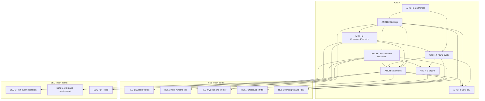

# Recertia ARCH workstream: implementation plan and specifications (ARCH-1 to ARCH-8)

**Status:** approved for implementation. This revision applies owner decisions D1 to D5 and the binding cross-spec reconciliations below.

**Owner:** the ARCH workstream, covering module boundaries, typed configuration, the command-execution port, the plane cycle, application services, the graph engine's extension points, and the persistence ports REL-10 will implement.

**Scope:** ARCH-1 to ARCH-8. REL and SEC items are dependencies and consumers. Their internals stay in the REL and SEC specs. REL-10 is in scope as a consumer of these ports (D1): this document specifies the Postgres-ready protocols and the `multi_node` startup hook, and REL-10 implements the pooled database, RLS, and object storage.

**Conventions**

- Paths are relative to `src/recertia/` unless they start at the repo root (`contracts/`, `tests/`, `scripts/`, `docs/`, `.github/`, `policy/`).
- Line numbers refer to the tree at the time of writing.
- Shared names are used exactly as agreed: `Settings`, `RuntimeLayout`, `RunsRootLayout`, `open_db`, `CommandExecutor`, `CommandRequest`, `ExecutionBackend`, `ExecutionConfig`, `GateRunner`, `CriterionRunner`, `HopHook`, `RunPersistence`, `RunService`, `JobService`, `PromotionService`, `EvalService`, `ProgramService`, `LibraryService`, `WorkspaceService`, `CheckpointReader`, `Principal`, `TenantId`, `PolicyDecisionPoint`, `RecertiaError`, `OrchestratorFactory`, `SolveStrategy`, `HandlerContext`, `SessionRepo`, `TenantRepo`.
- Size is the set of files and subsystems an item touches, not calendar time.

---

## 1. Decisions applied

### Owner decisions

| ID | Decision | Effect on this spec |
|---|---|---|
| D1 | **Multi-tenant service.** Pooled control plane: stateless API replicas, Postgres with `tenant_id` plus row-level security, object storage. Execution is isolated per tenant. `RECERTIA_DEPLOYMENT_MODE=single_node\|multi_node`. `multi_node` is the production target. Single-node remains the development and self-host default. REL-10 is in scope. | ARCH-2 adds `deployment_mode`, `db_backend`, `blob_store`, `database_url` and the `multi_node` startup hook. ARCH-7 repository protocols are Postgres-ready and include `SessionRepo` and `TenantRepo`; REL-10 supplies the Postgres implementations and RLS. ARCH-5 services take `TenantId` on every tenant-scoped method so replicas stay stateless. |
| D2 | The `runs` scope may run caller-supplied commands (command criteria, `must_pass_command`, goal `command` desired states) on **both** the container and local backends. The `exec` scope is required only for raw `script`. Local execution still needs the API break-glass and SEC-5 confinement. The local backend is **refused at startup** when `deployment_mode=multi_node`. | ARCH-3 `resolve_backend` / `build_executor(surface=)` honour the scope split by `CommandRequest.origin`, and they refuse `local` in `multi_node` before any command runs. ARCH-5 `RunService.create` enforces `exec` only when `origin="script"`. ARCH-2's startup hook is the process-level refusal. |
| D3 | Durability default is `normal`: fsync on atomic file replace, fsync on the ledger, batched fsync for JSONL, SQLite `synchronous=NORMAL` under WAL. | ARCH-7 `open_db` profile `durable` sets `synchronous=NORMAL` when `Settings.durability` is `normal`. ARCH-2 default for `RECERTIA_DURABILITY` is `normal`. `fast` is refused in `multi_node`. |
| D4 | `/v1/runs` is async by default after one release. During that release, sync callers are served by enqueue-and-wait. | ARCH-2 adds `api_default_async` defaulting to `0` for the transition release. ARCH-5 `RunService.create(..., wait: bool \| None)` is the single admission point; the route waits only when `wait` is true. REL-4 owns the queue. The following release flips the default to `1`. |
| D5 | The CLI is a local operator principal with admin (`platform_admin`) scopes. | ARCH-5 builds `Principal.local_operator()` in the CLI callback and passes it into every service call. The role is `platform_admin`. The scope token stays `admin` so existing API keys and `require_scope("admin")` keep working for one release. |

### Binding cross-spec reconciliations

| Topic | Binding shape | Where applied |
|---|---|---|
| Identity | `Principal` and `TenantId` live in `recertia/ports/identity.py`, with the validating function `tenant_id()`. The only resolver is `api/identity.py`. Shape: `subject`, `kind`, `tenant`, `tenants`, `scopes`, `roles`, plus `key_id` and `tenant_id` compatibility properties for one release. `RuntimeLayout` tenant methods take `TenantId`. | Shared section A1; ARCH-5; ARCH-7 |
| Execution | `ExecutionBackend` stays `Literal["container", "local"]` in `ports/execution.py`. The frozen config object is `ExecutionConfig`, built from `Settings` and held by each `CommandExecutor`. REL's `run_id`, `owner_id`, `fencing_token` and SEC-5's `origin` are fields on `CommandRequest`. There is no `ExecutionContext` type. | ARCH-3 |
| Authorization | `PolicyDecisionPoint` lives in `recertia/app/authz.py`. It implements the ARCH-5 `Authorizer` and `ports/approval.py::ApprovalPolicy`. Bootstrap injects that policy into `ToolRuntime`. `ApprovalGate` moves out of `governance/sandbox.py` so `governance` stays unreachable from T0/T1 run and job code. | ARCH-4 (import rule), ARCH-5 |
| Sandbox env | `SandboxLimits.allowed_env_keys` drops `HOME` in ARCH-3 PR-3.1. The executor always sets `HOME` to the workdir. Dev-only escape: `RECERTIA_LOCAL_HOME_PASSTHROUGH=1`. | ARCH-3 |
| Run events | Path is `root/runs/<tenant>/run_events/<run_id>.jsonl`. SEC-3 owns the migration off `root/run_events`. ARCH-7 exposes the path through the tenant accessor and does not move bytes. | ARCH-7 |
| Layout | Two classes, `RuntimeLayout` and `RunsRootLayout`. Add `runtime_db`, `control_db`, `locks_dir`, `root_lock`, `api_lock`. ARCH-7 baselines land first. REL-3's upgrade `rel3_runtime_db` later consolidates `checkpoints.db` and `operations.db` into `runtime.db`. | ARCH-7 |
| Golden gate | `golden_backend` default is `inherit`. A local gate requires an explicit capability: CLI `--local-exec` or the API break-glass. | ARCH-2, ARCH-3 |
| Policy backend | `policy.isolation.default_backend` has exactly one reader: `resolve_backend()`. | ARCH-3 |
| Observability | Package is `recertia/observability/` with `systems.py`, `logging.py`, `metrics.py`, `tracing.py`. | ARCH-4 moves `ops/systems.py`; REL-7 fills logging, metrics, tracing |
| Errors | One base: `recertia/errors.py::RecertiaError(code, http_status, retryable)`. ARCH-5 `ServiceError` subclasses it. CLI exits: 1 not found; 2 invalid input; 3 unauthorized/forbidden; 4 quota/rate; 5 conflict; 6 busy/lease lost; 7 unavailable/corrupt. `ledger verify` keeps 0/2. | Shared section A2; ARCH-5 |
| Quota | The only run-quota admission point is `RunService.create` / `RunService.resume`. | ARCH-5 |
| Repositories | ARCH-7 protocols are Postgres-ready. REL-10 implements them. `SessionRepo` and `TenantRepo` are part of the protocol set. | ARCH-7 |
| Startup | ARCH-2 `validate_deployment` refuses a local backend, requires the session secret, requires Postgres and S3, and refuses `durability=fast`, all when `deployment_mode=multi_node`. | ARCH-2 |

---

## 2. Cross-workstream references

| ID | Meaning in this spec |
|---|---|
| REL-1 | Atomic file replace, batched JSONL fsync, ledger fsync. Consumes `open_db` durability profiles. |
| REL-2 | Ledger concurrency. Console `GET /v1/ledger/verify` stops doing a full verify on the request thread once REL-2 lands; ARCH-5 only moves the call behind `LibraryService.verify_ledger`. |
| REL-3 | Run ownership, fencing, `rel3_runtime_db` consolidating checkpoints and operations into `runtime.db`. Depends on ARCH-7 baselines. |
| REL-4 | Durable `RunQueue`, worker process, fair claims, enqueue-and-wait. Injects the queue into `RunService`. |
| REL-5 | Cross-store atomicity and the quota ledger. Calls `RunService` for admission and does not add a second admit path. |
| REL-7 | Logging, metrics, tracing, `/ready`. Fills `observability/logging.py`, `metrics.py`, `tracing.py` beside the `systems.py` ARCH-4 moves. |
| REL-9 | Backup and restore. CLI `backup` / `restore` / `gc` stay thin wrappers; REL-9 replaces `ops/backup.py`. |
| REL-10 | Pooled Postgres, RLS, object storage, stateless replicas. Implements ARCH-7 protocols. In scope (D1). |
| REL-11 | Tenant lifecycle. Uses `TenantRepo` and `PolicyDecisionPoint` actions `tenants.admin`, `tenants.export`, `tenants.delete`. |
| SEC-3 | Tenant-keyed run events and cancel authorization. Owns the byte migration to `runs/<tenant>/run_events/`. |
| SEC-5 | `CommandRequest.origin` and local-backend confinement. |
| SEC identity | Credential verification. Consumes `ports/identity.py`; does not define a second `Principal`. |
| SEC exec gate | `runs` versus `exec`. ARCH-5 enforces it; SEC specifies the threat rule. |
| SEC PDP | The rule table evaluated inside `PolicyDecisionPoint`. |
| SEC auth | API-key hashing, rate limits, key issue and revoke. Store moves under `persistence/`; hashing stays SEC. |
| SEC OIDC | OIDC flow and session cookie. Persists through `SessionRepo`. |

`ExecutionUnavailable` and `ConfigError` are raised by ARCH-2 at startup, before `recertia.runtime` exists. They are defined once in `recertia/errors.py`. REL's `recertia/runtime/errors.py` re-exports them and does not define a second class with the same `code`.

---

## 3. Findings index

| ID | Finding | Evidence | ARCH |
|---|---|---|---|
| F1 | The ADR-0005 guard is a direct-import AST walk over `nodes/` and `jobs/` only. Transitive imports are invisible, and `solver` is not scanned. | `tests/boundary/test_import_boundary.py:20-57`; ADR-0005 consequences ("enforced by module boundaries and asserted in CI, not by convention") | 1 |
| F2 | T0 code imports T3 sandbox types. `SandboxLimits.from_policy` imports `governance.sandbox`, and bootstrap imports `ApprovalGate` from the same module. | `solver/sandbox.py:22-31`; `bootstrap.py:17` | 1, 3, 5 |
| F3 | Ruff is unpinned (`ruff>=0.6` in `pyproject.toml:41`) and selects only `E,F,I,W` (`pyproject.toml:58`). A local 0.6.9 install disagrees with the CI resolver. There is no bugbear, complexity, banned-API, unused-noqa, simplify, or pyupgrade gate. | `pyproject.toml`; `.github/workflows/ci.yml:35-36` | 1 |
| F4 | Mypy covers `contracts/` and `src/recertia/` with `ignore_missing_imports = true` and no per-module ratchet. Contracts are strict only because CI passes `--strict` separately. | `pyproject.toml:63-70`; `ci.yml` type-check step | 1 |
| F5 | Process configuration is ~58 `RECERTIA_*` reads scattered through API, solver, CLI, jobs, and memory. There is no composition root. | `api/__init__.py:47-49`; `api/console_auth.py`; `api/quotas.py:26-28`; `solver/container.py:45-135`; `config.py:63-101`; `policy_load.py:29` | 2 |
| F6 | Two call sites write `RECERTIA_EXECUTION_BACKEND` into the process environment, so one golden or one CLI flag changes every later reader in the process. | `evals/golden.py:189-213` and `:336-361`; `cli/runs.py:36-40` | 2, 3 |
| F7 | `IsolationSettings.default_backend` has no reader. Backend selection reads the environment in `configured_backend()` and again in `applicability.environment_model_from_registry`. | `contracts/policy.py:197`; `solver/container.py:53-59`; `memory/procedural/applicability.py:33` | 3 |
| F8 | Command execution is a free function, `run_configured_command`, with seven production call sites and no `run_id` / owner / origin. | `solver/container.py:309-326`; call sites listed in ARCH-3 | 3 |
| F9 | Handlers receive ambient state through three `ContextVar`s (`limits`, `model`, `step`). | `solver/runtime.py:21-29`, set at `:124-126`; read by `solver/handlers.py:33` and `:197` | 3 |
| F10 | `HOME` is an allowed env key, so the local executor forwards the host home directory. It then `setdefault`s `HOME` to the workdir only when the key was absent. | `solver/sandbox.py:18`; `governance/sandbox.py:22`; `solver/container.py:337-346` | 3 |
| F11 | The improvement plane constructs the task-plane engine. `evals/golden.py` imports `GraphOrchestrator`, and `memory/procedural/promote.py` imports the golden runner, which imports the engine, which imports nodes, which import memory. | `evals/golden.py:37`; `memory/procedural/promote.py:20-26`; `graph/engine.py:30` | 4 |
| F12 | Memory imports upward into solver, evals, and review. | `memory/affordance/__init__.py:16` (`ToolResult`); `memory/procedural/lint.py:13` (`ClaimScheduler`); `contribution.py:14` (`evals.statistics`); `active_set.py:16,24` (`EvalStore`, `AutonomyConfig`); `portfolio.py:34` | 4 |
| F13 | Criterion execution is private to `nodes/validate.py`, and three other packages reimplement command criteria by calling `run_configured_command` themselves. | `nodes/validate.py:168-209`; `review/shadow.py:70-90`; `validation/sensitivity.py:95-111`; `jobs/arxiv_pdf.py:146` | 4 |
| F14 | Hop gauges live in `ops/systems.py` and are imported from inside the engine loop and the tool runtime. | `graph/engine.py:321`; `solver/runtime.py:129`; `solver/result_cache.py:13` | 4 |
| F15 | HTTP behaviour is closed over `ConsoleContext`, which holds stores, an in-memory run dict, a semaphore, and a pile of unbound functions. Routes are registered as closures on one `FastAPI` app from four modules. | `api/console_deps.py:21-73`; `api/__init__.py:303-342` (771 lines); `console_library_routes.py` (802 lines); `console_program_routes.py` (719 lines) | 5 |
| F16 | Job dispatch is copy-pasted. `cli/jobs.py` and `POST /v1/jobs/{job}/run` each branch on `mine` / `curator` / `practice` / … and call `JobRunner` themselves. `JOB_NAME_TO_PRIORITY` is a third name table. | `cli/jobs.py:147-219`; `api/console_library_routes.py:632-669`; `jobs/__init__.py:18-41` | 5 |
| F17 | Run quota is admitted in the route (`QuotaStore` plus an in-process semaphore), not in one service method. Resume has its own copy. | `api/__init__.py:365-411` and `:579`; `api/quotas.py` | 5 |
| F18 | Authorization is ad hoc: `require_scope` factories, `RouteState.require_library_write`, `_principal_may_exec`, and a separate `ApprovalGate` dataclass. | `api/auth.py:289`; `console_deps.py:159-171`; `api/__init__.py:71-72`; `governance/sandbox.py:53-85` | 5 |
| F19 | CLI commands construct orchestrators, stores, and ledgers directly and exit `1` or `2` for every failure. `ledger verify` exits `1` on an invalid chain. | `cli/runs.py:36-45,231,300-309`; `cli/jobs.py`; `cli/main.py` | 5 |
| F20 | `GraphOrchestrator.__init__` constructs six stores. Bootstrap then overwrites `workspaces` with a second `WorkspaceManager`. | `graph/engine.py:80-101`; `bootstrap.py:182` and `:229` | 6 |
| F21 | The hop loop inlines telemetry, MEA, trajectory, and checkpointing. There is no hook a subscriber can implement without editing `_execute`. | `graph/engine.py:290-423` | 6 |
| F22 | `solve` picks a strategy with a five-branch conditional. Node capabilities are one `NodeContext` bag: every node receives tools, the reviewer, and index maintenance. | `nodes/solve.py:29-66`; `graph/engine.py:157-194`; `nodes/context.py:145-175` | 6 |
| F23 | Eleven modules call `sqlite3.connect` with WAL and no `synchronous` pragma. The durability default D3 is therefore not in force. | `graph/store.py:24-25`; `graph/ops.py:46-47`; `api/auth.py`; `api/quotas.py:40`; `api/jobs_store.py:37`; `programs/store.py:21`; `proposals/store.py:44`; `evals/store.py:28`; `workspaces/registry.py:19`; `retrieval/index.py:75` | 7 |
| F24 | `store/migrations/001_init.*.sql` creates `skills_meta`, `facts_meta`, `embeddings`, and `run_checkpoints` that the live skill store and `GraphOrchestrator` never open. Callers are tests, `store/backend.py`, and `scripts/soak_postgres.py`. | `store/migrations/001_init.sqlite.sql`; `store/backend.py:93-100` | 7 |
| F25 | Run-event and tenant paths are string concatenation. The API log is `root/run_events` (not tenant-scoped). There is no `control.db` or lock path. | `api/console_deps.py:67` and `:82-83` | 7 |
| F26 | `policy/default.json` and `src/recertia/policy_default.json` are byte-identical (2647 bytes) and both maintained by hand. | `policy_load.py:13-24`; `pyproject.toml:81` | 8 |
| F27 | `jobs/workers.py` is 819 lines and 16 public functions covering mine, curate, practice, recertify, and step-graph proposals. `config.py` will collide with `Settings`. `workspace/` (snapshots) and `workspaces/` (host registry) are different packages with adjacent names. | `jobs/workers.py`; `config.py`; `workspace/__init__.py`; `workspaces/registry.py` | 8 |
| F28 | `docs/architecture2.md` is a committed concatenation. CI's `--check` fails when a topic file changes and the concatenation is stale. `tests/unit/` mixes package-mirrored tests with a flat `test_*.py` layer (~140 test modules). | `scripts/generate_architecture2.py:9-11`; `docs/architecture.md:4` | 8 |

---

## 4. Shared decisions

### A1. Identity port

ARCH-5 PR-5.0 creates `ports/identity.py` when the file is absent. When SEC has already created it, PR-5.0 only adds the fields and helpers that are missing. One class, one module.

```python
# recertia/ports/identity.py
class TenantId(str):
    """Validated tenant id. Constructing it runs tenant_id()."""

def tenant_id(value: str) -> str:
    """Accept ^[A-Za-z0-9][A-Za-z0-9_-]{0,63}$. Raise ValueError otherwise.

    This is the move of api/auth.py:validate_tenant_id (lines 43-49).
    """

PrincipalKind = Literal["api_key", "console_session", "local_operator"]

@dataclass(frozen=True)
class Principal:
    subject: str
    kind: PrincipalKind
    tenant: TenantId
    tenants: tuple[TenantId, ...]
    scopes: frozenset[str]
    roles: frozenset[str]

    @property
    def key_id(self) -> str:
        """Compatibility: api-key id, or subject for session and CLI. One release."""

    @property
    def tenant_id(self) -> str:
        """Compatibility: str(self.tenant). One release."""

    @classmethod
    def local_operator(
        cls, *, tenant: TenantId | None = None, actor: str | None = None
    ) -> Principal:
        """D5. scopes include 'admin' (and the operational scopes). roles == {'platform_admin'}."""

    def has_scope(self, scope: str) -> bool: ...
    def has_role(self, role: str) -> bool: ...
```

`local_operator` scopes are exactly today's allowlist (`api/auth.py:22`): `admin`, `runs`, `blobs`, `metrics`, `exec`, `promote`, `jobs`. The role `platform_admin` is what services check when they mean "operator of this process". The scope `admin` remains the API-key wire token.

`api/auth.py` keeps `ApiKeyStore`, hashing, and `require_scope` until ARCH-5 PR-5.5 replaces the dependency. It re-exports `Principal` and binds `validate_tenant_id = tenant_id` for one release. New code imports from `ports.identity`.

The resolver lives only in `api/identity.py`:

```python
# recertia/api/identity.py
class IdentityResolver:
    def __init__(self, *, keys: ApiKeyStore, sessions: SessionRepo, settings: Settings) -> None: ...

    def from_request(self, request: Request) -> Principal:
        """API key (X-API-Key) or console session cookie / X-Recertia-Session.

        Raises ServiceError unauthorized / forbidden. Does not build a Principal
        from a raw tenant header. X-Recertia-Tenant is applied by RunService
        against principal.tenants.
        """

    def resolve_tenant(self, principal: Principal, requested: str | None) -> TenantId:
        """Move of RouteState.resolve_tenant (console_deps.py:128-147)."""
```

CLI code calls `Principal.local_operator()` in the Typer callback. It does not call `IdentityResolver`.

### A2. Error base and CLI exits

```python
# recertia/errors.py
class RecertiaError(Exception):
    code: ClassVar[str] = "internal_error"
    http_status: ClassVar[int] = 500
    retryable: ClassVar[bool] = False
    exit_code: ClassVar[int] = 7

    def __init__(
        self,
        message: str,
        *,
        run_id: str | None = None,
        details: Mapping[str, object] | None = None,
        retry_after_s: float | None = None,
    ) -> None: ...

class ConfigError(RecertiaError):
    code = "invalid_config"; http_status = 400; retryable = False; exit_code = 2

class ExecutionUnavailable(RecertiaError):
    code = "execution_unavailable"; http_status = 503; retryable = False; exit_code = 7

class NotFound(RecertiaError):
    code = "not_found"; http_status = 404; retryable = False; exit_code = 1

class Unauthorized(RecertiaError):
    code = "unauthorized"; http_status = 401; retryable = False; exit_code = 3

class Forbidden(RecertiaError):
    code = "forbidden"; http_status = 403; retryable = False; exit_code = 3

class Conflict(RecertiaError):
    code = "conflict"; http_status = 409; retryable = False; exit_code = 5

class QuotaExceeded(RecertiaError):
    code = "quota_exceeded"; http_status = 429; retryable = False; exit_code = 4

class Busy(RecertiaError):
    code = "busy"; http_status = 409; retryable = True; exit_code = 6
```

ARCH-5 adds `ServiceError` in `app/errors.py`, subclassing `RecertiaError`, as the base for service-layer failures (`RunNotFound(NotFound)`, `ScriptRequiresExec(Forbidden)`, `RunExists(Conflict)`). REL subclasses that need richer codes live in `runtime/errors.py` and subclass `RecertiaError` directly. They re-export `ConfigError` and `ExecutionUnavailable`.

CLI mapping, applied by one helper `cli/exit.py::raise_exit(exc)`:

| Exit | Meaning | Typical code |
|---|---|---|
| 0 | success | — |
| 1 | not found | `not_found` |
| 2 | invalid input | `invalid_config`, validation errors |
| 3 | unauthorized or forbidden | `unauthorized`, `forbidden` |
| 4 | quota or rate limit | `quota_exceeded`, `rate_limited` |
| 5 | conflict | `conflict`, `run_id_exists` |
| 6 | busy or lease lost | `busy`, `run_busy`, `lease_lost` |
| 7 | unavailable or corrupt | `execution_unavailable`, `state_corrupt`, `unavailable` |

`recertia run` and `recertia resume` keep today's task-outcome exit (`cli/runs.py:231`): `0` when `terminal` is `solved` or `abstained`, and `1` when the run finished in another terminal. Stderr for that `1` starts with `unsolved:`. A missing run id is `not_found:` and the same exit `1`. `recertia ledger verify` changes from today's `0` / `1` (`cli/runs.py:309`) to `0` / `2`: a chain that fails verification is invalid input to the verifier, exit `2`, stderr `LEDGER INVALID:`.

### A3. Composition roots

Exactly three places call `Settings.load`:

1. The Typer callback in `cli/main.py`, once per process, stored on `ctx.obj`.
2. `create_app`, when the caller did not pass a `Settings` instance.
3. The worker entrypoint (`workers/run_worker.py` today; the REL-4 worker process later).

Libraries, nodes, the solver, and repositories receive `Settings` or a narrower frozen view (`ExecutionConfig`, `ModelConfig`) as an argument. They do not read `os.environ`.

### A4. What ARCH-7 baselines include

Baselines create the path objects and the migration runner. They do not copy checkpoint rows into `runtime.db`. `CheckpointStore` keeps opening `checkpoints.db` and `OperationLedger` keeps opening `operations.db` until REL-3's `rel3_runtime_db` upgrade. Both connections are obtained from `open_db`.

---

## 5. ARCH-1 — Guardrails

### Findings

F1, F2, F3, F4.

### Goal

Make the ADR-0005 tier boundary, the import direction, and the type/lint ratchet enforced by tools that see transitive imports, with a pinned ruff that matches CI.

### Non-goals

- Fixing every current complexity or pyupgrade finding in the same change as the pin. The ratchet records them, then later PRs burn them down.
- Replacing `scripts/security_review.py`.
- Rewriting the two AST checks that import-linter cannot express (attribute calls `.write(`, `.rebuild`, `.upsert` in retrieve/plan/solve). Those stay in `tests/boundary/test_import_boundary.py`.

### Design

**Pin.** `pyproject.toml` dev extra changes from `ruff>=0.6` to `ruff==<ci>`, where `<ci>` is the version a clean CPython 3.12 venv resolves today when it runs the CI install line `pip install -e ".[dev]"`. The implementing change records that version in the commit message and in a one-line comment above the pin. It does not pin `0.6.9`. CI gains `ruff --version` echoed in the lint step so a future resolver drift is visible. Local and CI then install the same wheel.

**Ruff rules, report then block.**

Report PR (`ARCH-1 PR-1.2`) adds a second CI step that is allowed to fail the job without failing the workflow:

```toml
[tool.ruff.lint]
select = ["E", "F", "I", "W"]

[tool.ruff.lint.extend-per-file-ignores]
# populated only by the block PR
```

The report step runs:

```text
ruff check --select B,C90,TID251,RUF100,SIM,UP contracts/ src/ scripts/ tests/ conftest.py
```

with `continue-on-error: true`, and uploads the output as the `ruff-preview` artifact.

Block PR (`ARCH-1 PR-1.4`), after ARCH-2 has removed the env writes TID251 will forbid, moves those codes into `select` and sets:

```toml
[tool.ruff.lint.mccabe]
max-complexity = 12

[tool.ruff.lint.flake8-tidy-imports.banned-api]
"os.environ".msg = "Read Settings. os.environ is confined to recertia.settings and tests."
"os.environ.get".msg = "Read Settings."
"os.environ.setdefault".msg = "Read Settings."
"os.environ.__setitem__".msg = "Do not write process env at runtime."
```

`per-file-ignores` for the ban: `recertia/settings.py` only, plus `tests/**` and `conftest.py` (tests may still `monkeypatch.setenv` before `Settings.load`). `src/recertia/**` outside `settings.py` is banned. The block PR may ignore existing C90 violations by function with an explicit `# noqa: C901` only where the function is listed in the PR description; new violations fail. `RUF100` makes stale `noqa` fail.

**import-linter.** Dev extra gains `import-linter`. Configuration lives in `pyproject.toml` under `[tool.importlinter]`. CI runs `lint-imports`. Contracts are transitive: `allow_indirect_imports` stays at its default `false`.

Layers, top to bottom (a layer may import layers below it and `contracts`):

| Layer | Modules |
|---|---|
| `composition` | `recertia.cli`, `recertia.api`, `recertia.bootstrap`, `recertia.workers`, `recertia.app` |
| `jobs` | `recertia.jobs` |
| `evals` | `recertia.evals` |
| `review` | `recertia.review` |
| `graph` | `recertia.graph` |
| `nodes` | `recertia.nodes` |
| `solver` | `recertia.solver` |
| `domain` | `recertia.memory`, `recertia.retrieval`, `recertia.validation`, `recertia.ledger`, `recertia.workspace`, `recertia.trajectory`, `recertia.mea`, `recertia.distill`, `recertia.programs`, `recertia.proposals` |
| `platform` | `recertia.persistence`, `recertia.observability`, `recertia.settings`, `recertia.errors`, `recertia.ports` |
| `governance` | `recertia.governance` |

`governance` is **not** below `domain`. It sits beside `platform` and is reached only through forbidden-contract exceptions for `composition`. The layer contract marks `governance` as an independent layer (`layers` + a `forbidden` contract), so `nodes`, `jobs`, `solver`, `graph`, `memory`, `evals`, and `review` cannot import it.

Forbidden contracts (replace the direct-import tests):

| Contract | Source | Forbidden | Replaces |
|---|---|---|---|
| `t3-unreachable` | `recertia.nodes`, `recertia.jobs`, `recertia.solver`, `recertia.graph`, `recertia.memory` | `recertia.governance`, `recertia.evals.ablation`, `recertia.evals.interventions`, `recertia.evals.faithfulness` | `test_no_t3_imports_in_runs_or_jobs`, and it now includes `solver` and `memory` (F2) |
| `no-replay` | `recertia.nodes` | `recertia.replay` | `test_nodes_must_not_import_replay_surface` |
| `no-lifecycle` | `recertia.nodes`, `recertia.graph` | `recertia.review.lifecycle` | `test_nodes_and_graph_must_not_import_lifecycle` |
| `memory-down` | `recertia.memory` | `recertia.solver`, `recertia.evals`, `recertia.review`, `recertia.graph`, `recertia.nodes`, `recertia.api` | F12, enforced once ARCH-4 deletes the edges |
| `evals-no-engine` | `recertia.evals` | `recertia.graph.engine` | F11, enforced once `OrchestratorFactory` lands |
| `api-cli-independent` | independence of `recertia.api` and `recertia.cli` | — | new |
| `one-policy-reader` | not an import contract; see ARCH-3 test | — | F7 |

Until ARCH-4 removes the real edges, `memory-down` and `evals-no-engine` are listed in `[tool.importlinter]` with `ignore_imports` entries that name the current offenders exactly:

- `recertia.memory.affordance -> recertia.solver.tools`
- `recertia.memory.procedural.lint -> recertia.solver.claims`
- `recertia.memory.procedural.promote -> recertia.evals.golden`
- `recertia.memory.procedural.contribution -> recertia.evals.statistics`
- `recertia.memory.procedural.active_set -> recertia.evals.store`
- `recertia.memory.procedural.active_set -> recertia.review.autonomy_config`
- `recertia.memory.procedural.portfolio -> recertia.review.autonomy_config`
- `recertia.evals.golden -> recertia.graph.engine`
- `recertia.solver.sandbox -> recertia.governance.sandbox`
- `recertia.bootstrap -> recertia.governance.sandbox` (allowed for `composition`; not an ignore once the layer contract treats bootstrap as composition)

The ignore list is a file `tests/boundary/import-linter-baseline.txt` copied into the config, and a test fails if an ignore line no longer matches a real import (so ignores cannot rot silently).

Residual AST tests kept, renamed, and left in `tests/boundary/test_import_boundary.py`:

- `test_retrieve_plan_solve_must_not_write_memory`
- `test_retrieve_cannot_maintain_the_index`

Deleted once `lint-imports` is required in CI:

- `test_no_t3_imports_in_runs_or_jobs`
- `test_nodes_must_not_import_replay_surface`
- `test_nodes_and_graph_must_not_import_lifecycle`
- `test_guarded_files_is_non_empty` (import-linter's unmatched-module check replaces the "scan nothing" guard)

**Mypy ratchet.** `scripts/mypy_ratchet.py` runs `mypy --no-error-summary contracts/ src/recertia/`, counts errors per module, and compares to `mypy-baseline.txt` at the repo root (module path, count). CI fails when any module's count rises or a new module appears with a count above zero. A PR that lowers a count updates the baseline in the same commit. `contracts/` stays on `mypy --strict contracts/` in CI, unchanged. The ratchet does not turn on `strict` for `src/recertia` as a whole. Per-module promotion is a one-line list `strict_modules` inside the script, initially empty, that adds `--strict` follow-ups for modules whose baseline count is already zero when a later PR opts them in.

`ignore_missing_imports` stays for this workstream. Third-party stubs are out of scope.

### Files

| Action | Path |
|---|---|
| Modify | `pyproject.toml` (ruff pin, select, mccabe, TID251, import-linter) |
| Modify | `.github/workflows/ci.yml` (report step, then block step; `lint-imports`; mypy ratchet) |
| Create | `scripts/mypy_ratchet.py` |
| Create | `mypy-baseline.txt` |
| Create | `tests/boundary/import-linter-baseline.txt` |
| Modify | `tests/boundary/test_import_boundary.py` (delete the three direct-import tests in the block PR) |
| Create | `tests/boundary/test_import_linter_baseline.py` |

No application modules change in ARCH-1 except where a one-line import cycle break is required for `lint-imports` to run at all. The known cycle is F11; it is baselined, not fixed here.

### Migration / compatibility

The report PR changes no runtime behaviour. The block PR fails CI on new violations only. Existing `noqa` comments that become unused fail under `RUF100` and are deleted in that PR.

### Tests

- `tests/boundary/test_import_linter_baseline.py::test_baseline_ignores_match_real_imports`
- `tests/boundary/test_import_linter_baseline.py::test_no_unlisted_ignore`
- `tests/unit/test_mypy_ratchet.py::test_ratchet_fails_when_a_module_count_increases` (fixture baseline, not the real tree)
- `tests/boundary/test_import_boundary.py::test_retrieve_plan_solve_must_not_write_memory` (kept)
- `tests/boundary/test_import_boundary.py::test_retrieve_cannot_maintain_the_index` (kept)

### Risks

A layer contract that is stricter than today's imports will fail `lint-imports` on `main` if the baseline is short. The baseline test exists so the list is reviewed rather than guessed. `TID251` will fail until ARCH-2 lands, which is why the block PR is sequenced after ARCH-2 PR-2.2.

### Dependencies

None. ARCH-2, ARCH-3, and ARCH-4 consume the ratchet. SEC supply chain reviews the `import-linter` dependency.

### PR slicing

| PR | Touches | Done when |
|---|---|---|
| PR-1.1 | `pyproject.toml`, `ci.yml` | Ruff pin equals a clean 3.12 resolve; `ruff check` of the existing `E,F,I,W` set still passes |
| PR-1.2 | `ci.yml` report step | `B,C90,TID251,RUF100,SIM,UP` run as a non-blocking artifact |
| PR-1.3 | `pyproject.toml`, `tests/boundary/`, baseline file | `lint-imports` is required and green against the baseline |
| PR-1.4 | `scripts/mypy_ratchet.py`, `mypy-baseline.txt`, `ci.yml` | Ratchet is required; baseline matches current `mypy` output |
| PR-1.5 | `pyproject.toml` select list, after ARCH-2 PR-2.2 | The preview codes are blocking, with reviewed ignores only |

PR-1.1 through PR-1.4 touch CI, `pyproject.toml`, `scripts/mypy_ratchet.py`, and `tests/boundary/`. They do not edit `src/recertia` behaviour.

---

## 6. ARCH-2 — Typed Settings

### Findings

F5, F6. D1 startup rules.

### Goal

One frozen `Settings` object, loaded at the three composition roots, holding every process setting. Runtime code stops reading and writing `os.environ`. `multi_node` startup validation lives on this object.

### Non-goals

- Moving secret storage (API keys, OIDC client secrets) out of the environment. `Settings` still reads them once at load.
- REL-10's check that `database_url` is not the owner role. That check registers into the hook from REL-10.
- Changing the meaning of any current variable.

### Design

```python
# recertia/settings.py
Durability = Literal["strict", "normal", "fast"]
DeploymentMode = Literal["single_node", "multi_node"]
DbBackend = Literal["sqlite", "postgres"]
BlobStoreKind = Literal["filesystem", "s3"]
GoldenBackend = Literal["inherit", "container", "local"]
ConsoleAuth = Literal["off", "dev", "oidc"]
MigrateMode = Literal["auto", "manual", "off"]

@dataclass(frozen=True)
class Settings:
    # deployment (new, D1/D3/D4)
    deployment_mode: DeploymentMode = "single_node"
    durability: Durability = "normal"
    db_backend: DbBackend = "sqlite"
    database_url: str | None = None
    blob_store: BlobStoreKind = "filesystem"
    runtime_db_migrate: MigrateMode = "auto"
    allow_faults: bool = False
    faults: str = ""
    tenant_encryption: Literal["off", "required"] = "off"
    api_default_async: bool = False  # D4: 0 for this release

    # execution
    execution_backend: ExecutionBackend = "container"
    container_runtime: Literal["docker", "podman"] | None = None
    container_image: str = "python:3.12-slim"
    allow_custom_image: bool = False
    api_allow_local_exec: bool = False
    workdir_world_write: bool = False
    local_home_passthrough: bool = False  # ARCH-3 PR-3.1
    command_policy: Literal["on", "off"] = "on"
    command_allowlist: str = ""
    golden_backend: GoldenBackend = "inherit"

    # model — fields match config.py:ModelConfig plus the provider env
    model_provider: Literal["stub", "anthropic", "openai"] = "stub"
    model_id: str = "stub"
    verifier_model_id: str | None = None
    api_key_env: str = ""
    model_timeout_s: float = 60.0
    model_max_retries: int = 2
    allow_stub_model: bool = False
    anthropic_base_url: str | None = None
    openai_base_url: str | None = None
    model_allowlist: str = ""
    model_allowlist_path: str = ""
    openai_http_referer: str = ""
    openai_title: str = ""
    openrouter_title: str = ""
    openai_extra_headers: str = ""
    openai_extra_body: str = ""
    openai_max_tokens: int | None = None
    default_input_usd_per_mtok: float = 1.0
    default_output_usd_per_mtok: float = 3.0
    model_prices: Mapping[tuple[str, str, Literal["IN", "OUT"]], float] = field(default_factory=dict)

    # api
    max_blob_bytes: int = 16 * 1024 * 1024
    api_max_criterion_timeout_s: int = 300
    api_max_in_flight_runs: int = 4

    # console / oidc — defaults match api/console_auth.py
    console_auth: ConsoleAuth = "off"
    console_dev_login: bool = False
    console_dev_admin: bool = False
    console_cookie_secure: bool | None = None
    console_session_secret: str = ""
    oidc_issuer: str = ""
    oidc_client_id: str = ""
    oidc_client_secret: str = ""
    oidc_scope: str = "openid profile email"
    oidc_role_allowlist: str = "operator,reviewer"
    oidc_default_roles: str = "operator"
    oidc_default_tenants: str = "default"
    oidc_token_url: str = ""
    oidc_userinfo_url: str = ""

    # quotas — defaults match api/quotas.py:26-28
    tenant_max_runs_per_day: int = 100
    tenant_max_cost_usd_per_day: float = 50.0
    tenant_max_in_flight: int = 4
    tenant_skills: bool = False

    # policy and misc
    policy_path: str = ""
    policy_version: str = ""
    library_commit: str = ""
    scratch_max_steps: int = 5
    fetch_allowlist: str = "pypi.org,files.pythonhosted.org,raw.githubusercontent.com,api.github.com"
    fetch_max_bytes: int = 512 * 1024
    fetch_timeout_s: float = 20.0
    pdf_extract: bool = True
    allow_posix_workspace_roots: bool = False
    allow_full_replay: bool = False

    def validate_deployment(self, *, role: Literal["api", "worker", "cli", "executor"]) -> None:
        """Call from every composition root after load.

        single_node: no extra rules.
        multi_node: the four ARCH-2 rules, then every check registered
        with register_deployment_check (REL-10, REL-11).
        """

    def execution_config(self) -> ExecutionConfig: ...
    def model_config(self) -> ModelConfig: ...

def load_settings(environ: Mapping[str, str] | None = None) -> Settings:
    """Read environ or os.environ exactly once. Bool flags accept 1/true/yes."""

def register_deployment_check(fn: Callable[[Settings], None]) -> None: ...
```

`load_settings` is the only function in `src/recertia` that reads `os.environ`, together with the dynamic price scan inside it. `ModelConfig` stays the solver-facing frozen object (`config.py:13-21`). `Settings.model_config()` builds it. `load_model_config` becomes a wrapper that reads `Settings` so existing callers compile during the migration, and PR-2.2 deletes the wrapper's env access.

**Inventory.** 60 `RECERTIA_*` tokens are read under `src/recertia`. 58 are process settings in the dataclass above. The dynamic family `RECERTIA_MODEL_PRICE_<PROVIDER>_<MODEL>_IN|OUT` (`solver/pricing.py:35`) is the one field `model_prices`, scanned only inside `load_settings`. Excluded from `Settings`:

| Token | Why it is not a setting |
|---|---|
| `RECERTIA_PAPER_ID` | A literal inside a generated skill command (`jobs/workers.py:712`), not a process read |
| `RECERTIA_NO_NETWORK`, `RECERTIA_REQUIRE_REAL_DOCKER` | Test harness and CI only |
| `RECERTIA_FORCE_LOCAL` | Popped by `scripts/smoke_container.py`; no reader |
| `RECERTIA_STORE_BACKEND` | Docs-only alias. `db_backend` replaces it. `scripts/soak_postgres.py` is updated to say so |
| `RECERTIA_PORTFOLIO_CONTROLLER` | A deleted flag. Tests assert it stays unread. Do not revive it |
| `RECERTIA_SCAN_DIRS`, `RECERTIA_CONTROLS` | Names inside `scripts/security_review.py`, not environment variables |

New keys this workstream adds, with defaults: `RECERTIA_DEPLOYMENT_MODE=single_node`, `RECERTIA_DURABILITY=normal`, `RECERTIA_DB_BACKEND=sqlite`, `RECERTIA_DATABASE_URL` (unset), `RECERTIA_BLOB_STORE=filesystem`, `RECERTIA_RUNTIME_DB_MIGRATE=auto`, `RECERTIA_ALLOW_FAULTS` unset, `RECERTIA_FAULTS` unset, `RECERTIA_TENANT_ENCRYPTION=off`, `RECERTIA_API_DEFAULT_ASYNC=0`, `RECERTIA_LOCAL_HOME_PASSTHROUGH` unset, `RECERTIA_GOLDEN_BACKEND=inherit`.

`DATABASE_URL` (no prefix), read today by `store/backend.py:96`, is accepted as an alias of `RECERTIA_DATABASE_URL` for one release. When both are set they must be equal or `load_settings` raises `ConfigError`.

**`validate_deployment` rules for `multi_node`** (ARCH-2 owns these four; REL appends more through `register_deployment_check`):

| Rule | Exception |
|---|---|
| `execution_backend != "local"`. `api_allow_local_exec` is ignored and the composition root logs a warning when it is set | `ExecutionUnavailable` |
| `db_backend == "postgres"` and `database_url` is non-empty | `ConfigError` |
| `blob_store == "s3"` | `ConfigError` |
| `console_session_secret` length ≥ 32. The random fallback in `api/console_auth.py:74-83` is not used | `ConfigError` |
| `durability != "fast"` | `ConfigError` |

`golden_backend == "local"` in `multi_node` raises `ExecutionUnavailable` here as well, because a local gate is a local backend. `inherit` follows `execution_backend`, which has already been refused when it is `local`.

`single_node` keeps today's behaviour, including local execution behind `--local-exec` and `RECERTIA_API_ALLOW_LOCAL_EXEC`.

**Composition-root wiring**

- `cli/main.py` callback: `settings = load_settings(); settings.validate_deployment(role="cli"); ctx.obj = AppObj(settings=settings, principal=Principal.local_operator())`.
- `create_app(*, settings: Settings | None = None, ...)`: load and `validate_deployment(role="api")` when `settings` is omitted.
- Worker entry: `validate_deployment(role="worker")`.

**Delete runtime env writes (PR-2.2)**

- `cli/runs.py:_prepare_execution` stops assigning `os.environ["RECERTIA_EXECUTION_BACKEND"]`. `--local-exec` builds a `LocalExecutionCapability(purpose="cli")` and passes it to `build_executor(surface="cli", ...)`. The flag remains on `run` and `resume`.
- `evals/golden.py:189-213` and `:336-361` stop reading and writing `RECERTIA_EXECUTION_BACKEND`. Gate functions take `executor: CommandExecutor`. The eval CLI and the API eval route build that executor (ARCH-3). When they need a local gate they pass a capability; they do not mutate the environment.

`tests/conftest.py` may keep `os.environ.setdefault("RECERTIA_EXECUTION_BACKEND", "local")` and the break-glass setdefault, because it runs before `load_settings`. Golden tests additionally install a capability (ARCH-3); the env write inside `golden.py` is what disappears.

### Files

| Action | Path |
|---|---|
| Create | `settings.py` |
| Modify | `config.py` (`load_model_config` reads `Settings`) |
| Modify | `cli/main.py`, `cli/runs.py` |
| Modify | `api/app.py`, `api/__init__.py` (`create_app` takes `Settings`) |
| Modify | `api/console_auth.py`, `api/quotas.py`, `api/console_deps.py` (read fields, not env) |
| Modify | `solver/container.py`, `solver/factory.py`, `solver/providers.py`, `solver/pricing.py`, `solver/model_allowlist.py`, `solver/command_policy.py`, `solver/handlers.py`, `solver/registry.py` |
| Modify | `bootstrap.py`, `policy_load.py`, `paths.py`, `nodes/solve_scratch.py`, `replay/harness.py`, `jobs/arxiv_pdf.py`, `evals/golden.py`, `evals/canary.py`, `memory/procedural/applicability.py` |
| Modify | `workers/run_worker.py` |
| Modify | `tests/conftest.py` (document that setenv happens before load) |
| Delete in PR-2.2 | the three `os.environ[...] =` assignments named above |

Every current reader listed in the inventory table is modified to take a value from `Settings` or from a frozen view. The PR may do this by threading `settings` from the composition root, not by a process-global singleton. Tests that call a leaf function construct `Settings(...)` directly.

### Migration / compatibility

Unknown `RECERTIA_*` names are ignored by `load_settings` (forward compatibility) and listed at debug log by the composition root. A known name with an illegal value raises `ConfigError` at startup (CLI exit 2, API process refuses to boot). Defaults match the current `os.environ.get` defaults so an empty environment boots the same single-node process as today.

### Tests

- `tests/unit/config/test_settings_inventory.py::test_every_src_recertia_env_read_is_in_the_inventory`
- `tests/unit/config/test_settings_inventory.py::test_src_does_not_subscript_os_environ` (after PR-2.2; allows `settings.py`)
- `tests/unit/config/test_deployment_validation.py::test_multi_node_refuses_local_backend`
- `tests/unit/config/test_deployment_validation.py::test_multi_node_requires_postgres_s3_and_session_secret`
- `tests/unit/config/test_deployment_validation.py::test_multi_node_refuses_fast_durability`
- `tests/unit/config/test_deployment_validation.py::test_single_node_accepts_local_backend`
- `tests/unit/config/test_settings_load.py::test_bool_flags_accept_1_true_yes`
- `tests/unit/config/test_settings_load.py::test_database_url_alias_must_match`
- `tests/unit/evals/test_golden_gate.py::test_golden_does_not_mutate_execution_backend_env`

### Risks

Tests that `setenv` after `create_app` was called against a cached app will keep the old values. `create_app` already builds a new app per call in tests; the fixture must pass `settings=load_settings()` after the patch. PR-2.2 includes that fixture update. A missed reader that still calls `os.environ` is caught by the inventory test, which scans `src/recertia` for `RECERTIA_` outside `settings.py`.

### Dependencies

ARCH-1 PR-1.1 (pin) is independent. ARCH-1 PR-1.5 (TID251 block) depends on PR-2.2. ARCH-3, ARCH-5, ARCH-7, and REL-10 depend on this item. REL-4 reads `api_default_async`.

### PR slicing

| PR | Touches | Done when |
|---|---|---|
| PR-2.1 | `settings.py`, `cli/main.py`, `api/__init__.py` `create_app`, `workers/run_worker.py` | Roots load `Settings` and pass it down; leaf modules may still read env |
| PR-2.2 | every reader in the inventory, `cli/runs.py`, `evals/golden.py` | No `os.environ` write under `src/recertia`; inventory test is green; TID251 would be green |
| PR-2.3 | `Settings.validate_deployment`, composition roots | `multi_node` hook implements the four rules and the extension register |

PR-2.2 is the wide one: on the order of 25 modules under `api/`, `solver/`, `cli/`, `evals/`, `jobs/`, `memory/procedural/applicability.py`, `paths.py`, `policy_load.py`, `bootstrap.py`, `replay/harness.py`. It is a mechanical substitution, one module group per commit inside the PR if that helps review, and it does not change command behaviour.

---

## 7. ARCH-3 — CommandExecutor port

### Findings

F2, F6, F7, F8, F9, F10. D2.

### Goal

One protocol for running a command, two implementations, one backend resolver, and an explicit `HandlerContext` in place of the three `ContextVar`s. `HOME` is the workdir unless a dev-only passthrough is set.

### Non-goals

- Container hardening changes (labels, reuse, byte caps). Those are REL-9 and SEC executor isolation. `ContainerExecutor` calls today's `_container_run` (`solver/container.py:217-259`) unchanged.
- Deciding `runs` versus `exec`. That is `RunService` (ARCH-5) looking at `CommandRequest.origin`.
- A third backend. `ExecutionBackend` stays `Literal["container", "local"]`.

### Design

```python
# recertia/ports/execution.py
ExecutionBackend = Literal["container", "local"]
CommandOrigin = Literal["criterion", "script", "tool", "job", "probe"]
Surface = Literal["cli", "api", "worker", "golden", "job"]

@dataclass(frozen=True)
class ExecutionConfig:
    """Built by Settings.execution_config(). Held by each executor. Not a per-call bag."""

    backend: ExecutionBackend
    runtime: Literal["docker", "podman"] | None
    image: str
    allow_custom_image: bool
    workdir_world_write: bool
    api_allow_local_exec: bool
    local_home_passthrough: bool
    allowed_env_keys: tuple[str, ...]  # no HOME; see PR-3.1
    max_cpu_seconds: int = 60
    max_address_space_mb: int = 512
    deployment_mode: Literal["single_node", "multi_node"] = "single_node"

@dataclass(frozen=True)
class CommandRequest:
    command: str
    workdir: Path
    timeout_s: float = 60
    limits: SandboxLimits | None = None
    # REL-3 / REL-10
    run_id: str | None = None
    owner_id: str | None = None
    fencing_token: str | None = None
    # SEC-5
    origin: CommandOrigin = "tool"

@dataclass(frozen=True)
class CommandResult:
    returncode: int
    stdout: str
    stderr: str

class CommandExecutor(Protocol):
    config: ExecutionConfig
    def run(self, request: CommandRequest) -> CommandResult: ...

@dataclass(frozen=True)
class LocalExecutionCapability:
    """Unchanged idea from solver/container.py:24-27. Required to construct LocalExecutor."""

    purpose: str

class ContainerExecutor:
    def __init__(self, config: ExecutionConfig) -> None: ...
    def run(self, request: CommandRequest) -> CommandResult: ...

class LocalExecutor:
    def __init__(self, config: ExecutionConfig, capability: LocalExecutionCapability) -> None: ...
    def run(self, request: CommandRequest) -> CommandResult: ...

def build_executor(
    *,
    surface: Surface,
    settings: Settings,
    capability: LocalExecutionCapability | None = None,
    policy: Policy | None = None,
) -> CommandExecutor: ...

def resolve_backend(
    settings: Settings,
    policy: Policy | None,
    *,
    surface: Surface,
    capability: LocalExecutionCapability | None,
) -> ExecutionBackend:
    """The only reader of policy.isolation.default_backend."""
```

**`resolve_backend` order**

1. `multi_node` and a request that would resolve to `local` raises `ExecutionUnavailable` immediately. `capability` does not override this. `api_allow_local_exec` does not override this.
2. An explicit capability is honoured only when the surface allows local: `cli` always (the capability is how `--local-exec` is passed), `api` and `worker` only when `settings.api_allow_local_exec` is true, `golden` only when the capability's purpose is `cli` or `api-break-glass` or `pytest`, `job` follows the same rule as the surface that scheduled the job.
3. Otherwise `settings.execution_backend` wins when the operator set `RECERTIA_EXECUTION_BACKEND`.
4. Otherwise, and only here, read `policy.isolation.default_backend` when `policy` is not `None`.
5. Otherwise `"container"`.

Step 4 is the single reader. `memory/procedural/applicability.py:33` stops calling `os.environ` and takes the already-resolved `ExecutionBackend` as an argument from the promotion service.

**`golden_backend`.** `build_executor(surface="golden")` resolves as follows. `settings.golden_backend == "inherit"` calls `resolve_backend`. `"container"` returns `ContainerExecutor`. `"local"` requires a capability and otherwise raises `ExecutionUnavailable` with the message that a local gate needs `--local-exec` or the API break-glass. Tests obtain the capability from an autouse fixture in `tests/conftest.py` (`purpose="pytest"`), which replaces the silent env write in `golden.py`.

**`SandboxLimits` (PR-3.1).** Default `allowed_env_keys` becomes `("PATH", "LANG", "LC_ALL", "TMPDIR")` in both `solver/sandbox.py:18` and `governance/sandbox.py:22`. `LocalExecutor.run` always sets `HOME` to `str(request.workdir)` after building the scrubbed env, overwriting any forwarded value. When `config.local_home_passthrough` is true **and** `config.deployment_mode == "single_node"`, the host `HOME` is copied instead. `multi_node` ignores the flag. `ContainerExecutor` does not pass a host env through; container env stays the runtime default plus an explicit `HOME=/work` matching `ContainerSpec.workdir_mount`.

`SandboxLimits.from_policy` (`solver/sandbox.py:22-40`) is deleted. It is the T0→T3 import (F2). `governance.sandbox.SandboxPolicy.to_limits` remains and constructs `SandboxLimits` directly. The composition root is the only caller of `to_limits`.

**`HandlerContext` (PR-3.4).**

```python
# recertia/solver/runtime.py
@dataclass(frozen=True)
class HandlerContext:
    workdir: Path
    limits: SandboxLimits
    model: ModelClient | None
    step: StepInvokeContext
    executor: CommandExecutor
    run_id: str | None = None
    origin: CommandOrigin = "tool"

Handler = Callable[[Mapping[str, object], HandlerContext], ToolResult]
```

`ToolRuntime.invoke` builds one `HandlerContext` and passes it to the handler. The three `ContextVar`s and `active_sandbox_limits` / `active_model` / `active_step_context` are deleted in the same PR. Every in-tree handler is in `solver/handlers.py` plus `solver/registry.py`'s registrations. There is no external handler plugin API to shim.

**Call sites of `run_configured_command` that move onto `executor.run`**

| Site | Origin | Notes |
|---|---|---|
| `solver/handlers.py:39` `shell_handler` | `tool` | uses `ctx.executor` and `ctx.limits` |
| `solver/handlers.py:253` `agent_subtask_handler` | `tool` | timeout stays 120s; model comes from `ctx.model` |
| `nodes/solve_script.py:174` `run_container_command` | `script` when the command is the raw run script, else `tool` | takes the executor from `NodeContext` |
| `nodes/validate.py:195` `_run_command` | `criterion` | moves into `CriterionRunner` in ARCH-4; until that PR, calls the executor on `NodeContext` |
| `review/shadow.py:83` `evaluate_shadow_offline` | `criterion` | caller passes the executor |
| `jobs/arxiv_pdf.py:146` | `job` | PDF extract |
| `validation/sensitivity.py:106` `_default_runner` | `criterion` | folded into `CriterionRunner` in ARCH-4 |

`solver/container.py:run_configured_command` remains as a one-release wrapper that builds an executor from `load_settings()` and delegates, so stragglers compile. PR-3.3's test forbids new call sites. The following release deletes the wrapper. `run_in_container`, `run_with_backend`, `configured_backend`, `ensure_execution_ready`, and `ensure_api_execution_ready` become methods on the executors (`ContainerExecutor.probe`, `build_executor` raising `ExecutionUnavailable` where those functions raised `SandboxError`). `SandboxError` subclasses `RecertiaError` (`code="execution_unavailable"`, `exit_code=7`) so existing `except SandboxError` blocks in the seven call sites keep working. It stops subclassing `RuntimeError` only; a test greps `src/recertia` for `except RuntimeError` that was relying on the old base (none do today).

**D2 at the port.** The executor runs the command it is given on whichever backend `build_executor` selected. It does not inspect scopes. `origin` is recorded on the result log line REL-7 will emit, and `RunService` refuses `origin="script"` without `exec` or `admin` before it builds the request. Command criteria, `must_pass_command` (`contracts/goal.py:251-263`), and desired states of kind `command` (`contracts/goal.py:66-67`, compiled to `kind="command"`) all use `origin="criterion"` and are legal for `runs`.

### Files

| Action | Path |
|---|---|
| Create | `ports/__init__.py`, `ports/execution.py` |
| Create | `solver/executor.py` (`ContainerExecutor`, `LocalExecutor`, `build_executor`, `resolve_backend`) |
| Modify | `solver/sandbox.py` (drop `HOME`, delete `from_policy`) |
| Modify | `governance/sandbox.py` (drop `HOME` from the policy default; keep `SandboxPolicy`) |
| Modify | `solver/container.py` (delegate; keep `ContainerSpec` and `_container_run`) |
| Modify | `solver/runtime.py`, `solver/handlers.py`, `solver/tools.py` (re-export `HandlerContext`) |
| Modify | the seven call sites |
| Modify | `nodes/context.py` (add `executor: CommandExecutor \| None`) |
| Modify | `bootstrap.py` (build one executor, pass it into `ToolRuntime` and `NodeContext`) |
| Modify | `tests/conftest.py` (pytest capability fixture) |

### Migration / compatibility

`run_configured_command(command, workdir=, limits=, timeout_s=)` keeps its signature for one release and forwards to `build_executor`. Callers that need `run_id` or `origin` use `CommandRequest` directly. Image allowlist behaviour (`solver/container.py:19`, `:132-142`) moves onto `ContainerExecutor` unchanged, including `allow_custom_image`.

### Tests

- `tests/unit/solver/test_resolve_backend.py::test_default_backend_attribute_has_one_reader` (AST scan: `default_backend` appears only in `resolve_backend` under `src/recertia`, plus the field definition in `contracts/policy.py`)
- `tests/unit/solver/test_resolve_backend.py::test_multi_node_capability_does_not_select_local`
- `tests/unit/solver/test_resolve_backend.py::test_api_local_requires_break_glass`
- `tests/unit/solver/test_resolve_backend.py::test_golden_inherit_follows_settings`
- `tests/unit/solver/test_resolve_backend.py::test_golden_local_without_capability_raises`
- `tests/unit/solver/test_local_executor.py::test_home_is_workdir_even_when_host_home_is_set`
- `tests/unit/solver/test_local_executor.py::test_home_passthrough_is_single_node_only`
- `tests/unit/solver/test_handler_context.py::test_shell_handler_reads_executor_not_contextvar`
- `tests/unit/solver/test_command_request.py::test_criterion_origin_does_not_require_exec_scope` (service-level assertion stub; full check lands with ARCH-5)
- `tests/boundary/test_no_run_configured_command_new_sites.py::test_production_call_sites_are_the_allowlist`

### Risks

Fixtures that read `~/.gitconfig` or a user pip cache from the local backend will start failing once `HOME` is the workdir. `RECERTIA_LOCAL_HOME_PASSTHROUGH=1` is the dev escape and is off in CI. Container runs were already isolated from the host home; this changes the local backend only.

Dropping `ContextVar`s breaks any test that set them without calling `invoke`. Those tests are in `tests/unit/solver/` and are updated in PR-3.4.

### Dependencies

ARCH-2 (`Settings`, `ExecutionConfig` source). SEC-5 owns the meaning of `origin` values; this item reserves the field. REL-3 writes `run_id`, `owner_id`, `fencing_token`; the fields exist here so REL does not add a second request type. ARCH-4 and ARCH-5 depend on this item.

### PR slicing

| PR | Touches | Done when |
|---|---|---|
| PR-3.1 | `solver/sandbox.py`, `governance/sandbox.py`, `LocalExecutor` env build (can land inside `container.py` before the class split) | `HOME` is absent from `allowed_env_keys`; passthrough flag works; container path unchanged |
| PR-3.2 | `ports/execution.py`, `solver/executor.py` | `build_executor` and `resolve_backend` exist; old functions delegate |
| PR-3.3 | the seven call sites, `nodes/context.py`, `bootstrap.py` | production code calls `executor.run` |
| PR-3.4 | `solver/runtime.py`, `solver/handlers.py` | `ContextVar`s deleted; handlers take `HandlerContext` |

PR-3.1 is specifically the `HOME` change the reconciliation names, and it is reviewable without the port move.

---

## 8. ARCH-4 — Break the plane cycle

### Findings

F11, F12, F13, F14.

### Goal

The task plane (`graph`, `nodes`, `solver`) no longer sits on a cycle with the improvement plane (`evals`, `review`, `memory` promotion). `governance` is imported only from the composition layer. Hop metrics move to `observability`.

### Non-goals

- Changing golden pass/fail rules, promotion thresholds, or which fixtures run.
- Rewriting `GraphOrchestrator._execute`. ARCH-6 adds hooks on top of the factory split.
- Filling `observability/logging.py`, `metrics.py`, `tracing.py` beyond empty modules REL-7 can import. `systems.py` moves with its current functions intact.

### Design

**`OrchestratorFactory`**

```python
# recertia/ports/orchestration.py
class OrchestratorFactory(Protocol):
    def build(
        self,
        runs_root: Path,
        *,
        skills_root: Path,
        facts_root: Path,
        golden_root: Path | None = None,
        executor: CommandExecutor,
        model_config: ModelConfig | None = None,
    ) -> OrchestratorBundle: ...
```

`bootstrap.build_default_orchestrator` becomes the implementation. Its signature gains `executor` and stops calling `ensure_execution_ready` itself; the composition root has already built the executor. `evals/golden.py` deletes `from recertia.graph.engine import GraphOrchestrator` (`line 37`). `run_golden` and `run_goal_fixture` take `factory: OrchestratorFactory` and `executor: CommandExecutor`. The engine type stays behind `TYPE_CHECKING` if a signature needs it, which is not a runtime import.

**`GateRunner`**

```python
# recertia/review/gate.py
@dataclass(frozen=True)
class GateRequest:
    skill_id: str
    version: int
    golden_root: Path
    runs_root: Path
    executor: CommandExecutor
    factory: OrchestratorFactory
    require_task_class_gate: bool = False

class GateRunner:
    def run(self, request: GateRequest, store: SkillStore) -> GoldenReport: ...
```

The body is the move of `select_and_run_gate` and the fixture setup in `evals/golden.py` (`discover_golden`, workspace copy, `orch.start`). `GoldenReport` / `GoldenResult` stay in `evals/golden.py` as data types with no engine import. `GateRunner` is the only type that calls the factory.

**`promote.py` moves to `review/`**

`memory/procedural/promote.py` (`promote_to_approved`, `PromotionError`, predecessor-fixture selection) moves to `review/promote.py`. It calls `GateRunner` and `lint_skill`. `memory/procedural/promote.py` remains as a re-export shim for one release:

```python
from recertia.review.promote import PromotionError, promote_to_approved
```

The shim is on the import-linter baseline until the following release deletes it. After ARCH-4, `memory` does not import `review` except through that temporary shim, and the shim is the last ignore line.

**`CriterionRunner`**

```python
# recertia/validation/criteria.py
class CriterionRunner:
    def __init__(self, executor: CommandExecutor) -> None: ...

    def score(self, criterion: CriterionLike, *, workdir: Path, judge: JudgeContext | None = None) -> CriterionResult: ...
    def score_all(self, criteria: Sequence[CriterionLike], *, workdir: Path, judge: JudgeContext | None = None) -> list[CriterionResult]: ...
```

`score` dispatches on `criterion.kind` exactly as `nodes/validate.py:_score_criterion` (`:168-186`): `command` → `executor.run` with `origin="criterion"`; `assertion` → `validation/assertions.py`; `schema` and `metric` → the helpers that move with it from `nodes/validate.py`; `judge` → `validation/judge.py`. `nodes/validate.py` calls `CriterionRunner` and deletes `_run_command`. `validation/sensitivity.py:_default_runner` and `review/shadow.py:evaluate_shadow_offline` call `CriterionRunner.score` for command criteria. `jobs/arxiv_pdf.py` stays on `CommandExecutor` directly (`origin="job"`), because it is not scoring a criterion.

**Cut memory's upward edges**

| Edge | Replacement |
|---|---|
| `affordance` → `solver.tools.ToolResult` | A frozen `ToolOutcome` dataclass in `ports/tools.py` (`tool`, `ok`, `duration_s`, `exit_code`, `stdout`, `stderr`). `solver.registry.ToolResult` subclasses it or is parsed into it at the affordance boundary. Affordance stores the port type |
| `lint.py` → `ClaimScheduler` | `lint_skill` takes `claim_checker: Callable[[SkillVersion], list[str]]`. The solver adapter lives in `solver/lint_bridge.py` and is passed by `review/promote.py`. Memory does not import it |
| `contribution.py` → `evals.statistics.newcombe_wilson_difference` | Move the function to `recertia/stats.py` (new, no eval imports). `evals/statistics.py` re-exports it |
| `active_set.py` → `EvalStore` | `assign_active_on_approval` takes a `ContributionSource` protocol (`def rate(self, skill_id: str) -> float \| None`) defined in `memory/procedural/contribution.py`. `EvalStore` adapts it in `evals/store.py` |
| `active_set.py` and `portfolio.py` → `review.autonomy_config.AutonomyConfig` | Move `AutonomyConfig` and `DEFAULT_AUTONOMY` to `recertia/autonomy.py`. `review/autonomy_config.py` re-exports for one release. Both sides import `recertia.autonomy` |
| `promote.py` → `evals.golden` | Removed by the move to `review/promote.py` |

**`ops.systems` → `observability`**

Create `observability/__init__.py`, `observability/systems.py` (move of `ops/systems.py`, including `component_class`, `hop_finished_attrs`, `canonical_tool_key`, `snapshot_stat_hash`), and empty `observability/logging.py`, `metrics.py`, `tracing.py` that define the module docstrings REL-7 will fill. `ops/systems.py` re-exports the moved names for one release. Update imports in `graph/engine.py:321`, `solver/runtime.py:129`, `solver/result_cache.py:13`, `ops/mea_systems.py`, and `cli/systems_cmd.py`.

**Approval gate leaves governance.** `ApprovalGate` and `ApprovalRecord` (`governance/sandbox.py:45-85`) move to `app/authz.py` in ARCH-5. ARCH-4 deletes the `solver` → `governance` import by removing `from_policy` (ARCH-3) and changes bootstrap to import `ApprovalPolicy` from `ports/approval.py`. The protocol:

```python
# recertia/ports/approval.py
class ApprovalPolicy(Protocol):
    def is_approved(self, tool: str, step_id: str) -> bool: ...
```

`solver/runtime.py`'s local `ApprovalGate` protocol is deleted in favour of this one. `ToolRuntime.__init__` types `approval_gate: ApprovalPolicy | None`. The concrete grant set is provided by ARCH-5's `PolicyDecisionPoint`, injected by bootstrap. Until PR-5.2, bootstrap injects a `ToolGrants` class that moves with the dataclass into `app/authz.py` and implements `ApprovalPolicy`. `governance/sandbox.py` keeps `SandboxPolicy` and `DEFAULT_SANDBOX` only.

After this item, `lint-imports` drops the baseline lines for F11 and F12. The `memory/procedural/promote.py` shim is the one remaining ignore, with an expiry noted in the baseline file.

### Files

| Action | Path |
|---|---|
| Create | `ports/orchestration.py`, `ports/approval.py`, `ports/tools.py` |
| Create | `review/gate.py`, `review/promote.py` |
| Create | `validation/criteria.py` |
| Create | `stats.py`, `autonomy.py`, `solver/lint_bridge.py` |
| Create | `observability/__init__.py`, `systems.py`, `logging.py`, `metrics.py`, `tracing.py` |
| Modify | `evals/golden.py` (data types and fixture discovery only; no engine import) |
| Modify | `bootstrap.py` |
| Modify | `nodes/validate.py`, `validation/sensitivity.py`, `review/shadow.py` |
| Modify | `memory/affordance/__init__.py`, `memory/procedural/lint.py`, `contribution.py`, `active_set.py`, `portfolio.py` |
| Modify | `graph/engine.py`, `solver/runtime.py`, `solver/result_cache.py`, `ops/mea_systems.py`, `cli/systems_cmd.py` |
| Modify | `governance/sandbox.py` (delete `ApprovalGate`) |
| Shim one release | `memory/procedural/promote.py`, `ops/systems.py`, `review/autonomy_config.py` |
| Modify | `tests/boundary/import-linter-baseline.txt` |

### Migration / compatibility

Import paths `recertia.memory.procedural.promote`, `recertia.ops.systems`, and `recertia.review.autonomy_config` keep working for one release via re-exports. `GoldenResult` field names stay. `promote_to_approved`'s signature stays; it gains optional `factory` and `executor` keyword arguments. When they are omitted, the function builds them from `load_settings()` so existing tests keep calling it. The following release makes the two arguments required.

### Tests

- `tests/boundary/test_plane_cycle.py::test_golden_module_does_not_import_graph_engine`
- `tests/boundary/test_plane_cycle.py::test_memory_does_not_import_solver_evals_or_review` (ignores the promote shim until it is deleted)
- `tests/unit/review/test_gate_runner.py::test_gate_uses_injected_factory_not_graph_import`
- `tests/unit/validation/test_criterion_runner.py::test_command_criterion_uses_executor_origin_criterion`
- `tests/unit/validation/test_criterion_runner.py::test_shadow_and_sensitivity_share_criterion_runner`
- `tests/unit/observability/test_systems_move.py::test_component_class_import_path`
- Existing promotion and golden suites (`tests/unit/memory/`, `tests/unit/evals/`) run unchanged against the shim

### Risks

`GateRunner` can drift from `GraphOrchestrator.start`'s keyword arguments. The factory protocol returns `OrchestratorBundle`, and the gate calls `bundle.orchestrator.start` with the same arguments `run_goal_fixture` uses today (`golden.py:340-357`). A contract test compares a recorded call against that argument list.

Moving `AutonomyConfig` changes a small dataclass's module. The re-export keeps `isinstance` checks working because it is the same class object.

### Dependencies

ARCH-3 (`CommandExecutor`, `HandlerContext`). ARCH-1 baseline ignores. ARCH-5 depends on `GateRunner`, `ApprovalPolicy`, and `review/promote.py`. ARCH-6 depends on the observability package existing. REL-7 depends on `observability/` existing.

### PR slicing

| PR | Touches | Done when |
|---|---|---|
| PR-4.1 | `observability/`, `ops/systems.py` shim, three import sites | `ops.systems` symbols import from `observability.systems`; behaviour unchanged |
| PR-4.2 | `validation/criteria.py`, `nodes/validate.py`, `sensitivity.py`, `review/shadow.py` | one scorer for command criteria |
| PR-4.3 | memory edges, `stats.py`, `autonomy.py`, `ports/tools.py`, `solver/lint_bridge.py` | memory import-linter ignores shrink to the promote shim |
| PR-4.4 | `review/gate.py`, `review/promote.py`, `evals/golden.py`, `ports/orchestration.py`, bootstrap | `evals.golden` does not import `graph.engine`; promote shim is the only leftover |

Each PR is one package boundary. PR-4.4 is the cycle cut and is the one that deletes the `evals-no-engine` ignore.

---

## 9. ARCH-5 — Application services

### Findings

F15, F16, F17, F18, F19. D2, D4, D5.

### Goal

CLI, API, and the worker call the same service methods. Routes are `APIRouter`s. `ConsoleContext` is gone. Tier, role, and run-quota checks happen inside the services through `PolicyDecisionPoint`. The CLI principal is `Principal.local_operator()`.

### Non-goals

- The durable queue, enqueue fairness, and the worker process (REL-4). `RunService` accepts an optional queue port and, when it is absent, runs inline the way `create_run` does today.
- Rewriting console HTML or `console/static`.
- OIDC protocol changes (SEC OIDC). The routes move; `SessionRepo` is the store (ARCH-7).
- Backup semantics (REL-9).

### Design

**Package**

```text
recertia/app/__init__.py
recertia/app/authz.py          # PolicyDecisionPoint, ToolGrants
recertia/app/errors.py         # ServiceError
recertia/app/state.py          # AppState
recertia/app/runs.py           # RunService
recertia/app/jobs.py           # JobService, the one registry
recertia/app/promotion.py      # PromotionService
recertia/app/evals.py          # EvalService
recertia/app/programs.py       # ProgramService
recertia/app/library.py        # LibraryService
recertia/app/workspaces.py     # WorkspaceService
recertia/app/checkpoints.py    # CheckpointReader
recertia/app/keys.py           # KeyService (cli/keys.py and key admin have no other home)
recertia/app/ops_service.py    # thin pass-through for backup, gc, soak, tabletop, systems
```

```python
# recertia/app/authz.py
class Authorizer(Protocol):
    def require(self, principal: Principal, action: str, resource: Resource | None = None) -> None: ...

class PolicyDecisionPoint:
    """Implements Authorizer and ApprovalPolicy. SEC PDP fills the rule table;
    this class is the call site and the default-tool grant set.
    """

    def __init__(self, settings: Settings, *, grants: ToolGrants | None = None) -> None: ...

    def require(self, principal: Principal, action: str, resource: Resource | None = None) -> None:
        """Raises Forbidden or Unauthorized. platform_admin / scope admin short-circuits
        allowlisted operator actions. It does not short-circuit SEC-owned denies
        once SEC registers them.
        """

    def is_approved(self, tool: str, step_id: str) -> bool: ...  # ApprovalPolicy

    def approve(self, tool: str, *, step_id: str | None = None, actor: str, reason: str) -> None: ...

class ToolGrants:
    """The moved ApprovalGate (governance/sandbox.py:53-85)."""
```

Bootstrap constructs one `PolicyDecisionPoint`, calls `approve` for each default registry name (today's loop at `bootstrap.py:166-168`), and passes the PDP into `ToolRuntime(approval_gate=pdp)`.

Actions used by services (SEC may add rules for the same names):

```text
runs.create, runs.read, runs.resume, runs.cancel, runs.exec_script,
blobs.read, blobs.write, metrics.read,
skills.read, skills.search, skills.promote,
jobs.run, jobs.read,
proposals.read, proposals.decide,
programs.read, programs.write,
workspaces.read, workspaces.write,
policy.read, policy.propose,
evals.run, ledger.verify,
keys.issue, keys.revoke, keys.read,
tenants.switch
```

`runs.exec_script` requires scope `exec` or `admin`. `runs.create` with `origin="criterion"` requires scope `runs` only (D2). Role checks that today live in `require_library_write` (`console_deps.py:159-171`) become: console session needs role `reviewer` for `skills.promote` and `jobs.run`; API keys need scope `promote` or `jobs`, or `admin`.

**`AppState`** replaces `ConsoleContext`.

```python
@dataclass
class AppState:
    settings: Settings
    layout: RuntimeLayout
    principal_resolver: IdentityResolver
    pdp: PolicyDecisionPoint
    runs: RunService
    jobs: JobService
    promotion: PromotionService
    evals: EvalService
    programs: ProgramService
    library: LibraryService
    workspaces: WorkspaceService
    checkpoints: CheckpointReader
    keys: KeyService
    ops: OpsService
```

`create_app` builds one `AppState` and stores it on `app.state.recertia`. Routers take `Depends(get_state)`. The closures `record_from_state`, `load_from_checkpoints`, `resolve_create_workdir`, `persist_workdir`, `canonical_run_workdir`, `clamp_criteria`, `principal_may_exec` move into `RunService` as methods. `console_deps.py` is deleted in PR-5.5.

**`RunService`** — the quota admission point.

```python
class RunService:
    def __init__(self, *, settings: Settings, layout: RuntimeLayout, pdp: PolicyDecisionPoint,
                 quota: QuotaRepo, factory: OrchestratorFactory, executor: CommandExecutor,
                 queue: RunQueue | None = None) -> None: ...

    def create(self, principal: Principal, body: RunCreate, *,
               tenant: TenantId, wait: bool | None = None) -> RunRecord:
        """pdp.require(runs.create). If body.script: pdp.require(runs.exec_script) (D2).
        quota.admit(tenant) — the only admit call. Then persist the run row.
        wait defaults to `not settings.api_default_async` (D4, default False-wait? 
        api_default_async defaults False, so wait defaults True for this release:
        enqueue-and-wait when a queue is injected, inline execute when it is not).
        """

    def resume(self, principal: Principal, run_id: str, *, tenant: TenantId,
               wait: bool | None = None) -> RunRecord: ...

    def get(self, principal: Principal, run_id: str, *, tenant: TenantId) -> RunRecord: ...
    def list(self, principal: Principal, *, tenant: TenantId, limit: int, cursor: str | None) -> RunPage: ...
    def cancel(self, principal: Principal, run_id: str, *, tenant: TenantId) -> None: ...
    def transcript(self, ...) -> str: ...
    def trajectory(self, ...) -> Mapping[str, object]: ...
    def events(self, ...) -> Iterator[bytes]: ...  # SEC-3 path via layout
    def execute(self, principal: Principal, run_id: str, *, tenant: TenantId) -> RunState:
        """Inline engine drive. REL-4's worker calls this after a claim.
        Routes do not call GraphOrchestrator.
        """
```

`wait is True` and `queue is None`: call `execute` on the request thread, which is today's sync behaviour. `wait is True` and `queue is not None`: enqueue and block until terminal or timeout (REL-4 provides the wait). `wait is False`: enqueue if a queue exists, otherwise `execute` still runs inline and the response is the terminal record — there is no "accepted" state without REL-4. `api_default_async` defaults to false, so this release stays synchronous for clients that omit the flag. Clients may pass `?wait=0` or body `wait: false` to opt into async once REL-4 is present. The following release sets the default to true.

Quota: `QuotaStore.admit` / `complete` / `release_inflight` are called from `create` and `resume` only. Routes lose their direct `quota_store` use. Job-token quota (`JobQuota`) stays inside `JobService` and is a different ledger.

**`JobService`** — one registry.

```python
@dataclass(frozen=True)
class JobSpec:
    name: str
    aliases: tuple[str, ...]
    priority: JobPriority
    fn: Callable[[JobContext], list[Proposal]]

class JobService:
    def __init__(self, specs: tuple[JobSpec, ...], ...) -> None: ...
    def run(self, principal: Principal, name: str, *, tenant: TenantId, options: JobOptions) -> JobRunRecord: ...
    def get(self, principal: Principal, job_run_id: str, *, tenant: TenantId) -> JobRunRecord: ...
    def list(self, principal: Principal, *, tenant: TenantId) -> list[JobRunRecord]: ...
    def known_names(self) -> tuple[str, ...]: ...
```

`default_job_specs()` is the only name table. It replaces `JOB_NAME_TO_PRIORITY` (`jobs/__init__.py:18-34`), the `if name in {"mine", "miner"}` chain in `cli/jobs.py:147`, and the copy in `console_library_routes.py:632`. Aliases: `mine|miner`, `curator|curate`, `practice`, `recertify|recertifier`, `fail_cluster|fail_cluster_author`, `hex|practice_hex`, `compress`, `parallelise`, `serialise`, `correction`. The functions registered are the ones in `jobs/workers.py` (ARCH-8 splits the file; the registry imports the public functions either way). `cli/jobs.py` becomes argument parsing plus `jobs.run(principal, name, ...)`.

**Other services** (signatures only; each method `pdp.require`s first):

```python
class PromotionService:
    def promote(self, principal: Principal, skill_id: str, version: int, *, tenant: TenantId,
                golden_root: Path, runs_root: Path) -> SkillStatus: ...  # GateRunner

class EvalService:
    def run_golden(self, principal: Principal, *, tenant: TenantId, golden_dir: Path) -> GoldenReport: ...
    def run_canary(self, principal: Principal, *, tenant: TenantId, ...) -> Mapping[str, object]: ...
    def lift(self, principal: Principal, *, tenant: TenantId, ...) -> Mapping[str, object]: ...
    def metrics_report(self, principal: Principal, *, tenant: TenantId) -> Mapping[str, object]: ...
    def metrics_dashboard(self, principal: Principal, *, tenant: TenantId) -> Mapping[str, object]: ...
    def probes(self, principal: Principal, *, tenant: TenantId, ...) -> Mapping[str, object]: ...
    def faithfulness(self, principal: Principal, *, tenant: TenantId, ...) -> Mapping[str, object]: ...
    def run_eval_suite(self, principal: Principal, *, tenant: TenantId, body: Mapping[str, object]) -> Mapping[str, object]: ...

class ProgramService:
    def create_from_pack(self, principal, *, tenant, body) -> Program: ...
    def create(self, principal, *, tenant, body) -> Program: ...
    def list(self, principal, *, tenant) -> list[Program]: ...
    def get(self, principal, *, tenant, program_id: str) -> Program: ...
    def accept(self, principal, *, tenant, program_id: str) -> Program: ...
    def abandon(self, principal, *, tenant, program_id: str) -> Program: ...
    def patch_step(self, principal, *, tenant, program_id: str, step_id: str, body) -> Program: ...
    def preview_step(self, principal, *, tenant, program_id: str, step_id: str) -> Mapping[str, object]: ...
    def run_step(self, principal, *, tenant, program_id: str, step_id: str) -> Mapping[str, object]: ...
    def skip_step(self, principal, *, tenant, program_id: str, step_id: str) -> Program: ...
    def bind_repo(self, principal, *, tenant, program_id: str, body) -> Program: ...
    def record_tip(self, principal, *, tenant, program_id: str, step_id: str) -> Program: ...
    def seed_workdir(self, principal, *, tenant, program_id: str, step_id: str) -> Program: ...

class LibraryService:
    def list_skills(self, principal, *, tenant) -> list[Mapping[str, object]]: ...
    def get_skill(self, principal, *, tenant, skill_id: str, version: int) -> Mapping[str, object]: ...
    def search_skills(self, principal, *, tenant, query: str) -> list[Mapping[str, object]]: ...
    def lint_skills(self, principal, *, tenant, root: Path) -> list[str]: ...
    def list_facts(self, principal, *, tenant) -> list[Mapping[str, object]]: ...
    def list_cases(self, principal, *, tenant) -> list[Mapping[str, object]]: ...
    def get_case(self, principal, *, tenant, case_id: str) -> Mapping[str, object]: ...
    def list_affordances(self, principal, *, tenant) -> list[Mapping[str, object]]: ...
    def query_memory(self, principal, *, tenant, query: str) -> Mapping[str, object]: ...
    def list_proposals(self, principal, *, tenant) -> list[Mapping[str, object]]: ...
    def get_proposal(self, principal, *, tenant, proposal_id: str) -> Mapping[str, object]: ...
    def decide_proposal(self, principal, *, tenant, proposal_id: str, decision: str, note: str) -> Mapping[str, object]: ...
    def list_reviews(self, principal, *, tenant) -> list[Mapping[str, object]]: ...
    def decide_review(self, principal, *, tenant, decision_id: str, body) -> Mapping[str, object]: ...
    def get_policy(self, principal, *, tenant) -> Mapping[str, object]: ...
    def propose_policy(self, principal, *, tenant, patch: Mapping[str, object]) -> Mapping[str, object]: ...
    def verify_ledger(self, principal, *, tenant) -> Mapping[str, object]: ...
    def preview_goal(self, principal, *, tenant, goal: Goal) -> Mapping[str, object]: ...
    def suggest_goal(self, principal, *, tenant, body) -> Mapping[str, object]: ...
    def probe_goal(self, principal, *, tenant, body) -> Mapping[str, object]: ...
    def list_templates(self, principal, *, tenant) -> list[Mapping[str, object]]: ...
    def get_template(self, principal, *, tenant, template_id: str) -> Mapping[str, object]: ...
    def tower_summary(self, principal, *, tenant) -> Mapping[str, object]: ...
    def list_models(self, principal, *, tenant) -> Mapping[str, object]: ...
    def import_trajectory(self, principal, *, tenant, body) -> Mapping[str, object]: ...
    def distill_trajectory(self, principal, *, tenant, body) -> Mapping[str, object]: ...

class WorkspaceService:
    def list(self, principal, *, tenant) -> list[Mapping[str, object]]: ...
    def get(self, principal, *, tenant, workspace_id: str) -> Mapping[str, object]: ...
    def register(self, principal, *, tenant, body) -> Mapping[str, object]: ...
    def update(self, principal, *, tenant, workspace_id: str, body) -> Mapping[str, object]: ...
    def delete(self, principal, *, tenant, workspace_id: str) -> None: ...
    def disable(self, principal, *, tenant, workspace_id: str) -> None: ...

class CheckpointReader:
    def latest(self, tenant: TenantId, run_id: str) -> RunState | None: ...
    def history(self, tenant: TenantId, run_id: str) -> list[tuple[int, str, str | None]]: ...
    def audited_state(self, tenant: TenantId, run_id: str) -> Mapping[str, object] | None: ...

class KeyService:
    def issue(self, principal, *, tenant: TenantId, scopes: frozenset[str]) -> IssuedApiKey: ...
    def revoke(self, principal, *, key_id: str) -> None: ...
    def list(self, principal, *, tenant: TenantId) -> list[Mapping[str, object]]: ...

class OpsService:
    def backup(self, principal, *, root: Path, output: Path | None) -> Path: ...
    def restore(self, principal, *, root: Path, archive: Path) -> None: ...
    def gc(self, principal, *, root: Path) -> Mapping[str, object]: ...
    def soak_record(self, principal, *, root: Path, body) -> None: ...
    def soak_status(self, principal, *, root: Path) -> Mapping[str, object]: ...
    def tabletop(self, principal, *, root: Path) -> Mapping[str, object]: ...
    def systems(self, principal, *, root: Path) -> Mapping[str, object]: ...
```

`goal compile` stays a direct `contracts.goal.compile_goal` call in the CLI. It does not touch tenant state. That is the one command without a service method.

**Routers.** `api/__init__.py` stops defining routes. `create_app` includes:

| Router module | Routes |
|---|---|
| `api/routes/meta.py` | `GET /health`, `GET /console`, `GET /console/` |
| `api/routes/runs.py` | `POST /v1/runs`, `GET /v1/runs`, `GET /v1/runs/{run_id}`, `POST /v1/runs/{run_id}/resume`, `POST /v1/runs/{run_id}/cancel`, `GET .../transcript`, `GET .../trajectory`, `GET .../events` |
| `api/routes/blobs.py` | `POST /v1/blobs`, `GET /v1/blobs/{digest}` |
| `api/routes/metrics.py` | `GET /v1/metrics/dashboard`, `GET /v1/metrics/report`, `GET /v1/metrics/canary`, `GET /v1/console/tower-summary` |
| `api/routes/goals.py` | `POST /v1/goals/preview`, `POST /v1/goals/suggest`, `POST /v1/goals/probe`, `GET /v1/templates`, `GET /v1/templates/{template_id}` |
| `api/routes/skills.py` | `GET /v1/skills`, `GET /v1/skills/{skill_id}/versions/{version}`, `POST /v1/skills/search`, `POST /v1/skills/{skill_id}/versions/{version}/promote` |
| `api/routes/jobs.py` | `GET /v1/jobs`, `GET /v1/jobs/{job_run_id}`, `POST /v1/jobs/{job}/run` |
| `api/routes/proposals.py` | `GET /v1/proposals`, `GET /v1/proposals/{proposal_id}`, `POST /v1/proposals/{proposal_id}/decision`, `GET /v1/reviews`, `POST /v1/reviews/{decision_id}` |
| `api/routes/programs.py` | the 13 program routes in `console_program_routes.py` |
| `api/routes/workspaces.py` | `GET/POST /v1/workspaces`, `GET/PATCH/DELETE /v1/workspaces/{workspace_id}` |
| `api/routes/auth.py` | `GET /v1/me`, `POST /v1/auth/dev-login`, `POST /v1/auth/logout`, `POST /v1/auth/switch-tenant`, `GET /v1/auth/oidc/login`, `GET /v1/auth/oidc/callback` |
| `api/routes/library.py` | `GET /v1/facts`, `GET /v1/cases`, `GET /v1/cases/{case_id}`, `GET /v1/affordances`, `POST /v1/memory/query`, `GET /v1/policy`, `POST /v1/policy/proposals`, `GET /v1/models`, `GET /v1/ledger/verify` |
| `api/routes/trajectories.py` | `POST /v1/trajectories/import`, `POST /v1/trajectories/distill` |
| `api/routes/evals.py` | `POST /v1/evals/runs` |

That is the 70 handlers registered today (9 in `api/__init__.py` including console static and health, 24 in `console_library_routes.py`, 13 in `console_program_routes.py`, 10 in `console_session_routes.py`, 12 in `remaining_routes.py`, with session workspace routes counted in the workspace router). A test asserts `sorted(route.path, route.methods)` equals a checked-in snapshot.

Pydantic models move from `api/__init__.py` (`RunCreate`, `RunRecord`) and `api/console_routes.py` (`GoalPreview`, `JobTrigger`, …) into `api/schemas.py`. Routers import schemas; services accept schemas or plain dataclasses, not `Request`.

**Exception handler.** `create_app` registers `@app.exception_handler(RecertiaError)` which writes the existing envelope (`api/errors.py:27-38`) plus `details` and `Retry-After` when `retry_after_s` is set. `V1HTTPError` stays as a subclass of `RecertiaError` for one release.

**Route → method**

| Route | Service method |
|---|---|
| `POST /v1/runs` | `RunService.create` |
| `GET /v1/runs` | `RunService.list` |
| `GET /v1/runs/{run_id}` | `RunService.get` |
| `POST /v1/runs/{run_id}/resume` | `RunService.resume` |
| `POST /v1/runs/{run_id}/cancel` | `RunService.cancel` |
| `GET /v1/runs/{run_id}/transcript` | `RunService.transcript` |
| `GET /v1/runs/{run_id}/trajectory` | `RunService.trajectory` |
| `GET /v1/runs/{run_id}/events` | `RunService.events` |
| `POST /v1/blobs`, `GET /v1/blobs/{digest}` | `LibraryService` blob methods `put_blob` / `get_blob` (same class; blob store from layout) |
| `GET /v1/metrics/dashboard` | `EvalService.metrics_dashboard` |
| `GET /v1/metrics/report` | `EvalService.metrics_report` |
| `GET /v1/metrics/canary` | `EvalService.run_canary` |
| `GET /v1/console/tower-summary` | `LibraryService.tower_summary` |
| `POST /v1/goals/preview` | `LibraryService.preview_goal` |
| `POST /v1/goals/suggest` | `LibraryService.suggest_goal` |
| `POST /v1/goals/probe` | `LibraryService.probe_goal` |
| `GET /v1/templates`, `GET /v1/templates/{template_id}` | `LibraryService.list_templates`, `get_template` |
| `GET /v1/skills`, `GET .../versions/{version}` | `LibraryService.list_skills`, `get_skill` |
| `POST /v1/skills/search` | `LibraryService.search_skills` |
| `POST .../promote` | `PromotionService.promote` |
| `GET /v1/jobs`, `GET /v1/jobs/{job_run_id}`, `POST /v1/jobs/{job}/run` | `JobService.list`, `get`, `run` |
| `GET/POST /v1/proposals...` | `LibraryService.list_proposals`, `get_proposal`, `decide_proposal` |
| `GET /v1/reviews`, `POST /v1/reviews/{decision_id}` | `LibraryService.list_reviews`, `decide_review` |
| program routes | the matching `ProgramService` method |
| workspace routes | the matching `WorkspaceService` method |
| `GET /v1/me`, auth routes | `IdentityResolver` plus `SessionRepo`; `switch-tenant` is `pdp.require(tenants.switch)` |
| `GET /v1/facts`, cases, affordances, `POST /v1/memory/query` | `LibraryService` |
| `GET /v1/policy`, `POST /v1/policy/proposals` | `LibraryService.get_policy`, `propose_policy` |
| `GET /v1/models` | `LibraryService.list_models` |
| `GET /v1/ledger/verify` | `LibraryService.verify_ledger` |
| `POST /v1/trajectories/import`, `.../distill` | `LibraryService.import_trajectory`, `distill_trajectory` |
| `POST /v1/evals/runs` | `EvalService.run_eval_suite` |
| `GET /health`, `GET /console` | no service; static and liveness stay in the router |

**CLI → method** (every command passes `Principal.local_operator()`)

| Command | Method |
|---|---|
| `run`, `resume` | `RunService.create`, `resume` with `wait=True` |
| `runs show` | `RunService.get` plus `CheckpointReader.history` for `--route-log` |
| `ledger verify` | `LibraryService.verify_ledger`; exit 0 or 2 |
| `goal compile` | `contracts.goal.compile_goal` |
| `skills lint/search/list/show` | `LibraryService` |
| `skills promote` | `PromotionService.promote` |
| `keys issue/revoke/list` | `KeyService` |
| `lift`, `metrics`, `canary`, `eval run`, `probes run`, `faithfulness run` | `EvalService` |
| `policy show/propose` | `LibraryService.get_policy`, `propose_policy` |
| `memory query` | `LibraryService.query_memory` |
| `review queue` | `LibraryService.list_reviews` |
| `review approve` | `LibraryService.decide_review` |
| `facts list`, `cases show`, `proposals queue` | `LibraryService` |
| `jobs run` | `JobService.run` |
| `workspaces register/list/disable` | `WorkspaceService` |
| `backup create`, `restore`, `gc`, `soak record`, `soak status`, `tabletop`, `systems` | `OpsService` |
| `task-state show/verify` | `CheckpointReader.audited_state` |
| `trajectory import/distill` | `LibraryService.import_trajectory`, `distill_trajectory` |

The worker calls `RunService.execute` only. It does not import route modules.

### Files

| Action | Path |
|---|---|
| Create | `app/` modules listed above, `ports/identity.py` if absent, `api/identity.py`, `api/schemas.py`, `api/routes/*.py`, `errors.py` if absent, `cli/exit.py` |
| Modify | `api/__init__.py` (shrink to `create_app` and router include), `api/app.py`, `api/errors.py`, `cli/main.py`, every `cli/*_cmd.py` and `cli/runs.py`, `cli/jobs.py`, `cli/keys.py`, `cli/skills.py` |
| Modify | `bootstrap.py` (inject PDP) |
| Delete | `api/console_deps.py` after PR-5.5; route bodies in `console_library_routes.py`, `console_program_routes.py`, `console_session_routes.py`, `console_routes.py`, `remaining_routes.py` once empty |

### Migration / compatibility

URL paths, methods, and status codes stay. Response JSON keys stay. `Principal.key_id` and `Principal.tenant_id` keep working. `require_scope` remains as a wrapper that calls `IdentityResolver` plus `pdp.require` for one release so tests that override the dependency keep passing. In-process `runs` dict on `ConsoleContext` moves into `RunService` as a cache in front of `CheckpointReader`; REL-6 replaces the cache. This item does not change its eviction behaviour.

`ledger verify` exit `1` → `2` is the one intentional CLI break, called out in the changelog.

### Tests

- `tests/unit/api/test_route_snapshot.py::test_route_set_matches_snapshot` (70 paths)
- `tests/unit/app/test_run_service_quota.py::test_routes_do_not_call_quota_admit`
- `tests/unit/app/test_run_service_script_scope.py::test_script_without_exec_is_forbidden`
- `tests/unit/app/test_run_service_script_scope.py::test_command_criterion_allowed_for_runs_scope_on_local_and_container`
- `tests/unit/app/test_job_registry.py::test_cli_and_api_share_one_registry`
- `tests/unit/app/test_pdp_injected.py::test_tool_runtime_receives_policy_decision_point`
- `tests/unit/cli/test_local_operator.py::test_cli_principal_is_platform_admin`
- `tests/unit/cli/test_exit_codes.py::test_not_found_is_1_invalid_is_2_ledger_verify_is_2`
- `tests/unit/api/test_async_default.py::test_default_wait_follows_api_default_async`
- Existing `tests/unit/test_api_runs.py`, `test_api_security.py`, `test_cli.py`, `test_product_console.py` updated to the routers and still green

### Risks

Splitting 70 closures can drop a dependency (`key_store` captured from the enclosing function). The route snapshot test plus the existing API suite is the guard. `RunService.create` must keep the workdir resolution order in `_resolve_create_workdir` (`api/__init__.py`) or registered workspaces break; that function moves verbatim.

### Dependencies

ARCH-2 (settings, `api_default_async`), ARCH-3 (executor, origin), ARCH-4 (`GateRunner`, `ApprovalPolicy`, observability import path), ARCH-7 layouts for paths the services open (PR-5.x may take a `runs_root: Path` until PR-7.2, then switch to `RuntimeLayout`). REL-4 injects `RunQueue`. SEC PDP adds rules without moving the class. SEC-3 supplies the event file the `events` method reads via the layout accessor.

### PR slicing

| PR | Touches | Done when |
|---|---|---|
| PR-5.0 | `errors.py`, `ports/identity.py`, `api/identity.py`, `app/authz.py`, `app/errors.py`, `app/state.py` | PDP implements `ApprovalPolicy`; bootstrap injects it; `ApprovalGate` is gone from `governance` |
| PR-5.1 | `app/runs.py`, `api/routes/runs.py`, `api/schemas.py` | run routes call `RunService`; quota admit has one caller |
| PR-5.2 | `app/jobs.py` | CLI and `POST /v1/jobs/{job}/run` call `JobService`; name tables deleted |
| PR-5.3 | `app/promotion.py`, `app/evals.py`, skill promote route, eval/canary/metrics routes | promotion goes through `GateRunner` |
| PR-5.4 | `app/programs.py`, `app/library.py`, `app/workspaces.py`, `app/checkpoints.py`, `app/keys.py`, `app/ops_service.py` | remaining routes and CLI commands delegate |
| PR-5.5 | delete `ConsoleContext` and empty route modules; `cli/exit.py` | route snapshot matches; CLI exits follow A2 |

PR-5.4 is the wide one (library, programs, workspaces, keys, ops, and the rest of `cli/`). It does not change command semantics beyond exit codes, which are isolated in PR-5.5.

---

## 10. ARCH-6 — Engine extension

### Findings

F20, F21, F22.

### Goal

The engine receives its stores, exposes a hop hook, builds a per-node capability set, and selects a solve strategy from an explicit chain.

### Non-goals

- Changing route legality (`contracts.graph` stays the route table).
- Adding a sixteenth node. `guide_stitch` stays a helper (`nodes/guide_stitch.py`), not a `NODE_FUNCS` entry. The registry remains the fifteen names in `nodes/registry.py:27-43`.
- Moving MEA bind/audit out of the engine. Those calls (`engine.py:388-409`) stay inline; a hook may observe them and may not replace them in this item.
- Checkpoint schema changes (REL-3, REL-6).

### Design

**`RunPersistence`**

```python
# recertia/graph/persistence.py
@dataclass
class RunPersistence:
    checkpoints: CheckpointStore
    operations: OperationLedger
    ledger: HashChainLedger
    trajectories: TrajectoryStore
    audited_states: AuditedStateStore
    workspaces: WorkspaceManager

    def close(self) -> None: ...

def open_run_persistence(layout: RunsRootLayout, *, durability: Durability) -> RunPersistence:
    """Opens the six stores through open_db / their current constructors.
    One WorkspaceManager. Bootstrap stops assigning orch.workspaces afterwards.
    """
```

```python
class GraphOrchestrator:
    def __init__(
        self,
        layout: RunsRootLayout,
        *,
        persistence: RunPersistence,
        hooks: Sequence[HopHook] = (),
        capabilities: NodeCapabilities,
        # existing optional collaborators unchanged: retriever, store, tools, model, ...
    ) -> None: ...
```

The constructor deletes the six `CheckpointStore(...)` / `OperationLedger(...)` / `HashChainLedger(...)` / `WorkspaceManager(...)` / `TrajectoryStore(...)` / `AuditedStateStore(...)` lines (`engine.py:80-101`). A compatibility constructor `GraphOrchestrator(runs_root, **kwargs)` remains for one release: it builds a `RunsRootLayout` for the local root and calls `open_run_persistence`. Tests that pass a bare path keep working. New production code passes `persistence`.

**`HopHook`**

```python
@dataclass(frozen=True)
class Hop:
    run_id: str
    tenant: TenantId
    node: str
    attempt_no: int
    seq: int
    workdir: Path

class HopHook(Protocol):
    def before(self, hop: Hop) -> None: ...
    def after(self, hop: Hop, outcome: NodeOutcome, *, hop_ms: float, idle_gap_ms: float) -> None: ...

class ObservabilityHopHook:
    """Moves the emit_in_run("node.started"/"node.finished") block (engine.py:324-349)
    out of the engine. Uses observability.systems.hop_finished_attrs.
    """
```

`_execute` calls `hook.before` immediately before `NODE_FUNCS[node]` and `hook.after` immediately after, still inside the existing telemetry context until REL-7 replaces it. Hooks must not raise into the run; the engine logs and continues, matching today's "trajectory must not fail runs" rule (`engine.py:144`). Bootstrap registers `ObservabilityHopHook` only.

**Per-node capabilities**

```python
# recertia/nodes/capabilities.py
@dataclass(frozen=True)
class NodeCapabilities:
    def context_for(self, node: str, *, base: NodeContext) -> NodeContext: ...
```

`context_for` starts from `base` and sets fields the node must not see to `None`. This replaces the single bag in `_build_node_context` (`engine.py:157-194`).

| Node | Keeps | Cleared |
|---|---|---|
| `intake` | ledger, ops, workspaces | tools, model, applicator, index, reviewer |
| `retrieve` | retriever as `SearchCapability` only, episodic read, facts read | `index` maintenance (`rebuild`/`upsert`), tools, reviewer |
| `plan` | retriever search, episodic read | index maintenance, tools |
| `fan_out`, `join` | ledger, ops | tools, reviewer, index |
| `solve` | tools, model, transcripts, applicator, executor, store read | reviewer, index maintenance |
| `validate` | executor via `CriterionRunner`, verifier model | solver model (judge isolation), index, reviewer |
| `classify_failure`, `evolve` | episodic read, affordances | tools, index |
| `distill` | store candidate-write, episodic, facts, one_off_log | tools, index maintenance |
| `review` | reviewer | tools, index |
| `store` | store, index maintenance | tools, model |
| `record_dead_end` | episodic write | tools, index, reviewer |
| `reject_draft` | store read | tools, index |
| `finalize` | ledger | tools, model, index |

`retrieve` receiving `index=None` makes the existing AST test `test_retrieve_cannot_maintain_the_index` also true at runtime. `validate` receiving a distinct verifier is the current field `verifier_model`; clearing `model` on that context makes a judge that called `ctx.model` fail closed.

**`SolveStrategy`**

```python
# recertia/nodes/strategy.py
class SolveStrategy(Protocol):
    name: str
    def applicable(self, state: RunState, ctx: NodeContext) -> bool: ...
    def run(self, state: RunState, ctx: NodeContext, *, attempt_no: int) -> NodeOutcome: ...

def default_strategies() -> tuple[SolveStrategy, ...]:
    """Order matches nodes/solve.py:29-66:
    branches, applicator (apply/adapt), scratch, script-via-tools, legacy script.
    """
```

`solve()` becomes:

```python
def solve(state: RunState, ctx: NodeContext) -> NodeOutcome:
    attempt_no = state.attempt_no + 1
    for strategy in ctx.strategies:
        if strategy.applicable(state, ctx):
            return strategy.run(state, ctx, attempt_no=attempt_no)
    raise RoutingError(f"no solve strategy for run {state.run_id}")
```

`NodeContext` gains `strategies: tuple[SolveStrategy, ...] = default_strategies()`. The five strategy classes live in `nodes/strategy.py` and call the existing `solve_branches`, `solve_via_applicator`, `solve_scratch_observe_act`, `solve_script_via_tools`, and `solve_legacy_script` functions. Those functions stay where they are.

### Files

| Action | Path |
|---|---|
| Create | `graph/persistence.py`, `graph/hooks.py`, `nodes/capabilities.py`, `nodes/strategy.py` |
| Modify | `graph/engine.py`, `bootstrap.py`, `nodes/context.py`, `nodes/solve.py` |
| Modify | tests that construct `GraphOrchestrator` only if the compatibility constructor is insufficient; the path constructor should keep them green |

### Migration / compatibility

`GraphOrchestrator(path)` works for one release and logs nothing. The double `WorkspaceManager` (`bootstrap.py:229`) is deleted in the same PR as `open_run_persistence`, so the applicator and the engine share one manager, which is what the overwrite was trying to do.

### Tests

- `tests/unit/graph/test_run_persistence.py::test_engine_does_not_construct_stores`
- `tests/unit/graph/test_run_persistence.py::test_single_workspace_manager`
- `tests/unit/graph/test_hop_hook.py::test_hook_sees_every_node_in_order`
- `tests/unit/graph/test_hop_hook.py::test_hook_exception_does_not_fail_the_run`
- `tests/unit/nodes/test_capabilities.py::test_retrieve_context_has_no_index_maintenance`
- `tests/unit/nodes/test_capabilities.py::test_validate_context_has_no_solver_model`
- `tests/unit/nodes/test_solve_strategy.py::test_default_order_matches_historical_branches`
- Existing `tests/runtime/` resume tests stay green through the path constructor

### Risks

Clearing `ctx.model` on `validate` will break a judge path that incorrectly used the solver model. That is the intended fail-closed change; `test_validate_context_has_no_solver_model` plus the existing judge-isolation tests cover it. A node that read a field it was not supposed to see will start seeing `None` and must use its declared capability.

### Dependencies

ARCH-4 (observability package, so the hook does not import `ops.systems`). ARCH-7 `RunsRootLayout` for `open_run_persistence`; until PR-7.2 the function accepts a `Path` and builds the layout internally. REL-3 replaces the bodies of `checkpoints` and `operations` inside `RunPersistence` without changing the engine constructor.

### PR slicing

| PR | Touches | Done when |
|---|---|---|
| PR-6.1 | `graph/persistence.py`, `engine.py`, `bootstrap.py` | six stores injected; one workspace manager; path constructor still works |
| PR-6.2 | `graph/hooks.py`, engine loop | `ObservabilityHopHook` emits the same events |
| PR-6.3 | `nodes/capabilities.py`, `_build_node_context` | per-node clearing table is in force |
| PR-6.4 | `nodes/strategy.py`, `nodes/solve.py` | `solve` is a chain; order test is green |

---

## 11. ARCH-7 — Persistence

### Findings

F23, F24, F25. D1, D3.

### Goal

One opener, two layout classes, checksummed migrations, and repository protocols REL-10 can implement against Postgres without changing method signatures. API stores move under `persistence/`. The unused `store/migrations` tree is retired. Baselines land before REL-3 consolidates databases.

### Non-goals

- RLS policies, the Postgres role split, and object-storage encryption (REL-10).
- Copying `checkpoints` and `operations` into `runtime.db` (REL-3 upgrade id `rel3_runtime_db`).
- Moving run-event bytes (SEC-3). This item only exposes the new path.
- Changing the skill library from files to SQL. `SkillStore` stays a filesystem store.

### Design

**`open_db`**

```python
# recertia/persistence/db.py
DbProfile = Literal["durable", "bulk", "ephemeral"]

class MigrationChecksumError(RecertiaError):
    code = "state_corrupt"; http_status = 503; retryable = False; exit_code = 7

def open_db(
    path: Path,
    *,
    profile: DbProfile = "durable",
    durability: Durability = "normal",
) -> sqlite3.Connection:
    """WAL, busy_timeout=5000, check_same_thread=False.

    durable + strict  -> synchronous=FULL
    durable + normal  -> synchronous=NORMAL     # D3 default
    durable + fast    -> synchronous=OFF
    bulk              -> synchronous=OFF, journal_mode=WAL
    ephemeral         -> journal_mode=MEMORY, synchronous=OFF
    """
```

Every current `sqlite3.connect` under `src/recertia` switches to `open_db`. The inventory is the eleven modules in F23 plus `store/vectors.py` and `store/__init__.py`. TID251 gains `sqlite3.connect` banned outside `persistence/db.py` in the ARCH-1 block PR that follows this item, or in PR-7.1 if that block has not landed; the rule is the same banned-api table.

**Layouts**

```python
# recertia/persistence/layout.py
class RuntimeLayout:
    root: Path
    control_db: Path          # root / "control.db"
    locks_dir: Path           # root / "locks"
    root_lock: Path           # root / ".lock"
    api_lock: Path            # root / "api.lock"
    api_keys_db: Path         # root / "api_keys.sqlite"
    quotas_db: Path           # root / "quotas.sqlite"
    proposals_db: Path        # root / "proposals.sqlite"
    programs_db: Path         # root / "programs.sqlite"
    job_runs_db: Path         # root / "job_runs.sqlite"
    workspaces_db: Path       # root / "workspaces_registry.sqlite"

    def tenant(self, tenant: TenantId) -> RunsRootLayout: ...   # root / "runs" / str(tenant)
    def local_runs(self) -> RunsRootLayout: ...                 # CLI legacy: runs_root == root
    def tenants(self) -> Iterator[TenantId]: ...
    def sqlite_files(self) -> list[Path]: ...
    def blobs_dir(self, tenant: TenantId) -> Path: ...          # root / "blobs" / tenant

class RunsRootLayout:
    parent: RuntimeLayout
    tenant: TenantId | None
    runs_root: Path
    runtime_db: Path            # runs_root / "runtime.db"   (file may be created empty)
    checkpoints_db: Path        # runs_root / "checkpoints.db"  (live until rel3_runtime_db)
    operations_db: Path         # runs_root / "operations.db"
    ledger_path: Path           # runs_root / "ledger.jsonl"
    run_events_dir: Path        # runs_root / "run_events"
    snapshots_dir: Path
    transcripts_dir: Path
    episodic_dir: Path
    affordances_path: Path      # affordances.json
    skill_index_db: Path
    evals_db: Path
    lineage_dir: Path
    trajectories_dir: Path
    audited_states_dir: Path
    job_quota_path: Path        # job_quota.json
    offload_dir: Path

    def run_events_path(self, run_id: str) -> Path: ...
    def jobs(self) -> RunsRootLayout: ...   # runs_root / "jobs", its own runtime.db
```

`tenant()` runs `tenant_id(str(tenant))` so a path escape cannot become a directory name. SEC-3 migrates readers from `root/run_events` (`console_deps.py:67`) to `layout.tenant(tenant).run_events_path(run_id)`. ARCH-7 does not delete the old directory.

`RuntimeLayout` and `RunsRootLayout` are the two classes. REL's names `control_db`, `locks_dir`, `root_lock`, `api_lock`, `runtime_db` match this listing. `checkpoints_db` and `operations_db` are the baseline extras REL-3 removes from the live path later.

**Checksummed migrations**

```text
src/recertia/persistence/migrations/
  runtime/001_baseline.sqlite.sql
  control/001_baseline.sqlite.sql
  pg/README.md                  # REL-10 adds NNN_*.postgres.sql here
```

Each file starts with a comment `-- id: 001_baseline` and the runner stores `sha256` of the file bytes in `schema_migrations(version TEXT PRIMARY KEY, checksum TEXT NOT NULL, applied_at TEXT NOT NULL)`. Re-applying an unchanged file is a no-op. A changed file for an applied version raises `MigrationChecksumError`. Adding a checksum column to a pre-existing `schema_migrations` without one backfills the hash of the current file on first open, so databases created by today's `apply_sqlite_migrations` do not fail closed during the switch.

`001_baseline` for runtime contains the `CREATE TABLE` statements currently embedded in `graph/store.py:26-38` and `graph/ops.py:48-59`, each guarded so it applies only when the runner is pointed at a new `runtime.db`. It is **not** executed against `checkpoints.db` by `open_run_persistence`. Those two stores keep their own `CREATE TABLE IF NOT EXISTS` until `rel3_runtime_db` drops it. The baseline file exists so the migration runner has a checksummed starting point REL-3 can follow.

`control/001_baseline.sqlite.sql` creates an empty `schema_migrations` only. REL-4 and REL-10 add the queue and tenant tables.

`Settings.runtime_db_migrate` is honoured: `auto` applies pending files under the root lock when REL-9 provides it, and without the lock on `single_node` until then; `manual` makes `open_db` raise `MigrationChecksumError` (`state_corrupt`) when pending files exist; `off` skips the runner for one release.

**Repository protocols** (Postgres-ready)

```python
# recertia/persistence/repos.py
class UnitOfWork(Protocol):
    def commit(self) -> None: ...
    def rollback(self) -> None: ...

class SessionRepo(Protocol):
    def put(self, session_id: str, payload: Mapping[str, object], *,
            tenant: TenantId, expires_at: datetime) -> None: ...
    def get(self, session_id: str) -> Mapping[str, object] | None: ...
    def delete(self, session_id: str) -> None: ...
    def put_oidc_pending(self, state: str, payload: Mapping[str, object], *,
                         expires_at: datetime) -> None: ...
    def pop_oidc_pending(self, state: str) -> Mapping[str, object] | None: ...

class TenantRepo(Protocol):
    def upsert(self, tenant: TenantId, *, display_name: str, status: str) -> None: ...
    def get(self, tenant: TenantId) -> Mapping[str, object] | None: ...
    def list_ids(self) -> Sequence[TenantId]: ...

class ApiKeyRepo(Protocol):
    def insert(self, uow: UnitOfWork, row: Mapping[str, object]) -> None: ...
    def get(self, key_id: str) -> Mapping[str, object] | None: ...
    def revoke(self, uow: UnitOfWork, key_id: str, *, actor: str) -> None: ...
    def list_for_tenant(self, tenant: TenantId) -> Sequence[Mapping[str, object]]: ...

class QuotaRepo(Protocol):
    def admit(self, uow: UnitOfWork, tenant: TenantId, *, cost_usd: float) -> None: ...
    def complete(self, uow: UnitOfWork, tenant: TenantId, *, cost_usd: float) -> None: ...
    def release(self, uow: UnitOfWork, tenant: TenantId) -> None: ...

class JobRunRepo(Protocol):
    def create(self, uow: UnitOfWork, row: Mapping[str, object]) -> str: ...
    def get(self, tenant: TenantId, job_run_id: str) -> Mapping[str, object] | None: ...
    def save(self, uow: UnitOfWork, row: Mapping[str, object]) -> None: ...
    def list_for_tenant(self, tenant: TenantId, *, limit: int) -> Sequence[Mapping[str, object]]: ...

class ProgramRepo(Protocol):
    def put(self, uow: UnitOfWork, tenant: TenantId, program_id: str,
            payload: Mapping[str, object], *, expected_version: int | None) -> None: ...
    def get(self, tenant: TenantId, program_id: str) -> Mapping[str, object] | None: ...

class ProposalRepo(Protocol):
    def put(self, uow: UnitOfWork, tenant: TenantId, proposal_id: str, payload: Mapping[str, object]) -> None: ...
    def get(self, tenant: TenantId, proposal_id: str) -> Mapping[str, object] | None: ...
    def list_for_tenant(self, tenant: TenantId) -> Sequence[Mapping[str, object]]: ...

class WorkspaceRegistryRepo(Protocol):
    def upsert(self, uow: UnitOfWork, tenant: TenantId, workspace_id: str, payload: Mapping[str, object]) -> None: ...
    def get(self, tenant: TenantId, workspace_id: str) -> Mapping[str, object] | None: ...
    def list_for_tenant(self, tenant: TenantId) -> Sequence[Mapping[str, object]]: ...
    def delete(self, uow: UnitOfWork, tenant: TenantId, workspace_id: str) -> None: ...
```

Rules that keep these implementable on Postgres:

- No `sqlite3.Row`, no SQL strings, and no path arguments on the protocol.
- Identifiers are `str`. Timestamps are `datetime`. Payloads are mappings of JSON-safe values.
- Methods that write take a `UnitOfWork` the caller commits. SQLite's unit of work is a connection's transaction. Postgres's is a connection checked out of the pool with `app.tenant_id` set (REL-10). The protocol does not mention either.
- Primary keys are application-generated (`run_id`, `key_id`, `job_run_id`), matching today's uuid style, so the protocol does not depend on `AUTOINCREMENT` or `RETURNING`.
- Every tenant-scoped read takes `TenantId`. A missing tenant filter is a review block. `SessionRepo.get` looks up by opaque session id (the cookie is unguessable); the row still stores `tenant`.

SQLite implementations live in `persistence/sqlite/` and are what `create_app` wires on `single_node`. They preserve the current table shapes inside `api_keys.sqlite`, `quotas.sqlite`, `job_runs.sqlite`, `programs.sqlite`, `proposals.sqlite`, and `workspaces_registry.sqlite` so existing files open. Postgres classes are not in this item; REL-10 adds `persistence/postgres/` implementing the same protocols.

**Move API stores**

| Today | After |
|---|---|
| `api/auth.py` `ApiKeyStore` SQL | `persistence/sqlite/api_keys.py`; `api/auth.py` keeps hashing and rate limit and calls `ApiKeyRepo` |
| `api/quotas.py` `QuotaStore` | `persistence/sqlite/quota.py` |
| `api/jobs_store.py` `JobRunStore` | `persistence/sqlite/job_runs.py` |
| `programs/store.py` | `persistence/sqlite/programs.py`; `programs/store.py` re-exports one release |
| `proposals/store.py` | `persistence/sqlite/proposals.py` |
| `workspaces/registry.py` SQL | `persistence/sqlite/workspaces.py` |
| `api/console_auth.py` in-memory session and OIDC dicts | `SessionRepo` SQLite implementation, still one file `root/control.db` table `sessions` on `single_node`. REL-10 moves the table to Postgres |

`store/blobs.py` moves to `persistence/blobs.py`. `store/vectors.py` moves to `persistence/vectors.py`. `store/__init__.py` and `store/backend.py` become one-release re-export shims, then delete.

**Retire `store/migrations`.** `001_init.sqlite.sql` and `001_init.postgres.sql` are not on the run path (`SkillStore` is files; checkpoints are created in `graph/store.py`). Delete them. Update `tests/runtime/test_migrations_rerun.py`, `tests/e2e/test_hardening_backlog.py`, `tests/e2e/test_implicit_completion.py`, and `scripts/soak_postgres.py` to the new runner. `postgres_dialect_mentions_pgvector` moves with the runner only if REL-10 still wants the probe; until then the soak script skips that assertion.

### Files

| Action | Path |
|---|---|
| Create | `persistence/db.py`, `layout.py`, `repos.py`, `sqlite/*.py`, `blobs.py`, `vectors.py`, `migrations/runtime/001_baseline.sqlite.sql`, `migrations/control/001_baseline.sqlite.sql` |
| Modify | the eleven `sqlite3.connect` call sites, `graph/store.py`, `graph/ops.py`, `retrieval/index.py`, `evals/store.py` (open via `open_db`, tables unchanged) |
| Modify | `api/auth.py`, `api/quotas.py`, `api/console_auth.py`, `bootstrap.py`, `create_app` |
| Delete | `store/migrations/*.sql` |
| Shim | `store/__init__.py`, `store/backend.py`, `store/blobs.py`, `store/vectors.py`, `api/jobs_store.py` |

### Migration / compatibility

Existing SQLite files open with the same paths (`RuntimeLayout` uses the current filenames). `synchronous=NORMAL` is the behaviour change (D3): a power loss may drop the last checkpoint transaction that `FULL` would have kept, and REL-1's crash tests accept that under `normal`. `strict` remains available for operators who set `RECERTIA_DURABILITY=strict`. No data copy runs in this item.

### Tests

- `tests/unit/persistence/test_open_db.py::test_durable_normal_sets_synchronous_normal`
- `tests/unit/persistence/test_open_db.py::test_durable_strict_sets_full`
- `tests/unit/persistence/test_open_db.py::test_fast_sets_off`
- `tests/unit/persistence/test_migrations.py::test_checksum_mismatch_raises`
- `tests/unit/persistence/test_migrations.py::test_rerun_is_noop`
- `tests/unit/persistence/test_layout.py::test_tenant_accessor_rejects_path_escape`
- `tests/unit/persistence/test_layout.py::test_run_events_path_is_tenant_scoped`
- `tests/unit/persistence/test_repos_protocols.py::test_sqlite_session_and_tenant_repos_roundtrip`
- `tests/unit/persistence/test_no_legacy_store_migrations.py::test_store_migrations_directory_absent`
- Existing store and API tests against unchanged file paths

### Risks

`synchronous=NORMAL` under WAL is the approved default and will look like a lost tail in a kill-9 test that expected `FULL`. Those tests should set `durability=strict` or assert the `normal` contract. REL-1 owns the crash matrix.

Backfilling checksums on an edited historical migration file would hide a drift. The backfill runs only when the `checksum` column is absent, once.

### Dependencies

ARCH-2 for `Durability` and `runtime_db_migrate`. ARCH-5 services should call repos, so PR-7.4 lands before PR-5.5 deletes the old store classes, or PR-5.x keeps constructing the old classes until the move. Preferred order: PR-7.1 and PR-7.2 first (baselines), then ARCH-5 services take `RuntimeLayout`, then PR-7.4 moves the classes. REL-3 depends on PR-7.2. REL-10 depends on the protocols. SEC-3 depends on `run_events_path`.

### PR slicing

| PR | Touches | Done when |
|---|---|---|
| PR-7.1 | `persistence/db.py`, call sites switched to `open_db` | no raw `sqlite3.connect` outside `db.py`; `normal` → `synchronous=NORMAL` |
| PR-7.2 | `persistence/layout.py` | `RuntimeLayout` / `RunsRootLayout` expose the REL accessors and the baseline db paths; no data move |
| PR-7.3 | `migrations/`, checksum runner | mismatch fails; rerun is a no-op |
| PR-7.4 | `repos.py`, `sqlite/session.py`, `sqlite/tenant.py` plus the other sqlite repos | protocols exist; SQLite session and tenant repos round-trip |
| PR-7.5 | move API stores, delete `store/migrations`, update soak and migration tests | old migration files are gone; API tests still pass on existing filenames |

PR-7.2 is the baseline REL-3 waits for. It is a path-object change, not a data migration.

---

## 12. ARCH-8 — Low-severity maintainability

### Findings

F26, F27, F28.

### Goal

Remove the duplicated policy file, split `jobs/workers.py`, separate promotion's write from its gate, rename the two colliding module pairs, stop committing the generated architecture concatenation, and stop new tests landing in a flat pile.

### Non-goals

- A mass move of existing `tests/unit/test_*.py` files.
- Editing topic files under `docs/architecture/` or `docs/specifications/`.
- Changing job behaviour. The split is a move of functions.

### Design

**Single policy source.** `policy/default.json` is the only source. Delete `src/recertia/policy_default.json` from the tree (the two files are identical today). `policy_load._packaged_policy_text` reads the package resource `recertia/policy_default.json` when a wheel installed it, and otherwise `Path(__file__).resolve().parents[2] / "policy" / "default.json"` for editable installs. A setuptools `build_py` subclass in `scripts/build_hooks.py`, registered from `pyproject.toml` `[build-system]` / cmdclass, copies `policy/default.json` into the build lib as `recertia/policy_default.json`. The wheel test installs the built wheel and compares bytes to `policy/default.json`.

**`jobs/workers.py` split.** 819 lines, 16 functions. New modules, functions moved verbatim:

| Module | Functions |
|---|---|
| `jobs/mine.py` | `mine_from_repo_hints`, `mine_from_arxiv`, `draft_from_mine_proposal`, `enqueue_mined_candidate` |
| `jobs/curator.py` | `curator_active_set_and_dedup` |
| `jobs/practice.py` | `practice_from_one_offs`, `practice_from_fail_clusters`, `load_one_off_reasons` |
| `jobs/recertify.py` | `recertify_stale`, `recertify_with_revokes` |
| `jobs/step_graph.py` | `propose_parallelise`, `propose_serialise`, `propose_hex_search`, `propose_compress`, `correction_miner_from_reviewer_edits`, `load_reviewer_edits`, `schedule_shadow_evaluations` |

`jobs/workers.py` re-exports them for one release, then the re-export is deleted. `JobService.default_job_specs` imports from the new modules.

**`PromotionWriter`**

```python
# recertia/review/writer.py
class PromotionWriter:
    def write_approved(
        self,
        store: SkillStore,
        version: SkillVersion,
        certification: Certification,
        *,
        actor: str,
    ) -> SkillStatus: ...
```

`review/promote.py:promote_to_approved` keeps lint, applicability, and `GateRunner`. The status write and certification record move into `PromotionWriter.write_approved`. The gate does not write; the writer does not run fixtures.

**Renames**

| From | To | Shim |
|---|---|---|
| `config.py` (`ModelConfig`, `load_model_config`) | `model_config.py` | `config.py` re-exports for one release, so `Settings` owns the name "config" informally and imports do not collide |
| `workspaces/` (host registry) | `workspace_registry/` | `workspaces/__init__.py` re-exports `WorkspaceRegistry` for one release. `workspace/` (snapshots, offload) keeps its name |

No other renames. `solver/tools.py` stays the facade it already is.

**`architecture2.md` as a CI artifact.** Delete the committed `docs/architecture2.md`. `scripts/generate_architecture2.py` still writes the file when invoked without `--check`. CI uploads that output as the artifact `architecture2` and does not fail the build on drift against git. `docs/architecture.md` replaces the "all-in-one download" link with the generator command and a note that CI publishes the artifact. `scripts/check_cross_refs.py` generates into a temp directory when it needs the concatenation, or skips the generated file. Local `--check` remains available and compares against a temp regeneration, not against git.

**Test-tree policy.** `scripts/check_test_tree.py` allows new tests only in:

- `tests/unit/<package>/` where `<package>` is a top-level package under `src/recertia/` (`api`, `solver`, `graph`, `nodes`, `memory`, `jobs`, `evals`, `persistence`, `app`, `cli`, …)
- `tests/boundary/`, `tests/runtime/`, `tests/e2e/`, `tests/contracts/`, `tests/support/`, `tests/fixtures/`
- `tests/conftest.py`

Existing flat `tests/unit/test_*.py` files are listed in `tests/test-tree-baseline.txt` and grandfathered. A new file outside the allowlist fails CI. This item does not move the grandfathered files.

### Files

| Action | Path |
|---|---|
| Delete | `src/recertia/policy_default.json`, `docs/architecture2.md` |
| Create | `scripts/build_hooks.py`, `scripts/check_test_tree.py`, `tests/test-tree-baseline.txt` |
| Create | `jobs/mine.py`, `curator.py`, `practice.py`, `recertify.py`, `step_graph.py`, `review/writer.py`, `model_config.py`, `workspace_registry/` |
| Modify | `policy_load.py`, `pyproject.toml`, `jobs/workers.py` (shim), `config.py` (shim), `workspaces/__init__.py` (shim), `review/promote.py` |
| Modify | `.github/workflows/ci.yml` (artifact upload, drop committed-file drift gate, add test-tree check) |
| Modify | `docs/architecture.md` (link), `scripts/generate_architecture2.py`, `scripts/check_cross_refs.py` |
| Modify | callers of `recertia.config` and `recertia.workspaces` over the following release; shims keep them working immediately |

### Migration / compatibility

Shims last one release. The policy wheel path is covered by the existing packaging CI job (`ci.yml` install-from-wheel steps) plus `test_wheel_policy_matches_source`. Operators who opened `docs/architecture2.md` on GitHub use the CI artifact or run the generator.

### Tests

- `tests/unit/test_policy_source.py::test_editable_load_reads_policy_default_json`
- `tests/unit/test_policy_source.py::test_wheel_policy_matches_source` (packaging job)
- `tests/unit/jobs/test_workers_split.py::test_public_names_still_import_from_workers_shim`
- `tests/unit/review/test_promotion_writer.py::test_writer_does_not_invoke_gate`
- `tests/unit/test_test_tree_policy.py::test_new_flat_test_file_is_rejected`
- `tests/unit/test_architecture2_artifact.py::test_generator_writes_without_a_committed_file`

### Risks

A symlink instead of a build hook would break Windows checkouts that do not enable symlink support. The build hook avoids that. Deleting `architecture2.md` makes inbound links 404 until the docs index is updated in the same PR.

### Dependencies

ARCH-4 (`review/promote.py` exists before `PromotionWriter` is split out). ARCH-5 (`JobService` imports the split modules; it can import the shim if this item lands later). ARCH-2 (`Settings` is why `config.py` is renamed). No REL item depends on ARCH-8.

### PR slicing

| PR | Touches | Done when |
|---|---|---|
| PR-8.1 | policy file, `policy_load.py`, `build_hooks.py`, packaging test | one source file; wheel bytes match |
| PR-8.2 | `jobs/*.py` split plus shim | `jobs.workers` imports still work; line count of `workers.py` is the re-export list |
| PR-8.3 | `review/writer.py` | gate and writer are different classes |
| PR-8.4 | `model_config.py`, `workspace_registry/`, shims | old import paths re-export |
| PR-8.5 | delete `docs/architecture2.md`, CI artifact, docs index, cross-ref script | CI publishes the artifact; `--check` is not a git drift gate |
| PR-8.6 | `scripts/check_test_tree.py`, baseline | new flat test files fail; existing ones are listed |

---

## 13. Dependency graph



Reading the edges that cross workstreams:

- **ARCH-7 → REL-1.** `open_db` is the SQLite half of the durability policy. REL-1 adds file and JSONL fsync on top.
- **ARCH-7 → REL-3.** Baselines (`checkpoints_db`, `operations_db`, `runtime_db`, checksummed migrations) land first. REL-3's upgrade `rel3_runtime_db` consolidates the two live databases into `runtime.db`.
- **ARCH-3 → REL-3.** `CommandRequest.run_id`, `owner_id`, and `fencing_token` exist so REL-3 does not invent a second request type.
- **ARCH-5 → REL-4, ARCH-2 → REL-4.** `RunService.create` / `resume` are the admission point and the `wait` switch. `api_default_async` defaults to off for one release.
- **ARCH-4 → REL-7, ARCH-6 → REL-7.** `observability/systems.py` is in place; `HopHook` is where REL-7 attaches metrics. REL-7 fills `logging.py`, `metrics.py`, `tracing.py`.
- **ARCH-2, ARCH-5, ARCH-7 → REL-10.** Startup validation, stateless services, and Postgres-ready `SessionRepo` / `TenantRepo` / sibling repos. REL-10 implements the Postgres side and RLS. D1 makes that a committed phase.
- **ARCH-7 → SEC-3.** `RunsRootLayout.run_events_path` is the destination. SEC-3 moves the bytes and the cancel check.
- **ARCH-3 and ARCH-5 → SEC-5.** `CommandRequest.origin` is the field; `RunService` enforces `exec` only for `origin="script"`.
- **ARCH-5 → SEC PDP.** The class lives in `app/authz.py`. SEC adds rules, not a second decision point.

ARCH-8 has no REL or SEC edge. ARCH-1's import-linter baseline shrinks as ARCH-4 deletes edges; that is an internal ARCH edge (`A1 → A4`).

**Suggested landing order inside ARCH**, given those edges: ARCH-1 PR-1.1–1.4 and ARCH-7 PR-7.1–7.2 and ARCH-2 PR-2.1 can proceed together. ARCH-3 follows ARCH-2. ARCH-4 follows ARCH-3. ARCH-6 follows ARCH-4 and ARCH-7 PR-7.2. ARCH-5 follows ARCH-2, ARCH-3, ARCH-4, and ARCH-7 PR-7.2, with PR-7.4–7.5 interleaved before PR-5.5. ARCH-8 follows the modules it renames. REL-3 does not start until ARCH-7 PR-7.2 is on `main`.
