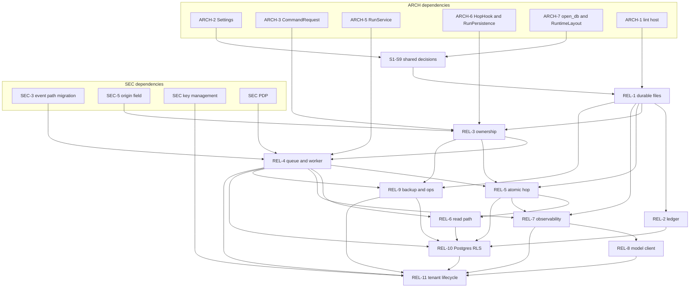

# Recertia REL workstream: implementation plan and specifications (REL-1 to REL-11)

**Status:** approved for implementation. This revision applies owner decisions D1 to D5 and the binding reconciliations below. It is the specification for the reliability, durability, scale-out, and tenant-lifecycle workstream.

**Owner:** REL. ARCH and SEC items are dependencies only. Their internals live in the ARCH and SEC specifications.

**Grounding:** line citations refer to the tree at the time of writing. Paths are relative to `src/recertia/` unless they start at the repository root (`contracts/`, `tests/`, `scripts/`, `docs/`).

**Shared names,** used exactly: `Settings`, `RuntimeLayout`, `RunsRootLayout`, `open_db`, `CommandExecutor`, `CommandRequest`, `ExecutionBackend`, `ExecutionConfig`, `GateRunner`, `CriterionRunner`, `HopHook`, `RunPersistence`, `RunService`, `JobService`, `PromotionService`, `EvalService`, `ProgramService`, `CheckpointReader`, `Principal`, `TenantId`, `PolicyDecisionPoint`, `RunLease`, `RunQueue`, `RecertiaError`.

**Sizing:** each item is sized by the subsystems and files it touches. Calendar effort is not estimated.

---

## Contents

1. Decisions applied
2. Cross-workstream references
3. Findings index
4. Shared decisions (S1 to S9)
5. REL-1 Durable file state
6. REL-2 Ledger concurrency and repair
7. REL-3 Run ownership
8. REL-4 Durable RunQueue, worker process, and fair claims
9. REL-5 Cross-store atomicity
10. REL-6 Read-path scalability
11. REL-7 Observability
12. REL-8 Model client resilience
13. REL-9 Backups and operations
14. REL-10 Multi-tenant control plane (committed)
15. REL-11 Tenant lifecycle and fairness
16. Consolidated configuration
17. Consolidated error and exit-code table
18. Regression-test map
19. Dependency graph
20. Rollout waves

---

## 1. Decisions applied

### Owner decisions

| ID | Decision | Effect on this spec |
|---|---|---|
| D1 | **Multi-tenant service.** Pooled control plane (stateless API replicas, Postgres with `tenant_id`, object storage) and isolated per-tenant execution. Single-node remains the development and self-host deployment. | REL-10 is a **committed phase**, in scope, and is not gated on a further ADR. It adds Postgres row-level security keyed on the per-connection setting `app.tenant_id`, connection-pool tenant binding, per-tenant fairness in claims, and a per-tenant ledger scope. **REL-11 Tenant lifecycle and fairness** is added: provisioning, per-tenant limits, export of every store (ledger, blobs, skills, and the rest), verified deletion with crypto-shred, noisy-neighbour controls (queue depth, in-flight, SSE caps, model spend caps), and per-tenant cost attribution. Every REL item states single-node and multi-node behaviour. |
| D2 | The `runs` scope may execute caller-supplied commands on the container backend and on the local backend. The `exec` scope is required only for a raw `script`. The local backend is **refused at startup** when `deployment_mode=multi_node`. | S7. The worker (REL-4), `/ready` (REL-7), and the executor client (REL-10) all enforce the refusal. `RECERTIA_API_ALLOW_LOCAL_EXEC` has no effect in multi-node mode. |
| D3 | Durability default is `normal`. | Confirmed in S3 and REL-1: fsync on atomic writes, fsync on each ledger append, batched fsync on JSONL, SQLite `synchronous=NORMAL`. |
| D4 | `/v1/runs` becomes async by default after one release. Callers that need a synchronous response use enqueue-and-wait. | REL-4 ships with `RECERTIA_API_DEFAULT_ASYNC=0`. The **release after REL-4 lands** flips the default to `1`. See section 20. |
| D5 | The CLI is a local operator principal with admin scopes. | S8. CLI commands build `Principal.local_operator()` and pass it as the ledger actor, the cancel actor, and the actor for repair, backup, and tenant administration. |

### Binding cross-spec reconciliations

| Topic | Binding shape | Where applied |
|---|---|---|
| Identity | `Principal` and `TenantId` live in `recertia/ports/identity.py`. Today's `Principal` is the frozen dataclass in `api/auth.py:29-32` (`key_id`, `tenant_id: str`, `scopes`). REL consumes the port type; SEC identity owns the move. | S8, every signature |
| Execution | `ExecutionBackend` is a `Literal` in `recertia/ports/execution.py`. Today the alias is `Backend = Literal["container", "local"]` in `solver/container.py:17`, read by `configured_backend()` at line 53 (`RECERTIA_EXECUTION_BACKEND`, default `"container"`). The port keeps that pair. The out-of-process daemon is `RemoteExecutor`, a `CommandExecutor` that holds the frozen `ExecutionConfig`, selected by `RECERTIA_EXECUTOR_MODE`. `run_id`, `owner_id`, `fencing_token`, and SEC-5 `origin` are **fields on `CommandRequest`**. There is no `ExecutionContext` type. | REL-3, REL-9, REL-10 |
| Run events | Path is `root/runs/<tenant>/run_events/<run_id>.jsonl`. SEC-3 owns the migration off the legacy locations. REL-4 and REL-6 call `RunsRootLayout.run_events_path`. The path is **not** `root/run_events/<tenant>/`. | REL-4, REL-6 |
| Layout | ARCH-7 defines two classes, `RuntimeLayout` and `RunsRootLayout`. REL requires `runtime_db`, `control_db`, `locks_dir`, `root_lock`, and `api_lock`. Tenant methods take `TenantId`. | S1 |
| Observability | Package is `recertia/observability/` (`logging.py`, `metrics.py`, `tracing.py`, `systems.py`). It is not `obs/`. | REL-7 |
| Errors | One base: `recertia/errors.py::RecertiaError`. REL runtime errors subclass it in `recertia/runtime/errors.py`. CLI exits are unified in section 17. `recertia ledger verify` keeps **0** (valid) and **2** (invalid). | S4, section 17 |
| Quota admission | The single admission point is `RunService.create` and `RunService.resume`. Daily quota comes from the quota repository. In-flight is **derived** from `RunQueue`, replacing the counter in `api/quotas.py:93-99`. | REL-4, REL-5, REL-11 |
| Authorization | `PolicyDecisionPoint` lives in `recertia/app/authz.py`. | REL-2, REL-4, REL-6, REL-11 |
| Golden gate | `golden_backend` default is `inherit`. | REL-4 eval jobs, S7 |

---

## 2. Cross-workstream references

| ID | Meaning in this spec |
|---|---|
| ARCH-1 | Guardrail framework that hosts the raw-write lint |
| ARCH-2 | `Settings`, typed configuration, startup validation |
| ARCH-3 | `CommandExecutor` port; `CommandRequest` and `ExecutionBackend` in `ports/execution.py` |
| ARCH-4 | Import-cycle break between graph, nodes, and solver |
| ARCH-5 | Application services (`RunService`, `JobService`, `EvalService`, `ProgramService`, `PromotionService`) and the `APIRouter` split |
| ARCH-6 | `HopHook` and `RunPersistence` |
| ARCH-7 | `open_db`, `RuntimeLayout` / `RunsRootLayout`, repository interfaces, one migrations directory |
| ARCH-8 | Low-severity maintainability. No REL item depends on it |
| SEC-3 | Tenant-keyed run events and cancel authorization. Owns the run-events path migration |
| SEC-5 | `CommandRequest.origin` |

Other SEC work is cited by topic. Each topic resolves to its ID in the SEC spec index.

| Topic label | Covers |
|---|---|
| SEC identity | `Principal`, `TenantId`, `Principal.local_operator()` |
| SEC exec gate | `runs` versus `exec`; raw `script` gating (`api/__init__.py:374-378` today) |
| SEC executor isolation | Container hardening, executor-service isolation, byte-capped output |
| SEC ledger signing | Signing and anchoring on the REL-2 `LedgerHook` |
| SEC PDP | Rules evaluated by `PolicyDecisionPoint` |
| SEC auth | API-key hashing, rate limits, audit sampling, key issue and revoke |
| SEC OIDC | OIDC flow, session cookie, contents of `oidc_pending` |
| SEC supply chain | Review of new dependencies (`cryptography`, `prometheus_client`, object-storage client) |
| SEC redaction | Log and error redaction |
| SEC key management | Review of the REL-11 envelope encryption and KMS choices |

---

## 3. Findings index

"Repro" means the failure was reproduced in review. Section 18 names the regression test for each one.

| ID | Finding | Evidence in the current tree | REL |
|---|---|---|---|
| F1 | Two writers fork the ledger. Repro message: `entry at position 31 has seq=30` (the format raised at `ledger/hashchain.py:143`). | `HashChainLedger` holds only a `threading.Lock` (`hashchain.py:54`). `append` (`106-123`) opens the file in `"a"` and writes one line. No `flock`, no `fsync`. Two processes each cache a tip from `_tip_unlocked` (`69-78`). | 2 |
| F2 | A torn tail makes every later `append` raise, and there is no repair command. | `_tip_unlocked` parses every line with `LedgerEntry.model_validate_json` (`80-88`). A partial last line fails validation inside the lock, so the chain cannot grow. | 2 |
| F3 | Tip lookup and `verify` rescan the whole file. `GET /v1/ledger/verify` (`api/console_library_routes.py:483-496`) constructs a ledger and calls `verify()` on every request, then `entries()` which scans again. | `hashchain.py:69-78`, `128-156` | 2 |
| F4 | State JSON is not an atomic replace. Repro: a torn `affordances.json` makes bootstrap raise `JSONDecodeError`. | `AffordanceStore._load` calls `json.loads` with no handler (`memory/affordance/__init__.py:84-92`). `save` uses `Path.write_text` (`120`). Wired at `bootstrap.py:220`. | 1, 5 |
| F5 | The job-quota sidecar fails open. Repro: a corrupt file reads as `{}`, so `tokens_spent=0`. The write uses a fixed `.tmp` sibling. `computer_use_tokens_spent` is dropped. | `QuotaSidecar.save` (`policy_load.py:90-100`) writes `tokens_spent`, `hex_tokens_spent`, `hex_jobs_by_class` only. `_read` (`102-109`) returns `{}` on `JSONDecodeError`. `JobQuota.computer_use_tokens_spent` exists (`contracts/policy.py:111`) and `charge` updates it (`167-169`), but the sidecar never persists it. `JobRunner._persist_quota` (`jobs/__init__.py:149-154`) is the only writer. | 1, 5 |
| F6 | Write-once files are guarded by `exists()`, so a torn file is kept forever. | `FilesystemBlobStore.put` (`store/blobs.py:52-54`). `EpisodicStore.write` (`memory/episodic/__init__.py:167-168`). `TranscriptStore.write` (`solver/transcript.py:54-58`) uses a fixed `dest.with_suffix(".tmp")`, so two writers share one temp name. `SkillStore.write_version` (`memory/procedural/store.py:73-81`) is `O_EXCL` and still has no `fsync`; a crash after `open` leaves a short file that then raises `ImmutabilityError` forever. | 1 |
| F7 | A pending operation is reclaimed after 5 seconds while its owner is still running. Repro: the tool calls were `['A','B']`. | `_PENDING_TIMEOUT_S = 5.0` (`graph/ops.py:24`). `run_once` reclaims when `time.monotonic() >= deadline` (`122-136`) with no owner identity. | 3 |
| F8 | Nothing enforces run ownership. Two resumes interleave, and `INSERT OR REPLACE` hides the conflict. | `resume_run` (`api/__init__.py:579-636`) takes a process-local semaphore and calls `orchestrator.resume` with no lease. `CheckpointStore.save` (`graph/store.py:44-51`) is `INSERT OR REPLACE` on `(run_id, seq)`. | 3 |
| F9 | `run_id` reuse survives a restart because the 409 check is the in-memory `runs` dict. Repro: the second script never ran, the output file stayed `FIRST`, and 14 checkpoint rows remained. | `create_run` (`api/__init__.py:382-385`) rejects only `run_key in runs`. After restart the dict is empty (`318`) and `start` appends more checkpoints into the same SQLite file (`graph/engine.py:80`). | 3 |
| F10 | The scratch solver calls the model outside `op_once`. Resume asks the model again, while the recorded result for that `op_seq` belongs to the previous command. | `nodes/solve_scratch.py:75-78` calls `ctx.model.complete` before `ctx.op_once(step, _run)` at line 126. The comment at line 93 states the consequence. The model spend is charged at `94-97` on every resume. | 3 |
| F11 | Two runs can share one workdir. No lock exists. | Create persists `workdir.json` with `write_text` (`api/__init__.py:176-188`) and never locks the directory. Resume reuses that path (`591-593`) with no exclusivity against a live owner. | 3 |
| F12 | The async worker is an in-process thread pool. Queued runs die with the process. In-flight counters leak because nothing resets them at startup. | `AsyncRunWorker` (`workers/run_worker.py:43-75`) uses `ThreadPoolExecutor` and a `_futures` dict. `QuotaStore.admit` increments `inflight` (`api/quotas.py:93-99`). `create_app` opens the store (`api/__init__.py:314`) and never zeroes `inflight`. | 4 |
| F13 | Cancellation is checked only before `orchestrator.start`. | `run_worker.py:87` and `116`. The comment at `115` says mid-node cancel lands later. `request_cancel` (`63-65`) only mutates a process-local set. | 4 |
| F14 | Sync runs, evals, and jobs hold API threads. | `create_run` calls `orchestrator.start` on the request thread (`api/__init__.py:502-522`) and turns failure into `HTTPException(500) from None` (`532`). `POST /v1/evals/runs` runs the suite inline (`api/remaining_routes.py:133-169`). Console job routes run inline (`api/console_library_routes.py:595-762`). | 4 |
| F15 | Run events are not tenant-scoped. | `ConsoleContext` builds `RunEventLog(root / "run_events")` (`api/console_deps.py:67`). `RunEventLog` documents `{runs_root}/events/{run_id}.jsonl` (`api/events.py:14`) and keys files by `run_id` only (`21-23`). The SSE route probes `ctx.root / "run_events" / f"{run_id}.jsonl"` (`console_library_routes.py:239`). | 4 (path migration owned by SEC-3) |
| F16 | Trajectory events are appended before the checkpoint, so a resume writes duplicates. | `GraphOrchestrator._step` calls `_emit_trajectory` then `checkpoints.save` (`graph/engine.py:411-420`). `_emit_trajectory` swallows every exception (`144`). `TrajectoryStore.append_many` (`trajectory/store.py:56-68`) assigns `seq` by counting lines and appends with no lock. | 5 |
| F17 | The eval observation is recorded after the finalize checkpoint, and exceptions are swallowed. | Finalize emits trajectory, saves the checkpoint, then calls `_record_eval_observation` (`graph/engine.py:357-368`). The hook swallows (`147-155`). `bootstrap._record_eval` (`194-208`) swallows `ObservationError` and every other `Exception`. | 5, 7 |
| F18 | Job quota is charged after `fn()` by a read-modify-write of the sidecar, so concurrent jobs lose updates and spend can pass the cap. | `JobRunner.run` calls `fn()` then `quota.charge` then `_persist_quota` (`jobs/__init__.py:141-147`). `build_job_runner` merges `runs/job_quota.json` (`185-186`). | 5 |
| F19 | Every attempt read-modify-writes the whole affordance file, so concurrent attempts lose updates. | `record_new_affordances` (`nodes/attempt.py:225-238`) calls `record_tool` / `record_conflict` and then `save()`, which rewrites the entire JSON document (`affordance/__init__.py:94-120`) under a process-local lock. | 5 |
| F20 | `ProgramStore.put` has no version check. Program idempotency is an in-memory dict. | `programs/store.py:43-69` is `INSERT ... ON CONFLICT DO UPDATE` of the whole payload. `ConsoleContext._program_idempotency: dict[str, str]` (`api/console_deps.py:64`) is empty after restart. | 5 |
| F21 | `list_runs` parses checkpoint state for every run it considers. Repro: 0.41 s at 500 runs and 1.25 s at 2,000. Facts, cases, and proposals are not paginated. | `list_runs` (`console_library_routes.py:128-181`) opens a `GraphOrchestrator` per request, lists every `run_id`, and calls `load_from_checkpoints`, which parses `state_json` (`api/__init__.py:754-770`). Cursor is a raw `run_id` compared with `>`. `GET /v1/proposals` (`console_library_routes.py:499`) takes `limit` and returns no cursor. | 6 |
| F22 | SSE replays the backlog and does not follow. | `RunEventLog.iter_sse` (`api/events.py:58-67`) yields current lines and returns. The route (`console_library_routes.py:226-245`) does not pass a byte offset and does not block. | 6 |
| F23 | Each request rebuilds the orchestrator: a git subprocess, a library fingerprint, an index rebuild check, and a new `ClaimScheduler`. | `bootstrap._git_head` (`58-72`), called from `build_run_manifest` (`92`). `build_default_orchestrator` fingerprints and maybe rebuilds (`152-158`) and constructs `ClaimScheduler()` (`177`) on every call. `create_run` and `resume_run` and `_load_from_checkpoints` each call this (`502`, `606`, `755`). | 6 |
| F24 | Each checkpoint stores the full `RunState`, so checkpoint bytes grow with the square of the hop count. | `CheckpointStore.save` writes `state.model_dump_json()` (`graph/store.py:44-51`). `history` parses every row (`77-84`). | 6 |
| F25 | In-process structures grow without bound: telemetry lists, the `runs` dict, `_futures`, the program-idempotency dict, and the OIDC dict. | `Telemetry.spans` and `.events` (`telemetry.py:52-54`) only append. `create_app` keeps `runs: dict` (`api/__init__.py:318`) and `get_run` inserts into it (`576`). `AsyncRunWorker._futures` (`run_worker.py:58, 74-75`) is never pruned. `console_deps.py:64`. `SessionStore._oidc` (`api/console_auth.py:127`, populated at `189`). | 6, 10 |
| F26 | The package has no operational logging. 500s are raised `from None` and never logged. `/health` is a synchronous handler that returns `{"status":"ok"}` without checking dependencies. There is no `/ready` and no metrics registry. | `api/__init__.py:361-363`, `532`, `620`. `telemetry.py` records in-process events and optionally OTel spans; it does not log. | 7 |
| F27 | The model client retries every exception, including 4xx, with a fixed backoff. It checks the timeout after the response has already been produced, and it discards responses that the provider will bill. No `Retry-After`. No circuit breaker. | `ModelClient.complete` (`solver/model.py:76-112`): bare `except Exception`, `time.sleep(retry_backoff_s * 2**attempt)` (`111`), timeout tested after `_complete_once` returns (`85-89`). `providers._http_json` (`solver/providers.py:26-53`) turns every `HTTPError` into `ProviderError` with the status only inside the message string, so the client cannot tell 400 from 503. Spend is added only on the success path (`90-92`), so a late-but-billed response is dropped. | 8 |
| F28 | Backups tar the live tree, so SQLite and WAL can be captured mid-write, and nothing verifies the archive. | `ops/backup.py:20-36` (`tar.add` of the live root). `restore_tree` (`39-64`) checks path escape and does not check hashes or `PRAGMA integrity_check`. | 9 |
| F29 | Containers have no Recertia labels, so a dead owner leaks them, and every command starts its own container. | `_container_run` (`solver/container.py:217-259`) sets `--name=rec-<16 hex>`, `--rm`, and resource flags. No `--label`. Timeout kills by name (`256-259`); process death does not. | 9 |
| F30 | Snapshots are full directory copies with no free-disk check. GC is purely age-based and can delete a snapshot an active run will restore. | `WorkspaceManager.snapshot` (`workspace/snapshot.py:44-54`) calls `_copy_tree_contained` with no `statvfs` check. `gc` (`81-111`) deletes by mtime. `retention.garbage_collect` (`retention.py:24-42`) and `cli/gc.py:14-27` pass that through. | 9 |
| F31 | There is no root lock, so restore can run while API and worker processes are live. | `restore_tree` (`ops/backup.py:39-64`) extracts into `dest` with no lock file. No `.lock` is created anywhere on the root. | 9 |
| F32 | The deployment can only run on one node: local SQLite and files, in-memory sessions, a random session-secret fallback, and an in-process scheduler. | `resolve_session_secret` returns `secrets.token_hex(32)` when the secret is unset and auth is not OIDC (`api/console_auth.py:73-83`). `SessionStore._oidc` is a process dict (`127`). Queue, leases, and quotas are local SQLite or memory (findings above). | 10 |
| F33 | Draining `RevokeQueue` races across processes. The lock is a `threading.Lock`, and drain rewrites the file. | `memory/procedural/lineage.py:143-171`. `enqueue` appends (`160-161`); `drain` reads all lines and `write_text`s the tail (`167-170`). | 1 |
| G1 | Tenants have no lifecycle. A tenant is a directory name plus the `tenant_id` column on an API key. | `tenant_runs_root` usage in `api/console_deps.py`; `Principal.tenant_id` (`api/auth.py:31`); `validate_tenant_id` allows any matching string. No `tenants` table. | 11 |
| G2 | Tenant data cannot be exported or deleted with a verification step. | No export/delete command. Ledger, blobs, skills, checkpoints, and events are separate trees. | 11 |
| G3 | No noisy-neighbour controls. The async pool is global FIFO. There is no per-tenant queue-depth cap, SSE cap, or model-spend cap. | `_MAX_IN_FLIGHT_RUNS` semaphore (`api/__init__.py` run slots, acquired at `491` and `598`). `AsyncRunWorker` has one pool (`run_worker.py:55`). Daily run and cost caps exist (`api/quotas.py:17-21`) and are process-global defaults, not a per-tenant row, and they do not cover queue depth, SSE, or model spend. | 4, 11 |
| G4 | No per-tenant cost attribution beyond the in-process `ModelSpend` dataclass and the daily `cost_usd` counter. | `telemetry.py` events require `tenant_id` (`68-71`) but are not a billing ledger. `ModelSpend` (`solver/model.py:27-32`) is per client instance. | 7, 11 |
| G5 | Storage has no tenant column that a pooled database could enforce. | `checkpoints` and `operations` primary keys omit `tenant_id` (`graph/store.py:28-36`, `graph/ops.py:50-57`). `QuotaStore.daily` has `tenant_id` (`api/quotas.py:45-51`) but no row security. Splitting by directory is the only isolation. | 10 |

---

## 4. Shared decisions

### S1. Storage layout and deployment modes

ARCH-7 owns both classes. The listing shows the members REL calls. The five accessors REL requires are marked.

```python
# recertia/runtime/layout.py — owned by ARCH-7. REL-required accessors marked REL.
class RuntimeLayout:
    root: Path                                   # .recertia, or the CLI --runs-root value
    control_db: Path                             # REL: root / "control.db"
    locks_dir: Path                              # REL: root / "locks"
    root_lock: Path                              # REL: root / ".lock"
    api_lock: Path                               # REL: root / "api.lock"

    def tenant(self, tenant: TenantId) -> RunsRootLayout: ...   # root / "runs" / str(tenant)
    def local_runs(self) -> RunsRootLayout: ...                 # legacy CLI: runs_root == root
    def tenants(self) -> Iterator[TenantId]: ...
    def sqlite_files(self) -> list[Path]: ...    # every SQLite file under root, for REL-9


class RunsRootLayout:
    parent: RuntimeLayout
    tenant: TenantId | None                      # None only for local_runs()
    runs_root: Path
    runtime_db: Path                             # REL: runs_root / "runtime.db"
    ledger_path: Path                            # runs_root / "ledger.jsonl"
    ledger_sidecar: Path                         # runs_root / "ledger.tip.json"
    run_events_dir: Path                         # runs_root / "run_events"   (SEC-3 migrates into this)
    jobs_root: Path                              # runs_root / "jobs"

    def run_events_path(self, run_id: str) -> Path: ...   # run_events_dir / f"{run_id}.jsonl"
    def jobs(self) -> RunsRootLayout: ...                 # jobs root, its own runtime.db
    def blob_root(self) -> Path: ...                      # runs_root / "blobs"
    def workspace(self, run_id: str) -> Path: ...         # parent.root / "workspaces" / tenant / run_id
```

**Single node** (`RECERTIA_DEPLOYMENT_MODE=single_node`, the default). One OS process family shares files under `root`.

- `runtime.db`, one per runs root, holds `checkpoints`, `operations`, `runs`, `run_leases`, `trajectory_events`, `trajectory_meta`, `route_entries`, `outbox`, and the affordance tables. It replaces the separate files opened today: `checkpoints.db` and `operations.db` (`graph/engine.py:80-81`). One file is what lets fencing, the checkpoint, operation completion, trajectory rows, and the outbox commit in one SQLite transaction (REL-5).
- `control.db`, one per root, holds `run_queue`, `workers`, `tenants`, `tenant_limits`, `tenant_sched`, `job_quota_week`, `job_quota_ledger`, `tenant_model_spend`, `tenant_usage_daily`, `maintenance`, `leader_leases`, `idempotency_keys`, and `sse_sessions`.
- Both use WAL, `busy_timeout=5000`, and `synchronous` from S3. Both are opened only through `open_db` (ARCH-7). `CheckpointStore` today sets `journal_mode=WAL` and leaves `synchronous` at the SQLite default (`graph/store.py:25-26`).

**Multi node** (`RECERTIA_DEPLOYMENT_MODE=multi_node`, the production multi-tenant service, D1).

| Single-node store | Multi-node store |
|---|---|
| `runtime.db` tables | Postgres schema `recertia`. Every tenant table has `tenant_id` and RLS (REL-10). |
| `control.db` tables | Postgres schema `recertia_ctl`. Reachable through the scheduler role. Tenant-scoped tables in this schema also have RLS. |
| `ledger.jsonl` per runs root | Postgres `recertia.ledger_entries` with `scope = tenant_id`, plus a `_system` scope (REL-10). |
| Run-events JSONL | Postgres `recertia.run_events` plus `LISTEN`/`NOTIFY` (REL-6, REL-10). |
| Blobs, case blobs, transcripts, skills, facts, snapshots | Object storage under `tenants/<tenant_id>/…`, encrypted with the tenant DEK (REL-10, REL-11). |
| Workspaces | Local to the executor, ephemeral (SEC executor isolation). |
| `api_keys.sqlite`, proposals, programs, registry, evals | Postgres tables with `tenant_id` and RLS (REL-10). |

`local_runs()` is the legacy CLI layout where `recertia run --runs-root .recertia` stores `ledger.jsonl` directly under the root (`cli/runs.py:304` uses `runs_root / "ledger.jsonl"`, while the API uses `root / "runs" / tenant / "ledger.jsonl"` via `console_library_routes.py:490` and `cli/policy_cmd.py`). `RuntimeLayout.local_runs()` keeps that CLI layout working. API servers always use `layout.tenant(tenant)`.

### S2. Lock primitive: `recertia.fsutil.locks`

`_skill_lock` (`memory/procedural/allocate.py:55-80`) moves here and becomes the only `flock` implementation. Callers in `allocate.py` become a wrapper.

```python
class LockBusy(RecertiaError):
    code = "lock_timeout"
    http_status = 503
    retryable = True
    exit_code = 6
    def __init__(self, path: Path, holder: str | None) -> None: ...

class LockHandle:
    path: Path
    def release(self) -> None: ...
    def write_holder(self, text: str) -> None: ...   # pwrite of a holder record; does not drop the lock

@contextmanager
def file_lock(
    path: Path,
    *,
    exclusive: bool = True,
    timeout_s: float | None = None,    # None blocks; 0 is try-lock
    poll_s: float = 0.05,
) -> Iterator[LockHandle]: ...          # raises LockBusy

def try_file_lock(path: Path, *, exclusive: bool = True) -> LockHandle | None: ...
```

Semantics:

- `flock` is on the open file description. Two descriptors in one process conflict, which is what makes two orchestrators in one process honest.
- A module-level `dict[str, threading.RLock]`, keyed by realpath, serialises threads in the same process before they call `flock`.
- The kernel releases the lock when the process dies. That is the single-node liveness signal `RunLease` uses (REL-3).
- Windows uses `msvcrt.locking` on byte 0, as `allocate.py:63-68` does today.
- NFS and SMB are unsupported. `/ready` (REL-7) reports not-ready when `statvfs` reports a remote filesystem type for `root`.

Multi-node equivalents (REL-10): run liveness is a session-level `pg_try_advisory_lock` on a dedicated connection; critical sections use `pg_advisory_xact_lock`; singletons use `LeaderLease`. File locks remain for executor-local workspaces.

### S3. Durability policy (D3: `normal` is the default)

`Settings.durability` is set by `RECERTIA_DURABILITY` to `strict`, `normal`, or `fast`.

| Policy | Atomic file replace | JSONL append | Ledger file | SQLite `synchronous` | Postgres `synchronous_commit` |
|---|---|---|---|---|---|
| `strict` | fsync file, then fsync the parent directory | fsync each append | fsync each append | `FULL` | `on` |
| `normal` (default) | fsync file, then fsync the parent directory | batched: fsync at most once per `RECERTIA_JSONL_FSYNC_INTERVAL_S` (default 1.0) and on close | fsync each append | `NORMAL` with WAL | `on` |
| `fast` | no fsync | no fsync | no fsync | `OFF` | `off` |

The ledger never drops below fsync-per-append unless the policy is `fast`. `fast` is for benchmarks and selected tests. S7 refuses it when `multi_node` is set.

`open_db` applies:

```sql
PRAGMA journal_mode=WAL;
PRAGMA busy_timeout=5000;
PRAGMA synchronous=NORMAL;   -- or FULL / OFF from the policy
PRAGMA foreign_keys=ON;
```

### S4. Error contract

REL errors subclass `recertia/errors.py::RecertiaError`. Subclasses live in `recertia/runtime/errors.py`.

```python
# recertia/errors.py — one base, shared with ARCH and SEC
class RecertiaError(Exception):
    code: ClassVar[str]
    http_status: ClassVar[int]
    retryable: ClassVar[bool]
    exit_code: ClassVar[int]
    def __init__(
        self,
        message: str,
        *,
        run_id: str | None = None,
        details: Mapping[str, object] | None = None,
        retry_after_s: float | None = None,
    ) -> None: ...
```

```python
# recertia/runtime/errors.py
class RunOwnershipError(RecertiaError): ...
class RunIdExists(RunOwnershipError):                 # code run_id_exists;            409; retryable False; exit 5
class IdempotencyMismatch(RunOwnershipError):         # code idempotency_mismatch;     409; retryable False; exit 5
class CheckpointConflict(RunOwnershipError):          # code checkpoint_conflict;      409; retryable False; exit 5
class ProgramConflict(RecertiaError):                 # code program_conflict;         409; retryable False; exit 5
# Note (2026-10-30): Superseded by REC-056c (2026-10-30): precondition_failed (412), PreconditionFailed; test renamed test_stale_if_match_is_precondition_failed. ProgramConflict above is replaced for a failed If-Match.
class OperationFingerprintMismatch(RunOwnershipError):# code op_fingerprint_mismatch; 409; retryable False; exit 5
class RunCancelled(RecertiaError):                    # code run_cancelled;            409; retryable False; exit 5
class RunBusy(RunOwnershipError):                     # code run_busy;                 409; retryable True;  exit 6
class WorkspaceBusy(RunOwnershipError):               # code workspace_busy;           409; retryable True;  exit 6
class LeaseLost(RunOwnershipError):                   # code lease_lost;               409; retryable True;  exit 6
class RootBusy(RecertiaError):                        # code root_busy;                503; retryable True;  exit 6
class LedgerLockTimeout(RecertiaError):               # code lock_timeout;             503; retryable True;  exit 6
class QuotaExceeded(RecertiaError):                   # code quota_exceeded;           429; retryable False; exit 4
class TenantLimitExceeded(RecertiaError):             # code tenant_limit_exceeded;    429; retryable True;  exit 4
class InvalidCursor(RecertiaError):                   # code invalid_cursor;           400; retryable False; exit 2
class PreconditionRequired(RecertiaError):            # code precondition_required;    428; retryable False; exit 2
class TenantNotFound(RecertiaError):                  # code tenant_not_found;         404; retryable False; exit 1
class TenantInactive(RecertiaError):                  # code tenant_inactive;          403; retryable False; exit 3
class StateCorrupt(RecertiaError):                    # code state_corrupt;            503; retryable False; exit 7
class LedgerUnavailable(RecertiaError):               # code ledger_unavailable;       503; retryable False; exit 7
class Maintenance(RecertiaError):                     # code maintenance;              503; retryable True;  exit 7
class ModelUnavailable(RecertiaError):                # code model_unavailable;        503; retryable True;  exit 7
class DiskSpaceLow(RecertiaError):                    # code disk_space_low;           503; retryable False; exit 7
class ExecutionUnavailable(RecertiaError):            # code execution_unavailable;    503; retryable False; exit 7
class TenantContextMissing(RecertiaError):            # code internal_error;           500; retryable False; exit 7
```

`api/quotas.py:13-14` defines a local `QuotaExceeded(Exception)`. REL-4 deletes that class and imports `runtime.errors.QuotaExceeded`. `ops/backup.py:11` `BackupError(ValueError)` becomes `StateCorrupt` or `RootBusy` as appropriate, with `BackupError` left as a deprecated alias for one release.

HTTP:

- `api/errors.py` keeps the body `{"error": {code, message, retryable, run_id?, details?, request_id?}}`.
- `v1_error` gains `details` and `retry_after_s`. A non-null `retry_after_s` sets the `Retry-After` header (integer seconds, rounded up).
- `_RETRYABLE_CODES` (`api/errors.py:12`) gains `run_busy`, `workspace_busy`, `lease_lost`, `root_busy`, `maintenance`, `model_unavailable`, `tenant_limit_exceeded`.
- One `@app.exception_handler(RecertiaError)` maps the hierarchy. It is registered at the ARCH-5 composition root. The handler logs via REL-7 before building the envelope. It does not use `from None`.

CLI exits (section 17):

| Exit | Meaning | Codes |
|---|---|---|
| 1 | not found | `tenant_not_found`, missing run, missing archive |
| 2 | invalid input | bad flags, `invalid_cursor`, `precondition_required`, and **ledger verify failure** |
| 3 | unauthorized or forbidden | `tenant_inactive`, missing scope |
| 4 | quota or rate | `quota_exceeded`, `tenant_limit_exceeded` |
| 5 | conflict | `run_id_exists`, `idempotency_mismatch`, `checkpoint_conflict`, `program_conflict`, `op_fingerprint_mismatch`, `run_cancelled` |
| 5 | note (2026-10-30) | Superseded by REC-056c (2026-10-30): `precondition_failed` (412), `PreconditionFailed`; test renamed `test_stale_if_match_is_precondition_failed`. It replaces `program_conflict` in the row above for a failed program `If-Match`. |
| 6 | busy | `run_busy`, `workspace_busy`, `lease_lost`, `root_busy`, `lock_timeout` |
| 7 | state or availability | `state_corrupt`, `ledger_unavailable`, `maintenance`, `model_unavailable`, `disk_space_low`, `execution_unavailable` |

`recertia ledger verify` stays on **0** (chain valid) and **2** (chain invalid or unreadable arguments). Today `cli/runs.py:307-309` exits **1** on `LedgerVerificationError`. REL-2 changes that exit to **2** so a broken chain is distinct from "run not found" (exit 1, `cli/runs.py:286`). Verify does not grow exits 3–7.

### S5. Migrations

ARCH-7 provides one migrations directory. REL adds four families:

- `migrations/runtime/NNN_*.sqlite.sql` for `runtime.db`
- `migrations/control/NNN_*.sqlite.sql` for `control.db`
- `migrations/pg/NNN_*.postgres.sql` for both multi-node schemas
- `migrations/pg/rls/NNN_*.postgres.sql` for policies and grants, kept separate so the REL-10 coverage check can parse them

Python data migrations live in `recertia/store/upgrade.py`, registered by id, and recorded in `schema_migrations`.

```text
recertia migrate status
recertia migrate apply [--root] [--dry-run]
recertia migrate rollback <upgrade-id>
recertia migrate export --to postgres --dsn ...     # REL-10
recertia migrate verify --dsn ...                   # REL-10
```

Status (#172): these `migrate` subcommands are planned, not shipped. The CLI ships only
`recertia migrate run-events`. Until `migrate apply` ships, and only once no process of an
older release uses this root, the import path is the `auto` open below (stay on `off`
otherwise), and `manual` names that procedure instead of a command.

`RECERTIA_RUNTIME_DB_MIGRATE`:

| Value | Behaviour |
|---|---|
| `auto` (single-node default) | Apply on first `open_db`, under the root lock shared and the tenant lock exclusive (REC-065). |
| `manual` | Refuse to start. CLI exits 7. API returns 503 `state_corrupt`. Shipped: `details.action` says that, only once no process of an older release uses this root, to reopen with `RECERTIA_RUNTIME_DB_MIGRATE=auto` and to retry on `root_busy`, and otherwise to stay on `RECERTIA_RUNTIME_DB_MIGRATE=off` (#172); `recertia migrate apply` once REL-10 ships it. |
| `off` | Legacy layout (`checkpoints.db` + `operations.db`) for one release only. Removed in the release after REL-3. |

Multi-node migrations run only as an explicit `recertia migrate apply` by the owner role. Application replicas never run DDL.

```sql
-- both databases
CREATE TABLE schema_migrations (
    id TEXT PRIMARY KEY,
    applied_at TEXT NOT NULL
);
```

### S6. Fault injection: `recertia/faults.py`

```python
class FaultInjected(RuntimeError): ...

def fault_point(name: str) -> None:
    """No-op unless RECERTIA_ALLOW_FAULTS=1 and name is listed in RECERTIA_FAULTS."""
```

Grammar: `RECERTIA_FAULTS="ledger.after_write_before_fsync:kill,checkpoint.before_commit:raise,atomic.before_replace:sleep=200"`.

| Action | Effect |
|---|---|
| `raise` | raise `FaultInjected` |
| `kill` | `os.kill(os.getpid(), SIGKILL)` |
| `sleep=<ms>` | sleep |

`RECERTIA_ALLOW_FAULTS=1` is refused in multi-node mode (S7). `scripts/security_review.py --check` gains a rule that every `fault_point(...)` argument is a string literal and that the allow flag is never defaulted on.

Named points:

```text
atomic.before_replace
atomic.after_replace
jsonl.mid_write
ledger.after_write_before_fsync
checkpoint.before_commit
checkpoint.after_commit
op.after_fn_before_complete
outbox.after_deliver_before_ack
quota.after_reserve
queue.after_claim
backup.mid_copy
tenant.delete.after_rows_before_shred
export.mid_section
```

### S7. Deployment modes and startup validation (D1, D2)

```python
DeploymentMode = Literal["single_node", "multi_node"]

def validate_deployment(
    settings: Settings,
    *,
    role: Literal["api", "worker", "cli", "executor"],
) -> None:
    """Raises ExecutionUnavailable or ConfigError. Called for every process role."""
```

`multi_node` startup fails closed:

| Rule | On violation |
|---|---|
| `execution.backend` (`ExecutionBackend`) is not `"local"`. `RECERTIA_API_ALLOW_LOCAL_EXEC` is ignored. Its presence is logged at warning. | `ExecutionUnavailable`, exit 7 |
| `RECERTIA_DB_BACKEND=postgres` and `RECERTIA_DATABASE_URL` is set. The URL's role is not the owner role (REL-10). | `ConfigError`, exit 2 |
| `RECERTIA_BLOB_STORE=s3` | `ConfigError`, exit 2 |
| `RECERTIA_CONSOLE_SESSION_SECRET` is set (at least 32 characters, the check already at `console_auth.py:76-77`). The random fallback at `console_auth.py:83` is not compiled into the multi-node path. | `ConfigError`, exit 2 |
| `RECERTIA_DURABILITY` is not `fast` | `ConfigError`, exit 2 |
| `RECERTIA_ALLOW_FAULTS` is not `1` | `ConfigError`, exit 2 |
| `RECERTIA_TENANT_ENCRYPTION=required` (REL-11) | `ConfigError`, exit 2 |
| The golden-gate backend, resolved through `inherit`, is the configured non-local backend. An explicit `local` gate backend is refused. | `ExecutionUnavailable`, exit 7 |

`single_node` keeps today's local backend behind the API break-glass (`RECERTIA_API_ALLOW_LOCAL_EXEC=1`, as `AGENTS.md` describes). CLI `--local-exec` (`cli/runs.py`) remains valid in single-node mode.

**D2 scope rule.** The `runs` scope may submit caller-supplied commands on container and on local. A raw `script` field requires `exec` or `admin`. That rule is owned by the SEC exec gate. The current check is `api/__init__.py:374-378`. REL code carries `origin` on `CommandRequest` and does not widen or narrow the rule.

`golden_backend` (`RECERTIA_GOLDEN_BACKEND`) is `Literal["inherit", "container", "local"]` with default `inherit`. `inherit` resolves to `Settings.execution_backend`.

### S8. Identity and tenancy plumbing

- `Principal` and `TenantId` come from `recertia/ports/identity.py`. `TenantId` is a `NewType` of `str` validated with the same expression as `_TENANT_ID_RE` (`api/auth.py:21`).
- Every REL repository method that reads or writes tenant data takes a `TenantId`, or runs inside a tenant-bound connection (REL-10).

```python
@dataclass(frozen=True)
class Principal:
    key_id: str
    tenant_id: TenantId
    scopes: frozenset[str]
    actor: str

    def has_scope(self, scope: str) -> bool: ...

    @staticmethod
    def local_operator(tenant: TenantId | None = None) -> Principal:
        """Admin scopes. actor is 'cli:<user>@<host>'. tenant defaults to TenantId('local')."""
```

**CLI (D5).** Every command builds `Principal.local_operator(tenant)` and passes it to services. It is the actor for ledger appends, `RunQueue.request_cancel`, tenant administration (REL-11), `ledger repair`, and backup/restore. Commands that address one tenant of a multi-tenant root take `--tenant`. The legacy `--runs-root` layout uses `local_runs()` and does not require `--tenant`.

**Tenant context.**

```python
# recertia/runtime/tenancy.py
current_tenant: ContextVar[TenantId | None]
def bind_tenant(tenant: TenantId) -> AbstractContextManager[None]: ...
```

`RunService`, `Worker`, and the ARCH-5 route dependencies set it. REL-10 repositories read it to bind the Postgres connection. A tenant repository call with no bound tenant raises `TenantContextMissing`. `telemetry._ACTIVE_TENANT` is set from the same context var so the two cannot diverge.

**Authorization.** Routes call `PolicyDecisionPoint` in `recertia/app/authz.py`:

```python
class PolicyDecisionPoint:
    def require(self, principal: Principal, action: str, resource: Resource) -> None: ...
    def allow(self, principal: Principal, action: str, resource: Resource) -> bool: ...
```

REL introduces these action names:

```text
runs.cancel
ledger.verify_full
ledger.repair
tenants.admin
tenants.export
tenants.delete
queue.admin
backup.admin
```

### S9. Turning each reproduction into a regression test

The full map, including findings that were not given a one-line repro, is section 18. The tests named there are the acceptance tests for the reproduced bugs. They are listed again inside the item that owns them.

---

## 5. REL-1 Durable file state

### Findings

F4, F5, F6, F33. F5's fail-open read and dropped `computer_use_tokens_spent` field are fixed here for the file format; the reserve-then-settle protocol is REL-5.

### Goal

Every durable file under a runs root is written by one of three primitives: atomic replace, write-once, or a locked JSONL appender. A crash leaves either the previous complete document or a new complete document. Torn JSON is quarantined or rejected according to the file class. `RevokeQueue.drain` is safe across processes. A lint rule stops new raw writes from landing.

### Non-goals

- Replacing SQLite or the ledger with these helpers. SQLite stays on its own durability settings (S3). The ledger uses the JSONL appender and adds chain rules in REL-2.
- Changing the on-disk schema of skill `version.json` beyond fsync and torn-file recovery.
- Encrypting files. That is REL-11.

### Design

#### Primitives (`recertia/fsutil/atomic.py`, `recertia/fsutil/jsonl.py`)

```python
class FileClass(StrEnum):
    FAIL_CLOSED = "fail_closed"          # refuse to serve a default; raise StateCorrupt
    QUARANTINE_REBUILD = "quarantine"    # move the torn file aside, start empty, log
    WRITE_ONCE = "write_once"
    APPEND = "append"

class Durability:
    fsync_file: bool
    fsync_dir: bool

def durability_from_settings(settings: Settings) -> Durability: ...

def atomic_write_bytes(
    path: Path,
    data: bytes,
    *,
    durability: Durability,
    mode: int = 0o600,
) -> None:
    """mkstemp in the same directory, write, fsync, os.replace, fsync the directory."""

def atomic_write_text(path: Path, text: str, *, durability: Durability, mode: int = 0o600) -> None: ...
def atomic_write_json(path: Path, payload: object, *, durability: Durability, mode: int = 0o600) -> None:
    """json.dumps(sort_keys=True, separators=(',', ':'), ensure_ascii=False) + newline."""

def write_once_bytes(
    path: Path,
    data: bytes,
    *,
    durability: Durability,
    mode: int = 0o600,
) -> bool:
    """Return True if this call wrote the file, False if a byte-identical file was already there.

    Publish by link/replace onto `path` only after fsync. If `path` exists and its bytes
    differ, move it to the quarantine directory and raise StateCorrupt (class FAIL_CLOSED
    content) — callers that are content-addressed pass expected_sha256 and then rewrite
    only when the existing file is absent or quarantined as torn (short, or hash mismatch
    with a trailing-partial detector). A matching hash is success.
    """

def read_json_document(
    path: Path,
    *,
    file_class: FileClass,
    quarantine_dir: Path,
) -> object | None:
    """None means missing or quarantined-rebuild. FAIL_CLOSED raises StateCorrupt."""
```

Atomic replace algorithm, matching D3:

1. `tempfile.mkstemp(dir=path.parent, prefix=f".{path.name}.", suffix=".tmp")`. The name is unique. This removes the shared `dest.with_suffix(".tmp")` race in `solver/transcript.py:56` and `policy_load.py:98`.
2. Write all bytes. `fsync` the fd when `durability.fsync_file` (true for `strict` and `normal`).
3. `fault_point("atomic.before_replace")`.
4. `os.replace(tmp, path)`.
5. Open the parent directory and `fsync` it when `durability.fsync_dir`.
6. `fault_point("atomic.after_replace")`.
7. On any exception before replace, unlink the temp file.

`write_once_bytes` uses the same temp file, then `os.link` when available and `os.replace` otherwise. If the destination appears between link and the existence check, the writer compares SHA-256. Equal hashes count as success. A short file (size not equal to `len(data)`) is treated as torn: it is moved to `quarantine_dir` and the publish is retried once.

#### Quarantine policy by file class

Quarantine directory: `runs_root / "quarantine" / <utc-compact> / <relative-path>`. The move is `os.replace`. A one-line `reason.json` records `error`, `size`, and `sha256`.

| Class | On torn or invalid JSON | Examples |
|---|---|---|
| `FAIL_CLOSED` | Quarantine the bad file. Raise `StateCorrupt`. Do not substitute zeros or `{}`. | `job_quota.json` (F5), `workdir.json`, facts, skill `status.json` / `stats.json`, lineage index, program exports, ledger sidecar |
| `QUARANTINE_REBUILD` | Quarantine, log `state.quarantined`, continue with an empty document. These stores are documented as rebuildable. | `affordances.json` (the module docstring says T0 rebuildable from the run store), episodic cluster JSON, telemetry dashboard JSON, soak reports |
| `WRITE_ONCE` | Torn (short, or hash does not match the address): quarantine and allow the writer to republish. Intact and hash-matching: keep. Intact and hash-mismatching for a content-addressed name: `StateCorrupt` (the name lied). | blobs, transcript JSON, episodic case blobs, `version.json` |
| `APPEND` | A trailing partial line is ignored by the reader (REL-2 defines this for the ledger; the JSONL reader uses the same rule). A corrupt line that is not at EOF is `StateCorrupt` for `FAIL_CLOSED` logs and is quarantined-and-skipped for rebuildable logs. | see the append inventory |

`affordances.json` is `QUARANTINE_REBUILD` because `AffordanceStore` is derived (module docstring, `memory/affordance/__init__.py:1-6`). That is what makes the F4 repro succeed at bootstrap: `_load` quarantines and starts empty instead of raising `JSONDecodeError`. `job_quota.json` is `FAIL_CLOSED`: `_read` must not return `{}` (`policy_load.py:107-108`). A corrupt sidecar raises `StateCorrupt` with `details.path`. The operator restores from backup or deletes the file deliberately. Serving `tokens_spent=0` is the bug.

#### JSONL appender (`recertia/fsutil/jsonl.py`)

```python
class JsonlAppender:
    def __init__(self, path: Path, *, durability: Durability, batch_interval_s: float = 1.0) -> None: ...
    def append(self, line: bytes) -> None:
        """Exclusive flock, write one newline-terminated record, optional batched fsync."""
    def append_many(self, lines: Sequence[bytes]) -> None: ...
    def close(self) -> None: ...          # fsync if a batch is open

class JsonlRewriter:
    """For the rare whole-file rewrite (RevokeQueue tail). Holds the same flock."""
    def rewrite(self, path: Path, lines: Sequence[bytes], *, durability: Durability) -> None: ...
```

- The lock is `file_lock(path.with_suffix(path.suffix + ".lock"))` so the lock file is distinct from the data file and a reader can open the data file without blocking on Windows byte-range locks.
- `append` writes with one `os.write` of `line + b"\n"` when `line` does not already end in newline. `fault_point("jsonl.mid_write")` sits between write and fsync.
- Under `normal`, the appender records the last fsync time and fsyncs when `batch_interval_s` has elapsed, and always on `close`. Under `strict`, every append fsyncs. The ledger (REL-2) passes a flag `fsync_each=True` that ignores the batch interval.
- Readers use `iter_complete_lines(path) -> Iterator[bytes]`, which drops a trailing partial line (no terminating newline, or a short read at EOF).

#### RevokeQueue (F33)

`RevokeQueue.enqueue` and `drain` (`lineage.py:152-171`) take the JSONL lock. `drain` holds it across the read and the rewrite:

```python
class RevokeQueue:
    def enqueue(self, *, source_kind: str, source_id: str, reason: str) -> None: ...
    def drain(self, limit: int) -> list[dict]: ...
```

`drain` reads complete lines under the lock, rewrites the tail with `JsonlRewriter` (atomic replace of the data file while the lock is held), then parses. A crash mid-rewrite leaves the previous file. Two processes cannot both take the same prefix. The in-process `threading.Lock` remains as the thread mutex inside `file_lock`.

#### Writer inventory

Every row moves to the primitive named in the last column. "Keep" means the call site is already `O_EXCL` or `mkstemp` and only gains fsync plus the shared helper.

| Path | Lines | Current write | Class | Primitive |
|---|---|---|---|---|
| `memory/affordance/__init__.py` | 120 | `write_text` of the whole document | quarantine | `atomic_write_json` |
| `policy_load.py` `QuotaSidecar.save` | 98-100 | fixed `.tmp` then `replace`, no fsync | fail-closed | `atomic_write_json`; payload gains `computer_use_tokens_spent` |
| `memory/episodic/clusters.py` | 49 | fixed temp + replace | quarantine | `atomic_write_json` |
| `memory/procedural/lineage.py` index flush | 85 | temp + replace | fail-closed | `atomic_write_json` |
| `memory/procedural/lineage.py` edge log | 96, 140 | append and full rewrite | append | `JsonlAppender` / `JsonlRewriter` |
| `memory/procedural/lineage.py` `RevokeQueue` | 160, 170 | append and full rewrite | append | `JsonlAppender` / `JsonlRewriter` under one lock |
| `memory/procedural/store.py` `write_version` | 73-81 | `O_EXCL`, no fsync | write-once | `write_once_bytes` |
| `memory/procedural/store.py` status and stats | 166, 201 | `write_text` | fail-closed | `atomic_write_json` |
| `memory/procedural/patch_templates.py` | 21 | `write_text` | write-once | `write_once_bytes` |
| `memory/procedural/promote.py` | 99 | `write_text` report | quarantine | `atomic_write_json` |
| `memory/semantic/__init__.py` | 162, 262, 269 | `write_text` fact documents | fail-closed | `atomic_write_json` |
| `memory/semantic/__init__.py` queue | 270 | append | append | `JsonlAppender` |
| `memory/episodic/__init__.py` | 168, 169 | `exists` then `write_bytes`; append index | write-once + append | `write_once_bytes`; `JsonlAppender` |
| `store/blobs.py` | 53-54 | `exists` then `write_bytes` and a sibling `.type` file | write-once | `write_once_bytes` for both, type file first |
| `solver/transcript.py` | 56-58 | fixed `.tmp` | write-once | `write_once_bytes` |
| `mea/store.py` | 31 | `write_text` | fail-closed | `atomic_write_json` |
| `api/__init__.py` `_persist_workdir` | 188 | `write_text` | fail-closed | `atomic_write_json` |
| `review/__init__.py` | 47, 149 | append queue; `write_text` decision | append; fail-closed | `JsonlAppender`; `atomic_write_json` |
| `nodes/distill.py` | 327 | append | append | `JsonlAppender` |
| `jobs/proposals_log.py` | 47 | append | append | `JsonlAppender` |
| `jobs/workers.py` | 323, 473 | `write_text` | fail-closed | `atomic_write_json` |
| `evals/golden.py` | 83 | `write_text` | fail-closed | `atomic_write_json` |
| `evals/probes.py` | 82 | `write_text` | quarantine | `atomic_write_text` |
| `workspace/offload.py` | 70 | `write_text` handle | fail-closed | `atomic_write_json` |
| `distill/failure_clusters.py` | 104 | `write_text` marker | write-once | `write_once_bytes` |
| `trajectory/import_store.py` | 92 | `write_text` | fail-closed | `atomic_write_json` |
| `trajectory/store.py` | 44, 62 | `write_text` meta; append events | fail-closed; append | `atomic_write_json`; `JsonlAppender`. REL-5 moves the source of truth to SQLite; the helper still covers the file until that cutover |
| `telemetry.py` | 129, 194 | append spans; `write_text` dashboard | append; quarantine | `JsonlAppender`; `atomic_write_json` |
| `ops/soak.py` | 224 | `write_text` | quarantine | `atomic_write_json` |
| `ledger/hashchain.py` | 119 | append | append, fsync each | REL-2 owns this call site; it must use `JsonlAppender(..., fsync_each=True)` |
| `api/events.py` | 35 | append under a `threading.Lock` only | append | `JsonlAppender`. SEC-3 moves the directory; REL-1 changes the write |

CLI commands that write an operator-chosen output path (`cli/canary_cmd.py:63`, `cli/metrics_cmd.py:51`, `cli/probes.py:60`, `cli/systems_cmd.py:51`, `cli/tabletop_cmd.py:40`) use `atomic_write_text` when the destination is inside a runs root, and a plain write when it is an explicit stdout-style export path outside the root. `solver/handlers.py:56` writes inside a sandbox workdir (user workspace content) and stays a direct write. `nodes/fan_out.py` and `nodes/join.py` copy workspace files and stay direct copies; they are not control-plane state. `jobs/arxiv_pdf.py` writes download caches and uses `atomic_write_bytes`.

#### Lint guard

`scripts/check_raw_writes.py` (ARCH-1 hosts it; REL-1 adds the script and the CI invocation already used by the other `scripts/* --check` tools):

- Walk `src/recertia/**/*.py`.
- Flag `Path.write_text`, `Path.write_bytes`, `open(..., "w")`, `open(..., "a")`, `open(..., "x")` outside `recertia/fsutil/`.
- Allowlist, file-and-line, checked in: `solver/handlers.py` (sandbox workspace), `nodes/fan_out.py`, `nodes/join.py`, and tests.
- A new call site fails CI until it uses a primitive or is added to the allowlist with a one-line reason.

### Files

| Action | Path |
|---|---|
| add | `src/recertia/fsutil/__init__.py`, `atomic.py`, `jsonl.py`, `locks.py` |
| add | `scripts/check_raw_writes.py` |
| edit | every row in the inventory |
| edit | `memory/procedural/allocate.py` to call `file_lock` |
| add | `tests/unit/fsutil/test_atomic_write.py`, `test_jsonl_appender.py`, `test_write_once.py` |
| add | `tests/unit/memory/test_affordance_durability.py`, `test_revoke_queue_drain.py` |
| add | `tests/unit/jobs/test_job_quota_durability.py`, `tests/unit/store/test_blob_write_once.py` |
| edit | `.github/workflows/ci.yml` to run `python3 scripts/check_raw_writes.py --check` |

### Data migration

No table rewrite. On first read, `read_json_document` quarantines a torn file in place. `QuotaSidecar.save` starts writing `computer_use_tokens_spent`. Old sidecars that lack the key load it as `0` only when the JSON parses; a parse failure is `StateCorrupt`. That is a one-release compatible read. Operators with a corrupt sidecar they know is disposable delete it; the next save creates a fresh week document from `JobQuota` caps (the caps still come from policy, the spend stays 0 only because the file was removed on purpose).

`RECERTIA_RUNTIME_DB_MIGRATE=off` does not affect REL-1. File helpers are unconditional.

### Test plan

| Test | Asserts |
|---|---|
| `tests/unit/fsutil/test_atomic_write.py::test_replace_is_atomic_under_kill` | `atomic.before_replace:kill` leaves the previous document intact and no temp file |
| `tests/unit/fsutil/test_atomic_write.py::test_dir_fsync_called_for_normal` | monkeypatched `os.fsync` sees the file and the directory under `normal`, and neither under `fast` |
| `tests/unit/fsutil/test_jsonl_appender.py::test_two_processes_no_torn_or_merged_lines` | concurrent appenders produce N valid JSON lines |
| `tests/unit/fsutil/test_jsonl_appender.py::test_partial_tail_ignored` | a reader stops before a line with no newline |
| `tests/unit/fsutil/test_write_once.py::test_matching_hash_is_noop` | second put does not rewrite |
| `tests/unit/memory/test_affordance_durability.py::test_torn_affordances_json_quarantined_bootstrap_succeeds` | **F4 repro.** Truncate `affordances.json` mid-file. `build_default_orchestrator` returns. The torn file is under `quarantine/`. The new store is empty. |
| `tests/unit/jobs/test_job_quota_durability.py::test_corrupt_sidecar_fails_closed` | **F5 repro.** `QuotaSidecar.merge` on `{` raises `StateCorrupt`. It does not return a quota with `tokens_spent=0`. |
| `tests/unit/jobs/test_job_quota_durability.py::test_computer_use_tokens_survive_reload` | **F5 repro.** Save a `JobQuota` with `computer_use_tokens_spent=7`, merge, observe 7. |
| `tests/unit/store/test_blob_write_once.py::test_torn_blob_detected_and_rewritten` | **F6 repro.** Plant a short file at the content-addressed path. `put` quarantines it and writes the full bytes. A subsequent `get` returns the original payload. |
| `tests/unit/memory/test_revoke_queue_drain.py::test_two_process_drain_no_loss_no_dup` | **F33 repro.** Two processes drain a 1_000-line queue. The multiset of items equals the enqueued multiset. |
| `tests/unit/scripts/test_check_raw_writes.py::test_inventory_is_clean` | `check_raw_writes.py --check` exits 0 on the tree after the migration |

### Risks

- Directory fsync on some virtual filesystems is a no-op. `/ready` warns; it does not pretend otherwise.
- `O_EXCL` skill versions that are already torn stay torn until a reader calls `write_once_bytes`, which quarantines only when a writer retries that version. REL-1 adds `SkillStore.audit_version_files()` and `recertia skills audit` invokes it. A torn `version.json` is quarantined and reported; it is not silently rewritten, because the version number is immutable (ADR-0007). The operator re-runs the job that produced it.
- Batching JSONL fsync means a crash can drop the last second of non-ledger logs. The ledger does not use the batch path.

### Dependencies

ARCH-7 for `RuntimeLayout` paths used as quarantine roots (REL-1 can take a `Path` until ARCH-7 lands; the helper signatures do not mention layout). ARCH-1 to host the lint. S3 durability enum from ARCH-2 `Settings`.

### PR slicing

| PR | Touches | Lands |
|---|---|---|
| REL-1a | `fsutil/` primitives, locks, unit tests, fault points | behaviour-neutral; no call-site migration |
| REL-1b | inventory migration, affordance and quota fail-closed/quarantine tests | F4, F5, F6 closed |
| REL-1c | `RevokeQueue` and lineage rewriter, `check_raw_writes.py`, CI hook | F33 closed; lint prevents regression |

### Configuration

| Key | Default | Meaning |
|---|---|---|
| `RECERTIA_DURABILITY` | `normal` | S3 |
| `RECERTIA_JSONL_FSYNC_INTERVAL_S` | `1.0` | batch interval for non-ledger JSONL under `normal` |
| `RECERTIA_QUARANTINE_DIR` | `<runs_root>/quarantine` | override for tests |

---

## 6. REL-2 Ledger concurrency and repair

### Findings

F1, F2, F3.

### Goal

Concurrent appenders, including multiple processes, produce one chain with contiguous `seq`. A torn tail is repairable by an audited truncate. Verify can use a verified sidecar and scan only the new suffix. SEC-6 can sign entries through a hook without forking the writer.

### Non-goals

- Changing `LedgerEntry` field semantics other than adding the `ledger_repaired` action.
- Anchoring or signing. SEC ledger signing implements `LedgerHook`.
- Moving the file ledger to Postgres. That is REL-10; the hook and the repair action exist on both backends.

### Design

#### Append critical section

`HashChainLedger.append` (`hashchain.py:95-123`) becomes:

```python
class LedgerHook(Protocol):
    def before_append(self, entry: LedgerEntry) -> LedgerEntry:
        """Return the entry to hash. SEC-6 may add a signature inside evidence."""
    def after_append(self, entry: LedgerEntry) -> None: ...

class HashChainLedger:
    def __init__(
        self,
        path: Path | str,
        *,
        durability: Durability | None = None,
        hook: LedgerHook | None = None,
        lock_timeout_s: float = 5.0,
    ) -> None: ...

    def append(self, *, actor: str, action: LedgerAction, target: str,
               evidence: dict | None = None, at: datetime | None = None) -> LedgerEntry: ...
    def verify(self, *, full: bool = False) -> VerifyReport: ...
    def repair_torn_tail(self, *, actor: str, dry_run: bool = False) -> RepairReport: ...
```

`append` holds `file_lock(ledger_path + ".lock", timeout_s=lock_timeout_s)` for the whole read-tip / write / fsync sequence. On timeout it raises `LedgerLockTimeout` (exit 6). Inside the lock:

1. Seek to the sidecar's `size` if the sidecar verifies (below); otherwise scan.
2. Re-read the last complete line from the file (tail re-read). If the last complete entry's `(seq, entry_hash)` disagrees with memory, rescan. This closes the stale-cache window that F1 exploits: the `threading.Lock` in `hashchain.py:54` does not coordinate processes, and the `(size, mtime_ns)` cache (`55-56`, `72-73`) can observe a size before the other process's write is visible as a complete line.
3. If the file ends with a partial line, raise `LedgerUnavailable` naming `recertia ledger repair --truncate-torn-tail`. Do not append after a torn tail (F2).
4. Build the draft at `seq = tip_seq + 1` (the current code uses `len(entries)` as the next seq, `hashchain.py:75`, which matches "seq starts at 0").
5. `entry = hook.before_append(draft)` if a hook is set, then set `entry_hash = compute_entry_hash(entry)`.
6. Write the canonical line through `JsonlAppender` with `fsync_each=True` unless durability is `fast`.
7. `fault_point("ledger.after_write_before_fsync")` between write and fsync.
8. Update the sidecar (below) and `hook.after_append`.

The in-process `threading.Lock` stays, inside the file lock, so threads do not deadlock on non-reentrant flock.

#### Tail re-read

```python
def read_tail(path: Path) -> tuple[LedgerEntry | None, int]:
    """Return (last complete entry, byte length of the complete prefix).

    A trailing partial line is excluded from the length. A complete line that
    does not parse raises LedgerUnavailable.
    """
```

`read_tail` reads at most the last 1 MiB, scanning backward for the penultimate newline. If the last record is larger than 1 MiB it reads further. It does not parse the prefix.

#### Repair

```text
recertia ledger repair --truncate-torn-tail [--runs-root PATH] [--tenant TENANT] [--dry-run]
```

The command requires `PolicyDecisionPoint.require(principal, "ledger.repair", resource)`. The CLI principal is `Principal.local_operator()` (D5).

Algorithm, under the ledger flock:

1. `read_tail`. If there is no partial trailing bytes, exit 0 and report `already_clean`.
2. Compute `keep = complete_prefix_length`. Verify the complete prefix with the existing hash rules (`verify` loop, `hashchain.py:140-156`).
3. On `--dry-run`, print the byte count that would be dropped and exit 0.
4. `fault` not required. Copy the partial suffix into `quarantine/` (REL-1).
5. Truncate the file to `keep` and fsync.
6. Append one entry with action `ledger_repaired`, target `ledger:<path>`, evidence `{dropped_bytes, prefix_sha256, prefix_entries, reason: "torn_tail"}`. That append uses the normal `append` path so it is itself chained.
7. Rewrite the sidecar.

`LedgerAction` in `contracts/ledger.py:17-34` gains `"ledger_repaired"`. Schema regeneration (`scripts/generate_schemas.py`) is part of the implementing PR. This specification does not run it.

A torn tail in the middle of the file (a valid-looking line whose hash does not match) is not truncated. Repair refuses with exit 7 `ledger_unavailable` and tells the operator to restore from backup. Truncation is only for a partial EOF.

#### Verified sidecar

`ledger.tip.json`, written with `atomic_write_json` (class `FAIL_CLOSED`):

```json
{
  "entries": 120,
  "next_seq": 120,
  "tip_hash": "<64 hex>",
  "prefix_bytes": 48123,
  "prefix_sha256": "<64 hex of the first prefix_bytes>",
  "durability": "normal"
}
```

On open, if the file's first `prefix_bytes` hash to `prefix_sha256` and the file length is `>= prefix_bytes`, the tip is trusted and only the suffix is parsed. Any mismatch discards the sidecar and does a full scan, then rewrites the sidecar. `verify(full=False)` uses the same check and then verifies only the suffix against `tip_hash`. `verify(full=True)` always rescans. The console route (`console_library_routes.py:483-496`) calls `verify(full=False)` and requires scope `runs`. `verify(full=True)` requires action `ledger.verify_full`.

`VerifyReport` is `{ok, entries, full, suffix_entries, tip_hash}`. CLI prints one line and exits 0 or 2.

#### Incremental verify

```python
@dataclass(frozen=True)
class VerifyReport:
    ok: bool
    entries: int
    full: bool
    suffix_entries: int
    tip_hash: str
```

The full-scan loop stays byte-for-byte the same predicates as `hashchain.py:140-156` (contiguous `seq` from 0, `prev_hash` link, recomputed `entry_hash`). Incremental mode runs that loop on the suffix only, starting from the sidecar tip.

#### Postgres (REL-10 preview, implemented there)

The same `append` method on `PostgresLedger` inserts one row in a transaction that takes `pg_advisory_xact_lock(scope_hash)`, allocates `seq` as `max(seq)+1` for that `scope`, and stores `prev_hash`. The hook runs before insert. Repair of a file tail does not apply; the Postgres store has no torn line. `ledger repair` on a Postgres backend returns `already_clean`.

#### State machine (file ledger)

```text
CLEAN --append--> CLEAN
CLEAN --crash mid-write--> TORN_TAIL
TORN_TAIL --append--> refused (LedgerUnavailable)
TORN_TAIL --repair --truncate-torn-tail--> CLEAN  (and one ledger_repaired entry)
CLEAN --hash mismatch in the middle--> CORRUPT
CORRUPT --repair--> refused (restore from backup)
```

### Files

| Action | Path |
|---|---|
| edit | `src/recertia/ledger/hashchain.py` |
| edit | `contracts/ledger.py` (`LedgerAction`) |
| edit | `src/recertia/cli/runs.py` `ledger_verify` exit code; add `ledger repair` |
| edit | `api/console_library_routes.py` verify route to use `VerifyReport` and the sidecar |
| add | `src/recertia/ledger/repair.py`, `src/recertia/ledger/sidecar.py` |
| add | `tests/runtime/test_ledger_concurrency.py`, `tests/unit/cli/test_ledger_repair.py` |
| edit | `tests/unit/test_ledger.py` for the new exit code and hook |

### Data migration

Existing `ledger.jsonl` files stay valid. The sidecar is created on the next append or the next verify. No historical rewrite. Readers that do not know `ledger_repaired` will fail closed on a repaired chain until they upgrade; the action is added before repair is exposed, in the same PR.

CLI default path remains `runs_root / "ledger.jsonl"` for `local_runs()`. With `--tenant`, the path is `layout.tenant(tenant).ledger_path`.

### Test plan

| Test | Asserts |
|---|---|
| `tests/runtime/test_ledger_concurrency.py::test_parallel_appends_two_instances_keep_chain_valid` | **F1 repro.** Two `HashChainLedger` objects in two threads append 200 entries. `verify(full=True)` passes. `seq` is `0..399`. |
| `tests/runtime/test_ledger_concurrency.py::test_parallel_appends_four_processes_keep_chain_valid` | **F1 repro.** Four processes. The error string `entry at position` does not appear. |
| `tests/unit/cli/test_ledger_repair.py::test_repair_truncates_torn_tail_and_records_ledger_repaired` | **F2 repro.** Append 10 entries, write 40 extra bytes, `append` raises `LedgerUnavailable`, repair truncates, the next append succeeds, the last action is `ledger_repaired`, `verify` exits 0. |
| `tests/unit/cli/test_ledger_repair.py::test_repair_refuses_mid_file_corruption` | Flip a byte in entry 3. Repair exits 7 and the file length is unchanged. |
| `tests/unit/cli/test_ledger_repair.py::test_verify_exit_code_is_2` | Invalid chain exits 2, valid chain exits 0. |
| `tests/unit/ledger/test_sidecar.py::test_verify_scans_suffix_only` | After a trusted sidecar, a counting parser sees only the new lines when `full=False`. |
| `tests/unit/ledger/test_hook.py::test_before_append_can_add_evidence` | Hook-added evidence is inside the hashed payload. |

### Risks

- Fsync-per-append caps ledger write rate. That is the D3 choice. Batching the ledger is out of policy for `normal`.
- A sidecar that is trusted incorrectly would hide corruption. The prefix SHA-256 covers the trusted byte range, so a flipped historical byte fails the check and forces a full scan.
- Repair itself appends. A crash between truncate and the `ledger_repaired` append leaves a clean shorter chain. The next repair is `already_clean`. The quarantine copy of the torn bytes remains as evidence. The `ledger_repaired` entry is best-effort relative to the truncate; the operator can see a missing repair entry by comparing quarantine time to the chain. REL-2 accepts that window rather than writing the repair entry before truncate (which would hash a chain that still contained the torn bytes).

### Dependencies

REL-1 (`JsonlAppender`, `file_lock`, quarantine, `atomic_write_json`). ARCH-2 for `Durability`. SEC identity for the repair actor. SEC ledger signing consumes `LedgerHook` and does not block REL-2.

### PR slicing

| PR | Touches |
|---|---|
| REL-2a | flock, tail re-read, fsync-each, concurrency tests (F1) |
| REL-2b | repair command, `ledger_repaired`, verify exit 2, torn-tail tests (F2) |
| REL-2c | sidecar, incremental verify, `LedgerHook`, console route (F3) |

### Configuration

| Key | Default | Meaning |
|---|---|---|
| `RECERTIA_LEDGER_LOCK_TIMEOUT_S` | `5` | flock wait before `LedgerLockTimeout` |
| `RECERTIA_LEDGER_VERIFY_FULL` | `0` | `1` makes the console route always full-scan |

---

## 7. REL-3 Run ownership

### Findings

F7, F8, F9, F10, F11.

### Goal

A run has one live owner, identified by `(owner_id, fencing_token)`. A second resume gets `run_busy` (409). A dead owner's pending operations are reclaimed immediately; a live owner's pending operations are never reclaimed on a timer. `run_id` cannot be reused, including across process restarts. Checkpoints are insert-only. The scratch model's command is inside `op_once`, so resume replays the recorded command. A workspace has one holder.

### Non-goals

- Moving execution off the API thread. That is REL-4. REL-3 makes `start` and `resume` fenced even when the caller is still the request thread.
- Delta checkpoints (REL-6). REL-3 stores full `RunState` JSON with a plain `INSERT`.
- Fair queueing (REL-4, REL-11).

### Design

#### DDL (`migrations/runtime/001_ownership.sqlite.sql`)

Applied to `runtime.db`. Postgres twin in `migrations/pg/001_ownership.postgres.sql` adds `tenant_id` types as `text` and RLS later (REL-10). Single-node tables include `tenant_id` from the start so the export does not rewrite keys.

```sql
CREATE TABLE runs (
    tenant_id       TEXT NOT NULL,
    run_id          TEXT NOT NULL,
    incarnation     INTEGER NOT NULL DEFAULT 1,
    status          TEXT NOT NULL
                    CHECK (status IN ('accepted','running','succeeded','failed','cancelled')),
    terminal        TEXT,
    task_class      TEXT,
    arm             TEXT,
    mode            TEXT NOT NULL,
    idempotency_key TEXT,
    idempotency_hash TEXT,
    request_hash    TEXT NOT NULL,
    summary_json    TEXT NOT NULL,
    workspace_kind  TEXT,
    workdir         TEXT,
    owner_id        TEXT,
    fencing_token   INTEGER NOT NULL DEFAULT 0,
    cancel_requested INTEGER NOT NULL DEFAULT 0,
    cost_usd        REAL NOT NULL DEFAULT 0,
    attempt_no      INTEGER NOT NULL DEFAULT 0,
    created_at      TEXT NOT NULL,
    updated_at      TEXT NOT NULL,
    finished_at     TEXT,
    PRIMARY KEY (tenant_id, run_id)
);

CREATE UNIQUE INDEX runs_idempotency
    ON runs (tenant_id, idempotency_key)
    WHERE idempotency_key IS NOT NULL;

CREATE TABLE run_leases (
    tenant_id      TEXT NOT NULL,
    run_id         TEXT NOT NULL,
    owner_id       TEXT NOT NULL,
    fencing_token  INTEGER NOT NULL,
    incarnation    INTEGER NOT NULL,
    heartbeat_at   TEXT NOT NULL,
    lock_path      TEXT,
    PRIMARY KEY (tenant_id, run_id),
    FOREIGN KEY (tenant_id, run_id) REFERENCES runs (tenant_id, run_id)
);

CREATE TABLE checkpoints (
    tenant_id      TEXT NOT NULL,
    run_id         TEXT NOT NULL,
    seq            INTEGER NOT NULL,
    node           TEXT NOT NULL,
    next_node      TEXT,
    state_encoding TEXT NOT NULL CHECK (state_encoding IN ('full','delta')),
    base_seq       INTEGER,
    state_json     TEXT NOT NULL,
    state_hash     TEXT NOT NULL,
    fencing_token  INTEGER NOT NULL,
    incarnation    INTEGER NOT NULL,
    created_at     TEXT NOT NULL,
    PRIMARY KEY (tenant_id, run_id, seq)
);

CREATE TABLE operations (
    tenant_id      TEXT NOT NULL,
    run_id         TEXT NOT NULL,
    incarnation    INTEGER NOT NULL,
    attempt_no     INTEGER NOT NULL,
    node           TEXT NOT NULL,
    op_seq         INTEGER NOT NULL,
    fingerprint    TEXT NOT NULL,
    status         TEXT NOT NULL CHECK (status IN ('pending','done')),
    result_json    TEXT,
    owner_id       TEXT NOT NULL,
    fencing_token  INTEGER NOT NULL,
    claimed_at     TEXT NOT NULL,
    completed_at   TEXT,
    PRIMARY KEY (tenant_id, run_id, incarnation, attempt_no, node, op_seq)
);

CREATE INDEX operations_pending
    ON operations (tenant_id, run_id, status)
    WHERE status = 'pending';
```

`state_encoding='delta'` is reserved for REL-6. REL-3 writes only `'full'`. `INSERT OR REPLACE` (`graph/store.py:47`) is removed. A second insert of the same primary key is a SQLite constraint failure mapped to `CheckpointConflict` when `state_hash` differs, and a no-op success when `state_hash` matches (replay of the same hop).

#### Signatures

```python
@dataclass(frozen=True)
class LeaseToken:
    tenant_id: TenantId
    run_id: str
    owner_id: str
    fencing_token: int
    incarnation: int

class RunLease:
    def acquire(self, tenant: TenantId, run_id: str, *, owner_id: str,
                heartbeat_s: float = 10.0) -> LeaseToken:
        """Insert or steal. Raises RunBusy if a live owner holds the run."""
    def heartbeat(self, token: LeaseToken) -> None:
        """Raises LeaseLost if fencing_token is no longer current."""
    def release(self, token: LeaseToken) -> None: ...
    def current(self, tenant: TenantId, run_id: str) -> LeaseToken | None: ...

class FencedRunPersistence:
    """ARCH-6 RunPersistence implementation. Every write carries the token."""
    def __init__(self, db: Connection, token: LeaseToken) -> None: ...
    def save_checkpoint(self, seq: int, node: str, next_node: str | None, state: RunState) -> None: ...
    def latest(self, run_id: str) -> tuple[int, str, str | None, RunState] | None: ...

class RunRegistry:
    def reserve(
        self, tenant: TenantId, run_id: str, *, idempotency_key: str | None,
        idempotency_hash: str | None, request_hash: str, summary: RunSummary,
    ) -> ReserveResult: ...
    def get(self, tenant: TenantId, run_id: str) -> RunRow | None: ...

class WorkspaceLock:
    def acquire(self, path: Path, *, owner_id: str, timeout_s: float = 0) -> LockHandle:
        """Raises WorkspaceBusy."""
```

`CommandRequest` (ARCH-3, fields owned jointly with SEC-5), consumed when a fenced owner dispatches a tool:

```python
ExecutionBackend = Literal["container", "local"]

@dataclass(frozen=True)
class CommandRequest:
    command: str
    workdir: Path
    timeout_s: float
    run_id: str
    owner_id: str
    fencing_token: int
    origin: str          # SEC-5
```

There is no `ExecutionContext`. `ExecutionConfig` remains the frozen config held by each `CommandExecutor` (image, network, runtime). The out-of-process daemon is `RemoteExecutor` under `RECERTIA_EXECUTOR_MODE`, not a third backend value. REL does not redefine `ExecutionConfig`.

#### Run lease state machine

```text
ABSENT --acquire--> HELD(token=1, incarnation=1)
HELD --heartbeat (same token)--> HELD
HELD --release by owner--> RELEASED
HELD --owner dead--> STEALABLE
STEALABLE --acquire--> HELD(token=n+1, incarnation=n+1)
HELD --acquire by someone else--> RunBusy
```

**Dead owner, single node.** `acquire` writes `locks_dir / "runs" / <sha256(tenant/run_id)>.lock` and holds `flock` for the life of the owner. `heartbeat` updates `run_leases.heartbeat_at` and the holder record. A challenger calls `try_file_lock`. If the lock is busy, the owner is alive: raise `RunBusy` regardless of how old `heartbeat_at` is. If the lock is free, the owner is dead even if the heartbeat is fresh (the process died between heartbeats): steal. The 5-second operation timeout is not a liveness signal.

**Dead owner, multi node (REL-10).** The flock is replaced by a session-level `pg_try_advisory_lock(hashtextextended(tenant || '/' || run_id, 0))` held on a dedicated connection from that worker. The lease row remains the audit record. Steal is allowed only when `pg_try_advisory_lock` succeeds. Heartbeat staleness (`RECERTIA_LEASE_TTL_S`, default 30) is a secondary signal used by the reconciler to *look* for dead sessions; it never reclaims while the advisory lock is held.

Stealing increments `runs.incarnation` and `runs.fencing_token` in the same transaction as the `run_leases` update. Pending `operations` rows whose `incarnation` is older than the new one become reclaimable. `done` rows stay and are replayed.

#### Owner-aware `run_once` (F7)

Replace `OperationLedger.run_once` (`graph/ops.py:94-201`).

```python
def op_once(
    self,
    token: LeaseToken,
    *,
    attempt_no: int,
    node: str,
    op_seq: int,
    fingerprint: str,
    fn: Callable[[], T],
) -> T: ...
```

1. `BEGIN IMMEDIATE`.
2. Read the row at `(tenant, run, token.incarnation, attempt_no, node, op_seq)`.
3. If `status='done'`: if `fingerprint` mismatches, raise `OperationFingerprintMismatch`. Else return `result_json`.
4. If no row: `INSERT` `status='pending'` with `owner_id` and `fencing_token` from the token. Commit. Run `fn`.
5. If `status='pending'` and `(owner_id, fencing_token)` is the current lease and the lease lock is held: this caller is a duplicate in the same owner (re-entry). Wait on the in-process condition. Do not reclaim. There is no `_PENDING_TIMEOUT_S`.
6. If `status='pending'` and the lease lock is free, or `fencing_token` is older than `runs.fencing_token`: the owner is dead. `UPDATE` the row to this owner and token (`claimed_at=now`). Commit. Run `fn`.
7. After `fn`: `UPDATE ... SET status='done', result_json=? WHERE fencing_token=?`. If zero rows, the lease was stolen mid-call: raise `LeaseLost`. Do not write the result. `fault_point("op.after_fn_before_complete")` sits between `fn` returning and the update.
8. If `fn` raises, delete the pending row only when `fencing_token` still matches, then re-raise. A stolen lease does not delete a newer owner's row.

The fingerprint is SHA-256 of the canonical JSON of the operation inputs (command string, tool name, model prompt hash). F7's repro (`['A','B']`) is two shell invocations sharing an `op_seq` because the pending row was reclaimed while the first owner was alive and the second owner ran a different command into the same key. With the rule above the second owner observes `RunBusy` at lease acquire, or, if it is the same owner re-entering, it waits. It does not start command `B` under `A`'s key.

#### Fenced checkpoints (F8)

`FencedRunPersistence.save_checkpoint` runs in a transaction that:

```sql
SELECT fencing_token FROM run_leases WHERE tenant_id=? AND run_id=?;
-- must equal token.fencing_token, else LeaseLost
INSERT INTO checkpoints (..., state_hash, fencing_token, incarnation, state_encoding)
VALUES (..., ?, ?, ?, 'full');
```

`state_hash` is SHA-256 of `state_json`. Conflict handling:

```sql
-- on constraint failure
SELECT state_hash FROM checkpoints WHERE tenant_id=? AND run_id=? AND seq=?;
```

Equal hash: return. Different hash: `CheckpointConflict`. `GraphOrchestrator` catches `CheckpointConflict` and stops the run; the API maps it to 409. Two interleaved resumes cannot overwrite each other's hop.

#### Run registry and idempotency (F9)

`RunService.create` (ARCH-5) calls `RunRegistry.reserve` before any workspace write:

```sql
INSERT INTO runs (tenant_id, run_id, status, request_hash, idempotency_key, idempotency_hash, summary_json, ...)
VALUES (?, ?, 'accepted', ?, ?, ?, ?, ...);
```

- Primary-key conflict with no idempotency key: `RunIdExists`. This survives restart because the row is in `runtime.db`, not the `runs` dict (`api/__init__.py:318, 384-385`).
- Idempotency key conflict with the same `idempotency_hash`: return the existing row (replay).
- Idempotency key conflict with a different hash: `IdempotencyMismatch`.

The F9 repro (second create with the same `run_id` runs a new script, leaves the file as `FIRST`, keeps the old 14 checkpoint rows) ends at the insert. The second request receives 409 `run_id_exists` and does not call `orchestrator.start`. The 14 rows stay the first run's rows.

`GET` and resume load `runs` from this table. The in-memory dict remains only as a cache in front of the table until REL-6 removes it.

#### Incarnation in operation keys

Operation identity is `(tenant_id, run_id, incarnation, attempt_no, node, op_seq)`. A stolen lease bumps `incarnation`, so the new owner does not treat the dead owner's `pending` row as its own, and it does not collide with a `done` row from the previous owner at the same `op_seq`. Replay within an incarnation still returns the stored result. A `done` row from an older incarnation is visible to the new owner as replay **only** when the fingerprint matches; otherwise the new owner allocates work under the new incarnation and does not execute the old command. This is the same fingerprint check F10 needs.

#### Scratch model inside `op_once` (F10)

`solve_scratch_observe_act` (`nodes/solve_scratch.py:48-147`) changes so each step is one operation whose `fn` both calls the model and runs the command, and whose stored result includes the command text:

```python
def _step(step: int) -> dict:
    response = ctx.model.complete(prompt, system="Return a single shell command only.")
    command = response.text.strip().splitlines()[0].strip().strip("`")
    # command policy, then tools.invoke
    return {
        "command": command,
        "prompt_tokens": response.prompt_tokens,
        "completion_tokens": response.completion_tokens,
        "cost_usd": response.cost_usd,
        "returncode": result.exit_code,
        "stdout": result.stdout,
        "stderr": result.stderr,
        "usage": window.delta().as_dict(),
    }

result = ctx.op_once(step, _step)   # fingerprint covers the prompt hash and step index
```

On resume, `op_once` returns the stored dict and does not call `complete`. The meter charges tokens from the stored result once, when the row first becomes `done`, not on replay. The comment at `solve_scratch.py:93` is deleted with the old structure. A fingerprint mismatch (the prompt changed under the same `op_seq`) raises `OperationFingerprintMismatch` instead of running a new command over an old result.

#### Workspace lock (F11)

`WorkspaceLock.acquire` flocks `locks_dir / "workspaces" / <sha256(resolved workdir)>.lock` for the lease lifetime. `resume_run` (`api/__init__.py:591`) and `start` acquire it after the run lease. A second run whose resolved workdir is the same path receives `WorkspaceBusy` (409, retryable, exit 6). Registered workspaces (`_resolve_create_workdir`, `api/__init__.py:128`) use the same lock. The lock holder record stores `run_id` and `owner_id` so the error `details` can name the holder.

#### 409 contract

| Situation | Code | Retryable | HTTP |
|---|---|---|---|
| `run_id` row exists, no matching idempotency key | `run_id_exists` | no | 409 |
| Same idempotency key, different request hash | `idempotency_mismatch` | no | 409 |
| Checkpoint seq exists with a different `state_hash` | `checkpoint_conflict` | no | 409 |
| Operation row `done` with a different fingerprint | `op_fingerprint_mismatch` | no | 409 |
| Live owner holds the run lease | `run_busy` | yes | 409 |
| Live holder has the workspace | `workspace_busy` | yes | 409 |
| Write lost the fencing compare | `lease_lost` | yes | 409 |
| Cancel observed at a hop boundary | `run_cancelled` | no | 409 |
| Program `If-Match` failed (REL-5) | `program_conflict` | no | 409 |
| Note (2026-10-30), replaces the row above: Superseded by REC-056c (2026-10-30): `precondition_failed` (412), `PreconditionFailed`; test renamed `test_stale_if_match_is_precondition_failed` | `precondition_failed` | no | 412 |
| Program intent-route save lost a version race (REC-094) | `conflict` | no | 409 |

The body is the S4 envelope. `details` includes `holder_owner_id` for busy codes and `seq` for checkpoint conflicts. Today's `HTTPException(409, detail="run_id already exists")` (`api/__init__.py:385`) is replaced by `RunIdExists`.

Note (2026-10-31): REC-108 supersedes the `holder_owner_id` clause above for `/v1`. A `/v1` `run_busy` or `workspace_busy` body has no `details` key, and its `message` is the fixed code (`"run_busy"` or `"workspace_busy"`), because the workspace lock is keyed by path, not tenant, so its holder can be another tenant's run. The full error, with its details, is logged server-side at WARNING, and the CLI keeps the details and the path.

#### Single node and multi node

Single node: flock plus `runtime.db`. Multi node: the same tables in Postgres, advisory locks instead of flock, RLS as in REL-10. The Python classes do not branch on deployment mode except for the lock backend, selected by `LeaseBackend` (`file` or `postgres`) from `Settings`.

### Files

| Action | Path |
|---|---|
| add | `migrations/runtime/001_ownership.sqlite.sql`, `migrations/pg/001_ownership.postgres.sql` |
| add | `src/recertia/runtime/lease.py`, `registry.py`, `workspace_lock.py`, `errors.py` |
| edit | `graph/store.py`, `graph/ops.py`, `graph/engine.py` to take `FencedRunPersistence` |
| edit | `nodes/solve_scratch.py` |
| edit | `api/__init__.py` create and resume to call `RunRegistry` and `RunLease` until ARCH-5 `RunService` replaces the route bodies |
| add | tests listed below |

### Data migration

`store/upgrade.py` id `runtime.import_legacy_checkpoints`:

1. Under the root lock, for each tenant runs root, open `checkpoints.db` if it exists (`graph/engine.py:80`).
2. Insert into `runtime.db` `runs` one row per distinct `run_id` with `status` taken from the latest checkpoint's parsed terminal (`succeeded`/`failed`/`cancelled` if `state.terminal` is set, else `running`), `incarnation=1`, `fencing_token=0`.
3. `INSERT` each checkpoint row. Do not use `OR REPLACE`. Duplicate `(run_id, seq)` with equal payload keeps one. Unequal payload aborts the migration with `StateCorrupt` and the legacy files untouched.
4. Import `operations.db` rows as `status='done'`, `incarnation=1`, `fingerprint='legacy'`, `owner_id='migration'`. Pending sentinels (`graph/ops.py:22`) are dropped, not imported, so the next resume re-executes them under the new owner rules.
5. Write `schema_migrations`. Leave the legacy files renamed to `checkpoints.db.migrated` and `operations.db.migrated`.

`RECERTIA_RUNTIME_DB_MIGRATE=off` keeps the legacy classes for one release. `auto` runs the import on first open.

### Test plan

| Test | Asserts |
|---|---|
| `tests/unit/test_operation_ledger.py::test_live_owner_pending_not_reclaimed_after_legacy_timeout` | **F7 repro.** Owner A inserts pending and blocks inside `fn`. After >5 s owner B's `op_once` on the same key raises `RunBusy` or waits; the recorded calls are `['A']` only, never `['A','B']`. |
| `tests/unit/test_operation_ledger.py::test_stale_fencing_owner_reclaimed_immediately` | Kill A's lock. B reclaims without sleeping 5 s and runs once. |
| `tests/runtime/test_run_lease.py::test_concurrent_resume_second_gets_run_busy` | **F8 repro.** Two resumes. The second response is 409 `run_busy`. Checkpoint rows for each `seq` have one `state_hash`. |
| `tests/unit/api/test_run_id_reuse.py::test_reused_run_id_after_restart_returns_409` | **F9 repro.** Create a run that writes `FIRST` and has 14 checkpoints. Drop the process memory. Create the same `run_id` with a different script. Status 409 `run_id_exists`. File content remains `FIRST`. Checkpoint count remains 14. |
| `tests/unit/test_cli.py::test_cli_run_rejects_existing_run_id` | CLI exits 5 with `run_id_exists`. |
| `tests/unit/nodes/test_solve_scratch_resume.py::test_resume_replays_recorded_model_command` | **F10 repro.** First step records command `echo A`. Resume does not call `complete`. The tool sees `echo A` again only as a replay, and `op_seq` 0 is not paired with a new command. |
| `tests/runtime/test_workspace_lock.py::test_second_run_same_workdir_is_workspace_busy` | **F11.** 409 `workspace_busy`. |
| `tests/unit/graph/test_checkpoint_insert.py::test_conflicting_seq_is_checkpoint_conflict` | Different payload at the same seq raises `CheckpointConflict` and the original row remains. |

### Risks

- Importing a large `checkpoints.db` holds the root lock. `recertia migrate apply` is the planned operator path (REL-10, not shipped; #172); until then, and only once no process of an older release uses this root (stay on `off` otherwise), the `auto` open is the import path, acceptable on single-node because one process opens the file.
- `fingerprint='legacy'` on imported operations means a resume that reaches an old `op_seq` with a newly computed fingerprint raises `OperationFingerprintMismatch`. The migration sets fingerprint to the hash of `result_json` only when the node is `solve` and the result contains `command`; otherwise `legacy` matches any fingerprint for that row and the result is replayed. This is recorded in the migration log so a surprising replay is explainable.
- Fencing rejects a slow owner after steal. The slow owner's in-flight tool may still finish in the workspace. The workspace lock is held by the new owner, so the old process's next tool call fails `WorkspaceBusy` / `LeaseLost` before it writes. REL-9's container labels let the reaper kill the old container.

### Dependencies

REL-1 locks. ARCH-6 `RunPersistence` interface (REL-3 ships `FencedRunPersistence` and adapts `GraphOrchestrator` even if the ARCH-6 protocol lands in the same release). ARCH-3 `CommandRequest` fields. ARCH-5 `RunService` should call these methods; until that split, `api/__init__.py` calls them directly. ARCH-7 `open_db` and `runtime_db` path.

### PR slicing

| PR | Touches |
|---|---|
| REL-3a | DDL, `RunLease`, `RunRegistry`, 409 mapping, F8 and F9 tests |
| REL-3b | `op_once` owner rules, incarnation, F7 tests |
| REL-3c | scratch `op_once`, workspace lock, legacy import, F10 and F11 tests |

### Configuration

| Key | Default | Meaning |
|---|---|---|
| `RECERTIA_LEASE_HEARTBEAT_S` | `10` | how often the owner updates `heartbeat_at` |
| `RECERTIA_LEASE_TTL_S` | `30` | reconciler hint; steal still requires a free lock |
| `RECERTIA_RUNTIME_DB_MIGRATE` | `auto` | S5 |

---

## 8. REL-4 Durable RunQueue, worker process, and fair claims

### Findings

F12, F13, F14, F15, G3 (fairness primitive; caps land in REL-11).

### Goal

A run is durable from the moment it is accepted. Restarting the API does not lose queued work and does not leak in-flight counts, because in-flight is a query. A separate `recertia worker` process executes hops. Cancel is observed at every hop boundary. The API thread never runs the orchestrator. Sync clients keep working through enqueue-and-wait. Run events are stored under the tenant runs root.

### Non-goals

- Flipping the async default in the same release as REL-4 (D4). The flag ships at `0`.
- Postgres `SKIP LOCKED` deployment. The SQL is in this item; turning it on is REL-10.
- Per-tenant spend caps and SSE connection caps. The queue consults limits that REL-11 defines; until those rows exist, the built-in defaults from `quota_from_env` (`api/quotas.py:24-29`) apply as the default `tenant_limits` row.
- The SEC-3 move of historical event files. REL-4 writes only the new path and reads it.

### Design

#### DDL (`migrations/control/001_queue.sqlite.sql`)

```sql
CREATE TABLE run_queue (
    tenant_id     TEXT NOT NULL,
    run_id        TEXT NOT NULL,
    kind          TEXT NOT NULL CHECK (kind IN ('run','eval','job')),
    status        TEXT NOT NULL CHECK (status IN
                  ('queued','claimed','running','succeeded','failed','cancelled','dead')),
    priority      INTEGER NOT NULL DEFAULT 0,
    enqueued_at   TEXT NOT NULL,
    not_before    TEXT NOT NULL,
    claimed_by    TEXT,
    claim_token   INTEGER NOT NULL DEFAULT 0,
    heartbeat_at  TEXT,
    attempt       INTEGER NOT NULL DEFAULT 0,
    max_attempts  INTEGER NOT NULL DEFAULT 3,
    payload_json  TEXT NOT NULL,
    error_code    TEXT,
    finished_at   TEXT,
    PRIMARY KEY (tenant_id, run_id, kind)
);

CREATE INDEX run_queue_claimable
    ON run_queue (status, not_before, enqueued_at);

CREATE TABLE workers (
    worker_id    TEXT PRIMARY KEY,
    started_at   TEXT NOT NULL,
    heartbeat_at TEXT NOT NULL,
    hostname     TEXT NOT NULL,
    pid          INTEGER,
    capacity     INTEGER NOT NULL,
    inflight     INTEGER NOT NULL DEFAULT 0
);

CREATE TABLE tenant_sched (
    tenant_id    TEXT PRIMARY KEY,
    deficit      INTEGER NOT NULL DEFAULT 0,
    weight       INTEGER NOT NULL DEFAULT 1,
    last_claim_at TEXT
);

CREATE TABLE tenant_limits (
    tenant_id                  TEXT PRIMARY KEY,
    max_runs_per_day           INTEGER NOT NULL,
    max_cost_usd_per_day       REAL NOT NULL,
    max_in_flight              INTEGER NOT NULL,
    max_queue_depth            INTEGER NOT NULL,
    max_sse_connections        INTEGER NOT NULL,
    max_model_spend_usd_per_day REAL NOT NULL,
    weekly_token_cap           INTEGER
);

CREATE TABLE tenant_usage_daily (
    tenant_id  TEXT NOT NULL,
    day        TEXT NOT NULL,
    runs       INTEGER NOT NULL DEFAULT 0,
    cost_usd   REAL NOT NULL DEFAULT 0,
    PRIMARY KEY (tenant_id, day)
);

CREATE TABLE maintenance (
    id     INTEGER PRIMARY KEY CHECK (id = 1),
    mode   TEXT NOT NULL CHECK (mode IN ('open','quiescing','frozen')),
    reason TEXT,
    since  TEXT NOT NULL
);

INSERT INTO maintenance (id, mode, since) VALUES (1, 'open', '1970-01-01T00:00:00Z');
```

`tenant_limits` is created here so admission has a row to read. REL-11 owns the lifecycle of that row. In-flight is **not** a column that admission increments. It is:

```sql
SELECT COUNT(*) FROM run_queue
WHERE tenant_id = ? AND kind = 'run' AND status IN ('claimed','running');
```

That replaces `QuotaStore.admit`'s `inflight` upsert (`api/quotas.py:93-99`). A crash cannot leak the gauge (F12).

#### Queue state machine

```text
queued --claim--> claimed --start hop--> running
running --terminal success--> succeeded
running --terminal failure--> failed
running --cancel at hop boundary--> cancelled
claimed --worker dead--> queued   (attempt += 1, not_before = now + backoff)
running --worker dead, attempt < max--> queued
running --worker dead, attempt >= max--> dead
queued --cancel--> cancelled
claimed --cancel--> cancelled     (worker observes on next heartbeat)
```

`dead` is terminal and surfaces as `execution_unavailable` on the run record. `maintenance.mode='frozen'` makes claim return nothing. `quiescing` lets running items finish and stops new claims.

#### Claim, SQLite

Under `BEGIN IMMEDIATE`, pick the tenant with the greatest deficit whose head-of-line item is due and whose in-flight count is below `tenant_limits.max_in_flight`:

```sql
SELECT q.tenant_id, q.run_id, q.kind
FROM run_queue q
JOIN tenant_sched s ON s.tenant_id = q.tenant_id
JOIN tenant_limits lim ON lim.tenant_id = q.tenant_id
WHERE q.status = 'queued'
  AND q.not_before <= :now
  AND (
    SELECT COUNT(*) FROM run_queue r
    WHERE r.tenant_id = q.tenant_id AND r.status IN ('claimed','running')
  ) < lim.max_in_flight
ORDER BY s.deficit DESC, q.enqueued_at ASC
LIMIT 1;

UPDATE run_queue
SET status = 'claimed', claimed_by = :worker, claim_token = claim_token + 1,
    heartbeat_at = :now
WHERE tenant_id = :tenant AND run_id = :run AND kind = :kind AND status = 'queued';
-- require changes() = 1, else retry

UPDATE tenant_sched
SET deficit = deficit - :cost, last_claim_at = :now
WHERE tenant_id = :tenant;
```

Other tenants receive `deficit = deficit + weight` in the same transaction, capped at `RECERTIA_SCHED_DEFICIT_CAP` (default 1000) so an idle tenant cannot hoard forever. This is deficit round-robin. A tenant that floods the queue still has one in-flight slot per claim cycle when its deficit drops below a quiet tenant's. G3's starvation repro is this ordering, not a global `ORDER BY enqueued_at`.

#### Claim, Postgres (executed in REL-10, SQL fixed here)

```sql
UPDATE run_queue q
SET status = 'claimed', claimed_by = $worker, claim_token = claim_token + 1,
    heartbeat_at = now()
WHERE (tenant_id, run_id, kind) IN (
    SELECT q2.tenant_id, q2.run_id, q2.kind
    FROM run_queue q2
    JOIN tenant_sched s ON s.tenant_id = q2.tenant_id
    WHERE q2.status = 'queued' AND q2.not_before <= now()
    ORDER BY s.deficit DESC, q2.enqueued_at ASC
    FOR UPDATE SKIP LOCKED
    LIMIT 1
)
RETURNING *;
```

The in-flight predicate stays in the subquery. `SKIP LOCKED` is the multi-worker equivalent of the SQLite `changes()=1` retry.

#### Signatures

```python
class RunQueue:
    def enqueue(self, item: QueueItem) -> None: ...
    def claim(self, worker_id: str, *, limit: int = 1) -> list[Claim]: ...
    def heartbeat_claim(self, claim: Claim) -> None: ...
    def finish(self, claim: Claim, *, status: Literal["succeeded","failed","cancelled"],
               error_code: str | None = None) -> None: ...
    def request_cancel(self, tenant: TenantId, run_id: str, *, by: str) -> None: ...
    def cancel_requested(self, tenant: TenantId, run_id: str) -> bool: ...
    def wait(self, tenant: TenantId, run_id: str, *, timeout_s: float) -> QueueItem | None: ...
    def inflight(self, tenant: TenantId) -> int: ...
    def depth(self, tenant: TenantId) -> int: ...

class CancelHopHook:
    """ARCH-6 HopHook."""
    def before_hop(self, ctx: HopContext) -> None:
        """Raise RunCancelled when the queue flag is set."""
    def after_hop(self, ctx: HopContext) -> None: ...

class Worker:
    def __init__(self, settings: Settings, layout: RuntimeLayout) -> None: ...
    def serve_forever(self) -> None: ...
    def reconcile_once(self) -> int: ...
```

`recertia worker --root .recertia --concurrency N` registers a `workers` row, heartbeats every `RECERTIA_WORKER_HEARTBEAT_S` (default 5), and claims up to `concurrency` items. It is a process, not a `ThreadPoolExecutor`. `AsyncRunWorker` (`workers/run_worker.py`) is deleted in the same PR. `create_app` stops constructing it.

#### Reconciler

Every `RECERTIA_RECONCILE_INTERVAL_S` (default 5), under the leader lease when multi-node (REL-10) and under `api_lock` shared section when single-node:

- A worker whose `heartbeat_at` is older than `RECERTIA_LEASE_TTL_S`, and whose run flock or advisory lock is free, has its `claimed`/`running` rows returned to `queued` with `attempt += 1` and `not_before` set to exponential backoff. `attempt >= max_attempts` moves the row to `dead`.
- `workers.inflight` is rewritten from the count of claims. It is a display column, not an admission input.

#### Admission (single point)

`RunService.create` and `RunService.resume` are the only callers that decide a tenant may take another run. The route bodies in `api/__init__.py:414-417` and `486-489` move into the service.

```python
class RunService:
    def create(self, principal: Principal, body: RunCreate, *, wait: bool) -> RunAccepted: ...
    def resume(self, principal: Principal, run_id: str, *, wait: bool) -> RunAccepted: ...

def admit_run(self, tenant: TenantId) -> None:
    """Raise QuotaExceeded or TenantLimitExceeded.

    Daily runs and daily cost come from tenant_usage_daily.
    In-flight comes from RunQueue.inflight.
    Queue depth comes from RunQueue.depth compared to max_queue_depth.
    """
```

`QuotaStore` (`api/quotas.py`) loses `admit` and `release_inflight`. `complete` becomes an update of `tenant_usage_daily` performed when the worker finishes, not when the API handler returns. The `quotas.sqlite` file is imported once into `tenant_usage_daily` and `tenant_limits`.

Resume admission counts the same in-flight cap. A resume of an already-`running` row owned by a live worker raises `RunBusy` and does not enqueue a second item.

#### Async by default and enqueue-and-wait (D4)

After REL-4 the API thread does not call `orchestrator.start` (`api/__init__.py:513`) or `orchestrator.resume` (`616`) or `run_eval_suite` (`remaining_routes.py:146`).

| Request | `RECERTIA_API_DEFAULT_ASYNC=0` (this release) | `=1` (the following release) |
|---|---|---|
| `mode` omitted | enqueue-and-wait | 202 immediately |
| `mode=sync` | enqueue-and-wait | enqueue-and-wait |
| `mode=async` | 202 | 202 |
| `Prefer: wait` or `?wait=1` | enqueue-and-wait | enqueue-and-wait |

Enqueue-and-wait: `RunService.create` admits, reserves the run (REL-3), enqueues, then `RunQueue.wait` up to `RECERTIA_API_SYNC_WAIT_S` (default 60). On terminal status, return 200 with the run record. On timeout, return 202 with `Retry-After` from the remaining lease and the same body as today's async accept (`api/__init__.py:456-467`). The client continues with `GET /v1/runs/{id}`.

Evals and console jobs use `kind='eval'` and `kind='job'` on the same queue so they release the API thread (F14). The golden-gate backend for eval items is `Settings.golden_backend` (`inherit` by default), resolved before enqueue. A resolved `local` backend in multi-node mode fails admission with `ExecutionUnavailable`.

#### Cancel (F13)

`POST /v1/runs/{id}/cancel` calls `pdp.require(principal, "runs.cancel", run)` then `RunQueue.request_cancel(by=principal.actor)`. `CancelHopHook.before_hop` polls the flag. The worker's current behaviour checks the flag only before `start` (`run_worker.py:87, 116`); the hook runs on every hop inside `GraphOrchestrator._step` before `NODE_FUNCS[node_name]`. A cancel during a long tool waits for that tool to return, then the next hop raises `RunCancelled`, the queue row becomes `cancelled`, and a `run.cancelled` event is appended. The CLI cancel path uses `Principal.local_operator()`.

#### Run events path (F15)

Writers and readers call `layout.tenant(tenant).run_events_path(run_id)`, which is `root/runs/<tenant>/run_events/<run_id>.jsonl`. `RunEventLog.__init__` takes that directory, not `root / "run_events"` (`console_deps.py:67`). The append uses `JsonlAppender` (REL-1). SEC-3 ships the one-shot copy from:

- `root/run_events/<run_id>.jsonl` (the SSE existence check at `console_library_routes.py:239`)
- `{runs_root}/events/<run_id>.jsonl` (the docstring at `api/events.py:14`)

REL-4 does not read those legacy paths. After SEC-3, a missing new-path file with a legacy file still present is a migration bug, covered by an SEC test. REL's test asserts new writes land only under `runs/<tenant>/run_events/`.

#### Single node and multi node

Single node: SQLite `control.db`, file locks, in-process wait via polling `run_queue.status`. Multi node: the Postgres claim above, `LISTEN run_finished` to wake `wait`, and the same Python `RunQueue` interface.

### Files

| Action | Path |
|---|---|
| add | `migrations/control/001_queue.sqlite.sql`, `migrations/pg/002_queue.postgres.sql` |
| add | `src/recertia/runtime/queue.py`, `worker.py`, `reconcile.py`, `admit.py` |
| add | `src/recertia/cli/worker_cmd.py` |
| edit | `api/__init__.py`, `api/quotas.py`, `api/events.py`, `api/console_deps.py`, `api/remaining_routes.py`, `api/console_library_routes.py` |
| delete | `workers/run_worker.py` after call sites move |
| add | tests below |

### Data migration

- Import `quotas.sqlite` `daily` into `tenant_usage_daily` and seed `tenant_limits` from `quota_from_env()` for each distinct `tenant_id`.
- Do not import `inflight`. It is recomputed. A non-zero leftover in the old table is the F12 leak and is discarded.
- In-memory queued runs cannot be imported; they did not survive the restart that deploys this code. The release note says so.

### Test plan

| Test | Asserts |
|---|---|
| `tests/unit/workers/test_reconciler.py::test_inflight_recomputed_from_queue_after_crash` | **F12 repro.** Seed `inflight` logic by crashing a worker that holds a claim. After reconcile, `RunQueue.inflight` equals the live `running` rows and a new admit succeeds within the cap. |
| `tests/runtime/test_worker_process.py::test_api_restart_queued_run_still_executes` | **F12 repro.** Enqueue, kill the API process, start a worker, the run reaches a terminal status. |
| `tests/unit/api/test_run_cancel.py::test_cancel_running_run_stops_at_next_hop` | **F13 repro.** Cancel after hop 1 has started. Hop 2's `before_hop` raises `RunCancelled`. Status is `cancelled`. |
| `tests/unit/api/test_enqueue_and_wait.py::test_sync_mode_does_not_run_on_request_thread` | The thread that called `create` is not the thread that calls `orchestrator.start`. |
| `tests/unit/api/test_default_async_flag.py::test_default_off_waits_and_default_on_returns_202` | D4 both values. |
| `tests/unit/workers/test_fair_claim.py::test_flooding_tenant_does_not_starve_small_tenant` | **G3 repro.** Tenant A enqueues 100 items, tenant B enqueues 1. Across 10 claims with `max_in_flight=1`, B is claimed at least once before A's 10th item. |
| `tests/unit/api/test_run_events_path.py::test_events_written_under_tenant_runs_root` | **F15.** Path is `root/runs/<tenant>/run_events/<id>.jsonl` and not `root/run_events/`. |

### Risks

- Enqueue-and-wait holds an API connection for up to `RECERTIA_API_SYNC_WAIT_S`. The default 60 s matches a typical proxy idle timeout. Operators who set it higher must raise the proxy timeout as well. The flag flip in the next release removes the hold for clients that omit `mode`.
- Two workers on SQLite will serialize on `BEGIN IMMEDIATE`. That is acceptable for single-node. Multi-node uses `SKIP LOCKED`.
- Eval suites that ran inside the request and returned a body will return 202 unless the caller waits. The console client in this release sends `mode=sync` so the UI does not change until it is ready.

### Dependencies

REL-3 registry and lease (the worker acquires the lease before the first hop). REL-1 JSONL for events. ARCH-5 `RunService` as the home of `create`/`resume`. ARCH-6 `HopHook` for `CancelHopHook`. SEC-3 for the historical path copy. SEC PDP for `runs.cancel`.

### PR slicing

| PR | Touches |
|---|---|
| REL-4a | `control.db` DDL, `RunQueue` SQLite claim, fair-claim test, reconciler, F12 tests |
| REL-4b | `recertia worker`, lease handoff, cancel hook, F13 test |
| REL-4c | API enqueue-and-wait, eval/job kinds, default-async flag at 0, event path, delete `AsyncRunWorker` |

### Configuration

| Key | Default | Meaning |
|---|---|---|
| `RECERTIA_API_DEFAULT_ASYNC` | `0` | D4; flipped to `1` in the following release |
| `RECERTIA_API_SYNC_WAIT_S` | `60` | enqueue-and-wait budget |
| `RECERTIA_WORKER_CONCURRENCY` | `2` | replaces `AsyncRunWorker.max_workers=2` |
| `RECERTIA_WORKER_HEARTBEAT_S` | `5` | worker and claim heartbeat |
| `RECERTIA_RECONCILE_INTERVAL_S` | `5` | reconciler period |
| `RECERTIA_SCHED_DEFICIT_CAP` | `1000` | DRR cap |
| `RECERTIA_GOLDEN_BACKEND` | `inherit` | eval execution backend |
| `RECERTIA_TENANT_MAX_RUNS_PER_DAY` | `100` | default limits row, from `quota_from_env` |
| `RECERTIA_TENANT_MAX_COST_USD_PER_DAY` | `50` | same |
| `RECERTIA_TENANT_MAX_IN_FLIGHT` | `4` | same |
| `RECERTIA_TENANT_MAX_QUEUE_DEPTH` | `100` | new |
| `RECERTIA_QUEUE_MAX_ATTEMPTS` | `3` | then `dead` |

---

## 9. REL-5 Cross-store atomicity

### Findings

F16, F17, F18, F19, F20. F4 and F5's file format is REL-1; this item removes the read-modify-write protocols that made those files lose updates.

### Goal

A hop commits its checkpoint, its trajectory events, and its outbox rows in one transaction. Eval observations are delivered at least once from the outbox. Job-quota spend is reserved before the job runs and settled after, including `computer_use_tokens_spent`. Affordance updates are SQL increments. Program writes require a version and `If-Match`.

### Non-goals

- Distributed transactions across Postgres and object storage. Blob writes stay write-once (REL-1) and are referenced by hash from the transaction.
- Exactly-once side effects inside a node. `op_once` (REL-3) remains at-least-once with replay. `commit_hop` is exactly-once for the *record* of the hop.
- Rebuilding the eval schema. `EvalStore.append_run` stays the delivery function.

### Design

#### Additional DDL (`migrations/runtime/002_hop.sqlite.sql`, `migrations/control/002_quota.sqlite.sql`)

```sql
-- runtime.db
CREATE TABLE trajectory_events (
    tenant_id  TEXT NOT NULL,
    run_id     TEXT NOT NULL,
    seq        INTEGER NOT NULL,
    hop_seq    INTEGER NOT NULL,
    event_json TEXT NOT NULL,
    PRIMARY KEY (tenant_id, run_id, seq)
);

CREATE TABLE trajectory_meta (
    tenant_id TEXT NOT NULL,
    run_id    TEXT NOT NULL,
    meta_json TEXT NOT NULL,
    PRIMARY KEY (tenant_id, run_id)
);

CREATE TABLE route_entries (
    tenant_id  TEXT NOT NULL,
    run_id     TEXT NOT NULL,
    seq        INTEGER NOT NULL,
    entry_json TEXT NOT NULL,
    PRIMARY KEY (tenant_id, run_id, seq)
);

CREATE TABLE outbox (
    id            INTEGER PRIMARY KEY,
    tenant_id     TEXT NOT NULL,
    kind          TEXT NOT NULL,
    dedupe_key    TEXT NOT NULL,
    payload_json  TEXT NOT NULL,
    status        TEXT NOT NULL CHECK (status IN ('pending','delivered','dead')),
    attempts      INTEGER NOT NULL DEFAULT 0,
    available_at  TEXT NOT NULL,
    created_at    TEXT NOT NULL,
    delivered_at  TEXT,
    UNIQUE (tenant_id, kind, dedupe_key)
);

CREATE TABLE affordance_tools (
    tenant_id              TEXT NOT NULL,
    tool                   TEXT NOT NULL,
    invocations            INTEGER NOT NULL DEFAULT 0,
    failures               INTEGER NOT NULL DEFAULT 0,
    durations_json         TEXT NOT NULL DEFAULT '[]',
    error_signatures_json  TEXT NOT NULL DEFAULT '{}',
    costs_json             TEXT NOT NULL DEFAULT '[]',
    PRIMARY KEY (tenant_id, tool)
);

CREATE TABLE affordance_resources (
    tenant_id         TEXT NOT NULL,
    kind              TEXT NOT NULL,
    resource_id       TEXT NOT NULL,
    waits_json        TEXT NOT NULL DEFAULT '[]',
    conflicts         INTEGER NOT NULL DEFAULT 0,
    timeouts          INTEGER NOT NULL DEFAULT 0,
    observed_ceiling  INTEGER NOT NULL DEFAULT 1,
    PRIMARY KEY (tenant_id, kind, resource_id)
);

-- programs.sqlite gains columns; the table already exists (programs/store.py:24-35)
ALTER TABLE programs ADD COLUMN version INTEGER NOT NULL DEFAULT 1;
ALTER TABLE programs ADD COLUMN payload_hash TEXT NOT NULL DEFAULT '';

-- control.db
CREATE TABLE job_quota_week (
    tenant_id                    TEXT NOT NULL,
    week_id                      TEXT NOT NULL,
    tokens_spent                 INTEGER NOT NULL DEFAULT 0,
    tokens_reserved              INTEGER NOT NULL DEFAULT 0,
    hex_tokens_spent             INTEGER NOT NULL DEFAULT 0,
    hex_tokens_reserved          INTEGER NOT NULL DEFAULT 0,
    computer_use_tokens_spent    INTEGER NOT NULL DEFAULT 0,
    computer_use_tokens_reserved INTEGER NOT NULL DEFAULT 0,
    hex_jobs_by_class_json       TEXT NOT NULL DEFAULT '{}',
    PRIMARY KEY (tenant_id, week_id)
);

CREATE TABLE job_quota_ledger (
    tenant_id        TEXT NOT NULL,
    reservation_id   TEXT NOT NULL,
    week_id          TEXT NOT NULL,
    job_name         TEXT NOT NULL,
    priority         TEXT NOT NULL,
    tokens_reserved  INTEGER NOT NULL,
    tokens_settled   INTEGER,
    computer_use_tokens INTEGER NOT NULL DEFAULT 0,
    hex_tokens       INTEGER NOT NULL DEFAULT 0,
    status           TEXT NOT NULL CHECK (status IN ('reserved','settled','released')),
    created_at       TEXT NOT NULL,
    settled_at       TEXT,
    PRIMARY KEY (tenant_id, reservation_id)
);
```

#### `commit_hop` (F16)

```python
def commit_hop(
    db: Connection,
    token: LeaseToken,
    *,
    seq: int,
    node: str,
    next_node: str | None,
    state: RunState,
    trajectory: Sequence[TrajectoryEvent],
    route_entry: RouteEntry | None,
    outbox_rows: Sequence[OutboxRow],
) -> None:
    """One transaction. Raises LeaseLost or CheckpointConflict."""
```

The body:

1. Compare `run_leases.fencing_token` to `token.fencing_token`.
2. `fault_point("checkpoint.before_commit")`.
3. `INSERT` the checkpoint (`state_encoding='full'` until REL-6).
4. `INSERT` trajectory rows with `seq` allocated as `COALESCE(MAX(seq),-1)+1` inside the transaction, not by counting a file (`trajectory/store.py:46-54`).
5. `INSERT` the route entry.
6. `INSERT` outbox rows `ON CONFLICT DO NOTHING`.
7. Commit. `fault_point("checkpoint.after_commit")` runs after commit returns.

`GraphOrchestrator` (`engine.py:411-420`) stops calling `_emit_trajectory` before `checkpoints.save`. Both happen inside `commit_hop`. A crash between them cannot exist. Resume reads trajectory from `trajectory_events` and does not append again for a hop whose checkpoint seq is already present. The JSONL trajectory file becomes a projection drained from the outbox kind `trajectory_export`, written by the same deliverer. Duplicate events on resume (F16) require the pre-commit crash window, which the single transaction closes.

#### Eval outbox (F17)

Finalize's `commit_hop` includes an outbox row:

```text
kind = eval_observation
dedupe_key = tenant/run_id/attempt_no
payload = the RunState fields EvalStore.append_run needs
```

The deliverer calls `EvalStore.append_run`. Success marks `delivered`. `ObservationError` and other exceptions increment `attempts`, set `available_at` with backoff, and leave `pending`. They are logged (REL-7). They do not disappear inside `except Exception: return` (`engine.py:154`, `bootstrap.py:207-208`). The run's terminal checkpoint is already committed, so the run stays successful when the observation is delayed. `on_finalize` remains as a test hook and is not the production delivery path. After `RECERTIA_OUTBOX_MAX_ATTEMPTS` (default 8) the row becomes `dead` and a metric increments (REL-7).

Outbox state machine:

```text
pending --deliver ok--> delivered
pending --deliver error, attempts < max--> pending (available_at in the future)
pending --attempts >= max--> dead
```

`fault_point("outbox.after_deliver_before_ack")` kills the process after `append_run` and before the status update. Restart delivers again. `EvalStore.append_run` must tolerate a duplicate `dedupe_key`; the outbox `UNIQUE` plus the store's existing observation identity make the second call a no-op. The test asserts one observation row.

#### Job quota reserve-then-settle (F18, F5 field)

```python
class JobQuotaRepository:
    def reserve(self, tenant: TenantId, *, job: str, priority: str, tokens: int,
                computer_use_tokens: int, hex_tokens: int, week_id: str) -> str:
        """Returns reservation_id or raises QuotaExceeded."""
    def settle(self, tenant: TenantId, reservation_id: str, *, tokens_used: int) -> None: ...
    def release(self, tenant: TenantId, reservation_id: str) -> None: ...
```

`reserve` in one transaction:

```sql
INSERT INTO job_quota_week (tenant_id, week_id) VALUES (?, ?)
ON CONFLICT DO NOTHING;

UPDATE job_quota_week
SET tokens_reserved = tokens_reserved + :tokens,
    computer_use_tokens_reserved = computer_use_tokens_reserved + :cu,
    hex_tokens_reserved = hex_tokens_reserved + :hex
WHERE tenant_id = :t AND week_id = :w
  AND tokens_spent + tokens_reserved + :tokens <= :cap
  AND computer_use_tokens_spent + computer_use_tokens_reserved + :cu <= :cu_cap
  AND hex_tokens_spent + hex_tokens_reserved + :hex <= :hex_cap;
-- changes()=0 -> QuotaExceeded

INSERT INTO job_quota_ledger (..., status) VALUES (..., 'reserved');
```

`fault_point("quota.after_reserve")` sits after the insert commits and before `fn()`. A crash there leaves `reserved`. The reconciler releases reservations older than `RECERTIA_QUOTA_RESERVE_TTL_S` (default 86400) whose job is not in `run_queue`.

`settle` moves the reserved amount to `*_spent`, writes `tokens_settled`, and sets `status='settled'`. `release` subtracts the reservation and sets `released`. `JobRunner.run` (`jobs/__init__.py:137-147`) reserves before `fn()`, settles on success, releases on skip or exception. It does not call `QuotaSidecar.save` on the hot path. The sidecar remains a read-only export for operators (`recertia quota show`) generated from `job_quota_week`, still via `atomic_write_json`, still including `computer_use_tokens_spent`.

Caps come from `Policy.job_quota` (`load_policy`) merged with `tenant_limits.weekly_token_cap` when that column is non-null (REL-11). The policy file is never written (AGENTS.md).

Quota state machine:

```text
(none) --reserve--> reserved --settle--> settled
reserved --release--> released
reserved --ttl reconciler--> released
```

#### Affordance counters (F19)

`AffordanceStore.record_tool` becomes:

```sql
INSERT INTO affordance_tools (tenant_id, tool, invocations, failures, durations_json, error_signatures_json, costs_json)
VALUES (?, ?, 1, ?, ?, ?, ?)
ON CONFLICT (tenant_id, tool) DO UPDATE SET
    invocations = invocations + 1,
    failures = failures + excluded.failures,
    durations_json = json_insert_capped(durations_json, excluded.durations_json, 200),
    costs_json = json_insert_capped(costs_json, excluded.costs_json, 200),
    error_signatures_json = json_merge_counts(error_signatures_json, excluded.error_signatures_json);
```

SQLite does not have those JSON helpers built in. The repository takes the row lock with `BEGIN IMMEDIATE`, reads the JSON arrays, appends, trims to 200 (the cap already applied in `affordance/__init__.py:103`), and writes the row back. Two attempts cannot lose an increment because the update is in a transaction on one database, not a process-local rewrite of a file (`attempt.py:238`). `save()` on the JSON file is removed. `load` reads the tables. The JSON file is imported once and then left quarantined as `affordances.json.imported`.

#### Program version and `If-Match` (F20)

```python
class ProgramRepository:
    def put(self, program: MigrationProgram, *, if_match: int | None,
            idempotency_key: str | None, idempotency_hash: str | None) -> MigrationProgram: ...
```

- Create (`if_match is None` and no row): `INSERT` with `version=1`.
- Update: `UPDATE programs SET payload=?, version=version+1, payload_hash=?, updated_at=? WHERE tenant_id=? AND program_id=? AND version=?`. Zero rows raises `ProgramConflict`.
- The HTTP route requires `If-Match: <version>` on `PUT`. A missing header on an existing program raises `PreconditionRequired` (428).
- Idempotency moves from `ConsoleContext._program_idempotency` (`console_deps.py:64`) to `idempotency_keys` in `control.db`:

```sql
CREATE TABLE idempotency_keys (
    tenant_id     TEXT NOT NULL,
    scope         TEXT NOT NULL,
    key           TEXT NOT NULL,
    request_hash  TEXT NOT NULL,
    response_json TEXT,
    created_at    TEXT NOT NULL,
    PRIMARY KEY (tenant_id, scope, key)
);
```

Same key and same hash returns the stored response. Same key and different hash raises `IdempotencyMismatch`. The dict is deleted.

#### Single node and multi node

The transaction is a SQLite transaction on single node and a Postgres transaction on multi node. Outbox delivery is a leader-elected loop on multi node so two API replicas do not double-deliver; the `UPDATE ... WHERE status='pending'` compare-and-swap makes double delivery harmless when the consumer is idempotent.

### Files

| Action | Path |
|---|---|
| add | `migrations/runtime/002_hop.sqlite.sql`, `migrations/control/002_quota.sqlite.sql` |
| add | `src/recertia/runtime/hop.py`, `outbox.py`, `quota_repo.py`, `affordance_repo.py` |
| edit | `graph/engine.py` finalize and `_step` |
| edit | `bootstrap.py` (`_record_eval` stops swallowing) |
| edit | `jobs/__init__.py`, `policy_load.py` (sidecar becomes an export) |
| edit | `memory/affordance/__init__.py`, `nodes/attempt.py` |
| edit | `programs/store.py`, `api/console_deps.py`, console program routes |
| add | tests below |

### Data migration

- Import `trajectories/<run>.jsonl` into `trajectory_events` ordered by file order. `seq` is the file order. Duplicate seq values in the file (the F16 symptom) collapse by `(run_id, seq, event hash)` and the import report lists dropped duplicates.
- Import `affordances.json` into the two tables if it parses. If it does not, REL-1 has already quarantined it and the tables start empty.
- Import `job_quota.json` into `job_quota_week` for `tenant_id='local'` and the file's `week_id`. Map `computer_use_tokens_spent` when present, else 0. A corrupt file is `StateCorrupt` and blocks `auto` migrate until the operator removes or repairs it (F5).
- Programs: existing rows get `version=1`.

### Test plan

| Test | Asserts |
|---|---|
| `tests/runtime/test_trajectory_tape_resume.py::test_crash_between_tape_and_checkpoint_no_duplicates` | **F16 repro.** `checkpoint.before_commit:kill` after the in-memory trajectory was built. Restart. Event count equals the number of committed hops, not hops+1. |
| `tests/unit/evals/test_eval_outbox.py::test_crash_after_finalize_checkpoint_observation_delivered` | **F17 repro.** `outbox.after_deliver_before_ack:kill`. Restart the deliverer. Exactly one observation. The run is terminal. |
| `tests/unit/evals/test_eval_outbox.py::test_observation_error_is_logged_and_retried` | An `ObservationError` leaves `pending` and does not return silently. |
| `tests/unit/jobs/test_quota_reserve.py::test_crash_after_reserve_does_not_double_spend` | **F18 repro.** Two jobs, one killed after reserve. Settled plus reserved never exceeds the cap. A replay settle is a no-op. |
| `tests/unit/jobs/test_quota_reserve.py::test_computer_use_reservation_persists` | `computer_use_tokens_spent` in `job_quota_week` matches charges. |
| `tests/unit/memory/test_affordance_concurrent.py::test_two_attempts_do_not_lose_increments` | **F19 repro.** 50 concurrent `record_tool` calls. `invocations=50`. |
| `tests/unit/programs/test_program_version.py::test_stale_if_match_is_program_conflict` | **F20 repro.** `If-Match: 1` after version 2 returns 409 `program_conflict`. |
| Note (2026-10-30), replaces the row above | Superseded by REC-056c (2026-10-30): `precondition_failed` (412), `PreconditionFailed`; test renamed `test_stale_if_match_is_precondition_failed`. It asserts 412 `precondition_failed`. |
| `tests/unit/programs/test_program_version.py::test_idempotency_survives_restart` | Same key replays; a different hash returns `idempotency_mismatch`. The dict in `console_deps.py` is gone. |

### Risks

- Outbox growth if the deliverer is down. A metric and a `/ready` check on oldest `pending` age (REL-7) cover it. Rows are small.
- Reserve TTL must exceed the longest job. The default is 24 h. A job that runs longer renews the reservation from its heartbeat.
- Importing duplicate trajectory events drops them. The import writes a report under `quarantine/` so the drop is visible.

### Dependencies

REL-3 fencing (the hop transaction checks the token). REL-1 atomic export of the quota sidecar. REL-4 worker (the deliverer runs there). ARCH-6 persistence interface.

### PR slicing

| PR | Touches |
|---|---|
| REL-5a | `commit_hop`, trajectory tables, engine cutover, F16 test |
| REL-5b | eval outbox, remove swallow, F17 test |
| REL-5c | quota reserve/settle, affordance tables, program version, F18–F20 tests |

### Configuration

| Key | Default | Meaning |
|---|---|---|
| `RECERTIA_OUTBOX_MAX_ATTEMPTS` | `8` | then `dead` |
| `RECERTIA_OUTBOX_BACKOFF_S` | `2` | base backoff |
| `RECERTIA_QUOTA_RESERVE_TTL_S` | `86400` | release abandoned reserves |
| `RECERTIA_AFFORDANCE_SAMPLE_CAP` | `200` | matches the trim in `affordance/__init__.py:103` |

---

## 10. REL-6 Read-path scalability

### Findings

F21, F22, F23, F24, F25.

### Goal

`GET /v1/runs` reads a summary projection and paginates with a keyset cursor, parsing at most `limit` payloads and normally zero full states. Cases, facts, and proposals use the same cursor shape. SSE resumes from a byte offset and follows new appends. A tenant-scoped service cache removes the per-request git subprocess, fingerprint rebuild, and `ClaimScheduler` construction. Checkpoints can be deltas. In-process collections are bounded.

### Non-goals

- Changing hop commit semantics (REL-5).
- Hosting OIDC in Postgres (REL-10). REL-6 only caps the in-memory dict.
- A new query language. Cursors are opaque.

### Design

#### Summary projection

`runs.summary_json` (REL-3) stores the fields `list_runs` returns today (`console_library_routes.py:165-178`): `run_id`, `task_class`, `terminal`, `status`, `attempt_no`, `created_at`, `cost_usd`, `arm`, `tenant_id`. `commit_hop` updates the summary in the same transaction. `list_runs` selects from `runs` and does not open `GraphOrchestrator` or call `_load_from_checkpoints` (`api/__init__.py:754-770`).

#### Keyset pagination

```python
@dataclass(frozen=True)
class Page(Generic[T]):
    items: list[T]
    next_cursor: str | None

def encode_cursor(payload: Mapping[str, object]) -> str: ...   # urlsafe b64 of canonical JSON
def decode_cursor(cursor: str, *, expected_keys: set[str]) -> Mapping[str, object]: ...
    # raises InvalidCursor
```

Runs:

```sql
SELECT summary_json FROM runs
WHERE tenant_id = :t
  AND (created_at, run_id) < (:created_at, :run_id)   -- when cursor present
  AND (:task_class IS NULL OR task_class = :task_class)
  AND (:terminal IS NULL OR terminal = :terminal)
ORDER BY created_at DESC, run_id DESC
LIMIT :limit;
```

Index: `CREATE INDEX runs_list ON runs (tenant_id, created_at DESC, run_id DESC);`

The cursor is `{created_at, run_id}`, not the raw `run_id` compared with `>` (`console_library_routes.py:147-148`). A cursor that fails to decode or carries the wrong keys raises `InvalidCursor` (400, exit 2).

Cases (`EpisodicStore`), facts (`FactStore`), and proposals (`GET /v1/proposals`) gain `cursor` and `limit` (default 50, max 100, matching `list_runs`). Each store adds an index column it can order by (`created_at` or file seq). The response shape is `{items, next_cursor}`.

#### SSE byte offset and follow (F22)

`RunEventLog.iter_sse` (`api/events.py:58-67`) becomes:

```python
def follow(
    self,
    run_id: str,
    *,
    offset: int,
    timeout_s: float,
) -> Iterator[str]:
    """Yield SSE from byte offset. Last-Event-ID is the decimal byte offset.
    Block until the file grows, the run reaches a terminal status, or timeout_s.
    """
```

The route accepts `Last-Event-ID` as the offset. `after=<event_id>` remains for one release and is translated by scanning once; new clients send the offset. After the backlog, `follow` uses a 0.5 s poll on single node and `LISTEN run_events` on Postgres (REL-10). Heartbeat comments (`: keep-alive`) go out every 15 s. A terminal run flushes remaining bytes and closes.

#### `TenantServicesCache` (F23)

```python
class TenantServicesCache:
    def __init__(self, *, max_tenants: int, commit_ttl_s: float) -> None: ...
    def get(self, tenant: TenantId, *, factory: Callable[[], OrchestratorBundle]) -> OrchestratorBundle: ...
    def invalidate(self, tenant: TenantId) -> None: ...
```

The cache key is `(tenant, library_fingerprint, policy_mtime, model identity)`. `build_default_orchestrator` is called on a miss only. `ClaimScheduler` is created once per cached bundle (`bootstrap.py:177`). `_git_head` (`bootstrap.py:58-72`) runs at most once per `RECERTIA_LIBRARY_COMMIT_TTL_S` (default 30). `RECERTIA_LIBRARY_COMMIT` still wins (`bootstrap.py:92`) and skips the subprocess. `max_tenants` (default 32) evicts least-recently-used bundles and calls `close()`. A skill write invalidates that tenant.

`_load_from_checkpoints` is not used on the list path. `GET /v1/runs/{id}` reads the summary plus, when `?view=full` is set, the latest checkpoint through `CheckpointReader` (below).

#### Delta checkpoints (F24)

```python
class CheckpointCodec:
    def encode(self, prev: RunState | None, state: RunState, *, seq: int, full_every: int) -> EncodedCheckpoint: ...
    def materialize(self, rows: Sequence[CheckpointRow]) -> RunState: ...
```

`commit_hop` writes `state_encoding='full'` when `seq % RECERTIA_CHECKPOINT_FULL_EVERY == 0` or `prev is None`, otherwise `'delta'` with `base_seq` pointing at the latest full row and `state_json` holding a JSON merge patch of the changed top-level keys (`task` is always full; `route_log` is stored as the new tail only, because `engine.py:385` appends one entry per hop). `materialize` loads the latest full row at or before the requested seq and applies deltas in order. `list_runs` never calls `materialize`. `history()` for debugging uses it. The square growth of storing a full `RunState` per hop (`graph/store.py:49`) stops for the delta rows.

#### Bounded memory (F25)

| Structure | Bound |
|---|---|
| `Telemetry.spans` and `.events` (`telemetry.py:53-54`) | `deque(maxlen=RECERTIA_TELEMETRY_BUFFER)` default 1024. Exporters still see each event as it is emitted. |
| `runs` dict (`api/__init__.py:318`) | Removed. Reads hit `runs` table. |
| `AsyncRunWorker._futures` | Removed with the class in REL-4. |
| `_program_idempotency` | Removed in REL-5. |
| `SessionStore._oidc` (`console_auth.py:127`) | Hard cap `RECERTIA_OIDC_PENDING_MAX` (default 1024) in addition to the existing TTL purge (`197-201`). Overflow drops the oldest. REL-10 moves the dict to `oidc_pending`. |
| `TenantServicesCache` | `max_tenants` |
| SSE follow tasks | counted against `tenant_limits.max_sse_connections` (REL-11). The accept path checks the gauge before starting `follow`. |

### Files

| Action | Path |
|---|---|
| add | `src/recertia/runtime/cursor.py`, `checkpoint_codec.py`, `services_cache.py` |
| edit | `api/console_library_routes.py` `list_runs`, events route |
| edit | `api/events.py` |
| edit | `bootstrap.py` |
| edit | `telemetry.py` |
| edit | `api/console_auth.py` cap |
| edit | fact, case, and proposal list routes |
| add | `tests/unit/test_performance_regressions.py` case (extend the existing module) |

### Data migration

Backfill `runs.summary_json` from the latest checkpoint for rows whose summary is `{}` after the REL-3 import. The backfill parses each run once, offline, under `recertia migrate apply`. List performance before the backfill finishes is the old cost; `/ready` reports `summary_backfill_remaining`.

No rewrite of historical full checkpoints. New hops write deltas. Old rows stay `state_encoding='full'`.

### Test plan

| Test | Asserts |
|---|---|
| `tests/unit/test_performance_regressions.py::test_list_runs_parses_at_most_limit_states` | **F21 repro.** 2_000 runs. The list handler's state-parse counter is 0. Wall time is recorded and must be under 100 ms on the CI host (the repro was 1.25 s with parsing). |
| `tests/unit/api/test_cursors.py::test_cases_facts_proposals_round_trip` | Cursor from page 1 fetches page 2 with no overlap and no gap. A garbage cursor returns `invalid_cursor`. |
| `tests/unit/api/test_sse_follow.py::test_follow_emits_events_appended_after_connect` | **F22 repro.** Connect at offset 0, append an event from another thread, the iterator yields it. Reconnect with `Last-Event-ID` equal to the returned offset does not replay earlier bytes. |
| `tests/unit/bootstrap/test_services_cache.py::test_second_request_does_not_spawn_git` | **F23 repro.** `git` subprocess count is 1 across 20 cache hits. `ClaimScheduler` constructions equal 1. |
| `tests/unit/graph/test_delta_checkpoints.py::test_bytes_grow_linearly` | **F24.** 40 hops. Total `state_json` bytes are below `8 * full_state_bytes` (a full snapshot every 16 hops is 3 full documents plus small deltas). `materialize` equals the last full `RunState`. |
| `tests/unit/test_bounded_memory.py::test_telemetry_deque_and_oidc_cap` | **F25.** Emit 5_000 events; `len(events)==1024`. 2_000 OIDC states; `len(_oidc)==1024`. |

### Risks

- A bad delta patch fails `materialize` with `StateCorrupt` for that run only. The full row every 16 hops limits the damage. Operators can `recertia runs checkpoint-rebuild <run_id>` which rewrites a full row from the materialized state.
- Caching a bundle past a skill write would serve a stale index. Invalidation is on `SkillStore` write methods. The TTL on the git commit is an additional bound.
- SSE long-polls hold a connection. The REL-11 cap is what keeps one tenant from opening thousands. REL-6 enforces the cap if the column exists and otherwise uses `RECERTIA_TENANT_MAX_SSE` (default 16).

### Dependencies

REL-3 `runs` table. REL-4 event path. REL-5 `commit_hop` as the summary and checkpoint writer. ARCH-5 route split so the list handler lives on a router that can take the cache.

### PR slicing

| PR | Touches |
|---|---|
| REL-6a | summary list, keyset cursor, F21 test, fact/case/proposal cursors |
| REL-6b | SSE follow, F22 test, SSE cap hook |
| REL-6c | service cache, delta codec, memory bounds, F23–F25 tests |

### Configuration

| Key | Default | Meaning |
|---|---|---|
| `RECERTIA_CHECKPOINT_FULL_EVERY` | `16` | delta stride |
| `RECERTIA_LIST_DEFAULT_LIMIT` | `50` | page size |
| `RECERTIA_LIST_MAX_LIMIT` | `100` | cap |
| `RECERTIA_LIBRARY_COMMIT_TTL_S` | `30` | git subprocess cache |
| `RECERTIA_SERVICE_CACHE_TENANTS` | `32` | LRU size |
| `RECERTIA_TELEMETRY_BUFFER` | `1024` | deque maxlen |
| `RECERTIA_OIDC_PENDING_MAX` | `1024` | in-memory cap until REL-10 |
| `RECERTIA_SSE_POLL_S` | `0.5` | single-node follow poll |
| `RECERTIA_SSE_KEEPALIVE_S` | `15` | comment interval |
| `RECERTIA_TENANT_MAX_SSE` | `16` | default SSE cap |

---

## 11. REL-7 Observability

### Findings

F26, F17 (the swallowed exception must be logged once REL-5 stops swallowing it), G4 (metric names; the billing rows are REL-11).

### Goal

One JSON log stream with request, tenant, and run context. A Prometheus metrics registry with a fixed name/label set. Optional OTLP export. `/health` and `/ready` are async and tell the truth about dependencies.

### Non-goals

- A hosted collector. The process exports; the operator runs the collector.
- Replacing `telemetry.py` event names. `REQUIRED_EVENTS` (`telemetry.py:17-29`) stay. The recorder delegates to the metrics registry and keeps the in-process deque from REL-6 for tests.
- Log redaction policy. SEC redaction reviews the formatter and may add filters. REL-7 provides the hook point `redact(record) -> record`.

### Design

Package `recertia/observability/` (not `obs/`):

```python
# logging.py
request_id_var: ContextVar[str]
tenant_var: ContextVar[str | None]
run_var: ContextVar[str | None]
owner_var: ContextVar[str | None]

def configure_logging(settings: Settings) -> None: ...
class JsonFormatter(logging.Formatter):
    """One JSON object per line: ts, level, logger, message, request_id, tenant_id, run_id, owner_id, exc_info."""

# metrics.py
class Metrics:
    def inc(self, name: str, *, value: float = 1, **labels: str) -> None: ...
    def observe(self, name: str, value: float, **labels: str) -> None: ...
    def set_gauge(self, name: str, value: float, **labels: str) -> None: ...
    def render_prometheus(self) -> bytes: ...

# tracing.py
def configure_otlp(settings: Settings) -> None: ...
def span(name: str) -> AbstractContextManager[None]: ...
```

`configure_logging` installs `JsonFormatter` on the root logger when `RECERTIA_LOG_FORMAT=json` (the default). `text` is available for local debugging. Context vars are set by middleware:

```python
@app.middleware("http")
async def bind_log_context(request: Request, call_next): ...
```

The middleware reads `X-Request-Id` or generates one, binds `tenant_var` from the principal after auth, and always unbinds in `finally`.

The `RecertiaError` handler and a catch-all `Exception` handler log at error with `exc_info` and the request id. They replace `raise HTTPException(...) from None` at `api/__init__.py:532` and `:620`. The response body stays the S4 envelope and does not include the traceback.

#### Metric catalogue

All names use the `recertia_` prefix. Labels are low-cardinality. `tenant_id` is included only on the rows marked yes; a metrics scrape of a multi-tenant process is an admin surface.

| Name | Type | Labels | Tenant label | Meaning |
|---|---|---|---|---|
| `recertia_http_requests` | counter | `method`, `route`, `status` | no | HTTP requests |
| `recertia_http_duration_seconds` | histogram | `method`, `route` | no | latency |
| `recertia_runs_started` | counter | `task_class`, `mode` | yes | admits that enqueued |
| `recertia_runs_finished` | counter | `task_class`, `terminal` | yes | terminal transitions |
| `recertia_queue_depth` | gauge | `status` | yes | `run_queue` counts |
| `recertia_inflight_runs` | gauge | | yes | claimed+running |
| `recertia_worker_up` | gauge | `worker_id` | no | heartbeat fresh |
| `recertia_ledger_appends` | counter | `action` | yes | ledger appends |
| `recertia_ledger_verify_seconds` | histogram | `full` | no | verify time |
| `recertia_outbox_pending` | gauge | `kind` | yes | pending rows |
| `recertia_outbox_dead` | counter | `kind` | yes | rows that became dead |
| `recertia_model_calls` | counter | `provider`, `model`, `outcome` | yes | `ok`, `client_error`, `unavailable` |
| `recertia_model_duration_seconds` | histogram | `provider`, `model` | no | latency |
| `recertia_model_tokens` | counter | `provider`, `model`, `direction` | yes | `prompt` or `completion` |
| `recertia_model_cost_usd` | counter | `provider`, `model`, `role` | yes | G4 attribution |
| `recertia_model_cost_usd_late` | counter | `provider`, `model` | yes | charged after deadline (REL-8) |
| `recertia_circuit_state` | gauge | `provider`, `model` | no | 0 closed, 1 half-open, 2 open |
| `recertia_quota_reserved_tokens` | gauge | `week_id` | yes | unreleased reserves |
| `recertia_backup_last_success_unixtime` | gauge | | no | REL-9 |
| `recertia_disk_free_bytes` | gauge | `mount` | no | REL-9 |
| `recertia_sse_connections` | gauge | | yes | open follows |
| `recertia_tenant_info` | gauge | `status` | yes | 1 if the tenant is in that status |

`/metrics` is served on the API when `RECERTIA_METRICS_ENABLED=1` (default 1) at `GET /metrics`. It requires the `metrics` scope in multi-node mode and is open on loopback in single-node mode. The existing `recertia metrics` CLI keeps writing its dashboard file through `atomic_write_json`.

#### OTLP

`configure_otlp` is a no-op unless `OTEL_EXPORTER_OTLP_ENDPOINT` is set. When it is set, spans wrap `run`, `hop`, `model.complete`, `queue.claim`, and `outbox.deliver`. The existing optional `opentelemetry` import in `telemetry.py:57-62` moves here. Missing packages log a warning and continue with the in-process recorder; they do not fail startup. Multi-node `/ready` does not require the collector to be up.

#### `/health` and `/ready`

```python
@app.get("/health")
async def health() -> dict[str, str]:
    """Process is up. Does not touch the database."""
    return {"status": "ok"}

@app.get("/ready")
async def ready() -> JSONResponse:
    """503 unless every check passes."""
```

`/health` becomes `async def`. It stays a liveness probe: no disk, no database. `/ready` checks, each with a 1 s budget:

| Check | Not ready when |
|---|---|
| control store | `open_db` or `SELECT 1` fails |
| runtime store for the local tenant, single-node | same |
| migrations | a required migration is unapplied (`manual` / failed `auto`) |
| durability | `multi_node` and `fast` (should have failed at startup; rechecked) |
| execution | `multi_node` and backend resolves to `local` (D2) |
| filesystem | `root` is a remote fs, or free bytes below `RECERTIA_MIN_FREE_BYTES` |
| maintenance | `maintenance.mode='frozen'` |
| outbox | oldest pending age exceeds `RECERTIA_OUTBOX_READY_MAX_AGE_S` (default 300) |
| worker | no fresh worker heartbeat when this process is the API and `RECERTIA_READY_REQUIRES_WORKER=1` |

The body is `{"status":"ready","checks":{...}}` or 503 `{"status":"not_ready","checks":{...}}`. Probes are unauthenticated. They return no tenant data.

### Files

| Action | Path |
|---|---|
| add | `src/recertia/observability/__init__.py`, `logging.py`, `metrics.py`, `tracing.py` |
| move | `ops/systems.py` helpers that are observability-shaped stay importable; `observability/systems.py` re-exports what REL-7 needs without a package cycle |
| edit | `api/app.py` or `api/__init__.py` middleware, handlers, `/health`, `/ready`, `/metrics` |
| edit | `telemetry.py` to forward emits into `Metrics` |
| add | `tests/unit/observability/` |

`ops/systems.py` remains the operator systems catalogue. REL-7 does not rename it into the new package beyond a thin adapter, because other CLI commands import it.

### Data migration

None.

### Test plan

| Test | Asserts |
|---|---|
| `tests/unit/observability/test_json_logging.py::test_500_logged_with_traceback_and_request_id` | **F26 repro.** A route that raises is logged with `exc_info` and the request id. The HTTP body has no traceback. The log line is one JSON object. |
| `tests/unit/observability/test_json_logging.py::test_contextvars_follow_the_task` | Two concurrent requests do not swap `tenant_id`. |
| `tests/unit/observability/test_metrics.py::test_catalogue_names_and_labels` | Rendered text contains every name in the catalogue and no extra labels. |
| `tests/unit/api/test_ready.py::test_ready_fails_when_db_missing` | `/health` is 200; `/ready` is 503. |
| `tests/unit/api/test_ready.py::test_ready_async_does_not_block_the_loop` | The handler is a coroutine. A slow check uses `asyncio.to_thread`. |
| `tests/unit/observability/test_otlp_optional.py::test_missing_endpoint_is_noop` | Startup succeeds with the package absent. |

### Risks

- `tenant_id` labels on cost counters are high-cardinality if a deployment has many tenants. The catalogue allows it because G4 requires attribution. Operators who scrape Prometheus and have thousands of tenants should scrape per-tenant usage from `tenant_model_spend` (REL-11) and drop the tenant label via `RECERTIA_METRICS_TENANT_LABEL=0`.
- JSON logs on stdout will surprise anyone grepping for plain text. `RECERTIA_LOG_FORMAT=text` remains.

### Dependencies

REL-4 worker heartbeats (readiness). REL-5 outbox (readiness and dead counter). ARCH-2 settings. SEC redaction reviews the formatter before multi-node go-live; it does not block single-node landing.

### PR slicing

| PR | Touches |
|---|---|
| REL-7a | logging, context vars, exception handler, F26 test |
| REL-7b | metrics catalogue, `/metrics`, telemetry bridge |
| REL-7c | OTLP, async `/health`, `/ready` |

### Configuration

| Key | Default | Meaning |
|---|---|---|
| `RECERTIA_LOG_FORMAT` | `json` | `json` or `text` |
| `RECERTIA_LOG_LEVEL` | `INFO` | root level |
| `RECERTIA_METRICS_ENABLED` | `1` | serve `/metrics` |
| `RECERTIA_METRICS_TENANT_LABEL` | `1` | include `tenant_id` on attributed series |
| `OTEL_EXPORTER_OTLP_ENDPOINT` | unset | enable OTLP |
| `RECERTIA_OUTBOX_READY_MAX_AGE_S` | `300` | readiness |
| `RECERTIA_READY_REQUIRES_WORKER` | `0` | API readiness includes a live worker |
| `RECERTIA_MIN_FREE_BYTES` | `1073741824` | 1 GiB, also used by REL-9 |

---

## 12. REL-8 Model client resilience

### Findings

F27. G4's late-charge counter is `recertia_model_cost_usd_late` from REL-7.

### Goal

The client retries only failures that can succeed later, waits a jittered backoff, honours `Retry-After`, records spend for responses that arrive after the deadline, bounds each call with a deadline, and opens a circuit when a provider is failing.

### Non-goals

- Changing provider payload formats (`solver/providers.py` request bodies stay).
- Hedged requests (two in-flight calls). One call at a time.
- Per-tenant circuit breakers. The breaker is per `(provider, model)`. Tenant fairness of spend is REL-11; the client checks the tenant cap before calling.

### Design

#### Classification

`providers._http_json` (`solver/providers.py:38-53`) raises `ProviderError` with the status buried in the string. REL-8 introduces:

```python
class ProviderHTTPError(ProviderError):
    status: int
    retry_after_s: float | None
    body_excerpt: str

class Outcome(StrEnum):
    OK = "ok"
    CLIENT_ERROR = "client_error"     # do not retry
    RETRYABLE = "retryable"
    TIMEOUT = "timeout"

def classify(exc: BaseException) -> Outcome: ...
```

| Condition | Outcome |
|---|---|
| HTTP 400, 401, 403, 404, 409, 422 | `CLIENT_ERROR` |
| HTTP 408, 429, 500, 502, 503, 504 | `RETRYABLE` |
| `URLError`, connection reset, incomplete read | `RETRYABLE` |
| `TimeoutError`, deadline exceeded | `TIMEOUT` (retryable until the deadline) |
| anything else, including `ValueError` from a bad prompt | `CLIENT_ERROR` |

`ModelClient.complete` (`solver/model.py:80-112`) retries only `RETRYABLE` and `TIMEOUT`. A 400 is returned to the caller on the first attempt. The bare `except Exception` goes away.

#### Backoff and `Retry-After`

```python
def backoff_s(attempt: int, *, base_s: float, cap_s: float, retry_after_s: float | None) -> float:
    """Full jitter: random.uniform(0, min(cap, base * 2**attempt)).
    If retry_after_s is set, wait at least that long, still capped.
    """
```

`Retry-After` is parsed from the HTTP header (delta-seconds or HTTP-date). The current code sleeps `retry_backoff_s * 2**attempt` with no jitter (`model.py:111`, default `retry_backoff_s=0.05` at line 41).

#### Deadline and late charges (F27)

```python
def complete(self, prompt: str, *, system: str | None = None, deadline_s: float | None = None) -> ModelResponse: ...
```

`deadline_s` defaults to `self.timeout_s`. The client computes `remaining = deadline - monotonic()` before each attempt and passes `remaining` as the HTTP timeout (`providers._http_json` already takes `timeout_s`). It does not wait for a response and then discover it was late (`model.py:85-89`).

If the socket returns a parsed `ModelResponse` after the deadline (the race the current code hits: the response is in hand, the clock is already past), the client:

1. Adds the tokens and `cost_usd` to `ModelSpend` and to `tenant_model_spend` (REL-11 repository; a no-op recorder in unit tests).
2. Increments `recertia_model_cost_usd_late`.
3. Raises `ModelUnavailable` with `details.reason="deadline"` and `retryable=True`.

The response text is not returned to the solver. The spend is not dropped. That is the bug at `model.py:90-92`: spend is recorded only on the path that returns the response.

#### Circuit breaker

```python
class CircuitBreaker:
    def before_call(self, key: tuple[str, str]) -> None: ...   # raises ModelUnavailable when open
    def record_success(self, key: tuple[str, str]) -> None: ...
    def record_failure(self, key: tuple[str, str]) -> None: ...
```

State machine:

```text
closed --failure_count reaches RECERTIA_CIRCUIT_FAILURES (default 5) in the window--> open
open --RECERTIA_CIRCUIT_OPEN_S (default 30) elapses--> half_open
half_open --one success--> closed
half_open --one failure--> open
```

`before_call` in `open` raises `ModelUnavailable` immediately and does not send HTTP. The gauge `recertia_circuit_state` follows the machine. The breaker is process-local. On multi-node each API/worker has its own breaker; that is acceptable because the failure signal is local.

#### Tenant spend check

Before `before_call`, the client asks `TenantSpend.would_exceed(tenant, estimated_usd)`. When the REL-11 cap is exceeded it raises `TenantLimitExceeded` and does not retry. Estimated cost uses `solver/pricing.py` when a rate exists, otherwise 0 (the cap still applies to recorded cost after the call).

### Files

| Action | Path |
|---|---|
| edit | `solver/model.py`, `solver/providers.py` |
| add | `solver/resilience.py` (`classify`, `backoff_s`, `CircuitBreaker`) |
| add | `tests/unit/solver/test_model_resilience.py` |

### Data migration

None.

### Test plan

| Test | Asserts |
|---|---|
| `tests/unit/solver/test_model_resilience.py::test_400_not_retried` | **F27 repro.** One HTTP 400. `_complete_once` / the HTTP stub is called once. `ModelSpend.retries==0`. |
| `tests/unit/solver/test_model_resilience.py::test_429_honours_retry_after` | Header `Retry-After: 2` sleeps at least 2 s (fake clock) and then succeeds. |
| `tests/unit/solver/test_model_resilience.py::test_jitter_is_bounded` | 100 samples lie in `(0, cap]`. |
| `tests/unit/solver/test_model_resilience.py::test_late_response_is_charged` | The stub returns a billed body after the deadline. `cost_usd` includes it. The caller receives `ModelUnavailable`. The late counter increments. |
| `tests/unit/solver/test_model_resilience.py::test_circuit_opens_and_short_circuits` | 5 failures, the 6th call does not hit HTTP, then half-open allows one probe. |

### Risks

- Not retrying unknown exceptions changes behaviour for a provider that raised a bare `RuntimeError` on a blip. Those now fail the attempt. The classification table is the contract; providers should raise `ProviderHTTPError`.
- Charging a late response can push a tenant over the daily cap by one call. The next call is refused. The alternative (dropping the charge) is the current under-count.

### Dependencies

REL-7 metrics. REL-11 `tenant_model_spend` for the persistent charge (the client calls a `SpendRecorder` protocol so REL-8 can land first with an in-memory recorder).

### PR slicing

| PR | Touches |
|---|---|
| REL-8a | `ProviderHTTPError`, `classify`, stop retrying 4xx, F27 test |
| REL-8b | jitter, `Retry-After`, deadline, late charge |
| REL-8c | circuit breaker and metric |

### Configuration

| Key | Default | Meaning |
|---|---|---|
| `RECERTIA_MODEL_TIMEOUT_S` | `60` | matches `ModelClient.timeout_s` default (`model.py:40`) |
| `RECERTIA_MODEL_MAX_RETRIES` | `2` | matches `max_retries` default (`model.py:39`) |
| `RECERTIA_MODEL_BACKOFF_BASE_S` | `0.25` | replaces the 0.05 s test-oriented default for real clients; tests inject a fake clock |
| `RECERTIA_MODEL_BACKOFF_CAP_S` | `8` | jitter cap |
| `RECERTIA_CIRCUIT_FAILURES` | `5` | failures before open |
| `RECERTIA_CIRCUIT_WINDOW_S` | `30` | failure window |
| `RECERTIA_CIRCUIT_OPEN_S` | `30` | open duration |

---

## 13. REL-9 Backups and operations

### Findings

F28, F29, F30, F31.

### Goal

An operator can take a consistent backup of a live single-node root, verify it, and restore it only while holding the root lock. Containers are labelled and reaped when their owner is dead. Snapshots refuse to fill the disk. GC does not delete artifacts of a non-terminal run.

### Non-goals

- Point-in-time recovery of Postgres. Multi-node backups are the database's own tooling plus object-storage versioning. REL-9's archive format is the single-node root.
- Replacing per-command containers with a long-lived sandbox. Labels and the reaper make the current `_container_run` (`solver/container.py:217`) operable. A pooled container is a later execution change.
- Encrypting the archive. The operator wraps it. Tenant encryption of blobs is REL-11.

### Design

#### Root lock (F31)

```python
@contextmanager
def root_lock(layout: RuntimeLayout, *, exclusive: bool, timeout_s: float | None = 0) -> Iterator[LockHandle]:
    """Flock layout.root_lock (root / '.lock'). Exclusive for restore, migrate, vacuum.
    Shared for backup and for ordinary API/worker startup.
    """
```

`restore_tree` (`ops/backup.py:39`) takes the exclusive lock first. If a live API or worker holds the shared lock, restore raises `RootBusy` (exit 6) and writes nothing. API and worker startup take the shared lock and hold it for the process lifetime (a dedicated fd, not a `with` block that releases). `recertia migrate apply` takes the exclusive lock. Ordinary requests do not take it; they rely on the process-lifetime shared lock to conflict with restore.

#### Online backup (F28)

```python
def backup_root(layout: RuntimeLayout, archive: Path, *, durability: Durability) -> BackupManifest: ...

@dataclass(frozen=True)
class BackupManifest:
    created_at: str
    durability: str
    files: tuple[ManifestEntry, ...]      # relative path, size, sha256
    sqlite: tuple[SqliteEntry, ...]       # path, integrity_check ok, schema_migrations ids
```

Procedure:

1. Shared `root_lock` so restore cannot run concurrently. Writers may continue.
2. For each path in `layout.sqlite_files()` (today that set includes `checkpoints.db`, `operations.db`, `quotas.sqlite`, `programs.sqlite`, `api_keys.sqlite`, `workspaces_registry.sqlite`, plus the new `runtime.db` and `control.db`):
   - Preferred: SQLite online backup API (`sqlite3.Connection.backup`) into a temp file, then `PRAGMA integrity_check`.
   - Quiesced alternative, used when `RECERTIA_BACKUP_METHOD=vacuum`: take exclusive lock, `VACUUM INTO` the temp file, release.
3. Copy non-SQLite files (ledger, JSON, blobs) with the shared lock held. `fault_point("backup.mid_copy")`.
4. Write `manifest.json` with SHA-256 of every member, including the sqlite temp copies.
5. Tar the staged directory, not the live tree. `tar.add(source)` of the live root (`ops/backup.py:34-35`) is removed.
6. `recertia backup verify <archive>` extracts to a temp dir, recomputes hashes, and runs `PRAGMA integrity_check` on each sqlite member. Mismatch exits 7 `state_corrupt`.

`backup_tree` remains as a deprecated wrapper that calls `backup_root` when given a directory that contains `control.db` or `ledger.jsonl`, so existing CLI flags (`cli/backup_cmd.py`) keep working.

#### Container labels and reaper (F29)

`_container_run` adds:

```text
--label recertia.managed=1
--label recertia.tenant=<tenant>
--label recertia.run_id=<run_id>
--label recertia.owner_id=<owner_id>
--label recertia.fencing_token=<token>
--label recertia.command_hash=<sha256 of the command, 16 hex>
```

Values come from `CommandRequest`. A command with no run context (operator probe) uses `run_id=none` and is still labelled `recertia.managed=1`.

```python
def reap_orphan_containers(*, runtime: str, layout: RuntimeLayout) -> list[str]:
    """docker/podman ps --filter label=recertia.managed=1.
    Kill and remove when the run lease lock is free or fencing_token is older
    than the live lease. Return the names killed.
    """
```

The worker calls `reap_orphan_containers` from the reconciler. A container whose owner is alive is left alone. Timeout still kills by name (`container.py:256-259`); the reaper covers the case where the client process died first.

This item does not introduce container reuse. Each command still starts a container. The labels are what make that operable.

#### Free disk before snapshot (F30)

`WorkspaceManager.snapshot` (`snapshot.py:44-54`) calls `check_free_space(dest_parent, need_bytes)` first. `need_bytes` is the apparent size of `workdir` times `RECERTIA_SNAPSHOT_HEADROOM` (default 1.2). Free space comes from `os.statvfs`. Below `RECERTIA_MIN_FREE_BYTES` or below `need_bytes`, raise `DiskSpaceLow` (exit 7) and do not start the copy. The metric `recertia_disk_free_bytes` is updated.

#### GC skips live runs (F30)

`garbage_collect` (`retention.py:24-42`) and `WorkspaceManager.gc` (`snapshot.py:81-111`) gain `live_run_ids: set[str]`. The CLI loads non-terminal runs from the `runs` table (`status IN ('accepted','running')` plus queue status `queued`/`claimed`/`running`) and passes their snapshot refs and workspace directory names. Age is still required; liveness is an additional exclusion. A snapshot whose `run_id` prefix parses as a live run is kept even if its mtime is old. `cli/gc.py` prints the skipped count.

```python
def garbage_collect(runs_root: Path | str, *, older_than_days: float = 14.0,
                    dry_run: bool = False, live_run_ids: set[str] | None = None) -> GcReport: ...
```

`GcReport` gains `skipped_live: list[str]`.

#### Single node and multi node

The archive covers the single-node root. In multi-node mode `recertia backup` refuses with `execution_unavailable` and a message that backups are `pg_dump` plus object-storage replication. The root lock, the reaper, and the free-disk check still run on the executor host, which has local workspaces and containers.

### Files

| Action | Path |
|---|---|
| add | `src/recertia/ops/root_lock.py`, `manifest.py`, `reaper.py` |
| edit | `ops/backup.py`, `cli/backup_cmd.py`, `cli/gc.py` |
| edit | `workspace/snapshot.py`, `retention.py` |
| edit | `solver/container.py` |
| edit | worker reconciler to call the reaper |
| add | tests below |

### Data migration

None. The first backup after deploy uses the new manifest. Old archives remain restorable by `restore_tree`'s extract path and fail `backup verify` because they have no manifest; verify's error says so.

### Test plan

| Test | Asserts |
|---|---|
| `tests/unit/ops/test_backup_consistency.py::test_backup_during_writes_passes_integrity_check` | **F28 repro.** A thread writes checkpoints while `backup_root` runs. `backup verify` passes `integrity_check`. The manifest hashes match. |
| `tests/unit/ops/test_root_lock.py::test_restore_while_shared_lock_held_is_root_busy` | **F31.** Exclusive acquire fails with `RootBusy`. The destination is unchanged. |
| `tests/unit/solver/test_container_labels.py::test_run_args_include_recertia_labels` | **F29.** The argv contains each `recertia.*` label. No runtime is invoked (the test inspects the argument builder). |
| `tests/unit/ops/test_reaper.py::test_dead_owner_container_is_killed` | A fake `ps` row with an old fencing token is selected. A live token is not. |
| `tests/unit/workspace/test_snapshot_disk.py::test_low_free_space_raises` | **F30.** `statvfs` patched to a small number. `snapshot` raises `DiskSpaceLow` and leaves no partial directory. |
| `tests/unit/test_retention.py::test_gc_keeps_snapshots_of_nonterminal_runs` | **F30.** A snapshot older than 14 days whose run is `running` is in `skipped_live` and still on disk. A finished run's old snapshot is removed. |

### Risks

- Online backup on a very busy WAL can take as long as the copy. It does not block writers. Operators who need a quiescent snapshot use `RECERTIA_BACKUP_METHOD=vacuum`, which takes the exclusive lock and will fail if the API holds the shared lock; they stop the API first.
- The reaper depends on `docker ps` / `podman ps`. If the runtime is down, the reaper logs and returns. It does not fail the worker loop.
- Label values are tenant and run ids. They are visible to anyone who can run `docker ps` on the host. That matches host-level trust on single-node.

### Dependencies

REL-1 atomic writes for the manifest. REL-3 lease lock as the liveness input to the reaper. REL-4 reconciler loop to call the reaper. S2 `file_lock`.

### PR slicing

| PR | Touches |
|---|---|
| REL-9a | root lock, backup API, manifest, verify, F28 and F31 tests |
| REL-9b | container labels, reaper, F29 test |
| REL-9c | free-disk check, GC live-run exclusion, F30 tests |

### Configuration

| Key | Default | Meaning |
|---|---|---|
| `RECERTIA_BACKUP_METHOD` | `online` | `online` or `vacuum` |
| `RECERTIA_MIN_FREE_BYTES` | `1073741824` | shared with `/ready` |
| `RECERTIA_SNAPSHOT_HEADROOM` | `1.2` | size multiplier |
| `RECERTIA_REAP_INTERVAL_S` | `30` | reaper period |
| `RECERTIA_GC_OLDER_THAN_DAYS` | `14` | matches `retention.py` default |

---

## 14. REL-10 Multi-tenant control plane (committed)

### Findings

F32, G5, and the multi-node half of F15, F25, G3.

### Goal

A pooled control plane: stateless API replicas, Postgres with row-level security, object storage for blobs, database-backed sessions and OIDC state, a leader lease for singletons, and an export/import from the single-node files. Execution stays isolated per tenant on the executor (D1). Single-node remains the default for development and self-hosting and does not require Postgres.

This phase is committed. It is not behind an ADR gate.

### Non-goals

- Building the executor service itself. SEC executor isolation owns the sandbox. REL-10 supplies the `RemoteExecutor` client (`CommandExecutor` holding `ExecutionConfig`, `RECERTIA_EXECUTOR_MODE`) and refuses `local`.
- Tenant provisioning UX, export bundles, and crypto-shred. Those are REL-11. REL-10 provides the schema and the RLS that REL-11 deletes through.
- Automatic dual-write between SQLite and Postgres. Cutover is `migrate export` then a config flip.

### Design

#### Startup refusals (D1, D2, F32)

`validate_deployment` (S7) is implemented here for the Postgres-specific rules and is called from API, worker, CLI, and executor startup. In `multi_node` the process refuses to start when any of these hold:

| Condition | Error |
|---|---|
| `RECERTIA_DB_BACKEND` is unset or `sqlite` | `ConfigError` exit 2 |
| `RECERTIA_DATABASE_URL` unset, or the role is the owner/superuser | `ConfigError` exit 2 |
| `RECERTIA_BLOB_STORE` is unset or `filesystem` | `ConfigError` exit 2 |
| `execution.backend` is `local`, or `golden_backend` resolves to `local` | `ExecutionUnavailable` exit 7 |
| `RECERTIA_DURABILITY=fast` | `ConfigError` exit 2 |
| `RECERTIA_CONSOLE_SESSION_SECRET` unset | `ConfigError` exit 2. The fallback `secrets.token_hex(32)` at `console_auth.py:83` is not on this path. |
| `RECERTIA_ALLOW_FAULTS=1` | `ConfigError` exit 2 |
| `RECERTIA_TENANT_ENCRYPTION` is not `required` | `ConfigError` exit 2 |

`single_node` accepts SQLite, the filesystem blob store, `fast` only when a test sets it, and the local backend behind the existing break-glass.

#### Roles and pool binding

Three database roles:

| Role | Used by | Rights |
|---|---|---|
| `recertia_owner` | `recertia migrate apply` only | DDL, bypassrls |
| `recertia_app` | API replicas | DML on `recertia.*` tenant tables, subject to RLS |
| `recertia_sched` | worker | DML on `recertia_ctl.*` plus tenant tables, subject to RLS |

```python
class PgPool:
    def connect(self) -> PgConnection: ...
    def connect_tenant(self, tenant: TenantId) -> PgConnection:
        """checkout; SET LOCAL app.tenant_id = <tenant>; SET LOCAL ROLE is already recertia_app.
        On release: RESET app.tenant_id so the connection cannot leak a tenant into the next checkout.
        """
```

`connect_tenant` reads `current_tenant.get()`. If it is unset, it raises `TenantContextMissing` and does not check out. A test asserts a connection returned to the pool has `current_setting('app.tenant_id', true)` null.

Application code never interpolates the tenant id into SQL. The setting is passed as a bind parameter to `SELECT set_config('app.tenant_id', $1, true)`.

#### RLS

Every table in schema `recertia` that has `tenant_id` gets, from `migrations/pg/rls/001_tenant.postgres.sql`:

```sql
ALTER TABLE recertia.runs ENABLE ROW LEVEL SECURITY;
ALTER TABLE recertia.runs FORCE ROW LEVEL SECURITY;

CREATE POLICY tenant_isolation ON recertia.runs
    USING (tenant_id = current_setting('app.tenant_id', true))
    WITH CHECK (tenant_id = current_setting('app.tenant_id', true));

REVOKE ALL ON recertia.runs FROM PUBLIC;
GRANT SELECT, INSERT, UPDATE, DELETE ON recertia.runs TO recertia_app, recertia_sched;
```

The same policy is repeated for `checkpoints`, `operations`, `run_leases`, `trajectory_events`, `trajectory_meta`, `route_entries`, `outbox`, `affordance_tools`, `affordance_resources`, `programs`, `run_events`, `ledger_entries` (where `scope` is the tenant id; the policy compares `scope`), `blobs` metadata, `sessions`, and the other tenant tables. `FORCE` means the table owner does not silently bypass; `recertia_owner` is the role that created the policy and is used only for migrations, with `BYPASSRLS`.

`recertia_ctl` tables that are tenant-scoped (`run_queue`, `tenant_limits`, `tenant_sched`, `job_quota_week`, `job_quota_ledger`, `tenant_model_spend`, `tenant_usage_daily`, `idempotency_keys`, `sse_sessions`) get the same policy for `recertia_sched` and for `recertia_app` where the API reads them (admission). `workers`, `maintenance`, and `leader_leases` have **no** tenant column and **no** RLS; grants are `recertia_sched` only.

A CI test parses `migrations/pg/rls/*.sql` and the `CREATE TABLE` statements and fails if a table with a `tenant_id` or `scope` column lacks `ENABLE ROW LEVEL SECURITY` and a policy.

Unbound connection behaviour: `current_setting('app.tenant_id', true)` returns null, the comparison is unknown, and the policy yields zero rows. G5's repro is a `SELECT` on that connection.

#### Ledger scope

```sql
CREATE TABLE recertia.ledger_entries (
    scope       TEXT NOT NULL,
    seq         BIGINT NOT NULL,
    prev_hash   TEXT NOT NULL,
    entry_hash  TEXT NOT NULL,
    actor       TEXT NOT NULL,
    action      TEXT NOT NULL,
    target      TEXT NOT NULL,
    evidence    JSONB NOT NULL,
    at          TIMESTAMPTZ NOT NULL,
    PRIMARY KEY (scope, seq)
);
```

`scope` is the tenant id for tenant actions and `_system` for `tenant_deleted`, `tenant_exported`, and migration records. The `_system` scope is written by `recertia_sched` through a separate policy `scope = '_system'` that only allows `INSERT` of a fixed action list. Tenant roles cannot read other tenants' scopes. `HashChainLedger` gains a Postgres implementation with the same `append` / `verify` / `LedgerHook` surface as REL-2. `seq` is allocated under `pg_advisory_xact_lock` on the scope.

#### Blob store

```python
class BlobStore(Protocol):
    def put(self, data: bytes, *, content_type: str = "application/octet-stream") -> str: ...
    def get(self, digest: str) -> bytes: ...
    def exists(self, digest: str) -> bool: ...
    def delete_prefix(self, prefix: str) -> int: ...     # REL-11

class S3BlobStore:
    """Key: tenants/<tenant_id>/blobs/ab/<sha256>.
    put uses write-once semantics: If-None-Match: * .
    Objects are encrypted with the tenant DEK (REL-11). Single-node keeps FilesystemBlobStore.
    """
```

`FilesystemBlobStore` (`store/blobs.py`) remains the single-node implementation and gains the REL-1 `write_once_bytes` path. `S3BlobStore` is selected by `RECERTIA_BLOB_STORE=s3`. The dependency is an object-storage client reviewed by SEC supply chain. Keys are content-addressed. Tenant prefix isolation is application-level; RLS on the `blob_index` table is what stops a tenant from learning another tenant's digests through the API.

#### Sessions and OIDC (F32)

```sql
CREATE TABLE recertia.sessions (
    session_id  TEXT PRIMARY KEY,
    tenant_id   TEXT NOT NULL,
    user_id     TEXT NOT NULL,
    payload     JSONB NOT NULL,
    expires_at  TIMESTAMPTZ NOT NULL
);
ALTER TABLE recertia.sessions ENABLE ROW LEVEL SECURITY;
ALTER TABLE recertia.sessions FORCE ROW LEVEL SECURITY;
-- policy as above

CREATE TABLE recertia.oidc_pending (
    state        TEXT PRIMARY KEY,
    redirect_uri TEXT NOT NULL,
    verifier     TEXT NOT NULL,
    created_at   TIMESTAMPTZ NOT NULL
);
-- no tenant yet; granted to recertia_app only; TTL delete by the leader
```

`SessionStore._oidc` (`console_auth.py:127, 184-201`) reads and writes `oidc_pending`. Session cookies validate against `sessions`. The random secret fallback stays for `single_node` non-OIDC dev (`console_auth.py:83`) and is refused for `multi_node` and for `oidc` (already refused at lines 79-82).

#### Leader lease

```sql
CREATE TABLE recertia_ctl.leader_leases (
    name           TEXT PRIMARY KEY,
    holder         TEXT NOT NULL,
    fencing_token  BIGINT NOT NULL,
    heartbeat_at   TIMESTAMPTZ NOT NULL,
    expires_at     TIMESTAMPTZ NOT NULL
);
```

```python
class LeaderLease:
    def acquire(self, name: str, *, holder: str, ttl_s: float) -> int | None:
        """Returns the new fencing token, or None if another holder is unexpired."""
    def renew(self, name: str, token: int, *, ttl_s: float) -> None: ...
    def release(self, name: str, token: int) -> None: ...
```

Singletons that take it: outbox deliverer, reconciler, orphan reaper, OIDC pending purge, quota-reservation TTL. Two workers may run user hops; only the leader runs those loops. Steal happens when `expires_at < now()` in the same `UPDATE ... WHERE name=? AND (holder=? OR expires_at < now()) RETURNING fencing_token`.

Leader state machine:

```text
FREE --acquire--> HELD(token=n)
HELD --renew--> HELD
HELD --expiry--> FREE
FREE --acquire by other--> HELD(token=n+1)
```

#### Claim fairness on the pooled queue

The Postgres `SKIP LOCKED` statement in REL-4 runs here unchanged, including the deficit ordering and the per-tenant in-flight predicate. RLS does not apply to the scheduler's claim of *which* tenant to run: `recertia_sched` sets `app.tenant_id` to the chosen tenant **after** the claim, for the hop transaction. The claim statement itself runs as `recertia_sched` with a policy on `run_queue` that allows `recertia_sched` to see all rows (`USING (current_user = 'recertia_sched' OR tenant_id = current_setting(...))`). `recertia_app` sees only its tenant. That split is what makes fairness possible without letting an API replica read another tenant's queue.

#### `migrate export` / `verify`

```text
recertia migrate export --root .recertia --dsn postgresql://recertia_owner@.../recertia --tenant TENANT
recertia migrate verify --root .recertia --dsn ... --tenant TENANT
```

Export copies, for one tenant (or `--all` for the operator principal): `runs`, checkpoints, operations, trajectory, outbox, affordances, programs, queue rows, quota rows, usage, ledger entries (file chain verified first, then inserted with the same `seq` and hashes), blob bytes into object storage, and the blob index. `verify` compares row counts, ledger tip hash, and blob byte sizes. It exits 2 on mismatch.

`single_node` does not open the DSN. `multi_node` does not open `control.db`.

#### Repository interface

ARCH-7 defines the repository protocols. REL-10 provides the Postgres implementations of `RunRepository`, `QueueRepository`, `LedgerRepository`, `BlobStore`, `SessionRepository`, and `LeaseRepository`. Method signatures take `TenantId` except `QueueRepository.claim`, which is scheduler-scoped.

### Files

| Action | Path |
|---|---|
| add | `migrations/pg/*.postgres.sql`, `migrations/pg/rls/*.postgres.sql` |
| add | `src/recertia/pg/pool.py`, `rls.py`, `repos/*.py` |
| add | `src/recertia/store/s3blob.py` |
| edit | `api/console_auth.py` session and OIDC persistence |
| edit | `bootstrap` / startup to call `validate_deployment` |
| add | `src/recertia/cli/migrate_export.py` |
| add | `tests/contracts/test_rls.py` (runs against a Postgres service in CI; skipped locally when no DSN, and a SQL-static test always runs) |
| edit | CI to add a Postgres service job. The existing container-smoke job stays Docker-dependent and is not this job. |

### Data migration

The export command is the migration. There is no in-place rewrite of SQLite into Postgres. Rollback is "point the config back at `single_node`" using the untouched SQLite root. After cutover the SQLite root is kept until `migrate verify` has passed and the operator deletes it.

### Test plan

| Test | Asserts |
|---|---|
| `tests/contracts/test_rls.py::test_tenant_a_connection_cannot_read_tenant_b_rows` | **G5 repro.** Insert as tenant A. Connect as tenant B. `SELECT` returns zero rows for `runs`, `checkpoints`, `ledger_entries`, `run_queue`. |
| `tests/contracts/test_rls.py::test_unbound_connection_sees_zero_rows` | No `set_config`. Zero rows. |
| `tests/contracts/test_rls.py::test_pool_reset_clears_tenant` | After release, `current_setting` is null. |
| `tests/unit/config/test_deployment_validation.py::test_multi_node_refuses_local_backend` | **D2.** `ExecutionUnavailable`. |
| `tests/unit/config/test_deployment_validation.py::test_multi_node_refuses_sqlite_fast_and_missing_secret` | Each condition fails startup. `single_node` accepts them. |
| `tests/unit/ops/test_migrate_export.py::test_round_trip_counts_and_ledger_tip` | Export and verify exit 0 on a fixture root. |
| `tests/unit/auth/test_oidc_is_durable.py::test_pending_state_survives_second_process` | **F32.** A state inserted by process A is taken by process B. |

The static RLS coverage test runs without Postgres: `tests/contracts/test_rls_coverage.py::test_every_tenant_table_has_a_policy`.

### Risks

- A policy mistake on `recertia_sched` could hide queue rows or expose them to `recertia_app`. The two-role test above is the guard. Review of the policy SQL is part of REL-10b.
- `BYPASSRLS` on the owner role is powerful. The URL check rejects it for `recertia_app` startup.
- Export of a large blob tree is long. It is resumable by key prefix: existing destination objects with the same SHA-256 are skipped.

### Dependencies

REL-2 ledger hook and verify. REL-3 through REL-6 schemas. REL-9 root lock during export so the source is not restored mid-copy. SEC identity, SEC OIDC (table contents), SEC supply chain for the object-storage client, SEC key management for the DEK hook used by `S3BlobStore` (REL-11 implements the hook; REL-10 calls `BlobCipher` with a passthrough in tests and the real cipher when `RECERTIA_TENANT_ENCRYPTION=required`).

### PR slicing

| PR | Touches |
|---|---|
| REL-10a | roles, pool, RLS policies, coverage test, G5 tests |
| REL-10b | Postgres repos for runs, queue (`SKIP LOCKED`), ledger scope, leader lease |
| REL-10c | S3 blob store, sessions, OIDC table, startup refusals, `migrate export`/`verify` |

### Configuration

| Key | Default | Meaning |
|---|---|---|
| `RECERTIA_DEPLOYMENT_MODE` | `single_node` | `single_node` or `multi_node` |
| `RECERTIA_DB_BACKEND` | `sqlite` | `sqlite` or `postgres` |
| `RECERTIA_DATABASE_URL` | unset | required in `multi_node` |
| `RECERTIA_BLOB_STORE` | `filesystem` | `filesystem` or `s3` |
| `RECERTIA_BLOB_S3_BUCKET` | unset | required when `s3` |
| `RECERTIA_BLOB_S3_PREFIX` | `tenants` | key prefix |
| `RECERTIA_LEADER_TTL_S` | `15` | leader lease |
| `RECERTIA_CONSOLE_SESSION_SECRET` | unset | required in `multi_node` and for OIDC |

---

## 15. REL-11 Tenant lifecycle and fairness

### Findings

G1, G2, G3, G4. Uses the REL-10 schema and the REL-4 limits columns.

### Goal

An operator can provision a tenant, set its limits, export every store that holds its data, and delete it so that a verification step passes and residual ciphertext is unreadable. A noisy tenant is capped on queue depth, in-flight runs, SSE connections, and model spend. Cost is attributed per tenant on the metrics from REL-7 and on durable daily rows.

### Non-goals

- A billing payment integration. Attribution stops at durable counters and metrics.
- Self-service signup UI. The CLI and an admin API are the interface.
- Changing single-node into a multi-tenant service. Single-node can provision the `local` tenant and apply limits locally; it does not require KMS. Crypto-shred is required only when `RECERTIA_TENANT_ENCRYPTION=required` (always, in `multi_node`).

### Design

#### Tenant state machine (G1)

```sql
CREATE TABLE recertia_ctl.tenants (
    tenant_id    TEXT PRIMARY KEY,
    status       TEXT NOT NULL CHECK (status IN
                 ('provisioning','active','suspended','deleting','deleted')),
    display_name TEXT,
    kek_ref      TEXT,
    dek_wrapped  BYTEA,
    created_at   TIMESTAMPTZ NOT NULL,
    updated_at   TIMESTAMPTZ NOT NULL,
    deleted_at   TIMESTAMPTZ
);
```

On single-node the same table lives in `control.db` with `TEXT` timestamps. `tenants` has no RLS in the sense of a tenant reading it: `recertia_app` may `SELECT` its own row (`tenant_id = current_setting(...)`), and `tenants.admin` actions run as the scheduler role.

```text
provisioning --ready--> active
active --suspend--> suspended
suspended --resume--> active
active --delete request--> deleting
suspended --delete request--> deleting
deleting --verify ok--> deleted
```

`deleted` rows remain as tombstones with no DEK. Admission (`RunService.create`) requires `status='active'`. Otherwise `TenantInactive` (403, exit 3) or `TenantNotFound` (404, exit 1).

```python
class TenantAdmin:
    def provision(self, principal: Principal, tenant: TenantId, *, display_name: str) -> TenantRow: ...
    def suspend(self, principal: Principal, tenant: TenantId) -> None: ...
    def resume(self, principal: Principal, tenant: TenantId) -> None: ...
    def set_limits(self, principal: Principal, tenant: TenantId, limits: TenantLimits) -> None: ...
    def export(self, principal: Principal, tenant: TenantId, *, dest: Path) -> ExportManifest: ...
    def delete(self, principal: Principal, tenant: TenantId, *, confirm: str) -> DeletionReport: ...
```

Each method calls `pdp.require(principal, "tenants.admin"|"tenants.export"|"tenants.delete", resource)`. The CLI is `Principal.local_operator()` (D5):

```text
recertia tenants provision TENANT [--display-name NAME]
recertia tenants suspend|resume TENANT
recertia tenants limits set TENANT --from limits.json
recertia tenants export TENANT --dest PATH
recertia tenants delete TENANT --confirm TENANT
```

`provision` inserts `provisioning`, creates the runs-root directories on single-node (or the object prefix on multi-node), wraps a fresh DEK with the KMS key, stores `dek_wrapped` and `kek_ref`, seeds `tenant_limits` from the defaults in REL-4, seeds `tenant_sched` with `weight=1`, and flips `active`.

#### Limits

`tenant_limits` columns are defined in REL-4. REL-11 is the writer. Defaults match `quota_from_env` (`api/quotas.py:24-29`) plus the new caps:

| Column | Default | Enforced where |
|---|---|---|
| `max_runs_per_day` | 100 | `RunService` admission, `tenant_usage_daily.runs` |
| `max_cost_usd_per_day` | 50 | admission against `tenant_usage_daily.cost_usd` |
| `max_in_flight` | 4 | `RunQueue.claim` and admission, derived count |
| `max_queue_depth` | 100 | admission, `RunQueue.depth` |
| `max_sse_connections` | 16 | SSE `follow` accept |
| `max_model_spend_usd_per_day` | 50 | model client before the call, `tenant_model_spend` |
| `weekly_token_cap` | null (use policy) | `JobQuotaRepository.reserve` |

Exceeding a cap raises `TenantLimitExceeded` (429, retryable, exit 4) with `Retry-After` set to seconds until the next UTC day for daily caps, and to 1 second for in-flight and queue depth. `QuotaExceeded` remains the weekly job-token failure (not retryable).

#### Noisy-neighbour controls (G3)

- **Queue depth.** `admit_run` compares `RunQueue.depth` to `max_queue_depth` before insert. A flooding tenant receives 429 and does not grow the table.
- **In-flight.** Already in the claim SQL (REL-4). Admission uses the same number so the API returns 429 instead of queueing work that cannot start.
- **SSE.** `follow` inserts a row into `sse_sessions` (below) and refuses when the count would exceed `max_sse_connections`. The row is deleted when the generator closes, including on client disconnect. A reconciler drops sessions whose `heartbeat_at` is older than 60 s.

```sql
CREATE TABLE sse_sessions (
    id           TEXT PRIMARY KEY,
    tenant_id    TEXT NOT NULL,
    run_id       TEXT NOT NULL,
    started_at   TEXT NOT NULL,
    heartbeat_at TEXT NOT NULL
);
```

- **Model spend.** `tenant_model_spend` is updated in the same process that records `ModelSpend`, including late responses (REL-8):

```sql
CREATE TABLE tenant_model_spend (
    tenant_id    TEXT NOT NULL,
    day          TEXT NOT NULL,
    provider     TEXT NOT NULL,
    model        TEXT NOT NULL,
    role         TEXT NOT NULL,
    calls        INTEGER NOT NULL DEFAULT 0,
    prompt_tokens INTEGER NOT NULL DEFAULT 0,
    completion_tokens INTEGER NOT NULL DEFAULT 0,
    cost_usd     REAL NOT NULL DEFAULT 0,
    cost_usd_late REAL NOT NULL DEFAULT 0,
    PRIMARY KEY (tenant_id, day, provider, model, role)
);
```

The pre-call check sums `cost_usd + cost_usd_late` for the tenant and UTC day.

Fair claim (deficit round-robin) is REL-4. REL-11 adds the caps that make fairness meaningful: a tenant cannot queue an unbounded backlog while the DRR slowly drains it.

#### Cost attribution (G4)

The durable source is `tenant_model_spend` and `tenant_usage_daily`. The metrics `recertia_model_cost_usd`, `recertia_model_tokens`, and `recertia_runs_finished` (REL-7) use the same dimensions. `recertia tenants usage TENANT --day YYYY-MM-DD` prints the rows. There is no second accounting path in `ModelSpend` alone; the client writes the table and the in-memory dataclass stays a per-call accumulator for the run record.

#### Export (G2)

`export` writes a directory (or an object prefix) with a manifest. Sections, each a file or prefix, each hashed:

| Section | Source |
|---|---|
| `tenant.json` | `tenants` row without `dek_wrapped` |
| `limits.json` | `tenant_limits` |
| `ledger.jsonl` | `ledger_entries` for `scope=tenant`, verified before copy |
| `runs.jsonl` | `runs` summaries |
| `checkpoints/` | checkpoint payloads |
| `operations.jsonl` | operation results |
| `trajectory/` | `trajectory_events` |
| `run_events/` | event JSONL or `run_events` rows |
| `blobs/` | every object under `tenants/<id>/` (blobs, transcripts, snapshots) |
| `skills/` | skill tree for the tenant |
| `facts/` | fact documents |
| `cases/` | episodic cases and index |
| `programs.jsonl` | programs |
| `proposals.jsonl` | proposals |
| `quota.json` | `job_quota_week` and ledger reservations |
| `usage.json` | `tenant_usage_daily` and `tenant_model_spend` |
| `sessions.jsonl` | session rows, secrets redacted |

`fault_point("export.mid_section")` is between sections. A partial export is not a successful manifest: the manifest is written last with `atomic_write_json` and lists each section's SHA-256. `recertia tenants export` exits 7 if any section fails. The command requires `tenants.export`.

#### Verified deletion and crypto-shred (G2)

```python
@dataclass(frozen=True)
class DeletionReport:
    tenant_id: str
    rows_deleted: dict[str, int]
    objects_deleted: int
    dek_destroyed: bool
    ledger_tip: str
    verified: bool
```

Steps, in order, status `deleting`:

1. Suspend admission (status already `deleting`).
2. Cancel queued and running work (`RunQueue.request_cancel`). Wait until in-flight is 0 or `RECERTIA_DELETE_DRAIN_S` (default 60) elapses, then reap containers (REL-9).
3. Export if `--export-first` is set (default on). A failed export aborts deletion.
4. Delete tenant rows in every RLS table by binding `app.tenant_id` and `DELETE`. Record counts.
5. `fault_point("tenant.delete.after_rows_before_shred")`.
6. Delete the object prefix `tenants/<tenant_id>/`.
7. Destroy the DEK: call KMS to disable the wrapped key material and overwrite `dek_wrapped` with zeros, then set it to null. Backups that contain ciphertext and the old wrapped DEK become unreadable once the KMS key version is scheduled for destruction (`RECERTIA_KMS_DESTRUCTION_DAYS`, default 7). The local overwrite covers single-node filesystem keys (`root/keys/<tenant>.dek`).
8. Append a `_system` ledger entry `target=tenant:<id>` action recorded in evidence as `tenant_deleted` (the chain action is `policy_change` unless SEC adds a dedicated action; REL-11 uses evidence `{"event":"tenant_deleted"}` on action `policy_change` so `contracts/ledger.py` does not need a new literal beyond what REL-2 added). Prefer adding nothing new if `policy_change` is acceptable. The entry includes the deletion report hash.
9. Verify: under the tenant binding, every tenant table returns 0 rows; the object prefix lists 0 keys; `get` of a previously exported digest fails; the DEK handle is not found; the `_system` entry verifies. Any miss sets `verified=false` and exits 7 with the report. Status becomes `deleted` only when `verified` is true.

Single-node crypto-shred is the local DEK file plus the same row deletes. Multi-node requires `RECERTIA_TENANT_ENCRYPTION=required` and a KMS endpoint. SEC key management reviews the KMS calls before the multi-node flag is turned on in production. The interface:

```python
class KeyManager(Protocol):
    def create_dek(self, tenant: TenantId) -> WrappedDek: ...
    def unwrap(self, tenant: TenantId, wrapped: bytes) -> bytes: ...
    def destroy(self, tenant: TenantId, kek_ref: str) -> None: ...
```

### Files

| Action | Path |
|---|---|
| add | `migrations/control/003_tenants.sqlite.sql`, `migrations/pg/003_tenants.postgres.sql`, RLS additions |
| add | `src/recertia/runtime/tenants.py`, `export_tenant.py`, `delete_tenant.py`, `keys.py` |
| add | `src/recertia/cli/tenants_cmd.py` |
| edit | `RunService` admission, SSE follow, model client spend check |
| add | tests below |

### Data migration

Existing API-key tenants (`api/auth.py` keys table) are provisioned as `active` by `store/upgrade.py` id `tenants.backfill`, with limits at the defaults and a new DEK. Directory-only tenants (a `runs/<id>` tree with no key) are listed by the upgrade and left `provisioning` until an operator runs `tenants provision` or the upgrade's `--adopt` flag. Nothing is deleted by the upgrade.

### Test plan

| Test | Asserts |
|---|---|
| `tests/unit/tenants/test_provision.py::test_unknown_tenant_is_not_found_and_suspended_is_inactive` | **G1.** |
| `tests/unit/tenants/test_export.py::test_export_covers_ledger_blobs_and_skills` | **G2.** Manifest sections exist and hashes match. `export.mid_section:kill` leaves no manifest. |
| `tests/unit/tenants/test_delete.py::test_verified_deletion_and_crypto_shred` | **G2.** After delete, row counts are 0, blob get fails, DEK destroy was called, report `verified` is true. A fault between row delete and shred leaves status `deleting` and `verified` false. |
| `tests/unit/tenants/test_limits.py::test_queue_depth_inflight_sse_and_spend_caps` | **G3.** Each cap returns `tenant_limit_exceeded` and the underlying store does not grow past the cap. |
| `tests/unit/workers/test_fair_claim.py::test_flooding_tenant_does_not_starve_small_tenant` | already required by REL-4; REL-11 adds the depth cap so the flood is rejected at 100, not merely delayed |
| `tests/unit/tenants/test_cost_attribution.py::test_model_spend_row_matches_metric` | **G4.** A charged call, including a late call, increments `tenant_model_spend.cost_usd` and `recertia_model_cost_usd`. |

### Risks

- Crypto-shred does not erase plaintext that an operator copied out of band, and it does not erase SQLite free pages until `VACUUM`. The delete path runs `VACUUM` on single-node tenant files it is about to unlink, and unlinks them. Postgres relies on KMS destruction for residual backups; the primary's `DELETE` is ordinary.
- A bug in the section list would omit a store. The test `test_export_covers_ledger_blobs_and_skills` is the minimum; the implementing PR adds one assertion per section in the table above.
- Deletion of a tenant with a stuck running container: the drain timeout plus the reaper bound the wait. The report lists containers still running, and `verified` stays false.

### Dependencies

REL-10 schema, RLS, blob prefix, ledger `_system` scope. REL-4 queue and limits table. REL-7 metrics. REL-8 late charge. REL-9 reaper. SEC key management review of `KeyManager`. SEC PDP actions `tenants.admin`, `tenants.export`, `tenants.delete`.

### PR slicing

| PR | Touches |
|---|---|
| REL-11a | `tenants` table, provision/suspend/resume, admission status check, backfill |
| REL-11b | limits enforcement: queue depth, in-flight, SSE, model spend; G3 and G4 tests |
| REL-11c | export manifest, verified delete, crypto-shred, G2 tests |

### Configuration

| Key | Default | Meaning |
|---|---|---|
| `RECERTIA_TENANT_ENCRYPTION` | `off` in `single_node`, forced `required` in `multi_node` | DEK on blobs and exported secrets |
| `RECERTIA_KMS_ENDPOINT` | unset | required when encryption is required |
| `RECERTIA_KMS_DESTRUCTION_DAYS` | `7` | KMS key destruction delay |
| `RECERTIA_DELETE_DRAIN_S` | `60` | wait for in-flight before shred |
| `RECERTIA_TENANT_MAX_SSE` | `16` | default `max_sse_connections` |
| `RECERTIA_TENANT_MAX_MODEL_SPEND_USD_PER_DAY` | `50` | default model cap |
| `RECERTIA_TENANT_MAX_QUEUE_DEPTH` | `100` | default depth cap |

---

## 16. Consolidated configuration

Defaults are the single-node values. `multi_node` startup (S7, REL-10) overrides or rejects the rows marked "refused".

| Key | Default | Introduced | Notes |
|---|---|---|---|
| `RECERTIA_DEPLOYMENT_MODE` | `single_node` | S7, REL-10 | `multi_node` is the pooled service |
| `RECERTIA_DURABILITY` | `normal` | S3, D3 | `fast` refused in `multi_node` |
| `RECERTIA_JSONL_FSYNC_INTERVAL_S` | `1.0` | REL-1 | non-ledger JSONL |
| `RECERTIA_QUARANTINE_DIR` | `<runs_root>/quarantine` | REL-1 | |
| `RECERTIA_LEDGER_LOCK_TIMEOUT_S` | `5` | REL-2 | |
| `RECERTIA_LEDGER_VERIFY_FULL` | `0` | REL-2 | |
| `RECERTIA_LEASE_HEARTBEAT_S` | `10` | REL-3 | |
| `RECERTIA_LEASE_TTL_S` | `30` | REL-3 | |
| `RECERTIA_RUNTIME_DB_MIGRATE` | `auto` | S5 | `manual` or `off` |
| `RECERTIA_API_DEFAULT_ASYNC` | `0` | REL-4, D4 | flip to `1` the release after REL-4 |
| `RECERTIA_API_SYNC_WAIT_S` | `60` | REL-4 | enqueue-and-wait |
| `RECERTIA_WORKER_CONCURRENCY` | `2` | REL-4 | |
| `RECERTIA_WORKER_HEARTBEAT_S` | `5` | REL-4 | |
| `RECERTIA_RECONCILE_INTERVAL_S` | `5` | REL-4 | |
| `RECERTIA_SCHED_DEFICIT_CAP` | `1000` | REL-4 | |
| `RECERTIA_GOLDEN_BACKEND` | `inherit` | S7, REL-4 | `local` refused in `multi_node` |
| `RECERTIA_QUEUE_MAX_ATTEMPTS` | `3` | REL-4 | |
| `RECERTIA_TENANT_MAX_RUNS_PER_DAY` | `100` | existing `quotas.py` | seeds `tenant_limits` |
| `RECERTIA_TENANT_MAX_COST_USD_PER_DAY` | `50` | existing | |
| `RECERTIA_TENANT_MAX_IN_FLIGHT` | `4` | existing | |
| `RECERTIA_TENANT_MAX_QUEUE_DEPTH` | `100` | REL-4, REL-11 | |
| `RECERTIA_TENANT_MAX_SSE` | `16` | REL-6, REL-11 | |
| `RECERTIA_TENANT_MAX_MODEL_SPEND_USD_PER_DAY` | `50` | REL-11 | |
| `RECERTIA_OUTBOX_MAX_ATTEMPTS` | `8` | REL-5 | |
| `RECERTIA_OUTBOX_BACKOFF_S` | `2` | REL-5 | |
| `RECERTIA_QUOTA_RESERVE_TTL_S` | `86400` | REL-5 | |
| `RECERTIA_AFFORDANCE_SAMPLE_CAP` | `200` | REL-5 | |
| `RECERTIA_CHECKPOINT_FULL_EVERY` | `16` | REL-6 | |
| `RECERTIA_LIST_DEFAULT_LIMIT` | `50` | REL-6 | |
| `RECERTIA_LIST_MAX_LIMIT` | `100` | REL-6 | |
| `RECERTIA_LIBRARY_COMMIT_TTL_S` | `30` | REL-6 | |
| `RECERTIA_SERVICE_CACHE_TENANTS` | `32` | REL-6 | |
| `RECERTIA_TELEMETRY_BUFFER` | `1024` | REL-6 | |
| `RECERTIA_OIDC_PENDING_MAX` | `1024` | REL-6 | until REL-10 |
| `RECERTIA_SSE_POLL_S` | `0.5` | REL-6 | |
| `RECERTIA_SSE_KEEPALIVE_S` | `15` | REL-6 | |
| `RECERTIA_LOG_FORMAT` | `json` | REL-7 | |
| `RECERTIA_LOG_LEVEL` | `INFO` | REL-7 | |
| `RECERTIA_METRICS_ENABLED` | `1` | REL-7 | |
| `RECERTIA_METRICS_TENANT_LABEL` | `1` | REL-7 | |
| `OTEL_EXPORTER_OTLP_ENDPOINT` | unset | REL-7 | |
| `RECERTIA_OUTBOX_READY_MAX_AGE_S` | `300` | REL-7 | |
| `RECERTIA_READY_REQUIRES_WORKER` | `0` | REL-7 | |
| `RECERTIA_MIN_FREE_BYTES` | `1073741824` | REL-7, REL-9 | |
| `RECERTIA_MODEL_TIMEOUT_S` | `60` | REL-8 | |
| `RECERTIA_MODEL_MAX_RETRIES` | `2` | REL-8 | |
| `RECERTIA_MODEL_BACKOFF_BASE_S` | `0.25` | REL-8 | |
| `RECERTIA_MODEL_BACKOFF_CAP_S` | `8` | REL-8 | |
| `RECERTIA_CIRCUIT_FAILURES` | `5` | REL-8 | |
| `RECERTIA_CIRCUIT_WINDOW_S` | `30` | REL-8 | |
| `RECERTIA_CIRCUIT_OPEN_S` | `30` | REL-8 | |
| `RECERTIA_BACKUP_METHOD` | `online` | REL-9 | |
| `RECERTIA_SNAPSHOT_HEADROOM` | `1.2` | REL-9 | |
| `RECERTIA_REAP_INTERVAL_S` | `30` | REL-9 | |
| `RECERTIA_GC_OLDER_THAN_DAYS` | `14` | REL-9 | |
| `RECERTIA_DB_BACKEND` | `sqlite` | REL-10 | `sqlite` refused in `multi_node` |
| `RECERTIA_DATABASE_URL` | unset | REL-10 | required in `multi_node` |
| `RECERTIA_BLOB_STORE` | `filesystem` | REL-10 | `filesystem` refused in `multi_node` |
| `RECERTIA_BLOB_S3_BUCKET` | unset | REL-10 | |
| `RECERTIA_BLOB_S3_PREFIX` | `tenants` | REL-10 | |
| `RECERTIA_LEADER_TTL_S` | `15` | REL-10 | |
| `RECERTIA_CONSOLE_SESSION_SECRET` | unset | existing; required by REL-10 | random fallback refused in `multi_node` |
| `RECERTIA_EXECUTION_BACKEND` | `container` | existing `container.py:56` | `local` refused in `multi_node` |
| `RECERTIA_API_ALLOW_LOCAL_EXEC` | unset | existing | ignored in `multi_node` |
| `RECERTIA_TENANT_ENCRYPTION` | `off` / `required` | REL-11 | required in `multi_node` |
| `RECERTIA_KMS_ENDPOINT` | unset | REL-11 | |
| `RECERTIA_KMS_DESTRUCTION_DAYS` | `7` | REL-11 | |
| `RECERTIA_DELETE_DRAIN_S` | `60` | REL-11 | |
| `RECERTIA_ALLOW_FAULTS` | unset | S6 | `1` refused in `multi_node` |
| `RECERTIA_FAULTS` | unset | S6 | |
| `RECERTIA_POLICY_PATH` | packaged default | existing | not a spend file |
| `RECERTIA_LIBRARY_COMMIT` | unset | existing `bootstrap.py:92` | skips git when set |

---

## 17. Consolidated error and exit-code table

HTTP mapping is `RecertiaError.http_status`. The CLI uses `exit_code`. `recertia ledger verify` is the exception: it exits 0 or 2 and does not go through this table's exit 7.

| Code | HTTP | Exit | Retryable | Item |
|---|---|---|---|---|
| `run_id_exists` | 409 | 5 | no | REL-3 |
| `idempotency_mismatch` | 409 | 5 | no | REL-3, REL-5 |
| `checkpoint_conflict` | 409 | 5 | no | REL-3 |
| `program_conflict` | 409 | 5 | no | REL-5 |
| `precondition_failed` | 412 | 5 | no | REL-5. Note (2026-10-30): Superseded by REC-056c (2026-10-30): `precondition_failed` (412), `PreconditionFailed`; test renamed `test_stale_if_match_is_precondition_failed`. It replaces the `program_conflict` row above. |
| `conflict` | 409 | 5 | no | REC-094 |
| `op_fingerprint_mismatch` | 409 | 5 | no | REL-3 |
| `run_cancelled` | 409 | 5 | no | REL-4 |
| `run_busy` | 409 | 6 | yes | REL-3 |
| `workspace_busy` | 409 | 6 | yes | REL-3 |
| `lease_lost` | 409 | 6 | yes | REL-3 |
| `idempotency_in_progress` | 409 | 6 | yes | REL-5 (REC-056e). Note (2026-10-30): added to match `cli/exit.py`. |
| `root_busy` | 503 | 6 | yes | REL-9 |
| `lock_timeout` | 503 | 6 | yes | REL-2 |
| `quota_exceeded` | 429 | 4 | no | REL-4, REL-5 |
| `tenant_limit_exceeded` | 429 | 4 | yes | REL-11 |
| `invalid_cursor` | 400 | 2 | no | REL-6 |
| `precondition_required` | 428 | 2 | no | REL-5 |
| `tenant_not_found` | 404 | 1 | no | REL-11 |
| `tenant_inactive` | 403 | 3 | no | REL-11 |
| `state_corrupt` | 503 | 7 | no | REL-1, REL-9 |
| `ledger_unavailable` | 503 | 7 | no | REL-2 |
| `maintenance` | 503 | 7 | yes | REL-4 |
| `model_unavailable` | 503 | 7 | yes | REL-8 |
| `disk_space_low` | 503 | 7 | no | REL-9 |
| `execution_unavailable` | 503 | 7 | no | S7, REL-10 |
| `internal_error` (`TenantContextMissing`) | 500 | 7 | no | REL-10 |

Ledger verify specifically:

| Result | Exit |
|---|---|
| chain valid | 0 |
| chain invalid, unreadable path, bad flags | 2 |

Today's invalid-chain exit is 1 (`cli/runs.py:309`). REL-2 changes it to 2.

---

## 18. Regression-test map

| Finding | Test |
|---|---|
| F1 | `tests/runtime/test_ledger_concurrency.py::test_parallel_appends_two_instances_keep_chain_valid`, `::test_parallel_appends_four_processes_keep_chain_valid` |
| F2 | `tests/unit/cli/test_ledger_repair.py::test_repair_truncates_torn_tail_and_records_ledger_repaired` |
| F3 | `tests/unit/ledger/test_sidecar.py::test_verify_scans_suffix_only` |
| F4 | `tests/unit/memory/test_affordance_durability.py::test_torn_affordances_json_quarantined_bootstrap_succeeds` |
| F5 | `tests/unit/jobs/test_job_quota_durability.py::test_corrupt_sidecar_fails_closed`, `::test_computer_use_tokens_survive_reload` |
| F6 | `tests/unit/store/test_blob_write_once.py::test_torn_blob_detected_and_rewritten` |
| F7 | `tests/unit/test_operation_ledger.py::test_live_owner_pending_not_reclaimed_after_legacy_timeout`, `::test_stale_fencing_owner_reclaimed_immediately` |
| F8 | `tests/runtime/test_run_lease.py::test_concurrent_resume_second_gets_run_busy` |
| F9 | `tests/unit/api/test_run_id_reuse.py::test_reused_run_id_after_restart_returns_409`, `tests/unit/test_cli.py::test_cli_run_rejects_existing_run_id` |
| F10 | `tests/unit/nodes/test_solve_scratch_resume.py::test_resume_replays_recorded_model_command` |
| F11 | `tests/runtime/test_workspace_lock.py::test_second_run_same_workdir_is_workspace_busy` |
| F12 | `tests/unit/workers/test_reconciler.py::test_inflight_recomputed_from_queue_after_crash`, `tests/runtime/test_worker_process.py::test_api_restart_queued_run_still_executes` |
| F13 | `tests/unit/api/test_run_cancel.py::test_cancel_running_run_stops_at_next_hop` |
| F14 | `tests/unit/api/test_enqueue_and_wait.py::test_sync_mode_does_not_run_on_request_thread` |
| F15 | `tests/unit/api/test_run_events_path.py::test_events_written_under_tenant_runs_root` |
| F16 | `tests/runtime/test_trajectory_tape_resume.py::test_crash_between_tape_and_checkpoint_no_duplicates` |
| F17 | `tests/unit/evals/test_eval_outbox.py::test_crash_after_finalize_checkpoint_observation_delivered` |
| F18 | `tests/unit/jobs/test_quota_reserve.py::test_crash_after_reserve_does_not_double_spend` |
| F19 | `tests/unit/memory/test_affordance_concurrent.py::test_two_attempts_do_not_lose_increments` |
| F20 | `tests/unit/programs/test_program_version.py::test_stale_if_match_is_program_conflict`, `::test_idempotency_survives_restart` |
| F20 (note, 2026-10-30) | Superseded by REC-056c (2026-10-30): `precondition_failed` (412), `PreconditionFailed`; test renamed `test_stale_if_match_is_precondition_failed`; `::test_idempotency_survives_restart` is unchanged. |
| F21 | `tests/unit/test_performance_regressions.py::test_list_runs_parses_at_most_limit_states` |
| F22 | `tests/unit/api/test_sse_follow.py::test_follow_emits_events_appended_after_connect` |
| F23 | `tests/unit/bootstrap/test_services_cache.py::test_second_request_does_not_spawn_git` |
| F24 | `tests/unit/graph/test_delta_checkpoints.py::test_bytes_grow_linearly` |
| F25 | `tests/unit/test_bounded_memory.py::test_telemetry_deque_and_oidc_cap` |
| F26 | `tests/unit/observability/test_json_logging.py::test_500_logged_with_traceback_and_request_id` |
| F27 | `tests/unit/solver/test_model_resilience.py::test_400_not_retried` |
| F28 | `tests/unit/ops/test_backup_consistency.py::test_backup_during_writes_passes_integrity_check` |
| F29 | `tests/unit/solver/test_container_labels.py::test_run_args_include_recertia_labels`, `tests/unit/ops/test_reaper.py::test_dead_owner_container_is_killed` |
| F30 | `tests/unit/test_retention.py::test_gc_keeps_snapshots_of_nonterminal_runs`, `tests/unit/workspace/test_snapshot_disk.py::test_low_free_space_raises` |
| F31 | `tests/unit/ops/test_root_lock.py::test_restore_while_shared_lock_held_is_root_busy` |
| F32 | `tests/unit/auth/test_oidc_is_durable.py::test_pending_state_survives_second_process`, `tests/unit/config/test_deployment_validation.py::test_multi_node_refuses_sqlite_fast_and_missing_secret` |
| F33 | `tests/unit/memory/test_revoke_queue_drain.py::test_two_process_drain_no_loss_no_dup` |
| G1 | `tests/unit/tenants/test_provision.py::test_unknown_tenant_is_not_found_and_suspended_is_inactive` |
| G2 | `tests/unit/tenants/test_export.py::test_export_covers_ledger_blobs_and_skills`, `tests/unit/tenants/test_delete.py::test_verified_deletion_and_crypto_shred` |
| G3 | `tests/unit/workers/test_fair_claim.py::test_flooding_tenant_does_not_starve_small_tenant`, `tests/unit/tenants/test_limits.py::test_queue_depth_inflight_sse_and_spend_caps` |
| G4 | `tests/unit/tenants/test_cost_attribution.py::test_model_spend_row_matches_metric` |
| G5 | `tests/contracts/test_rls.py::test_tenant_a_connection_cannot_read_tenant_b_rows`, `::test_unbound_connection_sees_zero_rows` |
| D2 | `tests/unit/config/test_deployment_validation.py::test_multi_node_refuses_local_backend` |

The PBKDF2 cost observed in review (about 0.12 s per authenticated request) is SEC auth scope and has no REL test.

---

## 19. Dependency graph



REL-8 may land its in-memory `SpendRecorder` before REL-11. The durable `tenant_model_spend` write waits for REL-11b. REL-10 is not optional (D1).

---

## 20. Rollout waves

Waves are merge order. A wave starts when the previous wave's tests are green. Single-node remains the default after every wave. `multi_node` is off until wave 6.

| Wave | Items | What operators see | Config flip |
|---|---|---|---|
| 0 | S4 error types, S6 fault points, S2 `file_lock` extracted from `allocate.py` | No API change. Lint not yet blocking. | none |
| 1 | REL-1, REL-2 | Torn JSON quarantined or fail-closed. Ledger appends take a flock and fsync. `ledger repair` and verify exit 2 exist. | `RECERTIA_DURABILITY=normal` |
| 2 | REL-3 | 409s for reuse, busy, and checkpoint conflict. Resume is single-owner. Legacy `checkpoints.db` imported. | `RECERTIA_RUNTIME_DB_MIGRATE=auto` |
| 3 | REL-4, REL-5 | API stops running the orchestrator inline. Sync clients still block via enqueue-and-wait. Worker process required for runs to finish. Quota is reserved. | `RECERTIA_API_DEFAULT_ASYNC=0` |
| 4 | REL-6, REL-7, REL-8 | List and SSE scale. JSON logs, `/ready`, `/metrics`. Model 4xx is not retried. | metrics on |
| 5 | REL-9 | `backup` uses the SQLite backup API and a manifest. GC skips live runs. Containers are labelled. | none |
| 6 | REL-10, REL-11 | Postgres, RLS, object storage, tenant provision/export/delete. Single-node builds unchanged. | `RECERTIA_DEPLOYMENT_MODE=multi_node` only on the service deployment |
| 7 | release after wave 3 has been in a shipped release | Clients that omit `mode` receive 202. `mode=sync` and `Prefer: wait` still enqueue-and-wait. | `RECERTIA_API_DEFAULT_ASYNC=1` |

Wave 7 is D4. It is not the same release as wave 3. Waves 4 and 5 may ship before wave 7; they do not block the flag flip, and the flag flip does not require them. Wave 6 does not block wave 7 either. The flag default change is a one-line settings change plus the tests in `test_default_async_flag`.

Per-wave size, by what moves:

| Wave | Subsystems |
|---|---|
| 0 | `fsutil/locks.py`, `errors.py`, `faults.py` |
| 1 | every writer in the REL-1 inventory; `ledger/hashchain.py`; CLI ledger |
| 2 | `graph/store.py`, `graph/ops.py`, `graph/engine.py`, `nodes/solve_scratch.py`, create/resume routes |
| 3 | `workers/`, `api/quotas.py`, `api/__init__.py` run routes, `jobs/`, `programs/store.py`, affordances, trajectory |
| 4 | list/SSE routes, `bootstrap.py`, `telemetry.py`, `solver/model.py`, `solver/providers.py`, new `observability/` |
| 5 | `ops/backup.py`, `retention.py`, `workspace/snapshot.py`, `solver/container.py` |
| 6 | new `pg/`, migrations, `console_auth.py`, tenant CLI, blob store |

Single-node development (`--local-exec`, SQLite, `.recertia/`) keeps working through wave 6. `multi_node` refuses that combination at startup (D2, REL-10).
