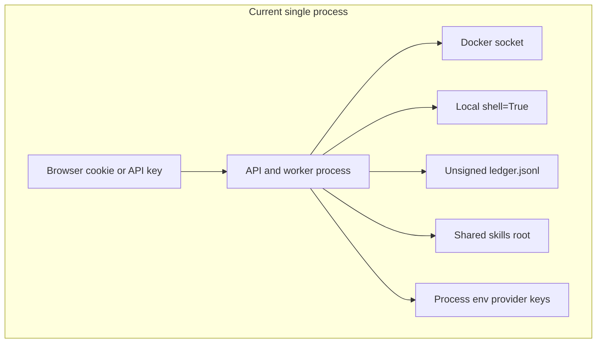
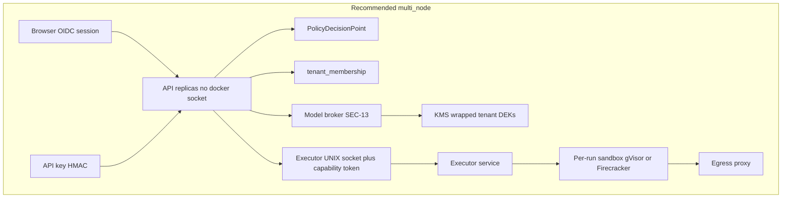
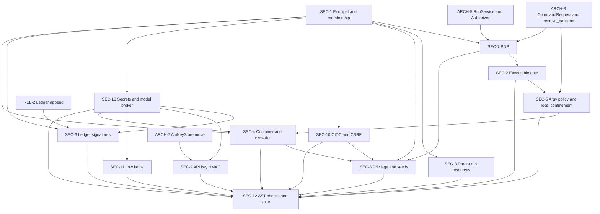

# Recertia SEC workstream: implementation plan and specifications (SEC-1 to SEC-13)

**Status:** approved for implementation. This revision applies the owner decisions D1 to D5 and the binding reconciliations below. It is a specification only. Implementation PRs change code; this document does not.

**Owner:** the SEC workstream, covering authentication, authorization, execution confinement, ledger tamper-evidence, and per-tenant secrets for recertia/recertia.

**Scope:** SEC-1 through SEC-13. ARCH and REL items are dependencies. Their internals stay in the ARCH and REL specs.

**Grounding:** line numbers refer to the tree at the time of writing. Paths are relative to `src/recertia/` unless they start at the repo root (`contracts/`, `tests/`, `scripts/`, `docs/`, `policy/`).

**Conventions**
- Shared names are used exactly as agreed: `Principal`, `TenantId`, `tenant_id`, `PolicyDecisionPoint`, `ExecutionBackend`, `ExecutionConfig`, `CommandRequest`, `CommandOrigin`, `RunService`, `RecertiaError`, `ApiKeyStore`, `RuntimeLayout`, `RunsRootLayout`.
- Size is the subsystems and files an item touches, not calendar time.
- A contract change under `contracts/` requires `python3 scripts/generate_schemas.py` in the implementation PR. A change that moves architecture text requires `python3 scripts/generate_architecture2.py` in that same PR. This specification does not run either generator.

---

## 1. Decisions applied

### Owner decisions

| ID | Decision | Effect on this spec |
|---|---|---|
| D1 | **Multi-tenant service.** Pooled control plane, isolated per-tenant execution. Single-node remains the development and self-host default. | STRICT `multi_node` rules are mandatory, not optional. OIDC plus a server-side membership table is the only browser login. Dev-login and `RECERTIA_CONSOLE_AUTH=off` are refused at startup. Skill, retrieval, episodic, and distillation stores are per-tenant. Shared seeds are signed, read-only, and copied into a tenant library only by `platform_admin`. SEC-4c, the executor service, is required: per-tenant or per-run sandbox, gVisor or Firecracker selectable, per-tenant egress, and the API process never holds the Docker socket. SEC-6 uses a per-tenant ledger scope and a per-tenant signing key. **SEC-13** is in scope: per-tenant provider keys (bring-your-own) or metered platform keys with attribution, KMS envelope encryption, no tenant secret in another tenant's view or in an executor environment by default, per-tenant API-key pepper and rotation, and redaction. |
| D2 | The `runs` scope may run **caller-supplied** commands (`command` criteria, `must_pass_command`, goal `command` desired states) on both the container and the local backends. The `exec` scope is required only for raw `script`. | The SEC-2 gate, the PDP rules, and the endpoint matrix all follow this split. Local execution still requires `RECERTIA_API_ALLOW_LOCAL_EXEC` and the SEC-5 confinement. `RECERTIA_DEPLOYMENT_MODE=multi_node` refuses the local backend at startup, so the break-glass flag has no effect there. `file_exists` and `file_contains` compile to confined AST assertions. `validation/freeze.py` quotes the sealed check with `shlex.quote`. Model-proposed commands stay a different origin from caller-supplied commands (SEC-5). |
| D3 | Durability default is `normal`. | SEC-6 signs the same append path REL-1/REL-2 use. Signing does not raise the durability mode. A `normal` append still fsyncs under REL's rule for that mode; SEC does not add a second fsync policy. |
| D4 | `/v1/runs` becomes async by default after one release. | SEC-2, SEC-3, and SEC-7 apply the same gate, the same tenant key, and the same quota admission to the sync path and the async path. The default flip itself stays on the REL-4 release train (`RECERTIA_API_DEFAULT_ASYNC`). |
| D5 | The CLI is a local operator principal with `platform_admin` and `admin` scopes. | Every CLI command builds `Principal.local_operator()`. Ledger actors, key issue, membership edits, seed promotion, and secret rotation from the CLI use that principal. A `--tenant` flag selects the tenant the operator acts inside. |

### Binding reconciliations

| Topic | Binding shape | Where applied |
|---|---|---|
| Identity | `Principal`, `TenantId`, and the `tenant_id()` constructor live in `recertia/ports/identity.py`. `recertia/api/identity.py` holds only `resolve_principal` and `require()`. `Principal` fields are `subject`, `kind`, `tenant`, `tenants`, `scopes`, `roles`. `key_id` and `tenant_id` are compatibility properties. | SEC-1 and every signature in this document |
| Execution | `ExecutionBackend` is the ARCH-3 `Literal`. The frozen configuration object is `ExecutionConfig`. `origin`, `run_id`, `owner_id`, and `fencing_token` are fields on `CommandRequest`. There is no `ExecutionContext` type. | SEC-2, SEC-4, SEC-5 |
| Authorization | `PolicyDecisionPoint` lives in `recertia/app/authz.py`. It implements the ARCH-5 `Authorizer` and `recertia/ports/approval.py::ApprovalPolicy`. `ApprovalGate` moves out of `governance/sandbox.py`. | SEC-7 |
| Run events | The path is `root/runs/<tenant>/run_events/<run_id>.jsonl`. SEC-3 owns the migration off `root/run_events/`. | SEC-3 |
| Golden gate | `golden_backend` defaults to `inherit`. A local gate passes an explicit `LocalExecutionCapability`. | SEC-2, SEC-8 |
| Policy backend | `policy.isolation.default_backend` has exactly one reader: `resolve_backend()` (ARCH-3). The PDP reads the resolved `ExecutionBackend`. | SEC-7 |
| Errors | One base, `recertia/errors.py::RecertiaError`. CLI exits: 1 not found; 2 invalid input; 3 unauthorized or forbidden; 4 quota or rate; 5 conflict; 6 busy; 7 unavailable or corrupt. | Shared decisions, each item's error list |
| Quota | The only admission points are `RunService.create` and `RunService.resume`. | SEC-7 |
| API keys | `ApiKeyStore` moves to `recertia/persistence/api_keys.py` (ARCH-7) before any SEC-9 hashing change. | SEC-9 |

---

## Contents

1. Decisions applied
2. Cross-workstream references
3. Findings index
4. Shared decisions
5. Trust boundaries
6. Endpoint authorization matrix
7. SEC-1 Unified Principal and TenantId
8. SEC-2 Executable-content gate
9. SEC-3 Tenant-keyed run resources
10. SEC-4 Executor isolation and container hardening
11. SEC-5 Local executor and argv command policy
12. SEC-6 Ledger tamper-evidence
13. SEC-7 PolicyDecisionPoint
14. SEC-8 Privilege model
15. SEC-9 API-key hashing, limiter, and audit
16. SEC-10 Session, OIDC, and CSRF
17. SEC-11 Low-severity items
18. SEC-12 Review automation and exploit regressions
19. SEC-13 Per-tenant secrets and model credentials
20. Consolidated configuration
21. Consolidated errors
22. Dependency graph
23. Rollout order

---

## 2. Cross-workstream references

| ID | Meaning in this spec |
|---|---|
| ARCH-2 | `Settings` and startup validation. SEC adds the fields in section 20; ARCH-2 owns the settings object. |
| ARCH-3 | `recertia/ports/execution.py`: `ExecutionBackend`, `CommandRequest`, `CommandExecutor`, and `resolve_backend()`. |
| ARCH-5 | Application services and the `Authorizer` protocol. Routes call services; services call the PDP. |
| ARCH-7 | `open_db`, `RuntimeLayout`, `RunsRootLayout`, repository interfaces, and the move of `ApiKeyStore` to `persistence/api_keys.py`. |
| REL-1 | Atomic file replace and the `normal` durability default. SEC-6 uses it for anchor files. |
| REL-2 | Ledger lock, torn-tail repair, and verify. SEC-6 adds a signature over the REL entry bytes. |
| REL-4 | `RunQueue` and the worker. Cancel and events use the SEC-3 path. Quota admission stays inside `RunService`. |
| REL-10 | Pooled Postgres and RLS. SEC DDL is the logical schema; REL-10 maps it into `recertia` / `recertia_ctl` and enables RLS. |
| REL-11 | Tenant lifecycle, export, and crypto-shred. SEC-13 stores the wrapped DEKs that REL-11 destroys. |

---

## 3. Findings index

Each row is a defect in the current tree. The regression column names the test SEC-12 collects under `tests/security/`. The test asserts the fixed behavior.

| ID | Finding | Evidence | SEC |
|---|---|---|---|
| F1 | Two unrelated caller identities. API keys are `Principal(key_id, tenant_id, scopes)`. Browser sessions are `ConsoleUser` with roles and a tenant list carried inside the cookie. | `api/auth.py:28-32`; `api/console_auth.py:86-92` | 1 |
| F2 | OIDC tenants come from the userinfo profile or `RECERTIA_OIDC_DEFAULT_TENANTS`, then the cookie stores that list and later treats it as membership. | `api/console_auth.py:292-304`, `156-171` | 1, 10 |
| F3 | `X-Recertia-Tenant` switches to any tenant named in the cookie. An API key is checked only for string equality with `principal.tenant_id`. | `api/console_deps.py:128-147` | 1 |
| F4 | `file_exists` compiles to `test -f {path}` with the path interpolated and unquoted. `file_contains` quote-escapes the pattern and leaves the path unquoted (`grep -qE '{pat}' {path}`). | `contracts/goal.py:164-187` | 2 |
| F5 | The `must_not_modify` placeholder is `" && ".join(f"test -e {p}" ...)`. The sealed replacement is `python -c ` plus `repr(code)`, which is Python quoting passed through `sh -c`. | `contracts/goal.py:278`; `validation/freeze.py:34-55` | 2 |
| F6 | The API clamps `timeout_s` on `body.criteria` only. `intake` then replaces criteria with `compile_goal`, which copies `DesiredState.timeout_s` up to 3600. | `api/__init__.py:59-68`, `407-409`; `nodes/intake.py:29-33`; `contracts/goal.py:56` | 2 |
| F7 | `exec` is checked for `body.script` only. Caller command criteria and goal `command` states run for any `runs` key. On the container backend, `approve_default_tools` is set for every `runs` caller. | `api/__init__.py:71-72`, `374-378`, `411`, `611-613`; `workers/run_worker.py:111` | 2, 7 |
| F8 | Run events live at `root/run_events/<run_id>.jsonl`. Cancel and the future map are keyed by `run_id` alone. The events route ignores the resolved tenant. A foreign `run_id` is cancelled and can be streamed. | `api/console_deps.py:67`; `api/events.py:21-23`; `api/console_library_routes.py:226-258`; `workers/run_worker.py:56-75` | 3 |
| F9 | The container argv drops capabilities and sets `no-new-privileges`, a read-only root, `network=none`, and a 512m memory cap. It does not set seccomp, ulimits, `--ipc=none`, `--memory-swap`, a `noexec` tmpfs, or `--mount`. Output is `capture_output=True` with no byte cap. | `solver/container.py:226-255` | 4 |
| F10 | `ensure_workdir_writable_by_container` chmods the bind-mounted workdir to `0770`, or `0777` when `RECERTIA_WORKDIR_WORLD_WRITE` is set. `run_in_container` calls it for every workdir, including a registered `host_root`. | `solver/container.py:107-129`, `186` | 4, 8 |
| F11 | Image pins are optional. The allowlist checks the tag before `@sha256`. The API process invokes `docker`/`podman` directly, so a multi-node API would hold the daemon socket. | `solver/container.py:132-143`, `217-255` | 4 |
| F12 | `shell_handler` runs the command string with no call to `assert_command_allowed`. Only `agent_subtask_handler` calls it. The allowlist is a string prefix (`text.startswith(prefix)`), so `python ` matches a longer argv and `git ` matches any git subcommand. | `solver/handlers.py:31-40`, `245-254`; `solver/command_policy.py:79-106` | 5 |
| F13 | The local executor uses `shell=True`. `HOME` is `setdefault` after copying the parent environment, so a host `HOME` in `allowed_env_keys` wins. `setrlimit` failures are swallowed. Nothing limits `/proc`. | `solver/container.py:329-370` | 5 |
| F14 | The ledger is an unsigned SHA-256 chain. `actor` is any string the caller passes. Entries have no tenant and no signature. Verify recomputes hashes and does not consult an external tip. | `ledger/hashchain.py:27-35`, `95-123`, `128-156`; `contracts/ledger.py:36-53` | 6 |
| F15 | `build_default_orchestrator` approves every registered tool when `approve_default_tools` is true, which the API sets whenever the backend is `container`. `Policy.require_tool_approval_for_non_read`, `Policy.isolation.default_backend`, and `Policy.faithfulness_interventions_enabled` have no reader under `src/`. | `bootstrap.py:164-168`; `contracts/policy.py:197`, `216-218` | 7 |
| F16 | `POST /v1/runs/{run_id}/resume` does not call `QuotaStore.admit`. Create does. | `api/__init__.py:486-489` versus `579-636`; `api/quotas.py:65` | 7 |
| F17 | `admin` in the scope set satisfies every `require_scope` check. `ConsoleUser.may` treats `admin` as every role. There is no `platform_admin` distinct from a tenant admin. | `api/auth.py:284-285`; `api/console_auth.py:94-107` | 8 |
| F18 | `POST /v1/memory/query` uses `Path(body.workdir)` and creates it. Registered `host_root` is any existing directory. Tenant skill libraries are off unless `RECERTIA_TENANT_SKILLS` is set; otherwise every tenant shares `skills_root`. | `api/remaining_routes.py:386-396`; `api/console_deps.py:75-80`; `paths.py` `normalize_host_root` | 8 |
| F19 | `POST /v1/skills/.../promote` checks the promote scope and then runs the golden gate with no `ensure_api_execution_ready`. `POST /v1/evals/runs` requires `metrics`, so a dashboard key can execute goldens. | `api/console_library_routes.py:375-407`; `api/remaining_routes.py:133-137` | 8 |
| F20 | API-key verify runs PBKDF2-HMAC-SHA256 at 600,000 iterations on the request path. The failure limiter is keyed by a hash of the presented secret, so a new secret is a new bucket. Every success inserts an audit row. | `api/auth.py:64-88`, `92-94`, `136-137`, `201-202` | 9 |
| F21 | The session cookie is `SameSite=lax`. When auth is not `oidc`, a missing session secret becomes `secrets.token_hex(32)` for that process. OIDC `state` lives in a process-local dict. The callback does not check a nonce, does not verify an ID token against JWKS, and builds `redirect_uri` from `request.url_for`. | `api/console_auth.py:63-84`, `122-128`, `184-190`, `249-305`; `api/console_session_routes.py:193-221` | 10 |
| F22 | Dev-login, when both flags are on, mints a session whose `tenants` and `roles` are the request body. Auth mode defaults to `off`. | `api/console_auth.py:32-40`; `api/console_session_routes.py:53-74` | 10 |
| F23 | `resolve_tip_sha` returns a caller-supplied `explicit` string with no commit check. `checkout_tip` passes that string to `git checkout --force`. | `programs/git_tip.py:82-100`, `103-126` | 11 |
| F24 | `sensitivity_evidence_hash` is an unkeyed SHA-256. `mint_rejecting_proof` can produce a binding hash for any fingerprint without a MAC key. | `contracts/criteria.py:54-63`, `83-99` | 11 |
| F25 | `fetch_handler` performs the HTTPS GET in the API process. `FastAPI(...)` leaves `/docs`, `/redoc`, and `/openapi.json` at their framework defaults. No process sets `umask(0o077)` before creating `api_keys.sqlite`, ledgers, or run files. | `solver/handlers.py:117-152`; `solver/registry.py:120-130`; `api/__init__.py:320` | 11 |
| F26 | `scripts/security_review.py` attestations are substring needles (`_file_contains`). They do not see that `shell_handler` skips the command policy, that `compile_goal` emits a shell check, or that cancel ignores tenant. | `scripts/security_review.py:387-398`, `400-485` | 12 |
| F27 | Model credentials are one process environment (`resolve_api_key` reads `ANTHROPIC_API_KEY` or `OPENAI_API_KEY`, overridable by `RECERTIA_API_KEY_ENV`). `credential_id` is that variable name. Every tenant's solver shares it. The local executor copies allowlisted env keys into the child. | `config.py:91-118`; `solver/factory.py:47-80`; `solver/container.py:337` | 13 |

---

## 4. Shared decisions

### S1. Identity module layout

```python
# recertia/ports/identity.py  — the only definition of these types

PrincipalKind = Literal["api_key", "session", "local_operator", "executor", "system"]

class TenantId(str):
    """Validated tenant identifier. Construct only via tenant_id()."""

def tenant_id(value: str) -> TenantId:
    """Accept ^[A-Za-z0-9][A-Za-z0-9_-]{0,63}$. Raise InvalidTenantId otherwise."""

@dataclass(frozen=True)
class Principal:
    subject: str
    kind: PrincipalKind
    tenant: TenantId
    tenants: tuple[TenantId, ...]
    scopes: frozenset[str]
    roles: frozenset[str]

    @property
    def key_id(self) -> str:
        """Compatibility: API-key subject. Empty string for other kinds."""

    @property
    def tenant_id(self) -> str:
        """Compatibility: str(self.tenant)."""

    def has_scope(self, scope: str) -> bool: ...
    def has_role(self, role: str) -> bool: ...

    @staticmethod
    def local_operator(*, tenant: TenantId | None = None) -> Principal:
        """D5. subject is 'cli:<user>@<host>'. kind is 'local_operator'.
        scopes include platform_admin and admin plus every tenant-local scope.
        roles are {'platform_admin', 'admin'}.
        """
```

`recertia/api/identity.py` imports those types and defines only:

```python
def resolve_principal(request: Request, x_api_key: str | None, sessions: SessionStore) -> Principal: ...

def require(scope: str) -> Callable[..., Principal]:
    """FastAPI dependency. 401 when unresolved, 403 when the scope is missing.
    Tenant admin ('admin' scope) satisfies tenant-local scopes.
    It does not satisfy platform_admin.
    """
```

The classes `Principal` and `IssuedApiKey` leave `api/auth.py`. `validate_tenant_id` becomes `tenant_id()` and raises `InvalidTenantId`, a `RecertiaError` (HTTP 400, exit 2, code `invalid_input`).

### S2. Scopes and roles

Tenant-local scopes: `runs`, `exec`, `blobs`, `metrics`, `evals`, `jobs`, `promote`, `admin`.

Cross-tenant scope: `platform_admin`.

Console roles: `operator`, `reviewer`, `admin`, `platform_admin`.

Rules:
- `admin` (scope or role) is a tenant administrator. It satisfies tenant-local scopes and the roles `operator`, `reviewer`, and `admin` inside `principal.tenant` and `principal.tenants`.
- `platform_admin` is not implied by `admin`. It is required for membership writes, shared-seed promotion, cross-tenant secret rotation, and reading the `_platform` secret namespace.
- `runs` authorizes caller-supplied commands (D2). `exec` authorizes raw `script` only.
- `evals` authorizes `POST /v1/evals/runs`. `metrics` authorizes read-only metric documents.

### S3. Execution types

ARCH-3 owns `recertia/ports/execution.py`. SEC specifies these members; ARCH-3 owns the executor methods around them.

```python
ExecutionBackend = Literal["container", "local", "executor"]
CommandOrigin = Literal["caller", "model", "skill", "criterion", "freeze"]

@dataclass(frozen=True)
class CommandRequest:
    argv: tuple[str, ...]          # already parsed; empty when shell_command is set
    shell_command: str | None      # set only for caller/criterion/freeze origins
    workdir: Path
    timeout_s: int
    output_cap_bytes: int
    origin: CommandOrigin          # SEC-5
    run_id: str | None             # REL-3
    owner_id: str | None           # REL-3
    fencing_token: str | None      # REL-3
    tenant: TenantId

@dataclass(frozen=True)
class ExecutionConfig:
    backend: ExecutionBackend
    image: str
    runtime: Literal["docker", "podman", "runsc", "firecracker"]
    network: Literal["none"]
    user: str
    memory: str
    memory_swap: str
    cpus: str
    pids_limit: int
    nofile_limit: int
    output_cap_bytes: int
    seccomp_profile: str
    read_only_root: bool
    ipc: Literal["none"]
    tmpfs_noexec: bool
```

`resolve_backend()` is the only function that reads `Policy.isolation.default_backend`. Precedence inside that function: `RECERTIA_EXECUTION_BACKEND` when set, otherwise the policy field. In `multi_node`, a result of `local` raises `ExecutionUnavailable` during startup, before the process serves traffic. The API and worker roles in `multi_node` resolve to `executor` (the UNIX-socket client). The executor role resolves to `container` with the selected sandbox runtime.

### S4. Errors

SEC subclasses live in `recertia/auth/errors.py` and `recertia/executor/errors.py`. They subclass `recertia/errors.py::RecertiaError(code, http_status, retryable)` and carry `exit_code`. The ARCH-5 handler is the only HTTP mapping. CLI commands map `exit_code` directly.

| Class | code | HTTP | exit | retryable |
|---|---|---|---|---|
| `InvalidTenantId` | `invalid_input` | 400 | 2 | no |
| `InvalidInput` | `invalid_input` | 400 | 2 | no |
| `AuthenticationRequired` | `authentication_required` | 401 | 3 | no |
| `InvalidCredentials` | `invalid_credentials` | 401 | 3 | no |
| `Forbidden` | `forbidden` | 403 | 3 | no |
| `CommandRefused` | `command_refused` | 403 | 3 | no |
| `ScriptRequiresExec` | `script_requires_exec` | 403 | 3 | no |
| `CsrfRejected` | `csrf_rejected` | 403 | 3 | no |
| `NotFound` | `not_found` | 404 | 1 | no |
| `Conflict` | `conflict` | 409 | 5 | no |
| `RateLimited` | `rate_limited` | 429 | 4 | yes |
| `QuotaExceeded` | `quota_exceeded` | 429 | 4 | no |
| `WorkerBusy` | `worker_busy` | 429 | 6 | yes |
| `ExecutionUnavailable` | `execution_unavailable` | 503 | 7 | no |
| `LedgerTampered` | `ledger_tampered` | 503 | 7 | no |
| `SecretUnavailable` | `secret_unavailable` | 503 | 7 | no |

Cross-tenant run, event, cancel, and future lookups raise `NotFound`. They do not raise `Forbidden`, so the response does not reveal that another tenant holds the id.

### S5. Deployment modes

`single_node` (default): one process may run the local backend when `RECERTIA_EXECUTION_BACKEND=local` and, for the API, `RECERTIA_API_ALLOW_LOCAL_EXEC=1`, with SEC-5 confinement. Console auth `off` is allowed (API keys only). Dev-login requires both existing flags. Membership may be bootstrapped from configuration.

`multi_node`: startup calls `validate_deployment()` and refuses the process (exit 7, code `execution_unavailable`) when any of the following hold:

- resolved backend is `local`
- process role is `api` or `worker` and `RECERTIA_EXECUTOR_SOCKET` is unset
- process role is `api` or `worker` and the Docker socket is reachable from that process (the client library is not imported there)
- `RECERTIA_CONSOLE_AUTH` is `off`, `dev`, or `development`
- `RECERTIA_CONSOLE_DEV_LOGIN` is true
- `RECERTIA_API_KEY_PEPPER` is unset
- `RECERTIA_OIDC_ISSUER`, client id, client secret, and redirect allowlist are incomplete
- `RECERTIA_TENANT_SKILLS` is explicitly disabled (the flag is ignored; per-tenant libraries are mandatory)
- image reference has no `@sha256:` digest

### S6. Where a command is allowed to run

| Origin | Who supplies the text | `runs` | `exec` | Container / executor | Local (single_node + break-glass) | Model allowlist |
|---|---|---|---|---|---|---|
| `caller` | Goal `command`, `must_pass_command`, task `command` criteria | yes | not required | yes | yes, SEC-5 confinement | no |
| `criterion` | Same texts after compile, `source=caller` | yes | not required | yes | yes, SEC-5 confinement | no |
| `freeze` | `seal_must_not_modify_criteria` | yes | not required | yes | yes, quoted argv | no |
| `skill` | Reviewed skill step | tool grant | not required | yes | refused | argv allowlist |
| `model` | `shell` tool or `agent_subtask` | tool grant | not required | yes | refused | argv allowlist |
| raw `script` | `RunCreate.script` | no | required | yes | yes, SEC-5 confinement | no |

`file_exists` and `file_contains` do not appear in this table. They are assertions (SEC-2).

---

## 5. Trust boundaries





The API verifies the caller and mints a short-lived capability token. The executor verifies the token and runs the sandbox. Provider keys stay in the model broker. The sandbox environment does not receive them unless a tenant explicitly opts into sandbox injection, which `multi_node` refuses by default (SEC-13).

---

## 6. Endpoint authorization matrix

Authentication is an API key, a console session, or both. The scope column is the API-key scope. A console session uses the role column inside the active tenant. `admin` covers tenant-local scopes. `platform_admin` is additional where listed. Tenant means the resource is loaded under `principal.tenant` after membership checks. Missing cross-tenant run resources return 404.

| Method | Path | Scope | Console role | Tenant | Notes |
|---|---|---|---|---|---|
| GET | `/health` | public | public | n/a | No secrets in the body |
| GET | `/console`, `/console/` | public static | public | n/a | Assets only. Docs URLs follow SEC-11 |
| GET | `/v1/me` | session | any authenticated | self | |
| POST | `/v1/auth/dev-login` | n/a | n/a | n/a | single_node and both dev flags. Refused in multi_node |
| POST | `/v1/auth/logout` | session + CSRF | any | self | |
| POST | `/v1/auth/switch-tenant` | session + CSRF | member of target | membership row | |
| GET | `/v1/auth/oidc/login` | public | n/a | n/a | Sets the bind cookie |
| GET | `/v1/auth/oidc/callback` | public + state | n/a | membership | |
| POST | `/v1/runs` | `runs` | operator | yes | `script` also requires `exec`. Commands follow D2 |
| GET | `/v1/runs` | `runs` | operator | yes | |
| GET | `/v1/runs/{run_id}` | `runs` | operator | yes | 404 outside tenant |
| POST | `/v1/runs/{run_id}/resume` | `runs` | operator | yes | Quota via `RunService.resume` |
| GET | `/v1/runs/{run_id}/events` | `runs` | operator | yes | Path is the tenant run_events file |
| POST | `/v1/runs/{run_id}/cancel` | `runs` | operator | yes | 404 when the pair is unknown |
| GET | `/v1/runs/{run_id}/transcript` | `runs` | operator | yes | |
| GET | `/v1/runs/{run_id}/trajectory` | `runs` | operator | yes | |
| POST | `/v1/blobs` | `blobs` | operator | yes | |
| GET | `/v1/blobs/{digest}` | `blobs` | operator | yes | |
| GET | `/v1/metrics/dashboard` | `metrics` | operator | yes | |
| GET | `/v1/metrics/report` | `metrics` | operator | yes | |
| GET | `/v1/metrics/canary` | `metrics` | operator | yes | Synthetic canary only |
| POST | `/v1/evals/runs` | `evals` | reviewer | yes | Breaking: `metrics` is no longer enough. Calls `ensure_api_execution_ready` |
| GET | `/v1/models` | `runs` | operator | yes | Allowlist only, no credentials |
| POST | `/v1/goals/preview` | `runs` | operator | yes | Compiles assertions; runs nothing |
| POST | `/v1/goals/suggest` | `runs` | operator | yes | |
| POST | `/v1/goals/probe` | `runs` | operator | yes | |
| GET | `/v1/templates` | `runs` | operator | yes | |
| GET | `/v1/templates/{template_id}` | `runs` | operator | yes | |
| GET | `/v1/skills` | `runs` | operator | yes | Tenant library plus that tenant's promoted seeds |
| GET | `/v1/skills/{skill_id}/versions/{version}` | `runs` | operator | yes | |
| POST | `/v1/skills/search` | `runs` | operator | yes | Tenant index only |
| POST | `/v1/skills/{skill_id}/versions/{version}/promote` | `promote` | reviewer | yes | `ensure_api_execution_ready` before the golden gate |
| POST | `/v1/seeds/promote` | `platform_admin` | platform_admin | target tenant | SEC-8. Copies a signed seed into the tenant library |
| GET | `/v1/ledger/verify` | `runs` | operator | yes | Verifies that tenant's chain and anchor |
| GET | `/v1/policy` | `runs` | operator | yes | Read-only document |
| POST | `/v1/policy/proposals` | `runs` | reviewer | yes | Creates a proposal. Does not apply T2 |
| GET | `/v1/proposals` | `runs` | reviewer | yes | |
| GET | `/v1/proposals/{proposal_id}` | `runs` | reviewer | yes | |
| POST | `/v1/proposals/{proposal_id}/decision` | `promote` | reviewer | yes | Applying a T2 change also requires the PDP `policy.apply` rule |
| GET | `/v1/reviews` | `runs` | reviewer | yes | |
| POST | `/v1/reviews/{decision_id}` | `promote` | reviewer | yes | |
| GET | `/v1/jobs` | `runs` | operator | yes | |
| GET | `/v1/jobs/{job_run_id}` | `runs` | operator | yes | |
| POST | `/v1/jobs/{job}/run` | `jobs` | reviewer | yes | |
| GET | `/v1/facts` | `runs` | operator | yes | |
| GET | `/v1/cases` | `runs` | operator | yes | |
| GET | `/v1/cases/{case_id}` | `runs` | operator | yes | |
| POST | `/v1/trajectories/import` | `runs` | reviewer | yes | Tenant store only |
| POST | `/v1/trajectories/distill` | `runs` | reviewer | yes | Writes the tenant skill library only |
| GET | `/v1/affordances` | `runs` | operator | yes | |
| POST | `/v1/memory/query` | `runs` | operator | yes | Workdir confined, SEC-8 |
| GET | `/v1/workspaces` | `runs` | operator | yes | |
| GET | `/v1/workspaces/{workspace_id}` | `runs` | operator | yes | |
| POST | `/v1/workspaces` | `admin` | admin | yes | `host_root` under `RECERTIA_WORKSPACE_ROOTS` |
| PATCH | `/v1/workspaces/{workspace_id}` | `admin` | admin | yes | |
| DELETE | `/v1/workspaces/{workspace_id}` | `admin` | admin | yes | Disables; does not chmod |
| POST | `/v1/programs/from-pack` | `runs` | operator | yes | |
| POST | `/v1/programs` | `runs` | operator | yes | |
| GET | `/v1/programs` | `runs` | operator | yes | |
| GET | `/v1/programs/{program_id}` | `runs` | operator | yes | |
| POST | `/v1/programs/{program_id}/accept` | `runs` | reviewer | yes | |
| POST | `/v1/programs/{program_id}/abandon` | `runs` | operator | yes | |
| PATCH | `/v1/programs/{program_id}/steps/{step_id}` | `runs` | operator | yes | |
| POST | `/v1/programs/{program_id}/steps/{step_id}/preview` | `runs` | operator | yes | |
| POST | `/v1/programs/{program_id}/steps/{step_id}/run` | `runs` | operator | yes | Binds a run; does not add a script |
| POST | `/v1/programs/{program_id}/steps/{step_id}/skip` | `runs` | operator | yes | |
| POST | `/v1/programs/{program_id}/repo-binding` | `admin` | admin | yes | Binding root stays under the tenant repo_bindings tree |
| POST | `/v1/programs/{program_id}/steps/{step_id}/record-tip` | `runs` | operator | yes | Records `git rev-parse` of the binding, not a client string |
| POST | `/v1/programs/{program_id}/steps/{step_id}/seed-workdir` | `runs` | operator | yes | `tip_sha` must be a verified commit, SEC-11 |
| GET | `/v1/console/tower-summary` | `runs` | operator | yes | |
| POST | `/v1/secrets` | `admin` | admin | own tenant | SEC-13. Platform namespace requires `platform_admin` |
| POST | `/v1/secrets/{name}/rotate` | `admin` | admin | own tenant | Pepper rotation is this route |
| GET | `/v1/membership` | `admin` | admin | own tenant | Read |
| POST | `/v1/membership` | `platform_admin` | platform_admin | target | Writes the membership table |

`GET /docs`, `GET /redoc`, and `GET /openapi.json` are unmounted in `multi_node` and when `RECERTIA_EXPOSE_DOCS=0` (SEC-11).

---

## 7. SEC-1 Unified Principal and TenantId

### Goal

One `Principal` for API keys, sessions, the CLI, and the executor. Tenant identifiers are `TenantId`. In `multi_node`, the membership table is the authority for which tenants a session may act in. The cookie does not grant a tenant that the table does not list.

### Non-goals

- Password login, SCIM, and billing identity.
- Rewriting REL-10 row-level security. SEC-1 supplies the `TenantId` REL-10 binds as `app.tenant_id`.
- Changing the `rec_<key_id>.<token>` secret format (SEC-9).

### Findings

F1, F2, F3.

### Design

**Types.** S1 is the full signature. `api/auth.py::Principal` and `console_auth.py::ConsoleUser` are deleted after call sites migrate. During the migration PR, `ConsoleUser` remains as a private session payload, not as an authorization type. `resolve_principal` builds a `Principal` from either factor:

- API key: `kind="api_key"`, `subject=key_id`, `tenant=tenant_id(row.tenant_id)`, `tenants=(that tenant,)`, `scopes` from the row, `roles=empty` unless the row has `admin` or `platform_admin`, in which case those role names are mirrored for PDP role checks.
- Session: `kind="session"`, `subject=user_id`, `tenant` is the active tenant, `tenants` is the membership-table result, `roles` from the table, `scopes` derived from roles by a fixed map (`operator` to `runs`+`blobs`+`metrics`; `reviewer` adds `promote`+`jobs`+`evals`; `admin` adds `admin`+`exec`; `platform_admin` adds `platform_admin`).
- Both presented: the session may narrow the active tenant only when the API key's tenant is in the session membership. Otherwise `Forbidden` code `forbidden`.

**Membership DDL** (SQLite in `single_node` under `control.db`; Postgres in `multi_node` under `recertia_ctl`, RLS by REL-10):

```sql
CREATE TABLE tenant_membership (
    subject     TEXT NOT NULL,
    tenant_id   TEXT NOT NULL,
    roles       TEXT NOT NULL,          -- comma-separated role tokens
    status      TEXT NOT NULL DEFAULT 'active',  -- active | suspended
    granted_by  TEXT NOT NULL,
    granted_at  TEXT NOT NULL,
    PRIMARY KEY (subject, tenant_id)
);
CREATE INDEX tenant_membership_by_tenant ON tenant_membership (tenant_id, status);
```

```python
class MembershipStore:
    def list_active(self, subject: str) -> tuple[Membership, ...]: ...
    def grant(self, *, subject: str, tenant: TenantId, roles: frozenset[str],
              actor: Principal) -> None: ...
    def revoke(self, *, subject: str, tenant: TenantId, actor: Principal) -> None: ...
```

`grant` and `revoke` require `platform_admin`. A tenant `admin` may read rows for its tenant and may not insert a `platform_admin` role.

**Session tenant resolution.**

```python
def session_principal(payload: SessionClaims, membership: MembershipStore) -> Principal:
    rows = [r for r in membership.list_active(payload.subject) if r.status == "active"]
    if settings.deployment_mode == "multi_node":
        allowed = tuple(tenant_id(r.tenant_id) for r in rows)
        # payload.tenants is ignored
    else:
        allowed = _single_node_tenants(payload, rows)  # table wins; cookie fills only when the table has no row and auth is dev
    if not allowed:
        raise Forbidden("no active membership")
    active = payload.active_tenant if payload.active_tenant in allowed else allowed[0]
    ...
```

In `multi_node`, a session whose claim lists tenants the table does not contain still authenticates, and those extra names are dropped. Switching to a dropped name returns 403 `forbidden` with detail `tenant not in membership`. It does not echo the table.

`validate_tenant_id` in `api/auth.py:43-49` moves to `tenant_id()`. Call sites in `api/__init__.py` (`_tenant_blob_root`, `_canonical_run_workdir`) use `TenantId` so a second regex cannot drift.

**CLI.** `Principal.local_operator()` uses the OS user and hostname in `subject`. Commands that take `--tenant` set `principal.tenant` to that id and require it to be a member when the CLI is talking to a `multi_node` API. Against a local `single_node` root, the operator principal is a member of every tenant directory under `root/runs/` because it holds `platform_admin`.

### Files

- Add `recertia/ports/identity.py`, `recertia/api/identity.py`, `recertia/persistence/membership.py`.
- Edit `api/auth.py` (delete the dataclass, keep store helpers until SEC-9 moves them), `api/console_auth.py`, `api/console_deps.py`, `api/__init__.py`, `cli/main.py`, `cli/keys.py`, `cli/runs.py`, `cli/policy_cmd.py`, `cli/review_cmd.py`, `cli/workspaces.py`.
- Tests: `tests/security/test_sec1_principal.py`, updates in `tests/unit/test_api_security.py`.

### Migration and breaking changes

- Existing session cookies fail to parse after the SEC-10 cookie version bump. SEC-1 reads the old payload only long enough to reject it with 401. Users log in again.
- `Principal.key_id` remains available so `submitted_by=principal.key_id` keeps working. New ledger actors use SEC-6's `ledger_actor(principal)`, not the raw key id alone.
- `X-Recertia-Tenant` still selects the active tenant. The value must be in membership. An API key still cannot leave its single tenant.

### Regression tests

| Exploit the test fixes | Test |
|---|---|
| F2 cookie tenant list accepted without a membership row in `multi_node` | `tests/security/test_sec1_principal.py::test_multi_node_session_ignores_unvalidated_tenant_claim` |
| F3 API key plus `X-Recertia-Tenant` of another tenant | `tests/security/test_sec1_principal.py::test_api_key_tenant_header_mismatch_is_403` |
| F1 session and API key both exposed as different types at the route | `tests/security/test_sec1_principal.py::test_resolve_principal_returns_ports_principal` |

### Risks

- Role-to-scope mapping can grant `exec` to every tenant `admin`. That matches today's `admin` short-circuit and D2 (`exec` remains the script gate). A tenant that wants admins without script access omits the `admin` scope and assigns `reviewer`.
- `local_operator` is powerful on a shared workstation. The CLI does not listen on the network. `multi_node` operators use the API with a real key; the local principal is for the process that has the root on disk.

### Dependencies

- ARCH-2 `Settings.deployment_mode`.
- REL-10 applies RLS to `tenant_membership` when Postgres is introduced. SEC-1 ships the SQLite table first.

### PR slicing

1. **SEC-1a types.** Add `ports/identity.py` and `tenant_id()`. No behavior change. Touch: one new module plus `api/auth.py` re-exports. Proves mypy and a unit test of the regex.
2. **SEC-1b membership and resolve.** Add the table, `resolve_principal`, and route adoption. Touch: `api/identity.py`, `persistence/membership.py`, console deps, session routes' tenant switch. Proves the three regression tests.
3. **SEC-1c CLI.** `Principal.local_operator()` threaded through CLI commands that write a ledger actor or issue keys. Touch: `cli/*.py` call sites that pass `actor=`.

---

## 8. SEC-2 Executable-content gate

### Goal

Caller-supplied commands run for `runs` on both backends, under SEC-5 when the backend is local. Raw `script` requires `exec` or tenant `admin`. `file_exists` and `file_contains` compile to confined assertions. Freeze scripts are shell-quoted. Timeouts are clamped after `compile_goal`. The local backend does not start in `multi_node`. Golden gates default to `inherit`.

### Non-goals

- Rewriting caller `command` desired states into assertions. Those stay commands, origin `caller` (D2).
- The model allowlist. That is SEC-5, and it still applies to origin `model` and `skill`.
- Changing the assertion language's existing node allowlist except to add two functions.

### Findings

F4, F5, F6, F7. Golden local default: `evals/golden.py:189-191` and `336-338`.

### Design

**Gate.** `RunService.create` is the only place that inspects `script` and caller commands for an API run (sync and async).

```python
def assert_run_executable(principal: Principal, body: RunCreate, *, backend: ExecutionBackend) -> None:
    if body.script and not (principal.has_scope("exec") or principal.has_scope("admin")):
        raise ScriptRequiresExec()
    # caller commands inside goal / criteria are allowed for runs
    if backend == "local":
        require_local_break_glass()  # RECERTIA_API_ALLOW_LOCAL_EXEC, SEC-5
```

`approve_default_tools = _principal_may_exec(...) or configured_backend() == "container"` is removed from `api/__init__.py:411` and `:611-613` and from `workers/run_worker.py:111`. Tool grants come from the PDP (SEC-7). Removing the blanket grant is required so that D2's permission to run caller criteria is not implemented as "approve every tool, including `external_computer`".

**AST compilation.** `contracts/goal.py::_desired_to_criterion` for the two kinds:

```python
def _desired_to_criterion(...) -> TaskCriterion:
    if d.kind == "file_exists":
        return TaskCriterion(
            id=d.id, kind="assertion",
            expr=f"file_exists({_assertion_string(d.path)})",
            ...
        )
    if d.kind == "file_contains":
        return TaskCriterion(
            id=d.id, kind="assertion",
            expr=f"file_contains({_assertion_string(d.path)}, {_assertion_string(d.pattern or '')})",
            ...
        )
```

`_assertion_string` uses `repr` and rejects `\x00`, `\n`, and `\r` in the source path or pattern before quoting. The evaluator in `validation/assertions.py` gains two allowlisted functions, both using the existing `_confine`:

```python
def file_exists(path: str) -> bool: ...          # confined is_file
def file_contains(path: str, pattern: str) -> bool:
    """re.search on at most 1 MiB of UTF-8 text. Pattern length <= 256.
    A pattern that does not compile returns False and records an error result.
    """
```

`file_contains` keeps today's regex semantics (`grep -qE`) inside the evaluator, so the shell string disappears and the check does not. `must_not_modify` in `_constraint_to_criterion` emits `kind="assertion", expr="False"` as the pre-seal placeholder. `seal_must_not_modify_criteria` replaces it, as it does today, with a command criterion whose `run` is:

```python
def _freeze_script(expected: dict[str, str]) -> str:
    code = _freeze_python(expected)          # payload still embedded with !r inside Python source
    return "python -c " + shlex.quote(code)  # POSIX shell quoting for sh -c
```

The inner `{payload!r}` stays. It is Python source. The outer quoting is what `sh -c` parses, on both backends, because the container entrypoint is `sh -c` (`solver/container.py:253`).

**Timeout clamp.** `nodes/intake.py` clamps after compile and seal:

```python
def clamp_criterion_timeouts(criteria: list[TaskCriterion], *, ceiling_s: int) -> list[TaskCriterion]:
    ceiling_s = max(1, min(ceiling_s, 3600))
    return [
        c.model_copy(update={"timeout_s": min(c.timeout_s, ceiling_s)})
        if c.timeout_s > ceiling_s else c
        for c in criteria
    ]
```

The API passes `Settings.api_max_criterion_timeout_s` (default 300, today's `RECERTIA_API_MAX_CRITERION_TIMEOUT_S`). The pre-intake clamp in `api/__init__.py:59-68` remains as a cheap bound on caller-supplied `TaskCriterion` objects and is no longer the only clamp. CLI runs use the contract maximum (3600) unless `--max-criterion-timeout` is set.

**Startup.** `validate_deployment()` (S5) runs from `create_app` and from CLI startup. `ensure_api_execution_ready` (`solver/container.py:88-104`) stays for the single-node API and additionally calls `validate_deployment()`.

**Golden backend.**

```python
def resolve_golden_backend(
    explicit: str | None = None,
    *,
    capability: LocalExecutionCapability | None = None,
) -> ExecutionBackend:
    mode = explicit or os.environ.get("RECERTIA_GOLDEN_BACKEND", "inherit")
    if mode == "inherit":
        return resolve_backend()
    if mode == "local":
        if capability is None:
            raise ExecutionUnavailable("local golden gate requires LocalExecutionCapability")
        return "local"
    if mode in {"container", "executor"}:
        return mode  # type: ignore[return-value]
    raise InvalidInput(f"unsupported golden backend {mode!r}")
```

`run_skill_golden` and `run_goal_fixture` stop assigning `RECERTIA_EXECUTION_BACKEND=local` when the variable is unset (`evals/golden.py:189-213`, `336-363`). `tests/conftest.py` already forces the local backend for pytest; it will pass `capability=LocalExecutionCapability(purpose="pytest")` into the harness so CI without Docker keeps working. Production promotion uses `inherit`, which is `container` or `executor`.

### Files

- `contracts/goal.py`, `validation/assertions.py`, `validation/freeze.py`, `nodes/intake.py`, `evals/golden.py`, `api/__init__.py`, `workers/run_worker.py`, `solver/container.py` (`ensure_api_execution_ready` only), `app/runs.py` (`RunService`, ARCH-5).
- Tests: `tests/security/test_sec2_compile.py`, `tests/security/test_sec2_gate.py`, `tests/conftest.py`.

### Migration and breaking changes

- Stored goals are unchanged. Newly compiled criteria for `file_exists` and `file_contains` have `kind="assertion"` and an `expr`. Checkpoints that already hold the old `kind="command"` strings keep running as commands until the run is re-intaken. Resume does not recompile a locked criteria set.
- Callers of `compile_goal` who matched on `kind="command"` for those two desired kinds must match `assertion`. In-repo callers: `api/console_library_routes.py` preview, `api/console_program_routes.py`, `programs/materialize.py`, `evals/golden.py`.
- `RECERTIA_GOLDEN_BACKEND` is new. Unset means `inherit`. A deployment that relied on "unset env implies local goldens" now follows the process backend. Pytest sets the capability explicitly.

### Regression tests

| Exploit the test fixes | Test |
|---|---|
| F4 path metacharacters inside `file_exists` / `file_contains` compilation | `tests/security/test_sec2_compile.py::test_file_exists_compiles_to_assertion_not_shell` |
| F4 pattern and path that would break out of the `grep` single quotes | `tests/security/test_sec2_compile.py::test_file_contains_compiles_to_file_contains_call` |
| F5 freeze script quoting under a shell parser | `tests/security/test_sec2_compile.py::test_freeze_script_is_shlex_quoted` |
| F6 `timeout_s=3600` on a desired state survives intake on the API | `tests/security/test_sec2_gate.py::test_timeout_clamped_after_compile_goal` |
| F7 `runs` key with a goal `command` is allowed and a `script` is refused | `tests/security/test_sec2_gate.py::test_runs_scope_command_allowed_script_requires_exec` |
| Local backend selected in `multi_node` | `tests/security/test_sec2_gate.py::test_multi_node_refuses_local_backend_at_startup` |
| Golden inherits the container backend unless a capability is passed | `tests/security/test_sec2_gate.py::test_golden_backend_inherit_does_not_force_local` |

### Risks

- Assertion `file_contains` reads up to 1 MiB. A criterion that depended on `grep` streaming a larger file will fail closed. The cap is intentional.
- Resume of an in-flight run keeps the already locked shell criteria. Only new runs get assertions. Document this in the PR so operators re-create runs after deploy.

### Dependencies

- SEC-1 `Principal.has_scope`.
- SEC-5 for local confinement of the commands D2 still allows.
- SEC-7 so the removed `approve_default_tools` flag has a replacement before the API PR merges. Land SEC-7's grant function in the same release train, immediately before or inside SEC-2's route PR.
- ARCH-5 `RunService`. If the service class does not exist yet, SEC-2 puts `assert_run_executable` in `recertia/app/runs.py` and the route calls it. ARCH-5 moves the method onto the service without a signature change.

### PR slicing

1. **SEC-2a compile.** `goal.py`, `assertions.py`, `freeze.py`, compile tests. No auth change.
2. **SEC-2b clamp and golden inherit.** `intake.py`, `golden.py`, `conftest.py`.
3. **SEC-2c gate.** Route and `RunService` scope check, startup refusal, deletion of the blanket `approve_default_tools` expression. Depends on SEC-7a's `approve_tools` returning a gate that preserves container read and reviewed write grants.

---

## 9. SEC-3 Tenant-keyed run resources

### Goal

Events, cancel, and the in-process future map are keyed by `(tenant, run_id)`. The on-disk path is `root/runs/<tenant>/run_events/<run_id>.jsonl`. A caller who names another tenant's run receives 404.

### Non-goals

- The queue and worker process (REL-4). SEC-3 changes the key and the path those components must use.
- SSE follow-the-writer (REL-6). `iter_sse` keeps its current backlog behavior and gains a tenant argument.

### Findings

F8. The `RunEventLog` docstring says `{runs_root}/events/` while the constructor is pointed at `root/run_events` (`api/events.py:13-17`, `api/console_deps.py:67`). The existence check uses the same unscoped directory (`console_library_routes.py:239`).

### Design

```python
class RunEventLog:
    def __init__(self, layout: RunsRootLayout) -> None: ...
    def path(self, run_id: str) -> Path:
        """layout.run_events_path(run_id) == runs_root/run_events/<safe>.jsonl"""
    def append(self, run_id: str, event_type: str, payload: dict | None = None) -> dict: ...
    def iter_sse(self, run_id: str, *, after: str | None = None) -> Iterator[str]: ...

class AsyncRunWorker:
    def request_cancel(self, tenant: TenantId, run_id: str) -> bool:
        """False when no future or queued record exists for the pair."""
    def future(self, tenant: TenantId, run_id: str) -> Future | None: ...
```

`ConsoleContext` builds one log per request from `layout.tenant(tenant).run_events_dir`, or a cache of logs keyed by tenant. It does not construct `RunEventLog(root / "run_events")`.

Cancel route:

```python
def cancel_run(...):
    tenant = resolve_tenant(...)
    run_id = validate_run_id(run_id)
    if not run_visible(tenant, run_id):      # memory, checkpoint, or event file under that tenant
        raise NotFound("run not found")
    worker.request_cancel(tenant, run_id)
    events_for(tenant).append(run_id, "run.cancelled", {"by": principal.subject})
```

`run_visible` checks, in order: the in-memory `(tenant, run_id)` record, checkpoints under `runs/<tenant>/`, and `run_events/<run_id>.jsonl` under that same runs root. It does not check another tenant and it does not check the legacy directory.

**Migration** (`recertia/persistence/migrate_run_events.py`, invoked by `recertia migrate` and by API startup once):

```python
def migrate_run_events(root: Path) -> MigrationReport:
    """Move root/run_events/<run_id>.jsonl to root/runs/<tenant>/run_events/<run_id>.jsonl
    when exactly one tenant has a checkpoint or workdir.json for that run_id.
    When zero or more than one tenant matches, move the file to
    root/run_events.quarantine/<run_id>.jsonl and leave it unserved.
    """
```

After `MigrationReport.pending == 0`, startup renames `root/run_events` to `root/run_events.migrated` if any files remain, and the reader never opens that directory.

The future dict becomes `dict[tuple[str, str], Future]`. `submit` stores `(tenant_id, run_id)`. A cancel for a pair that is absent returns false and the route responds 404.

### Files

- `api/events.py`, `api/console_deps.py`, `api/console_library_routes.py` (events and cancel), `workers/run_worker.py`, new `persistence/migrate_run_events.py`, `cli/main.py` migrate hook.
- REL's `RunsRootLayout.run_events_path` is the accessor. If ARCH-7 has not added it, SEC-3 adds the method on a local helper with the same signature and ARCH-7 adopts it.

### Migration and breaking changes

- Operators with files only in `root/run_events/` must run the migration before those streams are visible. Ambiguous run ids are quarantined on purpose.
- Clients that opened `/v1/runs/{id}/events` for a run they do not own now receive 404 instead of a backlog.
- Cancel of an unknown id returns 404. Today it returns `cancel_requested` even when the worker has no such run (`console_library_routes.py:256-258`).

### Regression tests

| Exploit the test fixes | Test |
|---|---|
| F8 tenant A cancels tenant B's run_id | `tests/security/test_sec3_run_resources.py::test_cancel_other_tenant_run_is_404` |
| F8 tenant A reads tenant B's event file by run_id | `tests/security/test_sec3_run_resources.py::test_events_other_tenant_run_is_404` |
| F8 two futures with the same run_id and different tenants | `tests/security/test_sec3_run_resources.py::test_futures_are_keyed_by_tenant_and_run` |
| Ambiguous legacy file is not attached to either tenant | `tests/security/test_sec3_run_resources.py::test_migrate_run_events_quarantines_ambiguous_file` |

### Risks

- A deployment that stored events only in the legacy directory, with no checkpoint, will see those streams quarantined. The report lists each quarantined name so an operator can attach a file by hand after confirming the tenant.

### Dependencies

- SEC-1 `TenantId` and tenant resolution.
- ARCH-7 path helper. SEC-3 owns the bytes on disk either way.
- REL-4 and REL-6 must call `run_events_path` and the tenant-keyed cancel. SEC-3 merges first and leaves the function names stable.

### PR slicing

1. **SEC-3a path and API.** Tenant-keyed log, route 404s, future key. Includes the regression tests that do not need historical files.
2. **SEC-3b migration.** One-shot mover plus a CLI entry. Includes the quarantine test.

---

## 10. SEC-4 Executor isolation and container hardening

### Goal

Every container invocation sets the hardening flags below, streams output under a byte cap, requires a digest pin in production, parses only an allowlisted argv, and chmods only ephemeral sandbox directories. In `multi_node` the API and worker talk to an executor service over a UNIX socket with a capability token. The API process does not open the Docker socket.

### Non-goals

- Orphan reaping and backup of workspaces (REL-9). SEC-4 does add tenant and run labels so REL-9 can reap.
- Per-tenant network policy contents beyond "default none, named allowlist enforced by the egress proxy" (SEC-11 owns the proxy; SEC-4 owns the sandbox network mode).
- A Kubernetes runtime. The executor is a host process.

### Findings

F9, F10, F11.

### Design

**Flags.** `_container_run` builds this argv and no other flags. Unknown `ExecutionConfig` fields cannot appear because the dataclass is frozen and the builder lists every argument.

| Flag | Value |
|---|---|
| `--name` | `rec-<16 hex>` |
| `--network` | `none` |
| `--user` | `65534:65534`, refuse root as today (`container.py:205-206`) |
| `--cap-drop` | `ALL` |
| `--security-opt` | `no-new-privileges` |
| `--security-opt` | `seccomp=<profile>` (`default` uses the runtime default profile; a path must sit under `RECERTIA_SECCOMP_DIR`) |
| `--ipc` | `none` |
| `--ulimit` | `nproc=<pids>` and `nofile=<nofile>` |
| `--pids-limit` | same pids value (default 256, today's hardcode) |
| `--memory` | default `512m` |
| `--memory-swap` | equal to `--memory` |
| `--cpus` | default `1` |
| `--read-only` | set |
| `--tmpfs` | `/tmp:rw,noexec,nosuid,nodev,size=64m` |
| `--mount` | `type=bind,source=<workdir>,destination=/work,readonly=false` |
| `--label` | `recertia.tenant`, `recertia.run_id`, `recertia.owner_id` |
| `--pull` | `never` when the image contains `@sha256:` |
| image | allowlisted tag plus, in production, `@sha256:` of 64 hex digits |
| command | `sh`, `-c`, `<shell_command>` or the argv, as `CommandRequest` specifies |

The builder rejects a workdir or image containing a comma, colon (except the digest separator), newline, or leading dash. Bind source and destination are passed as separate `--mount` key-value pairs after that validation, which replaces `-v`.

**Byte cap.** Default `RECERTIA_EXEC_MAX_OUTPUT_BYTES=262144` (256 KiB), combined stdout and stderr. The runner reads the pipes in a loop, counts bytes, and kills the container (today's `_kill_container`) when the cap is exceeded. The result is `exit_code=125` and `stderr` ending with `output cap exceeded`. Handlers may still slice to 8000 characters for the model (`handlers.py:48-49`); the cap is enforced before that slice, so the API process does not hold an unbounded capture.

**Digest pin.** `ExecutionConfig.image` must match `^<allowlisted-tag>@sha256:[0-9a-f]{64}$` when `Settings.require_image_digest` is true. That setting is true in `multi_node` and when `RECERTIA_REQUIRE_IMAGE_DIGEST=1`. `single_node` development may use a floating allowlisted tag. `RECERTIA_ALLOW_CUSTOM_IMAGE` does not bypass the digest requirement in `multi_node`.

**chmod policy.**

```python
def prepare_workdir(workdir: Path, *, kind: Literal["sandbox", "registered"]) -> None:
    if kind == "registered":
        return  # never chmod a host_root
    if settings.deployment_mode == "multi_node":
        raise ExecutionUnavailable("multi_node workdirs are prepared inside the executor")
    # ephemeral dir under root/workspaces/<tenant>/<run_id> only
    if settings.workdir_world_write:
        raise Forbidden("RECERTIA_WORKDIR_WORLD_WRITE is refused")
    workdir.chmod(workdir.stat().st_mode | 0o0770)
```

`run_in_container` stops calling `ensure_workdir_writable_by_container` on registered roots (`api/__init__.py:139-160` resolves those roots). `RECERTIA_WORKDIR_WORLD_WRITE` is refused in both modes. Ephemeral sandbox directories may gain group write so uid 65534 can write when the executor shares a group. The executor image documents that group; the API does not chmod the operator's repository.

**SEC-4c executor service** (required in `multi_node`).

```python
# recertia/executor/server.py
class ExecutorServer:
    def serve(self, socket_path: Path) -> None: ...

# recertia/executor/client.py
class ExecutorClient(CommandExecutor):
    def run(self, request: CommandRequest, *, token: CapabilityToken) -> CommandResult: ...

@dataclass(frozen=True)
class CapabilityToken:
    tenant: TenantId
    run_id: str
    owner_id: str
    fencing_token: str
    origin: CommandOrigin
    exp: int
    nonce: str

def mint_capability(request: CommandRequest, *, key: bytes, ttl_s: int = 60) -> str:
    """base64url(payload) || '.' || base64url(HMAC-SHA256(key, payload))."""

def verify_capability(token: str, *, key: bytes, now: int) -> CapabilityToken: ...
```

- Socket path: `RECERTIA_EXECUTOR_SOCKET`, mode `0600`, directory mode `0700`.
- The API and worker processes depend on `ExecutorClient` only. They do not import `docker` and they do not call `subprocess` with `docker` or `podman`. SEC-12's AST check enforces that under `recertia/api/` and `recertia/workers/`.
- The executor process is the only role that calls `_container_run`.
- One sandbox per run is the default (`RECERTIA_SANDBOX_SCOPE=run`). `RECERTIA_SANDBOX_SCOPE=tenant` keeps a long-lived sandbox for the tenant and still starts each command with a fresh workdir mount and a fresh capability check.
- `RECERTIA_SANDBOX_RUNTIME=runc` (default), `runsc` (gVisor: `--runtime=runsc`), or `firecracker` (a microVM per `SANDBOX_SCOPE`, virtio mount of the workdir, no NIC unless the tenant egress policy is non-empty, in which case the NIC is a tap that only routes to the egress proxy).
- Per-tenant egress: the sandbox network stays `none`. The tenant's allowlist is enforced by the egress proxy (SEC-11), not by giving the container a NIC. Firecracker's optional tap is the one exception and it points only at that proxy.
- The capability key is the platform secret `executor.mac` (SEC-13). Tokens expire in 60 seconds and bind tenant, run, owner, and fencing token. The executor rejects a mismatch with `Forbidden`.

`single_node` may keep in-process `_container_run` when `RECERTIA_EXECUTOR_SOCKET` is unset. `multi_node` may not.

### Files

- `solver/container.py` (flags, cap, chmod, digest).
- New `executor/config.py` (`ExecutionConfig`), `executor/client.py`, `executor/server.py`, `executor/token.py`, `cli/executor_cmd.py`.
- `api/__init__.py` stops importing `run_in_container`.
- Tests under `tests/security/test_sec4_container.py` and `tests/security/test_sec4_executor.py`. The existing container smoke stays in `tests/e2e/test_container_smoke.py` and gains the new flags as assertions on the argv. It remains skippable without a daemon, matching today's CI note in `AGENTS.md`.

### Migration and breaking changes

- Production images without a digest fail startup when `require_image_digest` is on. Operators pin `RECERTIA_CONTAINER_IMAGE=python:3.12-slim@sha256:…` before flipping `multi_node`.
- `RECERTIA_WORKDIR_WORLD_WRITE=1` starts failing closed. Group-write on the ephemeral workdir replaces it.
- In-process Docker from the API stops in `multi_node`. A socket and an executor unit are required or the API exits 7.

### Regression tests

| Exploit the test fixes | Test |
|---|---|
| F9 missing hardening flags or unbounded capture | `tests/security/test_sec4_container.py::test_container_argv_has_seccomp_ipc_swap_noexec_mount` |
| F9 output larger than 256 KiB retained | `tests/security/test_sec4_container.py::test_output_cap_kills_at_256kib` |
| F10 chmod of a registered host_root | `tests/security/test_sec4_container.py::test_registered_host_root_is_not_chmodded` |
| F10 world-write flag | `tests/security/test_sec4_container.py::test_workdir_world_write_refused` |
| F11 unpinned image in multi_node | `tests/security/test_sec4_container.py::test_multi_node_requires_image_digest` |
| F11 API process constructing a docker argv | `tests/security/test_sec4_executor.py::test_api_package_does_not_invoke_docker` |
| Forged capability token | `tests/security/test_sec4_executor.py::test_executor_rejects_bad_capability_token` |

### Risks

- gVisor and Firecracker are optional runtimes. The default `runc` path must pass the flag tests without them. CI in this environment has no Docker (`AGENTS.md`); unit tests assert argv and token behavior, and the smoke test stays skipped without a daemon.
- `--mount` parsing differs between Docker and Podman. The builder uses the documented CSV form and the smoke test, when a runtime exists, runs `true` with that argv.

### Dependencies

- SEC-1 tenant on the token and the label.
- SEC-5 `CommandRequest.origin` so the executor can refuse origin `model` on a mis-configured local runtime.
- SEC-13 `executor.mac` key. Until SEC-13 lands, the executor reads `RECERTIA_EXECUTOR_MAC_KEY` from the environment of the executor unit only, mode-equivalent to a file at `0600`. SEC-13 replaces that env var with the secret store.
- REL-3 supplies `run_id`, `owner_id`, and `fencing_token` on `CommandRequest`. SEC-4 reads them for labels and tokens.

### PR slicing

1. **SEC-4a flags and cap.** `container.py` argv, output cap, digest check, chmod policy. Unit tests that do not need a daemon.
2. **SEC-4b executor.** Socket server, client, capability token, process-role startup check. API imports the client.
3. **SEC-4c runtimes.** `runsc` and `firecracker` selection behind `RECERTIA_SANDBOX_RUNTIME`, each guarded so an absent binary fails at executor startup with `execution_unavailable` rather than falling back to runc silently.

---

## 11. SEC-5 Local executor and argv command policy

### Goal

`shell_handler` enforces an argv-level policy selected by `CommandRequest.origin`. Origin `model` runs only in a container or executor sandbox and only as an allowlisted argv. The local executor does not use `shell=True`, forces `HOME` and `TMPDIR` to the workdir, fails closed when rlimits cannot be set, and applies a `/proc` mitigation. Caller-supplied commands remain allowed on local under D2, with that confinement, and only outside `multi_node`.

### Non-goals

- Expanding the default allowlist. The binary names stay the current set (`command_policy.py:15-46`), matched on `argv[0]` exactly.
- Treating caller `command` criteria as model output. D2 keeps them distinct.
- A claim that the local backend is equivalent to the SEC-4 sandbox. Startup copy and `SECURITY.md` keep the local backend as single-node break-glass.

### Findings

F12, F13.

### Design

```python
@dataclass(frozen=True)
class CompiledCommand:
    origin: CommandOrigin
    mode: Literal["argv", "shell"]
    argv: tuple[str, ...]
    shell_command: str | None

def compile_command(command: str, *, origin: CommandOrigin, backend: ExecutionBackend) -> CompiledCommand:
    """Parse with shlex. Refuse newlines and, for mode argv, the operator characters
    already listed in normalize_command (';', '&&', '||', '|', '`', '$(', '${', '&', redirects).
    """
```

Policy by origin:

| Origin | mode | Backend | Allowlist |
|---|---|---|---|
| `model` | `argv` | `container` or `executor` only. `local` raises `CommandRefused` | `argv[0]` equals an allowlist entry with the trailing space stripped. `python`/`python3` with `-c` is refused |
| `skill` | `argv` | `container` or `executor`. `local` raises `CommandRefused` | Same list. Redirects stay refused. A skill step that needs a shell is rewritten by the author into argv or it does not run on this path |
| `caller`, `criterion` | `shell` | container, executor, or local when S5 allows local | No model allowlist. The string is executed as `sh -c` inside the sandbox. On local, the child is `["/bin/sh", "-c", command]` with `shell=False` |
| `freeze` | `argv` | any allowed backend | Exactly `python` or `python3`, `-c`, and the quoted script. No extra arguments |

`shell_handler` reads the active request:

```python
def shell_handler(inputs: dict, workdir: Path) -> ToolResult:
    request = active_command_request()
    compiled = compile_command(
        str(inputs.get("command", "true")),
        origin=request.origin,
        backend=resolve_backend(),
    )
    proc = executor.run(request.with_compiled(compiled), workdir=workdir)
```

`ToolRuntime.invoke` sets `CommandRequest.origin` from the step: applicator skill steps use `skill`, `agent_subtask_handler` uses `model`, and a direct model `shell` tool call uses `model`. Criterion execution in `nodes/validate.py::_run_command` sets `caller` when `criterion.source=="caller"` and `criterion` otherwise. It does not go through `shell_handler`, and it calls the same `compile_command`.

**Local confinement** (`_local_run`):

- `shell` keyword is false. The argv is the compiled argv or `["/bin/sh", "-c", shell_command]`.
- Environment is built from a fixed allowlist that does **not** include `HOME`. Then the function assigns `env["HOME"] = str(workdir)`, `env["TMPDIR"] = str(workdir)`, `env["PATH"] = "/usr/bin:/bin"`. Provider keys, `RECERTIA_*` secrets, and the parent `HOME` are absent.
- `preexec_fn` sets `RLIMIT_CPU` and `RLIMIT_AS`. On `OSError` the child exits 126 before `exec`. The parent turns that into `SandboxError` / `ExecutionUnavailable`. The `except: pass` at `container.py:367-368` is deleted.
- `/proc` mitigation, Linux only, required when the API break-glass is on (`RECERTIA_LOCAL_PROC_MITIGATION=required`, the default for that flag). The child calls `prctl(PR_SET_DUMPABLE, 0)` and installs a seccomp filter that denies `open`/`openat` of `/proc/<pid>` where pid is not `self`. If the filter cannot be installed, the child exits 126. `RECERTIA_LOCAL_PROC_MITIGATION=off` is accepted only when the process is under pytest (`RECERTIA_PYTEST=1`, set by `tests/conftest.py`). `multi_node` never reaches this code because startup already refused `local`.
- Output uses the SEC-4 byte cap.
- `start_new_session=True` and `_kill_tree` stay.

Origin `model` on the local backend never reaches `_local_run`. `compile_command` raises `CommandRefused` first. A `runs`-scoped caller command still reaches `_local_run` when D2 and the break-glass flag allow it.

### Files

- `solver/command_policy.py` (replace prefix match with `compile_command`), `solver/handlers.py`, `solver/runtime.py` (active request context), `solver/container.py` `_local_run`, `nodes/validate.py` `_run_command`, `nodes/solve_scratch.py` if it executes model commands (it must set origin `model`).
- `ports/execution.py` gains `origin` on `CommandRequest` if ARCH-3 has not added it.

### Migration and breaking changes

- Skill steps that relied on shell prefixes (`grep foo | head`) no longer run as model or skill commands. Authors split the step or move the check into a caller criterion, which may use a shell inside the sandbox.
- `RECERTIA_COMMAND_POLICY=off` remains a test escape and is refused when `deployment_mode=multi_node`.
- Local `HOME` no longer inherits the operator's home. Tools that read `~/.gitconfig` from the host stop seeing it. That is the intended confinement.

### Regression tests

| Exploit the test fixes | Test |
|---|---|
| F12 `shell` tool skips the allowlist | `tests/security/test_sec5_command_policy.py::test_shell_handler_refuses_model_command_not_on_argv_allowlist` |
| F12 prefix `python ` matches `python -c` | `tests/security/test_sec5_command_policy.py::test_argv_allowlist_rejects_python_c` |
| F12 model command on the local backend | `tests/security/test_sec5_command_policy.py::test_model_origin_refused_on_local_backend` |
| D2 caller command still runs on local under break-glass | `tests/security/test_sec5_command_policy.py::test_caller_origin_runs_on_local_with_capability` |
| F13 host `HOME` leaked into the child | `tests/security/test_sec5_command_policy.py::test_local_home_is_workdir` |
| F13 rlimit failure ignored | `tests/security/test_sec5_command_policy.py::test_local_rlimit_failure_is_fatal` |
| F13 child can open another process's `/proc/<pid>/environ` | `tests/security/test_sec5_command_policy.py::test_local_proc_mitigation_denies_foreign_proc` |

### Risks

- The `/proc` seccomp filter is Linux-specific. On other platforms the local API backend is refused unless `RECERTIA_LOCAL_PROC_MITIGATION=off` and pytest is set. Production is Linux and `multi_node` does not use local.
- Fail-closed rlimits can break a developer machine with an unusual hard limit below the soft request. The error is `execution_unavailable` and names the resource.

### Dependencies

- SEC-2 for the scope split the policy does not re-decide.
- ARCH-3 `CommandRequest` fields `origin`, `run_id`, `owner_id`, `fencing_token`.
- SEC-4 output cap helper, shared by local and container.

### PR slicing

1. **SEC-5a compile_command and shell_handler.** Policy module, handler, model-origin tests.
2. **SEC-5b local confinement.** `shell=False`, `HOME`, rlimits, `/proc` filter, caller-origin test.

---

## 12. SEC-6 Ledger tamper-evidence

### Goal

Each tenant's ledger is signed with that tenant's key (HMAC-SHA256 or Ed25519). Keys rotate. An external tip anchor detects truncation. The actor field is derived from `Principal`.

### Non-goals

- Cross-process file locking and torn-tail repair (REL-2). Signatures are computed on the bytes REL-2 appends.
- Changing durability away from `normal` (D3).
- A public transparency log. The anchor is an operator-controlled witness: a file outside the ledger directory, or an HTTPS witness URL.

### Findings

F14.

### Design

`LedgerEntry` gains fields (contract change, schema regeneration in the implementation PR):

```python
class LedgerEntry(BaseModel):
    seq: int
    prev_hash: str
    entry_hash: str          # sha256 of canonical body, unchanged algorithm
    actor: str               # ledger_actor(principal)
    action: LedgerAction
    target: str
    evidence: dict[str, Any]
    at: datetime
    tenant_id: str
    sig_alg: Literal["hmac-sha256", "ed25519", "unsigned-legacy"]
    key_id: str
    sig: str
```

Canonical bytes stay "every field except `entry_hash`" **and** except `sig`. `entry_hash` covers `tenant_id`, `sig_alg`, and `key_id`. `sig` is over `entry_hash` UTF-8 bytes, so a signature from tenant A fails on tenant B's key and a transplanted entry fails the `tenant_id` binding inside the hash.

```python
def ledger_actor(principal: Principal) -> str:
    return f"{principal.kind}:{principal.subject}"

class LedgerSigner(Protocol):
    def sign(self, tenant: TenantId, entry_hash: str) -> tuple[str, str, str]:
        """Return (sig_alg, key_id, sig)."""
    def verify(self, tenant: TenantId, entry_hash: str, *, sig_alg: str, key_id: str, sig: str) -> bool: ...

class HashChainLedger:
    def __init__(self, path: Path, *, tenant: TenantId, signer: LedgerSigner) -> None: ...
    def append(self, *, principal: Principal, action: LedgerAction, target: str,
               evidence: dict | None = None, at: datetime | None = None) -> LedgerEntry: ...
```

`append` refuses a `principal.tenant` that differs from the ledger's tenant (`Forbidden`). Routes stop passing a free-form actor (`remaining_routes.py:202-207`, `console_library_routes.py:434-439`).

**Keys.** Secret names `ledger.hmac` or `ledger.ed25519` in the SEC-13 store, per tenant. `RECERTIA_LEDGER_SIG_ALG` selects the algorithm (default `hmac-sha256`). Ed25519 public keys are stored next to the secret version so verify does not need the private key.

**Rotation.** `key_id` is `<alg>:<version>`. Verify accepts the current version and the previous version. Append always uses the current version. A successful verify of a previous version does not rewrite history.

**Anchor.**

```python
def anchor_tip(tenant: TenantId, *, seq: int, entry_hash: str, sig: str, key_id: str) -> None:
    """Atomically write root/anchors/<tenant>/<seq>.json (REL-1 replace).
    When RECERTIA_LEDGER_WITNESS_URL is set, PUT the same document.
    """
```

`verify` loads the highest anchor for the tenant. If the file's tip seq is less than the anchor seq, or the hash at that seq differs, verify raises `LedgerTampered`. Anchors are written every `RECERTIA_LEDGER_ANCHOR_EVERY` appends (default 100) and on process shutdown.

**Legacy.** Entries with no `sig` verify only when `sig_alg` is treated as `unsigned-legacy` and `seq` is less than or equal to `legacy_cutover_seq` recorded in `root/anchors/<tenant>/cutover.json` by `recertia ledger rekey`. `multi_node` refuses to append `unsigned-legacy`. `single_node` appends signed entries from the moment a tenant key exists; `rekey` creates the key and the cutover at the current tip.

Per-tenant scope matches D1: the file stays `runs/<tenant>/ledger.jsonl` in single-node, and REL-10's `ledger_entries.scope = tenant_id` in multi-node. The signer key is per tenant in both layouts. A `_system` scope (REL-10) uses the platform ledger key, not a tenant key.

### Files

- `contracts/ledger.py`, `ledger/hashchain.py`, `ledger/signer.py` (new), call sites that pass `actor=` (grep `ledger.append`).
- CLI `ledger verify` and new `ledger rekey`, `ledger anchor`.
- Tests: `tests/security/test_sec6_ledger.py`.

### Migration and breaking changes

- The entry schema gains fields. Old files verify up to the cutover and then require signatures. `recertia ledger verify` keeps exit 0 for a valid chain and exit 2 for a broken one, matching the REL reconciliation, and uses exit 7 when the failure is `ledger_tampered` (anchor mismatch) rather than a malformed line.
- Actors that were free strings (`principal.key_id`, `"async-worker"`, `"cli"`) become `kind:subject`. Verifiers comparing old actor strings must use the cutover: legacy lines keep their original actor.

### Regression tests

| Exploit the test fixes | Test |
|---|---|
| F14 rewrite of an entry's evidence without detection | `tests/security/test_sec6_ledger.py::test_tampered_evidence_fails_verify` |
| F14 truncate the file back to an earlier valid prefix | `tests/security/test_sec6_ledger.py::test_truncated_chain_fails_against_anchor` |
| F14 append with a caller-chosen actor string | `tests/security/test_sec6_ledger.py::test_append_actor_comes_from_principal` |
| Signature from tenant A appended under tenant B | `tests/security/test_sec6_ledger.py::test_cross_tenant_signature_rejected` |
| Verify after one rotation still accepts the previous key | `tests/security/test_sec6_ledger.py::test_previous_key_verifies_new_key_signs` |

### Risks

- HMAC without a protected key is a checksum. The key lives in SEC-13, outside the ledger directory, mode `0600` or KMS. Putting the key next to `ledger.jsonl` would void the control; the signer loads it from the secret store only.
- Anchor publication to a witness URL can fail. Append still succeeds (D3, durability of the ledger is independent). Verify reports `anchor_stale` in the JSON body and exits 7 only when an anchor exists and disagrees. A missing optional witness is a warning, not a tamper signal.

### Dependencies

- SEC-1 `Principal`.
- SEC-13 tenant signing key. The env fallback in SEC-4's style applies: `RECERTIA_LEDGER_HMAC_KEY_FILE` per tenant until the store lands, file mode `0600`, path outside `runs/<tenant>/`.
- REL-2 append hook. SEC-6 signs inside `append` after REL-2 assigns `seq`.

### PR slicing

1. **SEC-6a signed append and verify.** Contract fields, signer, legacy cutover, tamper test.
2. **SEC-6b anchors and rotation.** Anchor file, witness URL, `rekey`, cross-tenant test.
3. **SEC-6c actor migration.** Replace free-form `actor=` call sites with `principal`.

---

## 13. SEC-7 PolicyDecisionPoint

### Goal

One PDP in `recertia/app/authz.py` implements ARCH-5 `Authorizer` and `ports/approval.py::ApprovalPolicy`. Unused policy keys are read. The blanket tool grant is replaced. T2 checks run in services. Resume admits quota only through `RunService.resume`.

### Non-goals

- The numeric values inside `policy/default.json`. SEC wires the keys; it does not retune budgets.
- Queue fairness (REL-11).

### Findings

F15, F16. Tool approval enforcement already exists in `solver/runtime.py:112-120` and is bypassed by `bootstrap.py:166-168`.

### Design

`ApprovalGate` moves from `governance/sandbox.py:53-85` to `recertia/app/approval.py`. `governance/sandbox.py` keeps `SandboxPolicy` and re-exports `ApprovalGate` for one release with a deprecation comment. `solver/runtime.py::ApprovalGate` Protocol remains the structural type the runtime needs (`is_approved`).

```python
# recertia/ports/approval.py
class ApprovalPolicy(Protocol):
    def approve_tools(self, principal: Principal, *, origin: CommandOrigin,
                      backend: ExecutionBackend) -> ApprovalGate: ...

# recertia/app/authz.py
class PolicyDecisionPoint:
    def __init__(self, policy: Policy, backend: ExecutionBackend) -> None:
        self._policy = policy
        self._backend = backend          # resolved value, not policy.isolation.default_backend

    def decide(self, principal: Principal, action: str, resource: Resource) -> Decision: ...
    def require(self, principal: Principal, action: str, resource: Resource) -> None:
        """Raise Forbidden or NotFound per S4."""
    def authorize(self, principal: Principal, action: str, resource: Resource) -> None:
        """ARCH-5 Authorizer."""
    def approve_tools(self, principal: Principal, *, origin: CommandOrigin,
                      backend: ExecutionBackend) -> ApprovalGate: ...
```

`resolve_backend()` is called once at process start and passed in. The PDP has no reference to `policy.isolation`.

**Tool grants** (`approve_tools`), replacing `approve_default_tools`:

- Read and pure tools (`read_file`, `grep`) are granted.
- `shell`, `edit_file`, and `agent_subtask` are granted when the resolved backend is `container` or `executor` and `policy.require_tool_approval_for_non_read` is true, with `actor="pdp"` and `reason="container-default"`. The command policy (SEC-5) still applies inside `shell`. This grant is what keeps container solves working after the blanket flag is removed. It is recorded per tool name, not "every name in the registry".
- `fetch` is granted only with the container grant and is executed via the egress proxy (SEC-11).
- `external_computer` is granted only when `isolation.allow_external_computer` and the allowlist checks in `solver/external_computer.py` already pass. The PDP calls that existing function. It does not grant the tool because the registry lists it.
- When `require_tool_approval_for_non_read` is false, write tools are granted without a human record. `multi_node` startup refuses that policy value (`execution_unavailable`).
- Origin `model` does not receive a grant on backend `local` (SEC-5). Origin `caller` does not need a tool grant to run criteria; criteria go through `CommandExecutor` directly.

**Actions** the PDP knows. Routes call `pdp.require` only through services.

| Action | Rule |
|---|---|
| `runs.create` | scope `runs`, tenant match |
| `runs.script` | scope `exec` or `admin` |
| `runs.cancel` | scope `runs`, resource tenant match, else the service raises `NotFound` |
| `runs.resume` | scope `runs` |
| `skill.promote` | scope `promote` or role `reviewer` |
| `skill.promote_seed` | scope `platform_admin` |
| `job.run` | scope `jobs` |
| `eval.run` | scope `evals` |
| `policy.propose` | scope `runs` and role `reviewer` for sessions |
| `policy.apply` | role `admin` or scope `admin`, and the proposal's tenant matches |
| `workspace.register` | scope `admin`, host_root allowed (SEC-8) |
| `membership.grant` | scope `platform_admin` |
| `secret.write` | scope `admin` for the tenant namespace; `platform_admin` for `_platform` |

**T2 in services.** `PromotionService.promote`, `JobService.run`, and the policy decision path call `pdp.require` before side effects. `console_deps.py::_require_library_write` becomes a thin wrapper that calls the PDP and is deleted once call sites move. `faithfulness_interventions_enabled`: `cli/faithfulness_cmd.py` reads the loaded policy and refuses a live intervention with exit 3 when the flag is false. The unit test `tests/unit/jobs/test_policy_wire.py` continues to assert the default false, and a new test asserts the CLI refusal.

**Quota.** `RunService.create` and `RunService.resume` are the only callers of `QuotaStore.admit`. `resume_run` in `api/__init__.py:579` gains that admission by calling the service. The route does not call `admit` itself. A second admission inside the worker is a defect; SEC-12 scans for `admit(` outside `app/runs.py`.

`policy.isolation.default_backend` remains in the document for operators. The single reader is `resolve_backend()` in `ports/execution.py`.

### Files

- New `app/authz.py`, `app/approval.py`, `ports/approval.py`.
- Edit `governance/sandbox.py`, `bootstrap.py`, `solver/runtime.py` (construct the gate from the PDP), `cli/faithfulness_cmd.py`, `api/__init__.py` resume path, `app/runs.py`.
- Tests: `tests/security/test_sec7_pdp.py`.

### Migration and breaking changes

- A `runs` key on the container backend no longer receives `external_computer` or an implicit grant of future tools. New tools are unapproved until `approve_tools` names them.
- Setting `require_tool_approval_for_non_read` to false in `policy/default.json` will fail `multi_node` startup. The default file stays `true`.
- Resume starts consuming in-flight quota. Clients that resumed in a loop can now receive 429 `quota_exceeded` or `worker_busy`.

### Regression tests

| Exploit the test fixes | Test |
|---|---|
| F15 every registry tool approved, including `external_computer` | `tests/security/test_sec7_pdp.py::test_container_grant_does_not_include_external_computer` |
| F15 `require_tool_approval_for_non_read=false` ignored | `tests/security/test_sec7_pdp.py::test_policy_flag_false_grants_writes_and_multi_node_refuses_it` |
| F15 PDP reads `policy.isolation.default_backend` directly | `tests/security/test_sec7_pdp.py::test_pdp_uses_resolved_backend_only` |
| F16 resume skips quota | `tests/security/test_sec7_pdp.py::test_resume_admits_quota_only_through_run_service` |
| Unread faithfulness flag | `tests/security/test_sec7_pdp.py::test_faithfulness_live_refused_when_flag_false` |

### Risks

- Container default grants for `shell` are what make solves work. They are safe only together with SEC-5. The SEC-2c PR that deletes the blanket flag depends on this grant function being present so the suite does not lose all write tools in between.

### Dependencies

- SEC-1 `Principal`.
- ARCH-3 `resolve_backend`.
- ARCH-5 `RunService`, `PromotionService`, `JobService`, `Authorizer`.
- SEC-5 origin values on `approve_tools`.

### PR slicing

1. **SEC-7a PDP and grants.** New modules, bootstrap uses `approve_tools`, external_computer test.
2. **SEC-7b service checks and resume quota.** Move inline checks, faithfulness flag, admit-only-in-RunService test.
3. **SEC-7c delete the re-export.** Remove `ApprovalGate` from `governance/sandbox.py` after in-repo imports move.

---

## 14. SEC-8 Privilege model

### Goal

`platform_admin` and tenant `admin` are different. Workspace roots come from `RECERTIA_WORKSPACE_ROOTS`. Memory query stays inside the tenant tree. `multi_node` skill libraries are per-tenant. Shared seeds are signed and read-only until `platform_admin` promotes a copy. `evals` is its own scope. Promote calls `ensure_api_execution_ready`.

### Non-goals

- The golden gate algorithm (`memory/procedural/promote.py`). SEC-8 wraps it with authorization and execution readiness.
- Tenant export and deletion (REL-11).

### Findings

F17, F18, F19.

### Design

**Privilege.** S2 is normative. `require_scope` in `api/auth.py:284-285` changes from "`admin` satisfies every scope" to "`admin` satisfies tenant-local scopes and does not satisfy `platform_admin`". `ConsoleUser.may` (`console_auth.py:98-107`) moves into the PDP. `admin` does not return true for role `platform_admin`.

**Workspace roots.**

```python
def workspace_roots(settings: Settings) -> tuple[Path, ...]:
    """RECERTIA_WORKSPACE_ROOTS is a colon-separated list of absolute directories.
    Empty in single_node: registration still requires a resolved existing directory
    and SEC-4 will not chmod it.
    Empty in multi_node: registration raises ExecutionUnavailable.
    """

def assert_host_root_allowed(host_root: Path, roots: tuple[Path, ...]) -> Path:
    """Resolve, reject symlink escape, require the path to be equal to a root
    or a descendant. Raise InvalidInput otherwise.
    """
```

`workspaces/registry.py::register` calls `assert_host_root_allowed` before insert.

**Memory query.** `remaining_routes.py:388` becomes:

```python
base = (runs_root / "memory-query").resolve()
workdir = confine_under(base, body.workdir)   # None means base; absolute and .. raise InvalidInput
```

`body.env` is not passed through to a subprocess. It remains a fingerprint dict for retrieval, and keys matching `*KEY*`, `*SECRET*`, `*TOKEN*` are dropped before the fingerprint is stored.

**Skills.** `ConsoleContext.tenant_skills_root` (`console_deps.py:75-80`) always returns `runs/<tenant>/skills` in `multi_node`. The `RECERTIA_TENANT_SKILLS` opt-out is ignored there and startup fails if the operator set it to a false value (S5), because that setting would silently share a library. `single_node` keeps the opt-in flag for local development; the default stays the shared `skills/` directory so existing checkouts keep working until the operator turns the flag on.

Retrieval (`retrieval/`), episodic (`memory/episodic/`), and distillation (`distill/imported.py`, `POST /v1/trajectories/distill`) receive the tenant root from the service. They do not accept a caller-chosen `skills_root` on the HTTP body. A query never opens `runs/<other>/`.

**Signed seeds.**

```python
@dataclass(frozen=True)
class SeedManifest:
    seed_id: str
    version: int
    digest: str          # sha256 of the skill directory archive
    signed_by: str       # platform key id

def verify_seed_bundle(path: Path, *, public_keys: Mapping[str, bytes]) -> SeedManifest: ...
```

Bundles live at `root/seeds/<seed_id>/` mode `0555` after install. The public keys are platform secrets `seeds.ed25519.pub`. `POST /v1/seeds/promote` (`platform_admin`) verifies the signature, copies the bundle into `runs/<tenant>/skills/`, and then runs the normal golden gate. The copy is the tenant's artifact. The shared directory is not on the retriever's path.

**evals scope.** Add `evals` to the allowlist in `api/auth.py:22` (the set moves with `ApiKeyStore`). `POST /v1/evals/runs` depends on `require("evals")`. Existing keys that only have `metrics` lose this route. Operators reissue keys. `admin` still implies `evals` because it is tenant-local.

**Promote readiness.** `promote_skill` and `EvalService.run` call `ensure_api_execution_ready()` before `promote_to_approved` or `run_eval_suite`. A 503 `execution_unavailable` returns before a job row is marked running.

### Files

- `api/auth.py` scope set and `require_key`, `api/console_auth.py`, `api/console_deps.py`, `api/remaining_routes.py`, `api/console_library_routes.py`, `workspaces/registry.py`, `paths.py`, `memory/procedural/seeds/` (manifest signer), new `app/seeds.py`.
- Tests: `tests/security/test_sec8_privilege.py`.

### Migration and breaking changes

- Keys need an `evals` scope or `admin` to run evals. Document in the PR and in `recertia keys issue --scopes` help.
- `multi_node` deployments that shared one `skills/` tree must copy per-tenant libraries before startup. Startup refuses `RECERTIA_TENANT_SKILLS=0`.
- Workspace rows whose `host_root` is outside `RECERTIA_WORKSPACE_ROOTS` fail closed on the next read in `multi_node` (`InvalidInput` on use, listed by `recertia workspaces check`).

### Regression tests

| Exploit the test fixes | Test |
|---|---|
| F17 tenant `admin` calls a platform-only route | `tests/security/test_sec8_privilege.py::test_tenant_admin_cannot_promote_shared_seed` |
| F18 `memory/query` workdir escapes the tenant tree | `tests/security/test_sec8_privilege.py::test_memory_query_workdir_confined` |
| F18 `host_root` outside `RECERTIA_WORKSPACE_ROOTS` | `tests/security/test_sec8_privilege.py::test_workspace_host_root_must_sit_under_allowlist` |
| F18 retrieval reads another tenant's skill file | `tests/security/test_sec8_privilege.py::test_skill_search_does_not_cross_tenants` |
| Unsigned seed promoted | `tests/security/test_sec8_privilege.py::test_seed_promote_requires_valid_signature` |
| F19 promote with the executor unavailable | `tests/security/test_sec8_privilege.py::test_promote_requires_execution_ready` |
| F19 `metrics` key runs evals | `tests/security/test_sec8_privilege.py::test_evals_route_requires_evals_scope` |

### Risks

- Forcing per-tenant skills in `single_node` would break the current default layout. The flag stays opt-in there. Only `multi_node` forces the split.
- Seed signatures need a trusted public key on first boot. Ship the development public key in `policy/` for tests and require `RECERTIA_SEED_TRUST_STORE` in `multi_node`.

### Dependencies

- SEC-1 roles and SEC-7 actions `skill.promote_seed`, `eval.run`, `workspace.register`.
- SEC-4 `ensure_api_execution_ready` behavior in `multi_node` (executor socket present).
- SEC-13 public key storage for seed trust. A file trust store is the SEC-8 fallback.

### PR slicing

1. **SEC-8a scopes and roles.** `platform_admin` split, `evals` scope, promote readiness.
2. **SEC-8b containment.** Workspace roots and memory-query confinement.
3. **SEC-8c tenant libraries and signed seeds.** Mandatory split in `multi_node`, promote-copy route, signature tests.

---

## 15. SEC-9 API-key hashing, limiter, and audit

### Goal

Store API keys as HMAC-SHA256 with a pepper. Rehash PBKDF2 rows lazily on successful login. Rate-limit by client IP and `key_id`. Cap audit rows. In `multi_node`, the pepper is per-tenant and rotates through SEC-13.

### Non-goals

- A new secret format. `rec_<key_id>.<token>` stays (`api/auth.py:25`, `_STRUCTURED_SECRET_RE`).
- Replacing SQLite in `single_node`. REL-10 moves the table to Postgres.

### Findings

F20. The review measured about 0.12 s of PBKDF2 per authenticated request (REL spec, auth cost note). That cost is this item.

### Design

**Order.** ARCH-7 moves `ApiKeyStore` to `recertia/persistence/api_keys.py` with the current PBKDF2 behavior and the same public methods. SEC-9 changes hashing only after that module is the import path. `api/auth.py` keeps `require_scope` until SEC-1 replaces it, and imports the store from `persistence`. If ARCH-7 has not merged, SEC-9's first slice is the move with no algorithm change, reviewed as a relocation.

**DDL** additions:

```sql
ALTER TABLE api_keys ADD COLUMN hash_alg TEXT NOT NULL DEFAULT 'pbkdf2-sha256';
ALTER TABLE api_keys ADD COLUMN pepper_id TEXT NOT NULL DEFAULT 'legacy';
-- salt remains NOT NULL for pbkdf2 rows; hmac rows store a zero-length salt
```

```python
def _hmac(secret: str, *, pepper: bytes) -> bytes:
    return hmac.new(pepper, secret.encode("utf-8"), hashlib.sha256).digest()
```

New `issue` writes `hash_alg='hmac-sha256'` and `pepper_id` of the current pepper. `authenticate`:

1. Parse `key_id`. Unstructured secrets fail as they do today (`auth.py:210-221`).
2. Load the row by `key_id` where `revoked_at IS NULL`.
3. If `hash_alg=='pbkdf2-sha256'`, compare with PBKDF2. On success, in the same transaction, set `key_hash` to the HMAC, `hash_alg` to `hmac-sha256`, `pepper_id` to current, and `salt` to empty.
4. If `hash_alg=='hmac-sha256'`, compare with `hmac.compare_digest` against the current pepper, then the previous pepper. On a previous-pepper match, rewrite `pepper_id` to current.

**Pepper.**

- `single_node`: file `root/api_key_pepper` mode `0600`, created once if missing, 32 random bytes. A process-random pepper is not used (it would invalidate keys on restart, unlike the session-secret fallback which SEC-10 removes).
- `multi_node`: `RECERTIA_API_KEY_PEPPER` is required at startup and is the platform pepper. After the row's `tenant_id` is known, the HMAC key is `HKDF-SHA256(platform_pepper, info=tenant_id || pepper_version)`. The version is `pepper_id`. SEC-13 stores each tenant's pepper version. Rotation writes a new version, keeps one previous version for verify, and lazy-rehash moves rows forward.
- The platform pepper never appears in an executor environment or in a tenant secret read API.

**Limiter.** Replace `_AuthRateLimiter._key(secret)` (`auth.py:73-74`).

```python
class _AuthRateLimiter:
    def check(self, *, client_ip: str, key_id: str | None) -> bool: ...
    def record_failure(self, *, client_ip: str, key_id: str | None) -> None: ...
```

Bucket id is `ip + "|" + (key_id or "anon")`. Default 20 failures per 60 seconds per bucket, matching today's constants. The presented secret is not stored in the bucket map. `authenticate` takes `client_ip: str`. The dependency reads `request.client.host`.

**Audit.**

- `authentication_failed` always inserts, `detail` truncated to 200 characters, no secret and no token body.
- `authenticated` inserts at most one row per `key_id` per hour.
- `issued` and `revoked` always insert.
- A daily job or a check inside `_audit` deletes rows beyond 10,000 per tenant, oldest first.
- `chmod 0600` failure on the database file raises `SecretUnavailable` instead of `except OSError: pass` (`auth.py:123-126`).

### Files

- `persistence/api_keys.py`, `api/auth.py` (re-export only), `cli/keys.py` (actor becomes `Principal.local_operator()`).
- Tests: `tests/security/test_sec9_api_keys.py`.
- Update the `api-key-pbkdf2` control in `scripts/security_review.py` to require `hmac-sha256` and `pepper` once SEC-9 merges (SEC-12).

### Migration and breaking changes

- Existing keys keep working. The first successful use rewrites the hash. A key that is never used stays on PBKDF2 until `recertia keys rehash` (CLI, operator principal) rewrites all rows that verify... it cannot verify without the secret, so the CLI command only reports remaining PBKDF2 counts. Lazy rehash is the migration.
- Pepper loss makes HMAC keys unverifiable. Operators back up `api_key_pepper` with the root. REL-9 backups must include that file and exclude it from tenant export bundles (REL-11). SEC-9 documents the path in the backup include-list comment in `ops/backup.py` only if that file is already being edited; otherwise the note lives in this spec and the REL-9 PR.
- Rate-limit behavior changes: failures are counted per IP and key id, so scripts that rotated garbage secrets to avoid the limiter are now limited.

### Regression tests

| Exploit the test fixes | Test |
|---|---|
| F20 plaintext or unsalted storage | `tests/security/test_sec9_api_keys.py::test_issued_key_stored_as_hmac_not_plaintext` |
| F20 PBKDF2 row still accepted and rewritten | `tests/security/test_sec9_api_keys.py::test_lazy_rehash_from_pbkdf2` |
| F20 limiter bypass by changing the secret | `tests/security/test_sec9_api_keys.py::test_limiter_keys_on_ip_and_key_id` |
| F20 audit table grows on every success and can contain the secret | `tests/security/test_sec9_api_keys.py::test_audit_caps_success_and_redacts_secret` |
| Tenant B's pepper verifies tenant A's key | `tests/security/test_sec9_api_keys.py::test_tenant_pepper_mismatch_rejects` |

### Risks

- Lazy rehash holds a write transaction on the hot path once per key. That is one write, then HMAC verifies. Acceptable next to today's 600,000-iteration PBKDF2.
- HKDF tenant binding means a restored row without its pepper version is dead. `pepper_id` is on the row so the version travels with the backup of `api_keys.sqlite`. The pepper material itself is in SEC-13, and backups of secrets are REL-9's encrypted bundle, not this table.

### Dependencies

- ARCH-7 move of `ApiKeyStore` before the algorithm change.
- SEC-1 `Principal` returned by `authenticate` (the store can keep returning the SEC-1 type).
- SEC-13 for `multi_node` per-tenant pepper material. SEC-9's platform pepper env var is the predecessor.

### PR slicing

1. **SEC-9a move.** Relocation only, if ARCH-7 has not done it. Tests still expect PBKDF2.
2. **SEC-9b HMAC, lazy rehash, pepper file.** Issue and authenticate.
3. **SEC-9c limiter and audit caps.** IP plus key id, sampling, chmod failure.
4. **SEC-9d tenant pepper.** HKDF and rotation hook calling SEC-13. Can merge with SEC-13b.

---

## 16. SEC-10 Session, OIDC, and CSRF

### Goal

Browser login in `multi_node` is OIDC with a server-side membership check (SEC-1), a browser-bound `state`, a nonce, JWKS verification, an allowlisted `redirect_uri`, `jti` replay rejection, `Origin` checks, a double-submit CSRF cookie, and `SameSite=Strict`. `multi_node` refuses auth mode `off` and dev-login. `single_node` may keep auth `off` (API keys only) and dev-login behind both existing flags.

### Non-goals

- A particular identity vendor. The flow is generic OIDC with PKCE, as today's `oidc_exchange_code` intends (`console_auth.py:249-305`).
- Frontend framework changes beyond sending `X-Recertia-CSRF` and handling `SameSite=Strict`.

### Findings

F2, F21, F22.

### Design

**Startup.** S5. `auth_mode()=="oidc"` requires `RECERTIA_CONSOLE_SESSION_SECRET` of at least 32 characters (already required at `console_auth.py:79-82`). The random fallback at `console_auth.py:83` is removed for every mode. Auth `off` issues no cookies, so it needs no secret. Dev mode requires the secret as well, because it issues cookies.

**Cookie.**

```python
def session_cookie_kwargs() -> dict:
    return {"httponly": True, "samesite": "strict", "secure": cookie_secure(),
            "path": "/", "max_age": 86400}
```

Cookie value: `v2.` + body + `.` + hex HMAC. Body claims: `sub`, `jti`, `exp`, `active_tenant`. Roles and tenants are **not** in the cookie. `parse` loads membership (SEC-1). A `v1` body (today's JSON with `tenants`) returns None.

**CSRF.**

- On session issue, set `recertia_csrf` (not HttpOnly, `SameSite=Strict`, `Secure` matching the session) to a random 32-byte token, and store the same token inside the session body as `csrf`.
- Unsafe methods (`POST`, `PATCH`, `DELETE`, `PUT`) under `/v1/` that authenticated via the cookie require header `X-Recertia-CSRF` to match the cookie and the session claim, and require `Origin` (or `Referer` when `Origin` is absent) to be in `RECERTIA_CONSOLE_ORIGINS`.
- API-key requests without a session cookie skip CSRF.
- Failure raises `CsrfRejected`.

**OIDC.**

```python
@dataclass(frozen=True)
class OidcPending:
    verifier: str
    nonce: str
    redirect_uri: str
    bind: str              # value of the recertia_oidc_bind cookie
    created_at: float
```

`begin_oidc` stores the row in `oidc_pending` (SQLite or Postgres), not in `SessionStore._oidc` (`console_auth.py:127`). The bind cookie is set on `/v1/auth/oidc/login` and must be presented on the callback.

Authorize URL gains `nonce`. `redirect_uri` is the single string `RECERTIA_OIDC_REDIRECT_URI`, which must be a member of `RECERTIA_OIDC_REDIRECT_URIS` (comma-separated exact match). `request.url_for` is not used (`console_session_routes.py:197`).

Token exchange:

1. Pop the pending row. Missing, expired (600 s, today's `_OIDC_TTL_S`), or bind mismatch returns 400.
2. POST the token endpoint with PKCE, as today.
3. Fetch `{issuer}/.well-known/openid-configuration`, then `jwks_uri`, cache by `kid` for `RECERTIA_OIDC_JWKS_TTL_S` (default 3600).
4. Verify the ID token: signature, `iss`, `aud` equals the client id, `exp`, `iat` within 5 minutes, `nonce` equals the pending nonce.
5. Insert `jti` into `oidc_replay(jti PRIMARY KEY, exp)`. A duplicate `jti` returns 401 `invalid_credentials`.
6. Userinfo is optional and is not the source of tenants. `sub` is the membership subject. Roles in the token are intersected with `RECERTIA_OIDC_ROLE_ALLOWLIST` and then with the membership row. `RECERTIA_OIDC_DEFAULT_TENANTS` is not consulted in `multi_node`. In `single_node`, `RECERTIA_OIDC_BOOTSTRAP_TENANTS=1` may insert membership rows once when the subject has zero rows, using that env list. The default of the flag is off.

Dev-login (`console_session_routes.py:53-74`) stays behind `dev_login_enabled()` and additionally requires `deployment_mode=single_node`. The body may not introduce a tenant absent from membership unless `RECERTIA_CONSOLE_DEV_ADMIN=1` and the operator is bootstrapping; even then the route writes a membership row rather than trusting the cookie alone.

### Files

- `api/console_auth.py`, `api/console_session_routes.py`, `api/console_deps.py` (CSRF dependency), new `auth/oidc.py`, `persistence/oidc_state.py`.
- Console static fetch helper, if it posts with cookies, must send the CSRF header. That is `console/static/` and is in this item's file list.
- Tests: `tests/security/test_sec10_session.py`.

### Migration and breaking changes

- All browser sessions are logged out (cookie version `v2`).
- `SameSite=Strict` means a cross-site top-level POST will not carry the cookie. The console is same-site with the API.
- Deployments on `auth=off` that also set `multi_node` will not start. They configure OIDC first.
- `redirect_uri` must be configured explicitly. A proxy that depended on `request.url_for` matching the public URL sets `RECERTIA_OIDC_REDIRECT_URI` to the public callback.

### Regression tests

| Exploit the test fixes | Test |
|---|---|
| F21 login CSRF against `SameSite=lax` plus a cross-site POST | `tests/security/test_sec10_session.py::test_cookie_samesite_strict_and_missing_csrf_rejected` |
| F21 `state` accepted from another browser (no bind cookie) | `tests/security/test_sec10_session.py::test_oidc_state_bound_to_browser_cookie` |
| F21 ID token with a bad signature or a reused nonce | `tests/security/test_sec10_session.py::test_oidc_id_token_jwks_and_nonce` |
| F21 `redirect_uri` taken from the Host header | `tests/security/test_sec10_session.py::test_redirect_uri_must_match_allowlist` |
| F21 reused `jti` | `tests/security/test_sec10_session.py::test_oidc_jti_replay_rejected` |
| F22 dev-login in `multi_node` | `tests/security/test_sec10_session.py::test_multi_node_refuses_dev_login_and_auth_off` |
| F2 `tenants` claim becomes membership without a table row | `tests/security/test_sec10_session.py::test_oidc_tenants_claim_does_not_grant_membership` |

### Risks

- JWKS fetch is a network dependency at login. Cache it, and fail login with 503 `execution_unavailable` when the issuer is unreachable. Do not accept an unverified token.
- Clock skew of more than five minutes rejects `iat`. Operators should run NTP. The skew window is `RECERTIA_OIDC_CLOCK_SKEW_S` (default 300).

### Dependencies

- SEC-1 membership store.
- SEC-13 does not hold the OIDC client secret in the tenant store. The client secret is a platform secret (`oidc.client_secret`) once SEC-13 exists. Until then it remains `RECERTIA_OIDC_CLIENT_SECRET` in the API environment only.

### PR slicing

1. **SEC-10a cookie, CSRF, SameSite, secret fallback removal.** Session parse tests.
2. **SEC-10b OIDC verification.** JWKS, nonce, redirect allowlist, jti table, browser-bound state.
3. **SEC-10c multi_node refusal and membership intersection.** Startup checks and the claim-versus-table test.

---

## 17. SEC-11 Low-severity items

### Goal

Close the smaller gaps: git `tip_sha` must be a commit object, sensitivity proofs are keyed MACs, supply-chain checks run in CI, interactive docs are off in production, processes set `umask 077`, and `fetch` leaves the API process through the egress proxy.

### Non-goals

- Replacing git as the handoff mechanism (ADR goal packs).
- A full SBOM product. The CI check is `pip-audit` or OSV against the lockfile.

### Findings

F23, F24, F25.

### Design

**Git tip.** `programs/git_tip.py`:

```python
_COMMIT = re.compile(r"^[0-9a-f]{40}$")

def assert_commit(repo: Path, sha: str) -> str:
    if not _COMMIT.fullmatch(sha):
        raise GitTipError("tip_sha must be 40 lowercase hex characters")
    subprocess.run(
        ["git", "-C", str(repo), "cat-file", "-e", f"{sha}^{{commit}}"],
        check=True, capture_output=True, text=True, timeout=30,
    )
    return sha
```

`resolve_tip_sha` runs `assert_commit` on an explicit value before returning it (`git_tip.py:93-94`). `checkout_tip` runs it again and passes only the returned sha to `git checkout --force`. A string that does not match the regex never reaches git, so a leading dash cannot become an option.

**Sensitivity MAC.** `contracts/criteria.py::sensitivity_evidence_hash` gains a `key: bytes` parameter and returns HMAC-SHA256. `sensitivity_proof_binds` takes the same key. The key is the tenant secret `sensitivity.mac` (SEC-13), or `root/sensitivity.key` mode `0600` in `single_node`. `mint_rejecting_proof` requires the key. `multi_node` rejects a proof whose hash matches the legacy unkeyed SHA-256. `single_node` accepts the legacy hash until `recertia skills reproof` rewrites skill proofs, for one release, and only when `RECERTIA_SENSITIVITY_LEGACY=1`. The default of that flag is off in `multi_node` and on in `single_node` for the one release, then the follow-up removes it.

**Supply chain.** CI gains a job that runs `pip-audit -r` against the locked requirements (or `uv export` output) and fails on a known vulnerability of high severity. `scripts/security_review.py` records a control `supply-chain-lock` that the lockfile path exists. Dependabot or the equivalent stays configured for `pyproject.toml`. New SEC dependencies (`cryptography` for Ed25519 and HKDF) are pinned in that lockfile and covered by the same job.

**Docs.** `create_app` passes:

```python
expose = settings.deployment_mode == "single_node" and settings.expose_docs
app = FastAPI(
    title="Recertia",
    version="0.1.0",
    docs_url="/docs" if expose else None,
    redoc_url="/redoc" if expose else None,
    openapi_url="/openapi.json" if expose else None,
)
```

`expose_docs` is false when `RECERTIA_EXPOSE_DOCS=0` and false whenever `deployment_mode=multi_node`.

**umask.** `create_app`, CLI entry (`cli/main.py`), and the executor entry call `os.umask(0o077)` before opening stores. Combined with the explicit `chmod` on the pepper, the key database, and the executor socket.

**Egress proxy.**

```python
class EgressProxy:
    def get(self, *, tenant: TenantId, url: str, timeout_s: float, max_bytes: int) -> bytes: ...
```

`fetch_handler` calls the proxy. The proxy enforces HTTPS, the existing allowlist (`solver/registry.py:92-110`), redirect refusal (`_RefuseRedirect`), and the byte cap. In `single_node`, when `RECERTIA_EGRESS_SOCKET` is unset, the proxy implementation is the current in-process `_https_get`. In `multi_node` the socket is required and the sandbox stays on `network=none` (SEC-4). The proxy process holds the network, not the sandbox and not an arbitrary tenant command.

### Files

- `programs/git_tip.py`, `contracts/criteria.py`, `validation/sensitivity.py`, `api/__init__.py`, `cli/main.py`, `solver/handlers.py`, `solver/registry.py`, new `executor/egress.py`, `.github/workflows/ci.yml` (audit job).
- Tests: `tests/security/test_sec11_low.py`.

### Migration and breaking changes

- Clients that passed a branch name as `tip_sha` must pass a 40-hex commit. `record-tip` already stores a rev-parse result.
- Existing sensitivity proofs fail closed in `multi_node` until reproofed. `single_node` honors the one-release legacy flag.
- Bookmarking `/docs` on a `multi_node` deployment stops working.

### Regression tests

| Exploit the test fixes | Test |
|---|---|
| F23 `tip_sha` that is a ref or starts with `-` | `tests/security/test_sec11_low.py::test_tip_sha_must_be_commit_object` |
| F24 unkeyed proof forged by recomputing SHA-256 | `tests/security/test_sec11_low.py::test_sensitivity_proof_requires_tenant_mac` |
| F25 fetch from the API process in `multi_node` | `tests/security/test_sec11_low.py::test_fetch_goes_through_egress_proxy` |
| F25 `/docs` mounted in `multi_node` | `tests/security/test_sec11_low.py::test_docs_unmounted_in_multi_node` |
| F25 world-readable file created at startup | `tests/security/test_sec11_low.py::test_umask_077_on_new_store_files` |

### Risks

- HMAC on sensitivity proofs changes `criteria_hash` when proofs are embedded in the criterion document. Reproof runs before the next promotion gate so golden hashes move in one PR.
- `pip-audit` needs network in CI. The job is allowlisted like the existing dependency install.

### Dependencies

- SEC-13 for `sensitivity.mac` and the platform network of the egress proxy. File and in-process fallbacks cover `single_node` first.
- SEC-4 `network=none` so the proxy is the only egress.

### PR slicing

1. **SEC-11a git tip and docs and umask.** Small, independent.
2. **SEC-11b keyed proofs.** Contract signature change plus legacy flag.
3. **SEC-11c egress proxy and supply-chain CI job.**

---

## 18. SEC-12 Review automation and exploit regressions

### Goal

`scripts/security_review.py` gains AST checks that cross component boundaries, and `tests/security/` holds the regression named in each item above. CI's existing `security_review.py --check` fails when a control regresses.

### Non-goals

- A second SAST product. The script stays a repo-local AST walker (`scripts/security_review.py` already parses with `ast`).
- Generating exploit payloads. Each test arranges the preconditions and asserts a refusal, a 404, or a compiled assertion.

### Findings

F26. Current controls are substring needles (`_RECERTIA_CONTROLS`, lines 400-485) plus per-file dangerous-call rules. Those stay. The new checks are additional.

### Design

```python
@dataclass(frozen=True)
class CrossCheck:
    id: str
    message: str

def run_cross_checks(root: Path) -> list[ControlResult]:
    ...
```

Checks, all fail-closed:

| Control id | What the AST must show |
|---|---|
| `shell-handler-policy` | `shell_handler` contains a call to `compile_command` or `assert_command_allowed` |
| `goal-no-shell-exists` | `contracts/goal.py` function `_desired_to_criterion` contains no constant matching `test -f` or `grep -qE` |
| `freeze-shlex` | `_freeze_script` contains a call to `shlex.quote` |
| `container-hardening-flags` | `_container_run` source contains `seccomp`, `--ipc`, `--memory-swap`, `noexec`, and `--mount` |
| `api-no-docker-socket` | modules under `recertia/api` and `recertia/workers` contain no string `docker.sock` and no call whose function name resolves to `run_in_container` |
| `cancel-tenant-key` | `request_cancel` has a `tenant` parameter |
| `resume-quota-site` | `admit(` appears in `app/runs.py` and does not appear in `api/__init__.py` |
| `default-backend-one-reader` | the attribute `default_backend` is loaded in `resolve_backend` and not in `app/authz.py` |
| `hmac-api-keys` | `persistence/api_keys.py` contains `hmac-sha256` and `pepper` (replaces `api-key-pbkdf2` after SEC-9) |
| `multi-node-no-dev-login` | `validate_deployment` references `dev-login` and `multi_node` |

`tests/security/conftest.py` sets `RECERTIA_DEPLOYMENT_MODE` per test via a fixture, grants `LocalExecutionCapability` only when the test asks, and uses `tmp_path` for roots. The suite is part of `pytest` (no Docker). `tests/contracts/test_security_review.py` gains one test per control id with a tiny synthetic tree that must fail.

The regression names from SEC-1 through SEC-11 and SEC-13 are the suite. SEC-12 does not rename them.

### Files

- `scripts/security_review.py`, `tests/contracts/test_security_review.py`, `tests/security/**`.
- CI already runs `python3 scripts/security_review.py --check` (see `AGENTS.md`). No new workflow entry is required for the AST checks. The `tests/security` package is collected by the existing `pytest` job.

### Migration and breaking changes

- A control that mentions a function not yet merged will fail CI. Land each control in the same PR as the code it attests, or gate the control on the symbol existing and flip it to mandatory in that PR. Prefer the same PR. Do not merge SEC-12's full table before the code exists. SEC-12's PR is last and expects the symbols.

### Regression tests

| Exploit the test fixes | Test |
|---|---|
| F26 needle control still passes after `shell_handler` drops the policy call | `tests/contracts/test_security_review.py::test_cross_check_shell_handler_policy_fails_when_call_removed` |
| F26 cancel without a tenant parameter | `tests/contracts/test_security_review.py::test_cross_check_cancel_requires_tenant_parameter` |

### Risks

- AST checks are brittle across refactors that rename helpers. The control ids are stable; the symbol names are listed in this section so a rename updates the check and this spec together.

### Dependencies

- Every other SEC item for the symbol it attests. The suite files land beside each item; this item adds the walker and the meta-tests.

### PR slicing

1. **SEC-12a walker.** Cross-check framework and two meta-tests against fixtures in the test.
2. **SEC-12b enable the table.** Turn on each control as its feature PR merges. The final PR flips the last controls and confirms `pytest tests/security` is green.

---

## 19. SEC-13 Per-tenant secrets and model credentials

### Goal

Each tenant has its own provider credentials (bring-your-own) or uses a metered platform key with attributed spend. Secrets are envelope-encrypted with a KMS or a local KEK. A tenant secret is not readable by another tenant and is not placed in an executor environment or a sandbox environment by default. API-key peppers rotate per tenant. Logs, errors, and transcripts pass through redaction.

### Non-goals

- A customer-managed HSM UI. The KMS interface is a small protocol with a local implementation and a KMS implementation.
- Changing provider HTTP protocols in `solver/providers.py` beyond where the key is read from.

### Findings

F27.

### Design

**DDL** (`control.db` or `recertia_ctl.tenant_secrets`):

```sql
CREATE TABLE tenant_secrets (
    tenant_id    TEXT NOT NULL,     -- tenant id or '_platform'
    name         TEXT NOT NULL,     -- provider.openai, provider.anthropic,
                                    -- ledger.hmac, ledger.ed25519,
                                    -- apikey.pepper, sensitivity.mac,
                                    -- executor.mac, oidc.client_secret,
                                    -- seeds.ed25519
    version      INTEGER NOT NULL,
    wrapping     TEXT NOT NULL,     -- 'kms' or 'local-kek'
    kek_id       TEXT NOT NULL,
    nonce        BLOB NOT NULL,
    ciphertext   BLOB NOT NULL,     -- AES-256-GCM(DEK) of the secret bytes
    created_at   TEXT NOT NULL,
    retired_at   TEXT,
    PRIMARY KEY (tenant_id, name, version)
);

CREATE TABLE model_spend (
    tenant_id      TEXT NOT NULL,
    day            TEXT NOT NULL,
    provider       TEXT NOT NULL,
    model_id       TEXT NOT NULL,
    key_source     TEXT NOT NULL,   -- 'byo' or 'platform'
    input_tokens   INTEGER NOT NULL,
    output_tokens  INTEGER NOT NULL,
    cost_usd       REAL NOT NULL,
    PRIMARY KEY (tenant_id, day, provider, model_id, key_source)
);
```

```python
class KeyEncryptionKey(Protocol):
    def wrap(self, dek: bytes) -> tuple[str, bytes]: ...      # kek_id, wrapped_dek
    def unwrap(self, kek_id: str, wrapped: bytes) -> bytes: ...

class SecretStore:
    def put(self, *, tenant: TenantId | Literal["_platform"], name: str,
            plaintext: bytes, actor: Principal) -> int: ...
    def get(self, *, tenant: TenantId | Literal["_platform"], name: str,
            version: int | None = None) -> bytes: ...
    def retire(self, *, tenant: TenantId | Literal["_platform"], name: str,
               version: int, actor: Principal) -> None: ...
```

`get` for a normal tenant refuses `tenant == "_platform"`. `platform_admin` may read platform names. The unwrap result lives in process memory of the API, worker, or model broker. `CommandRequest` has no secret field. `ExecutionConfig` has no secret field.

**Envelope.** Generate a random 32-byte DEK, AES-256-GCM the secret, wrap the DEK with the KEK. `multi_node` uses `wrapping='kms'` (`RECERTIA_KMS_KEY_ID`). `single_node` uses `wrapping='local-kek'` with a file `root/kek` mode `0600` outside any `runs/<tenant>/` directory. REL-11 crypto-shred deletes the wrapped DEK row and, for local-kek, is documented as "delete the row"; destroying a cloud KMS key version is the multi-node shred.

**Model broker.**

```python
class ModelBroker:
    def client_for(self, principal: Principal, cfg: ModelConfig) -> ModelClient: ...
    def record_spend(self, principal: Principal, response: ModelResponse, *, source: Literal["byo", "platform"]) -> None: ...
```

Resolution order:

1. Tenant secret `provider.<cfg.provider>` when present (`byo`).
2. Else platform secret `provider.<cfg.provider>` (`platform`), and `record_spend` writes `key_source='platform'`.
3. Else `SecretUnavailable`. Stub provider skips secrets, as `resolve_api_key` does today for `provider=="stub"` (`config.py:115-116`).

`solver/factory.py::resolve_api_key` becomes a call into the broker. The process environment is the `single_node` fallback only when no row exists and `deployment_mode=single_node`, preserving today's `ANTHROPIC_API_KEY` / `OPENAI_API_KEY` / `RECERTIA_API_KEY_ENV` behavior for a workstation. `multi_node` does not read provider keys from the environment.

**Sandbox injection.** Default `RECERTIA_INJECT_PROVIDER_KEY=0`. The sandbox env from SEC-5 stays free of provider keys. Setting the flag to `1` is refused in `multi_node`. A future opt-in would inject into that tenant's sandbox only, never into another tenant's, and is out of scope until an owner asks for it.

**Pepper rotation.** `POST /v1/secrets/apikey.pepper/rotate` (tenant `admin`) writes a new `apikey.pepper` version. SEC-9's HKDF info includes that version. The previous version verifies until `retired_at` is set, which the route does after a configurable overlap (`RECERTIA_PEPPER_OVERLAP_S`, default 86400) via a follow-up call or the next process start after the overlap. Platform pepper rotation is `platform_admin` on the `_platform` namespace.

**Redaction.** `recertia/redaction.py`:

```python
def redact_text(value: str) -> str:
    """Replace matches of the patterns already listed in scripts/security_review.py
    _SECRET_PATTERNS, plus rec_<key_id>.<token>, with '[redacted]'.
    """
```

Applied in the `RecertiaError` HTTP handler (message and details), in `TranscriptStore` before write, and in structured logs (REL-7 calls the same function). Tool stdout stored on a `ToolResult` is redacted before it enters the transcript. The model still sees the unredacted tool output inside the sandbox decision; the persisted copy is redacted. Provider keys therefore do not land in `runs/<tenant>/transcripts`.

**Attribution.** `model_spend` is the per-tenant cost record D1 asks for. REL-7 may export it as a metric. SEC-13 writes the row. A tenant `metrics` reader can read its own rows through the existing dashboard once REL-7 adds the panel; until then `GET /v1/metrics/dashboard` includes a `model_spend` stat from this table for `principal.tenant` only.

### Files

- New `secrets/store.py`, `secrets/kms.py`, `secrets/broker.py`, `redaction.py`, routes in `api/remaining_routes.py` or `api/secret_routes.py`.
- Edit `config.py`, `solver/factory.py`, `solver/model.py` (spend hook already has `cost_usd`).
- Tests: `tests/security/test_sec13_secrets.py`.

### Migration and breaking changes

- `multi_node` will not call a provider until a platform or tenant secret is loaded. Workstation `single_node` keeps env keys.
- Transcripts written after this change have secrets masked. Old transcripts are not rewritten (they may already contain secrets). REL-11 deletion is the removal path. A one-shot `recertia secrets redact-transcripts` is included in this item for operators who want to scrub existing files; it rewrites through the atomic replace REL-1 provides.
- Pepper rotation invalidates nothing immediately because of the overlap and SEC-9 lazy rehash. After retire, keys that were never used in the overlap must be reissued.

### Regression tests

| Exploit the test fixes | Test |
|---|---|
| F27 tenant B's run uses tenant A's provider key | `tests/security/test_sec13_secrets.py::test_broker_uses_only_the_callers_tenant_secret` |
| F27 provider key appears in the local child environment | `tests/security/test_sec13_secrets.py::test_executor_env_has_no_provider_key_by_default` |
| F27 platform key bytes returned by the tenant secrets API | `tests/security/test_sec13_secrets.py::test_tenant_cannot_read_platform_namespace` |
| Secret echoed in an error body or transcript | `tests/security/test_sec13_secrets.py::test_redaction_strips_provider_key_and_api_secret` |
| Pepper rotation still verifies once, then retire rejects the old pepper | `tests/security/test_sec13_secrets.py::test_pepper_rotation_overlap_then_retire` |
| Platform spend attributed to the calling tenant | `tests/security/test_sec13_secrets.py::test_platform_key_spend_recorded_for_tenant` |

### Risks

- Envelope encryption with a local KEK on the same disk as the ciphertext protects against accidental reads by another tenant's API path, and it does not protect against an operator who can read both files. `multi_node` uses KMS for that boundary. The spec does not pretend the local KEK is a KMS.
- Redaction is pattern-based, the same high-signal set as `security_review.py`. It will miss a secret that does not match. Store-time hygiene (`memory/procedural/hygiene.py`) remains the skill-library control.

### Dependencies

- SEC-1 `Principal` and tenant.
- SEC-6, SEC-9, SEC-10, and SEC-11 consume named secrets. They can merge with file fallbacks; SEC-13 deletes those fallbacks in `multi_node`.
- REL-11 calls `SecretStore.retire` on every name for a deleted tenant and drops the KMS key version.
- `cryptography` is the new dependency for AES-GCM, HKDF, and Ed25519. SEC-11's supply-chain job covers it.

### PR slicing

1. **SEC-13a store and local KEK.** DDL, put/get, chmod, tenant isolation test.
2. **SEC-13b broker and spend.** Replace `resolve_api_key` on the API path, spend rows, env fallback only in `single_node`.
3. **SEC-13c redaction and pepper rotation route.** Transcript hook, error hook, rotate endpoint.
4. **SEC-13d KMS wrapper.** `wrapping='kms'` behind `RECERTIA_KMS_KEY_ID`, required in `multi_node`.

---

## 20. Consolidated configuration

ARCH-2 owns the settings object. SEC requires these fields. Names in the environment match today's `RECERTIA_*` prefix.

| Setting | Env | Default | `multi_node` |
|---|---|---|---|
| `deployment_mode` | `RECERTIA_DEPLOYMENT_MODE` | `single_node` | `multi_node` |
| `process_role` | `RECERTIA_PROCESS_ROLE` | `api` | `api`, `worker`, `executor`, or `cli` |
| `execution_backend` | `RECERTIA_EXECUTION_BACKEND` | unset, then `policy.isolation.default_backend` via `resolve_backend()` | `executor` for api/worker |
| `api_allow_local_exec` | `RECERTIA_API_ALLOW_LOCAL_EXEC` | unset | ignored; startup already refused local |
| `api_max_criterion_timeout_s` | `RECERTIA_API_MAX_CRITERION_TIMEOUT_S` | `300` | same |
| `golden_backend` | `RECERTIA_GOLDEN_BACKEND` | `inherit` | `inherit` |
| `require_image_digest` | `RECERTIA_REQUIRE_IMAGE_DIGEST` | off | on |
| `container_image` | `RECERTIA_CONTAINER_IMAGE` | `python:3.12-slim` | tag `@sha256:…` |
| `exec_max_output_bytes` | `RECERTIA_EXEC_MAX_OUTPUT_BYTES` | `262144` | same |
| `sandbox_runtime` | `RECERTIA_SANDBOX_RUNTIME` | `runc` | `runc`, `runsc`, or `firecracker` |
| `sandbox_scope` | `RECERTIA_SANDBOX_SCOPE` | `run` | `run` or `tenant` |
| `executor_socket` | `RECERTIA_EXECUTOR_SOCKET` | unset | required for api/worker |
| `workdir_world_write` | `RECERTIA_WORKDIR_WORLD_WRITE` | unset | refused |
| `workspace_roots` | `RECERTIA_WORKSPACE_ROOTS` | empty | required to register a workspace |
| `command_policy` | `RECERTIA_COMMAND_POLICY` | `on` | `off` refused |
| `local_proc_mitigation` | `RECERTIA_LOCAL_PROC_MITIGATION` | `required` when local API | n/a |
| `console_auth` | `RECERTIA_CONSOLE_AUTH` | `off` | `oidc` only |
| `console_dev_login` | `RECERTIA_CONSOLE_DEV_LOGIN` | unset | refused |
| `session_secret` | `RECERTIA_CONSOLE_SESSION_SECRET` | required when cookies are issued | required |
| `console_origins` | `RECERTIA_CONSOLE_ORIGINS` | empty | required, exact origins |
| `oidc_*` | existing `RECERTIA_OIDC_*` | unset | issuer, client id, client secret, redirect URI required |
| `oidc_redirect_uris` | `RECERTIA_OIDC_REDIRECT_URIS` | empty | required |
| `api_key_pepper` | `RECERTIA_API_KEY_PEPPER` | file `root/api_key_pepper` | required |
| `ledger_sig_alg` | `RECERTIA_LEDGER_SIG_ALG` | `hmac-sha256` | same or `ed25519` |
| `ledger_anchor_every` | `RECERTIA_LEDGER_ANCHOR_EVERY` | `100` | same |
| `ledger_witness_url` | `RECERTIA_LEDGER_WITNESS_URL` | unset | optional |
| `expose_docs` | `RECERTIA_EXPOSE_DOCS` | on in `single_node` | off |
| `egress_socket` | `RECERTIA_EGRESS_SOCKET` | unset (in-process) | required |
| `kms_key_id` | `RECERTIA_KMS_KEY_ID` | unset (local KEK) | required |
| `inject_provider_key` | `RECERTIA_INJECT_PROVIDER_KEY` | `0` | refused when `1` |
| `seed_trust_store` | `RECERTIA_SEED_TRUST_STORE` | test key in repo for pytest | required |
| `sensitivity_legacy` | `RECERTIA_SENSITIVITY_LEGACY` | `1` for one `single_node` release | `0` |

`policy/default.json` keeps `isolation.default_backend` of `container`. No SEC item writes job-quota spend into that file (AGENTS.md).

---

## 21. Consolidated errors

See S4 for the class table. CLI mapping is the `exit_code` on the exception. `recertia ledger verify` additionally uses exit 0 for a valid chain and exit 2 for a malformed line, and exit 7 for `ledger_tampered`. HTTP bodies use the existing v1 envelope (`api/errors.py`) once the ARCH-5 `RecertiaError` handler is in place. Until that handler exists, SEC raises `RecertiaError` and a temporary adapter in `api/errors.py` maps it onto `V1HTTPError`. One adapter, deleted when ARCH-5 lands. No route raises a bare `HTTPException` for a condition that has a `RecertiaError` subclass.

---

## 22. Dependency graph



Items with no edge between them can proceed in parallel after SEC-1: SEC-3, the SEC-13a store, and SEC-11a (git tip, docs, umask). SEC-9b waits on the ARCH-7 move. SEC-6b and SEC-9d wait on SEC-13 key material or use the documented file fallbacks inside `single_node` only.

---

## 23. Rollout order

The release train inside this workstream, sized by what each step touches:

1. **Identity.** SEC-1a, SEC-1b, SEC-1c. Unblocks every later item. Subsystems: `ports/identity.py`, membership table, CLI actor.
2. **Authorization shell.** SEC-7a grants, then SEC-2a compile fixes (assertions, freeze quoting, timeout clamp). These are safe without the executor.
3. **Confinement.** SEC-5a and SEC-5b, SEC-4a container flags. Subsystems: command policy, local executor, container argv.
4. **Tenant resources.** SEC-3a and SEC-3b. Subsystem: run events path and cancel. Independent of the executor once SEC-1 has landed, so it can run beside step 3.
5. **Executor.** SEC-4b and SEC-4c. Required before `multi_node` is enabled. Subsystem: new `executor/` package.
6. **Privilege and browser auth.** SEC-8 and SEC-10. Subsystems: scopes, workspace roots, seeds, OIDC. `multi_node` startup checks from S5 turn on at the end of this step.
7. **Secrets.** SEC-13a through SEC-13d, then SEC-9 (after ARCH-7), SEC-6, and the rest of SEC-11. Subsystems: secret store, key hashing, ledger signer, egress proxy.
8. **Attestations.** SEC-12 enables the remaining AST controls and runs `pytest tests/security`.

`single_node` remains the default after every step. `multi_node` is a startup mode an operator selects when steps 5 through 7 are present. D4's async default flip stays on the REL release that follows, and it does not change these gates.

**Breaking changes operators will see, gathered:**

- Session cookies invalidated (SEC-10).
- `file_exists` / `file_contains` compile to assertions for new runs (SEC-2).
- Resume consumes quota (SEC-7).
- `metrics` no longer runs evals; keys need `evals` (SEC-8).
- `multi_node` refuses local exec, auth `off`, dev-login, unpinned images, shared skill libraries, and world-writable workdirs (S5, SEC-4, SEC-8, SEC-10).
- Ledger entries after cutover are signed (SEC-6).
- `tip_sha` must be a 40-hex commit (SEC-11).
